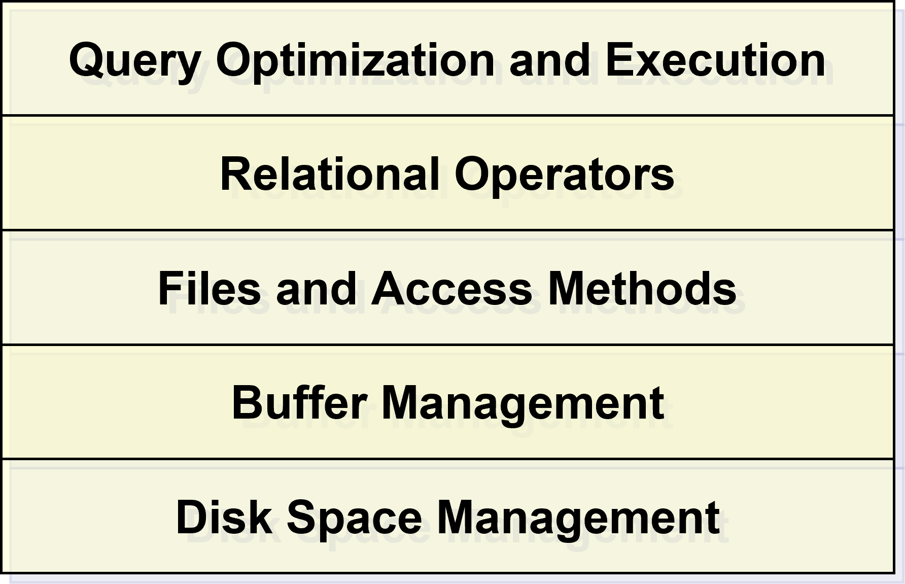

[课本的官网](https://www.db-book.com/)
## 1.1 Database-System Applications
**DBMS**: **D**ata**b**ase **M**anagement **S**ystem

DBMS的框架长这样：

两种使用模式：
- online transaction processing
- data analytics

## 1.2 Purpose of Database Systems
传统的file-processing system存在以下问题
- Data redundancy and inconsistency

    不同的文件里面的数据不互通，有可能冗余，有可能矛盾
- Difficulty in accessing data
- Data isolation

    数据分散在不同的文件里面
- Integrity problems

    也是文件分散性导致的后果，很难对所有文件都做出数据上的约束
- Atomicity problems

    交易到一半被掐断了，一方的钱没了，而另一方却没有收到钱
- Concurrent-access anomalies

    多个用户同时操作一个数据库，导致奇葩的问题
- Security problems

## 1.3 View of Data
### 1.3.1 Data Models
- **Relational Model**

    

    表格就是
- **Entity-Relationship Model**(ER)

    以entity为基本单位
- **Semi-structured Data Model**

    没看懂
- **Object-Based Data Model**

    可以看作是用面向对象的思想扩充了一下relational model
### 1.3.3 Data Abstraction
开发者做了几层抽象来隐藏细节

层级从低到高依次为：
- **Physical level**

    ==how== the data are actually stored
- **Logical level**

    ==what== data are stored, and what are the relationships

    一般来说大多数时候都是在这个层级工作
- **View level**

    only part of the entire database

### 1.3.4 Instances and Schemas
- **Instance**

    ==某一时刻==，存储在数据库中的信息
- **Schema**

    数据库的数据定义

## 1.4 Database Languages
- data-definition language(DDL)
- data-manipulation language(DML)

伟大的SQL则是把两者结合了起来

### 1.4.1 Data-Definition Language
- Domain Constraints
- Referential Integrity 
- Authorization

