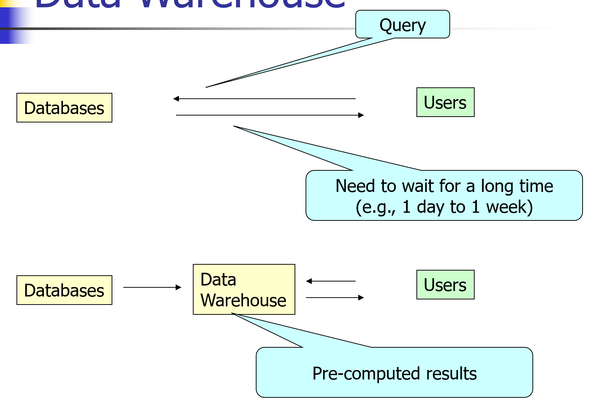
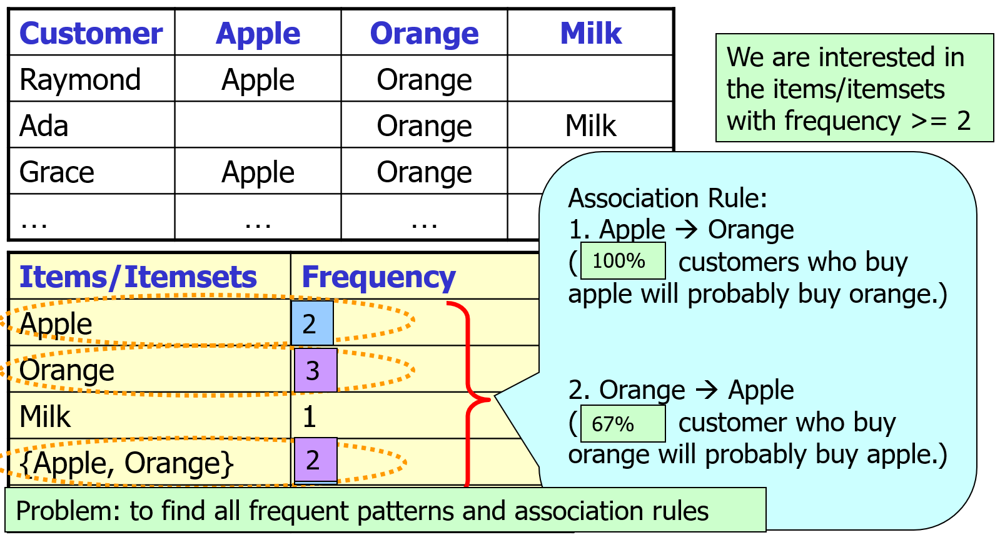
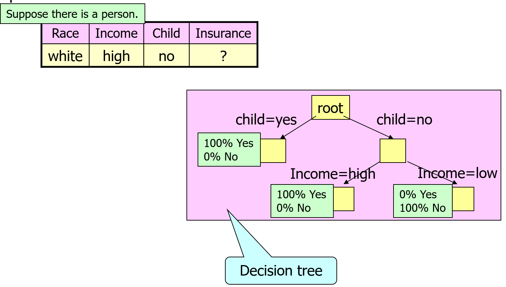

## 11.2 Data Warehousing
> A **data warehouse** is a repository of information gathered from multiple sources, stored under a unified schema, at a single site

也叫做Online Analytical Processing (OLAP)(其实书上把这个概念分开考虑的，也不知道谁对)

反正是在数据库之上又多了一层抽象，用来和用户做交互，假如database正在忙的话，那么和data warehouse做交互就是提升了query的效率

一般用来帮助公司做分析和决策

## 11.4 Data Mining
> **data mining** refers loosely to the process of analyzing large databases to find useful patterns

这东西被用来：
- Customer Relationship Management (CRM)

    To design methods to interact with customers
- Enterprise Resource Planning (ERP)

    To manage all the information and functions of a business or company from databases

### 11.4.1 Types of Data-Mining Tasks
- Association

    比如某些商品经常被一起购买

    

    比如这里苹果和牛奶就经常被一起买
- Clustering

    聚类，比如发现住在井水旁边的一坨人容易得风湿(地理位置上的聚类)，后来发现井水受污染
- Classification

    训练完之后，推测输入属于哪一类

    

    

