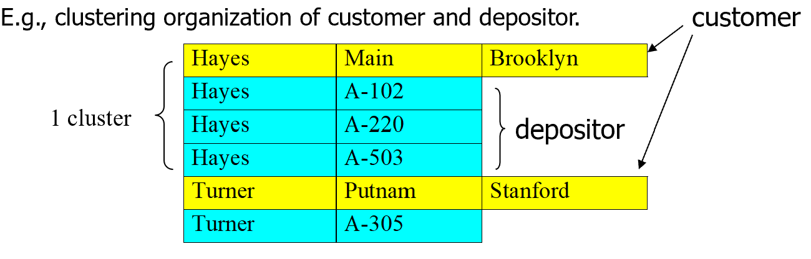

## 13.2 File Organization
Database is stored as a collection of **files**. Each file is a sequence of **records**. A record is a sequence of **fields**

- one file $\leftrightarrow$ one table
- one record $\leftrightarrow$ one tuple
- a record/tuple has a fixed length

### 13.2.1 Fixed-Length Records
虽说这种方式看着特简单，但是这种操作可能会==跨block==

至于需要删除某个项的时候，我们可以利用==freelist==的想法。

## 13.3 Organization of Records in Files
### 13.3.2 Sequential file organization
Records are stored in sequential order, according to the value of a “**search key**” of each record

这东西是用链表连接到一起的

- **Insertion**

    - Locate the record in the file that comes before the record to be inserted in search-key order

    - If there is a ==free record== (i.e., space left after a deletion) within the same block as this record, insert the new record there. Otherwise, insert the new record in an ==overflow block==. In either case, ==adjust the pointers== so as to chain together the records in search-key order.

    这种塞到overflow的做法面对大量数据的时候，就不得不做出**reorganization**

### 13.3.3 Multitable Clustering File Organization
正常情况下，简单的文件结构会把每个relation各放一个文件里面。而clustering就是把多个relation放在同一个文件里面

e.g.

- Good for queries involving depositor customer, and for queries involving one single customer and his accounts
- Bad for queries involving only customer
- Result in variable size records

