## 14.1 Basic Concepts
一般来说，我们请求数据的时候，只会涉及到table里面很小的一部分数据。假设我们每次请求的时候都需要遍历所有的tuple，那就真的蠢爆了。index就是来实现这种==直接访问==的

indices有两种基本类型：
- **Ordered indices**

    stores the values of the search keys in sorted order
- **Hash indices**

    看名字就很熟悉

衡量一个indexing technique的标准有如下：
- **Access types**

    include finding records with a specified attribute value and finding records whose attribute values fall in a specified range
- **Access time**
- **Insertion time**
- **Deletion time**
- **Space overhead**

还有除了index之外的一个概念:

**Search keys**
> An attribute or set of attribute used to look up records in a file is called a *search key*

## 14.2 Ordered Indices
- **clustering index / primary index**

    > an index whose search key also defines the sequential order of the file

    说人话就是index的顺序和实际tuple的顺序一样
- **nonclustering indices / secondary indices**

    > indices whose search key specifies an order different from the sequential order of the file

    说人话就是index顺序和实际tuple顺序不同

在14.2.1到14.2.3的讨论之中，我们都假设所有文件都根据特定的search key来排列，且使用clustering index。这样的文件叫做**index-sequential files**，是一种古老的文件管理方式

### 14.2.1 Dense and Sparse Indices
- **index entry / index record**

    就是index中的一项

    consists of:
    - **search-key value**
    - **pointers**

        pointers to one or more records with that value as their search-key value

有两种**ordered indices**:
- **Dense index**

    每一个不同的search key value==都会出现==在index之中

    假设index是clustering的（也就是说所有的record都已经排好了顺序），那么index的pointer就只需要存储对应值的第一个record的位置(剩下拥有同样search key value的record都紧跟着这第一个record)
    
    假设index是nonclustering的，那么pointer就需要存储所有records的位置了

    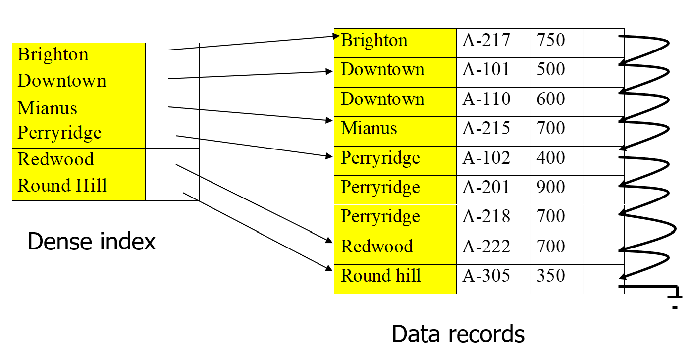
- **Sparse index**

    只有==部分==search key value会出现在index里

    只有当所有record都==已经排好序==了，才能使用sparse index

    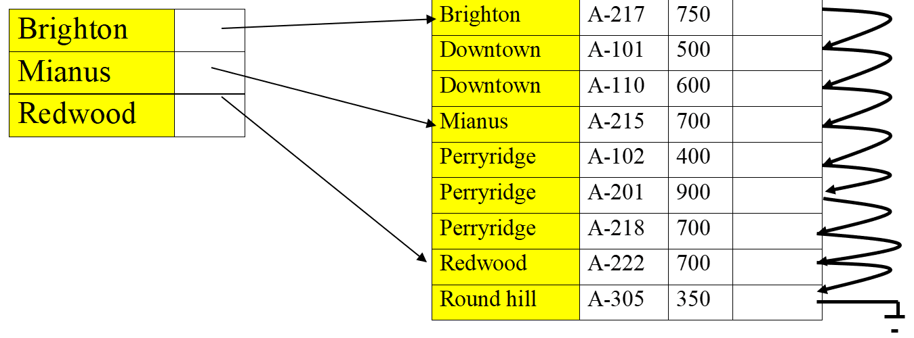

    想必看图你就明白应该怎么样查找值了

    - **advantage**:

       减小index大小，也就意味着需要维护的成本更小。
       
       而且反正memory都会读取disk中的一个block，在一个block种查找也不费事，所以给block建立sparse index就很合适
    - **disadvantage**: 

        搜寻的时候需要的时间长一点

### 14.2.2 Multilevel Indices
建立多层级的目录可以减少disk访问records的次数

结合了14.2.1中提到的两种不同的index
- **Outer index**

    a sparse index of the primary index
- **Inner index**

    the primary index file

假设两层目录还是不够的话，想加多少层都行

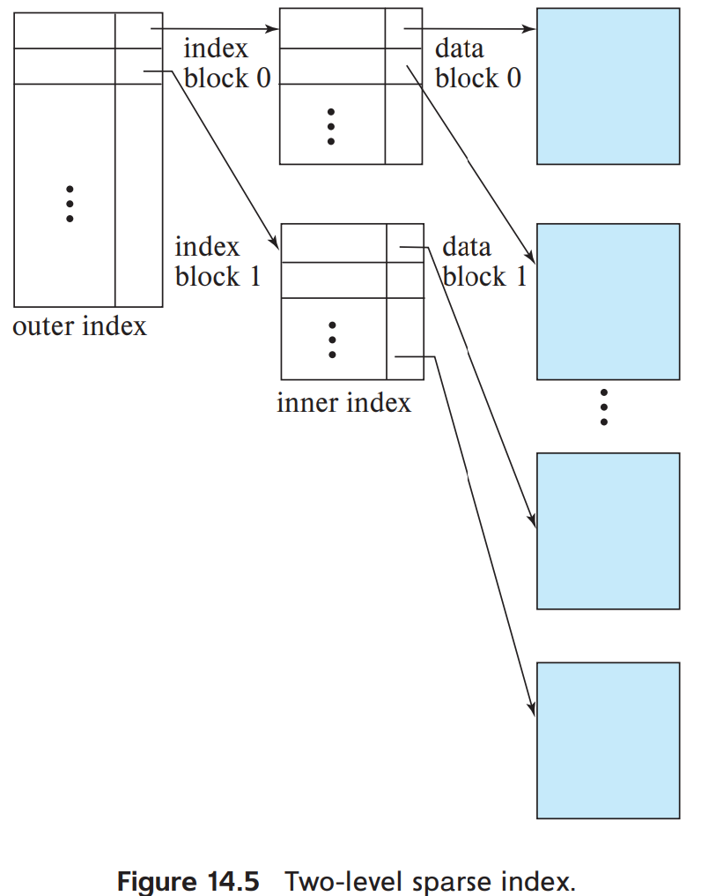

### 14.2.3 Index Update
#### 14.2.3.1 Insertion
不同的index类型有不同的操作:(其实脑补都脑补得出来)
- **Dense indices**

    - search-key value is ==not in== the index:

        the system inserts an index entry with the search-key value in the index at the appropriate position

    - search-key value is ==in== the index:

        - *clustering* index:

            the system places the record begin inserted after the other records with the same search-key values
        - *nonclustering* index:

            the system adds a pointer to the new record in the index entry
- **Sparse indices**

    We assume that the index stores an entry for each ==block==. 
    - ==no block== is created

        do nothing
    - ==new block== is created

        the system inserts the first search-key value appearing in the new block into the index
#### 14.2.3.2 Deletion
同样分情况讨论：
- **Dense indices**

    - the ==only== record with the search-key value

        delete the corresponding index entry from the index
    - no the only record with the search-key value:

        - *clustering* index:

            If the deleted record was the ==first== record with the search-key value, updates the index to point to the next record

            else, do nothing
        - *nonclustering* index:

            delete the corresponding pointer
- **Sparse indices**
    - ==does not== contain an index entry with the search-key value of the deleted record:

        do nothing

    - contains an index entry with the value:

        - 假设就剩他一个record了，就用下一个record顶替。假设下一个record已经存在就直接删了

        - 假设还剩很多，但它是第一个，就改一下指针指向下一个
### 14.2.4 Secondary Indices
就目前的观察来看，secondary index和multiple index里面的第二层index似乎==不是一个东西==: secondary key是nonclustering，而第二层的index是clustering的

secondary indices must be ==dense==. 不然的话本来就没按照顺序来排，压根找不到那些被省略的search-key value

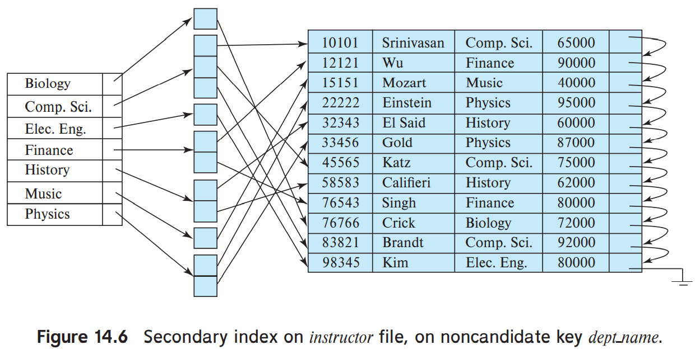

如上图，鉴于record压根==没有按照secondary key 的search key排好顺序==(当然，record是有==可能按照primary key的search key来排好了顺序的==)，我们可以用中间的==bucket==来辅助我们构建拥有同样search-key value的值组

对secondary key进行sequential scan可能开销会很大，因为可能从disk的不同block获取数据
## 14.3 B+ Tree Index Files
index-sequential file organization最大的缺点就是，随着文件大小的增大，性能就会快速下降

**B+ tree index**可以有效解决这个问题
### 14.3.1 Structure of a B+ Tree
在Data Structure的第10个笔记里面学过。

- **fanout**

    > the number of ==pointers== in a node

叶节点的结构一般如下：

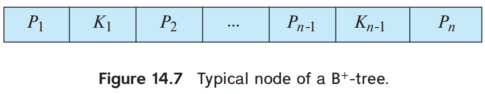

需要注意的是，叶节点虽然有$n$个pointer，但是==只有$n-1$个search key value==，因为最后一个指针是指向下一个叶结点的

反正最终构建出来大概就是长这样的：

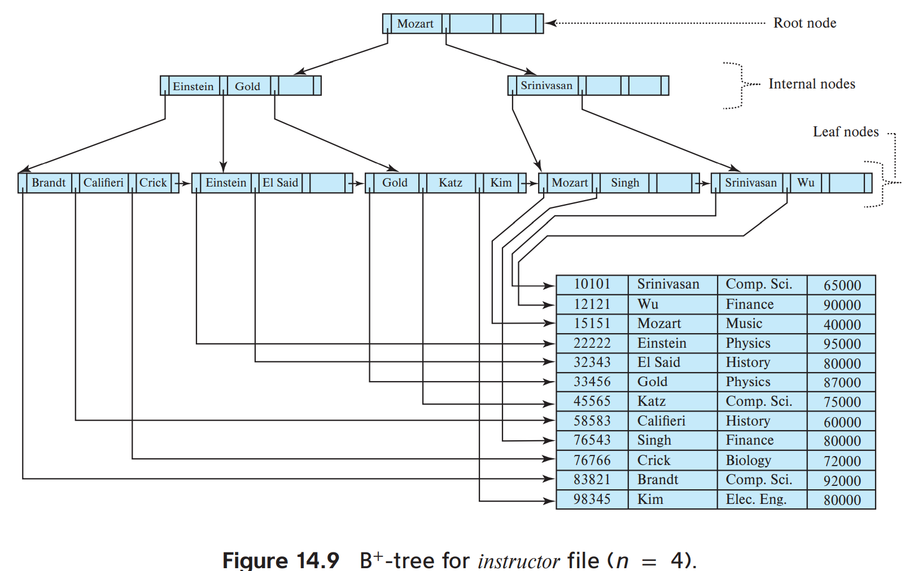

### 14.3.2 Queries on B+ Trees
假设$n$是一个叶节点包含的search key的数量，$N$是records总共的数量，那么树的高度最多为：
$$
\lceil \text{log}_{\lceil n/2\rceil}(N)\rceil
$$
### 14.3.3 Updates on B+ Trees
#### 14.3.3.1 Insertion
需要考虑overflow后拆分节点的情况

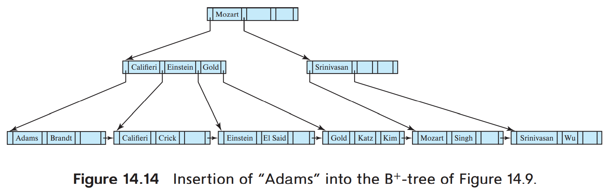

如上图，在图14.9里面插入"Adams"之后，变成了这个样子。可以发现第一个节点被分成了左右两边，并且父节点里增加了一个"Califieri"

这还是比较简单的，因为只有叶结点的分裂。现在考虑以下internal node也需要分裂的情况：

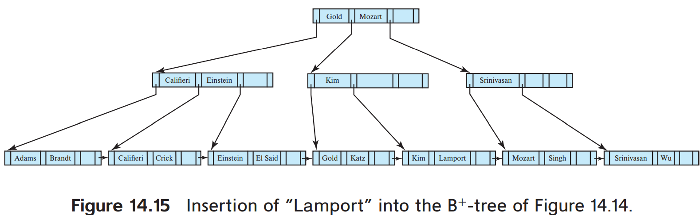

可以看到插入"Lamport"到第四个叶节点之后，这个叶节点分裂成了俩，然后需要把此时的第五个叶节点的"Kim"添加到父节点里。然而父节点也满了，所以我们把此时这个第二层的internal node的中间的那个值"Gold"提升到第一层，然后分裂一下这个internal node。
#### 14.3.3.2 Deletion
需要考虑元素太少后合并节点的情况

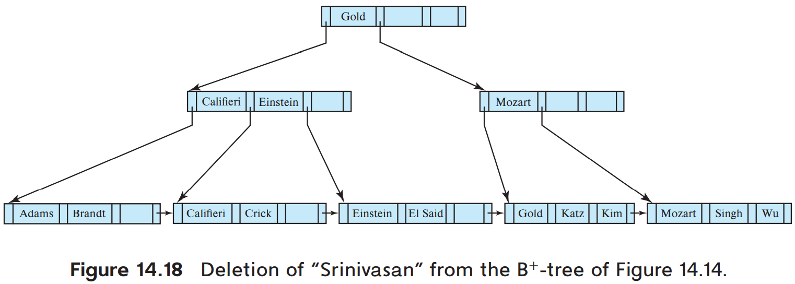

看着一头雾水，来试图整理一下操作流程：
- 先删除掉leaf node和internal node的"Srinivasan"
- 现在第二层的第二个节点只剩一个pointer，没有search key了，显然不符合要求。

    一般来说，我们会先尝试==合并==兄弟节点。然而这里假设合并了，就会产生5个pointer挤在一个节点的不符合要求的情况，所以不行

    这时候就只能在兄弟节点之间==redistribute==一下pointer了。
- 首先尝试一下把第二层左边节点里的==指向"Gold"的指针==放到右边来。然而这样子又会出现新的问题，那就是现在右边的节点里没有search key来分隔这俩指针。
- 这时候就应该想到，其实能够分隔这俩pointer的search key，在==更高一层==的第一层，于是把"Mozart"扔到第二层的右节点里，然后让"Gold"提升到第一层的search key

再来看下一个例子：

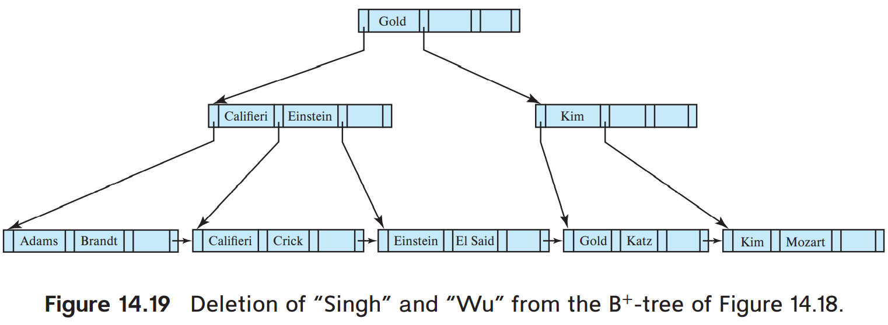

感觉不用解释？

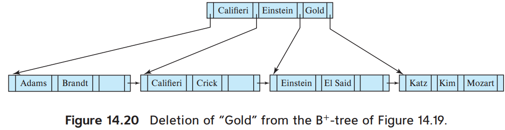

也能猜得出来啥意思吧

## 14.5 Hash Indices
*hash indices*永远都是*secondary indices*

其实*hash indexing*是可以分成:
- **static hashing**

    the number of buckets is ==fixed== when the index is created

    这种方法最大的问题在于，我们需要提前知道大概会有多少的record存储在index里面。一旦record的数量太多了，搜索就会变得非常低效
- **dynamic hashing**

这一节讲的是*static hashing*。在24.5节我们将要全面学习两者。不过 24.5 节会把两者统一讲一遍，所以这一节的 *static hashing* 算是提前预习了

接下来就要说明一堆概念
- **bucket**

    > a unit of storage that can store one or more records

    in-memory hash indices: a linked list of index entries or records

    disk-based indices: a linked list of disk blocks
- **hash file organization**

    > instead of record pointers, buckets store the ==actual records==

    听着很奇葩，这种结构也确实只对disk-resident data有用
- **hash function**

    > let $K$ denote the set of all search-key values, and let $B$ denote the set of all bucket addresses. A *hash function* $h$ is a function from $K$ to $B$

    也没必要看定义，你都会

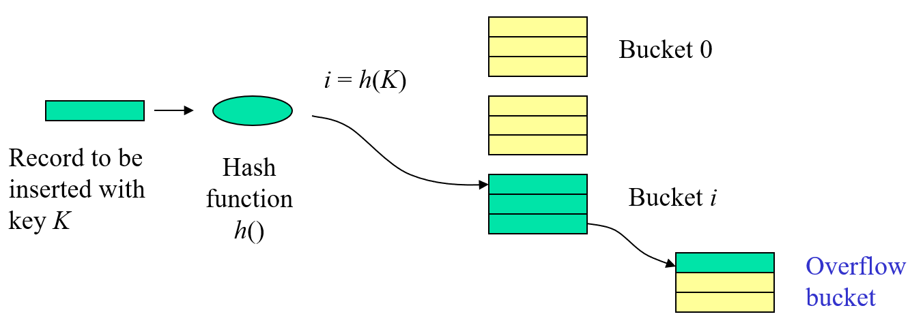

上图展示了插入record的过程，且使用了**overflow chaining**的机制。使用了*overflow chaining*的*hash indexing*也叫做**closed addressing / closed hashing**

