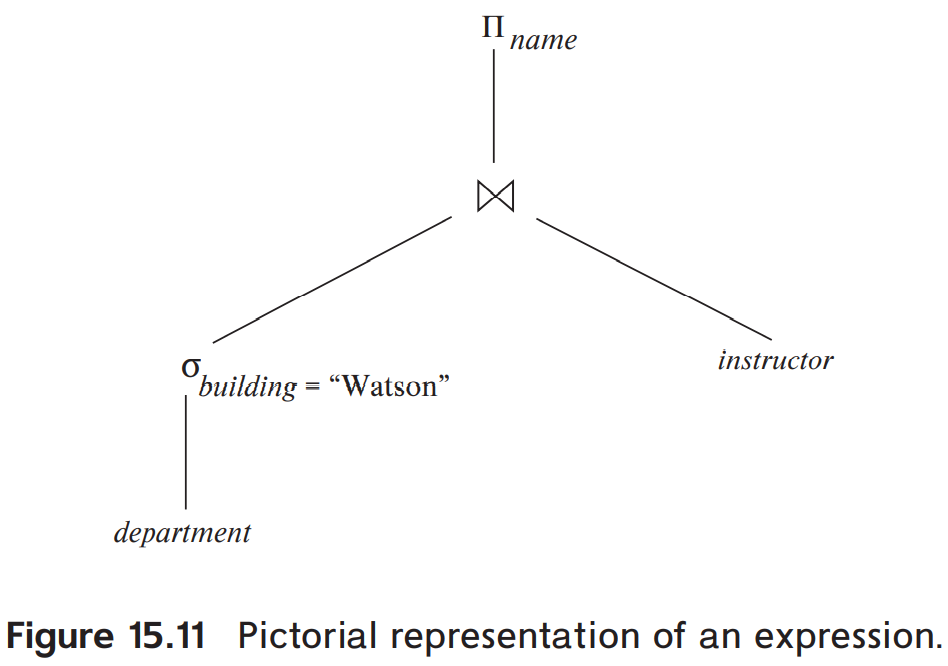

## 15.4 Sorting
### 15.4.1 External Sort-Merge Algorithm
有时候数据量远远大于RAM的大小，这种情况下的排序叫做**external sorting**

其中最常用的技巧是**external sort-merge** algorithm:

- In the first stage, a number of sorted **runs** are created; each *run* is sorted but contains only some of the records of the relation

    Let $M$ denote the number of blocks in the main memory buffer available for sorting:
    ```cpp
    i = 0
    repeat
        read M blocks of the relation, or the rest of the relation, whichever is smaller;
        sort the in-memory part of the relation;
        write the sorted data to run file Ri;
        i = i + 1;
    until the end of the relation
    ```
- In the second stage, the runs are ==merged==. Suppose, for now, that the total number of runs, $N$, is less than $M$, so that we can allocate one block to each run and have space left to hold one block of output.

    ```cpp
    repeat
        choose the first tuple (in sorted order) among all buffer blocks;
        write the tuple to the output, and delete it from the buffer block;
        if the buffer block of any run Ri is empty and not end-of-file(Ri)
            then read the next block of Ri into the buffer block;
    until all input buffer blocks are empty
    ```
    然而我们还是要考虑一下怎么对付run file的数量多于block的数量$M$的情况的。这种情况下，我们就每次==合并$M-1$个run file==（最后一个block留作输出用）。

上述算法对$N$个runs进行了merge操作，所以叫做**N-way merge**

### 15.4.2 Cost Analysis of External Sort-Merge
> 需要注意的是，数据库里面的cost和算法里面指的不是一个东西！数据库关心的是和==硬盘做交互的cost==

假设有$N$个data pages (就是所有数据占据了多少个blocks大小)，$B$个memory block:
- Number of passes: $1+\lceil \log_{B-1}\lceil N/B\rceil\rceil$

    "1"代表最开始需要将$N$个data pages划分成$\lceil N/B \rceil$个run files。

    "$\lceil \log_{B-1}\lceil N/B\rceil\rceil$"则是代表将这$\lceil N/B \rceil$个run files进行合并需要多少个pass (注意生成run files的时候是$B$个memory blocks都可以载入的，而合并run files的时候则需要留出1个block做输出，真是奇怪)
- Cost: $2N\cdot(\text{number of passes})$

    每个pass我们都将$N$个blocks读出来，又写回去，所以每个pass的开销都是$2N$

## 15.5 Join Operation
这节介绍几种不同的join operation的算法

- **equi-join**

    refer to a join of the form $r\Join_{r.A=s.B}s$

我们还是使用Ch2里面的例子：
$$
student\Join takes
$$
并且做如下的假设：
- Number of records of student: $n_{student}=5000$
- Number of blocks of student: $b_{student}=100$
- Number of records of takes: $n_{takes}=10000$
- Number of blocks of takes: $b_{takes}=400$
### 15.5.1 Nested-Loop Join
计算$r\Join_{\theta}s$:
```cpp
for each tuple tr in r do begin
    for each tuple ts in s do begin
        test pair (tr,ts) to see if they satisfy the join condition theta
        if they do, add tr·ts to the result;
    end
end
```
就是两层循环套一起，看着就很无脑，效率显然也不会高

其中relation $r$叫做**outer relation**，$s$叫做**inner relation**
### 15.5.2 Block Nested-Loop Join
```cpp
for each block Br of r do begin
    for each block Bs of s do begin
        for each tuple tr in Br do begin
            for each tuple ts in Bs do begin
                test pair (tr, ts) to see if they satisfy the join condition
                if they do, add tr·ts to the result;
            end
        end
    end
end
```
虽然说到头来还是会和普通的nested-loop一样，把每一对tuple都试一遍，但是分成block的好处是，可以==减少从硬盘读取到main memory的次数==。

以及，谁来当外层的relation其实是有点讲究的。==更小的relation放在外层==。

### 15.5.3 Indexed Nested-Loop Join
假如inner loop的join attribute上存在index，那么就可以用index lookups来代替file scans

cost的计算比较迷惑

### 15.5.4 Merge Join
也叫做**sort-merge-join** algorithm。

感觉和merge sort就特别相似

复杂度和external sort merge都一样
### 15.5.5 Hash Join
e.g.

if $d$ is a tuple in $student$, $c$ a tuple in $takes$, and $h$ a hash function on the ID attributes of the tuples, then $d$ and $c$ must be tested ==only if $h(c)=h(d)$==

看着就很直接了当

## 15.7 Evaluation of Expressions
这个小节来讨论一下怎么样通过不同的evaluation的方式，优化包含多个query的expression的性能

最直接的做法就是evaluate one operation at a time。接着每个evaluation的结果被**materialized**进一个临时relation里，以便后续调用。

这听起来就很不高效，毕竟还得把这些中间relation写到硬盘里

另一种做法叫做**pipeline**，它会将上一个operation的结果传给下一个，就不需要保存临时的relation了

接下来就来分别讨论这两种方法

### 15.7.1 Materialization
**materialized evaluation**的过程非常符合直觉：

e.g.

我们考虑如下的query:
$$
\Pi_{name}(\sigma_{building=``\text{Watson}"}(department)\Join instructor)
$$
我们可以用**operator tree**来可视化这个表达式：



显然我们需要==自底向上==来一步步求解

### 15.7.2 Pipelining
**pipelined evaluation**则是可以把多个operation塞进一个pipeline，这样子pipeline里面不需要存中间relation

甚至不需要例子来理解


