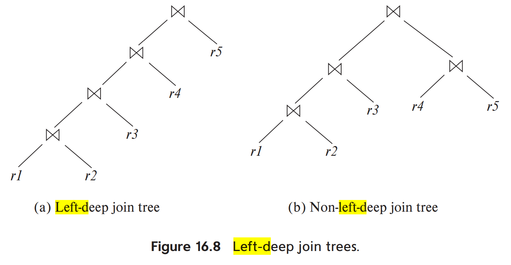

## 16.2 Transformation of Relational Expressions

### 16.2.1 Equivalence Rules

以下规则描述了query之间的等价关系：

- Selections:
  
  - Commutative
    
      $$
      \sigma_{c1}(\sigma_{c2}(R))\equiv \sigma_{c2}(\sigma_{c1}(R))
      $$
  
  - Cascading
    
      $$
      \sigma_{c1\land...\land cn}(R)\equiv \sigma_{c1}(...\sigma_{cn}(R))
      $$

- Join
  
  - Associative
    
      $$
      R\Join (S\Join T)\equiv (R\Join S)\Join T
      $$
  
  - Commutative
    
      $$
      (R\Join S)\equiv (S\Join R)
      $$

其实还有很多规则，ppt上没讲而已

## 16.4 Choice of Evaluation Plans

### 16.4.3 Heuristics in Optimization

**left-deep join orders**:

> optimizer considers only those join orders where the right operand of each join is one of the ==initial relations== $r_1,...,r_n$

这有啥好处呢？*pipeline evaluation*就特别适合这种结合顺序，因为每次join里面，只有一个操作数是pipelined而来的，另一个是现成的

当然，也不是所有用left-deep tree的计划都是fully pipelined的

enumeration of left-deep plans:

- enumerated using $N$ passes (if $N$ relations joined):
  - pass 1: find best 1-relation plan for each relation
  - pass 2: find best way to join result of each 1-relation plan (as outer) to another relation.(All 2-relation plans)
  - pass $N$: Find best way to join result of a $(N-1)$-relation plan (as outer) to the $N'th$ relation. (All $N$-relation plans)
- For each subset of relations, retain only the ==cheapest plan overall==
