## 17.0 Preface
很多时候，对于数据库的一系列操作，在用户看来似乎就是一个按键的事情

e.g.

a transfer of funds from a checking account to a savings account

transaction的字典定义：
- a piece of business that is done between people, especially an act of buying or selling
- the process of doing sth

## 17.1 Transaction Concept
> **transaction** is a sequence of operations

e.g.

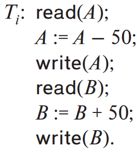

数据库必须在做出transaction操作的时候保留以下性质：
- **Atomicity**

    Either all operations of the transaction are carried out properly in the database, or none are
- **Consistency**

    Regardless of other transactions, each transaction must preserve the consistency of the database
- **Isolation**

    User can understand a transaction without considering the effect of other transactions

- **Durability**

    After a transaction completes successfully, the changes it has made to the database persist, even if there are system failures.

以上统称为**ACID properties**

## 17.5 Transaction Isolation
其实重要的是**schedule**这个概念:
> **schedule** represent the chronological order in which instructions are executed in the system

跟计组的指令执行的时间管理很像

之后又诞生了另一个概念：
> in **serial schedule**, the instructions belonging to one single transaction ==appear together==

说人话就是同一个transaction的operations都是挨在一起执行的

e.g.

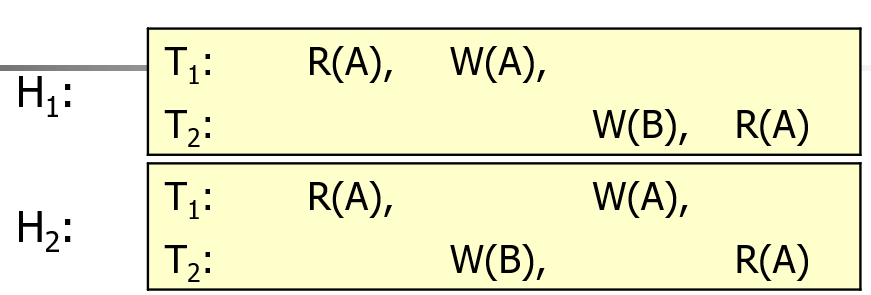

$H_1$就是serial，$H_2$就不是

还有个概念：
> **serializable schedule** has the same effect as a serial schedule

虽然事实上一个transaction里面的operation不是连续执行的，但是从结果上看似乎和连续执行一样

比如上图中的$H_2$看起来就像是先执行$T_1$后执行$T_2$一样，和$H_1$一样

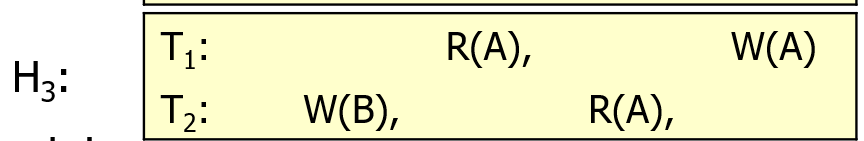

这个就相当于先执行$T_2$后执行$T_1$一样

## 17.6 Serializability
我们这节主要关注schedule equivalence之中**conflict serializability**这种形式

我们说两个instructions是**conflict**的，当：
- They are operations of different transactions on the ==same== data object
- At least one of them is a ==write== operation

接下来介绍**conflict equivalent**的概念：
> Two schedules $S_1$ and $S_2$ are **conflict equivalent** if:
> - $S_1$ and $S_2$ involve the same operations of the same transaction
> - Every pair of conflicting operations is ordered in the same way in $S_1$ and $S_2$

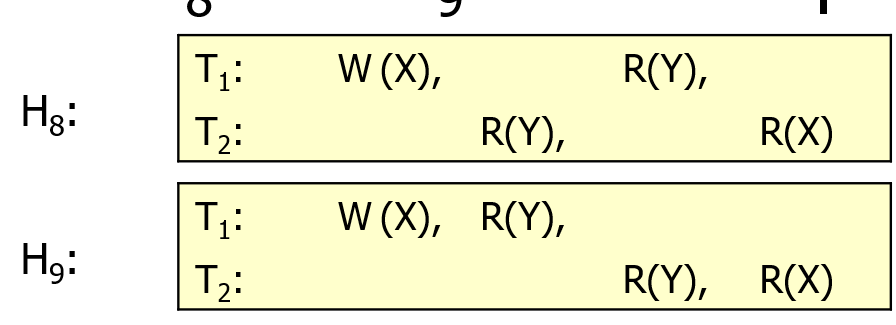

比如上面的两个schedule就是conflict equivalent的，因为W(X)的R(X)是conflict operation，且两者的时间先后顺序是一致的

接着就引出**conflict serializable**的概念：
> a schedule $S$ is **conflict serializable** if it is conflict equivalent to a ==serial== schedule

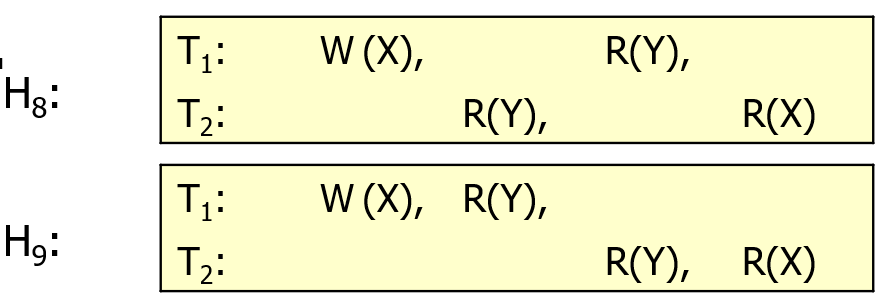

比如这里$H_8$就是conflict serializable的

我们现在介绍一种判断conflict serializability的有效方法，叫做**precedence graph**:
> A directed graph $G=(V,E)$, where:
> - $V$ includes all transactions involved in the schedule
> - $E$ consists of all edges $T_i\rightarrow T_j$ for which one of three conflict conditions holds:
>   - $T_i$ executes write(X) before $T_j$ executes read(X)
>   - $T_i$ executes read(X) before $T_j$ executes write(X)
>   - $T_i$ executes write(X) before $T_j$ executes write(X)

展示的其实是执行的==时间先后顺序==，由早的指向晚的

The serialization order is obtained through topological sorting

A schedule $S$ is conflict serializable iff $G(S)$ is acyclic (i.e., no cycle)

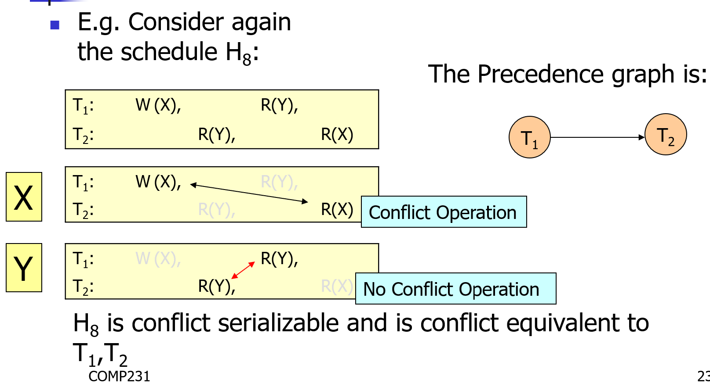

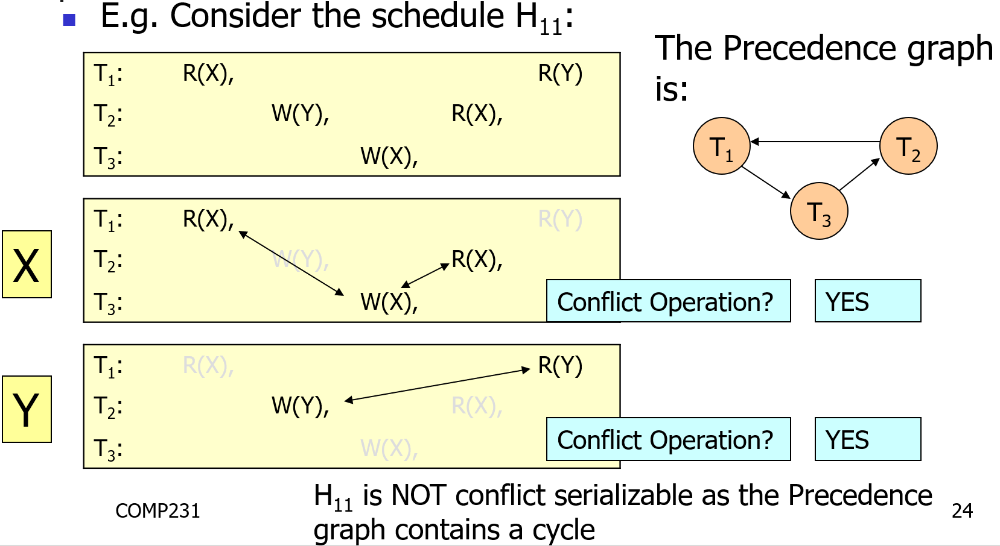

> 有个比较坑爹的事情，就是注意这个图像里面的箭头方向。比如：
>
> 
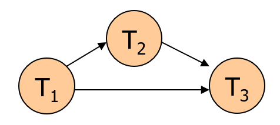

>
> 其实==没有构成环==!

之前我们介绍的等价是conflict equivalence，其实也还有别的方式来定义schedule equivalence，其中一种就是**view equivalence**:
> Two schedules S1 and S2, where the same set of transactions participates in both schedules. They are said to be **view equivalent**

比如：
- If $T_i$ reads the initial value of a data item in $S_1$, $T_i$ also reads the initial value of the item in $S_2$.
- If $T_i$ reads an item produced by $T_j$ in $S_1$, $T_i$ also reads the item produced by $T_j$ in $S_2$.
- If $T_i$ writes the final value of a data item in $S_1$, $T_i$ also writes the final value of the item in $S_2$.

可以看到这是一个根据读写来定义的equivalence

这就继续会引出**view serializable**的概念：
> $S$ is **view serializable** if it is view equivalent to a serial schedule

听了半天还是很抽象，不如看个例子：

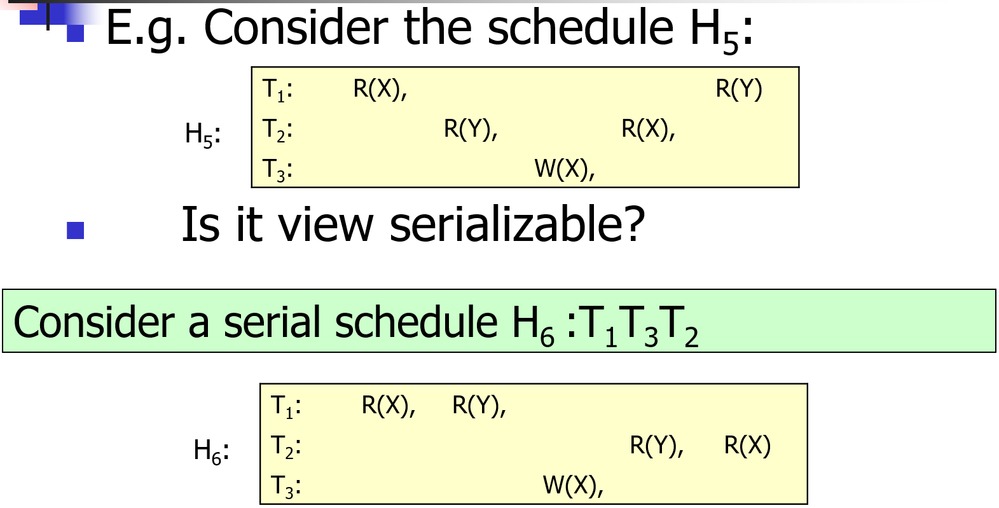

可以看到$H_5$和$H_6$的读和写的时候的操作对象都是对应相同的，所以两者view equivalent，也就是说$h_5$是view serializable的

来看个not view serializable的情况：

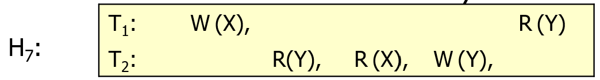

不管serial的顺序是$T_1T_2$还是$T_2T_1$，都无法和上面这家伙写的X对象和读的Y对象同时保持一致

two-phase locking protocol是一种保证serializability的技巧

## 17.7 Transaction Isolation and Atomicity
### 17.7.1 Recoverable Schedules
> A **recoverable schedule** is one where, for each pair of transactions $T_i$ and $T_j$ such that $T_j$ reads a data item previously written by $T_i$, the commit operation of $T_i$ must appears before the commit operation of $T_j$

听着一头雾水，拿个例子来说明：

e.g.

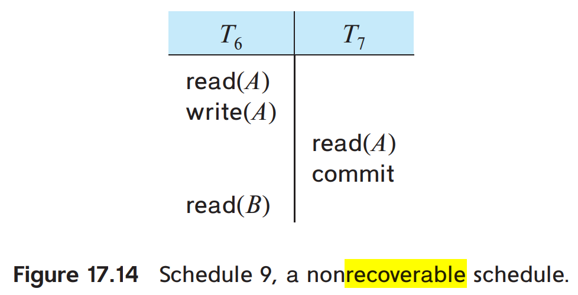

为什么说上面的这个schedule是nonrecoverable的呢？可以看到$T_7$读取了$T_6$修改的值，也就是说$T_7$是==dependent on== $T_6$的，而且还比$T_6$更早commit了。问题就来了，假如$T_6$在它commit前fail了，那么理论上我们应该舍弃掉$T_7$中我们读取值的结果。然而我们手贱已经commit了，这是撤回不了的。

想要变成recoverable的话，只需要$T_7$的commit推迟到$T_6$ commit完之后就可以了

总之，读取了其它transaction修改的值之后，就必须等待其它transaction都commit完了之后才能commit

### 17.7.2 Cascadeless Schedules
假如一个transaction失败了，那么依赖它的transaction全部都必须被rollback

这种事情听着就很低效，我们希望避免，于是有了**cascadeless schedule**的概念：
> a **cascadeless schedule** is one where, for each pair of transactions $T_i$ and $T_j$ such that $T_j$ reads a data item previously written by $T_i$, the commit operation of $T_i$ appears before the read operation of $T_j$

就是下面的意思：

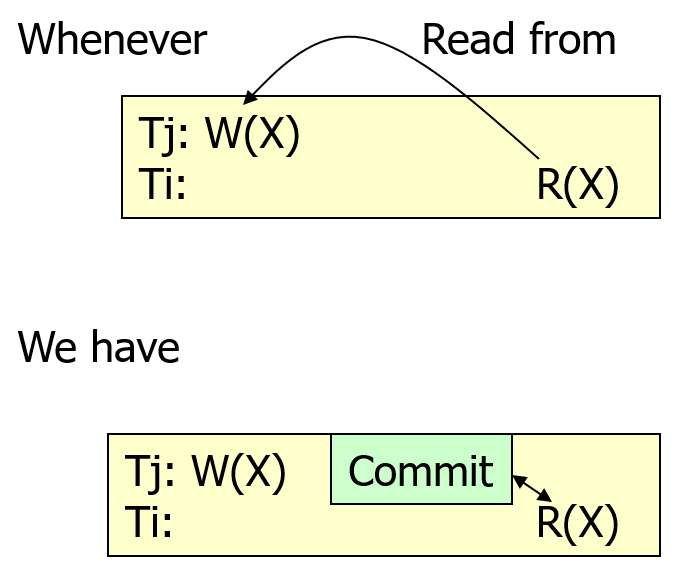

