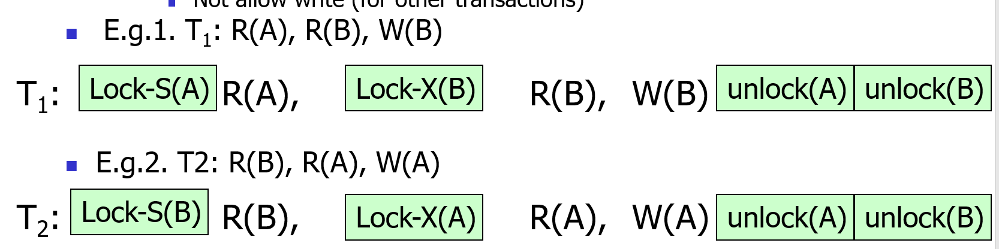
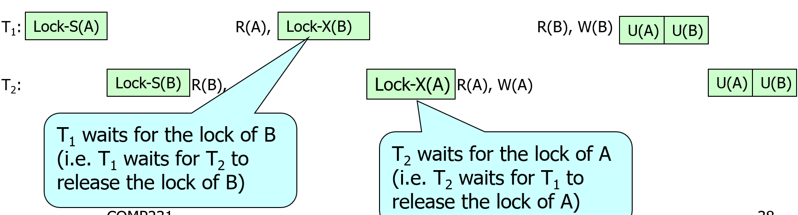
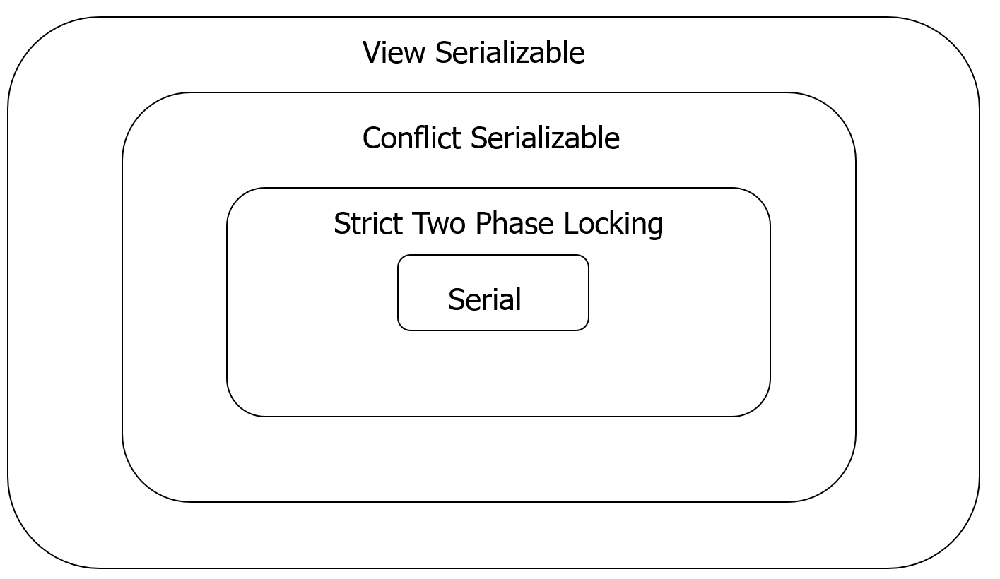
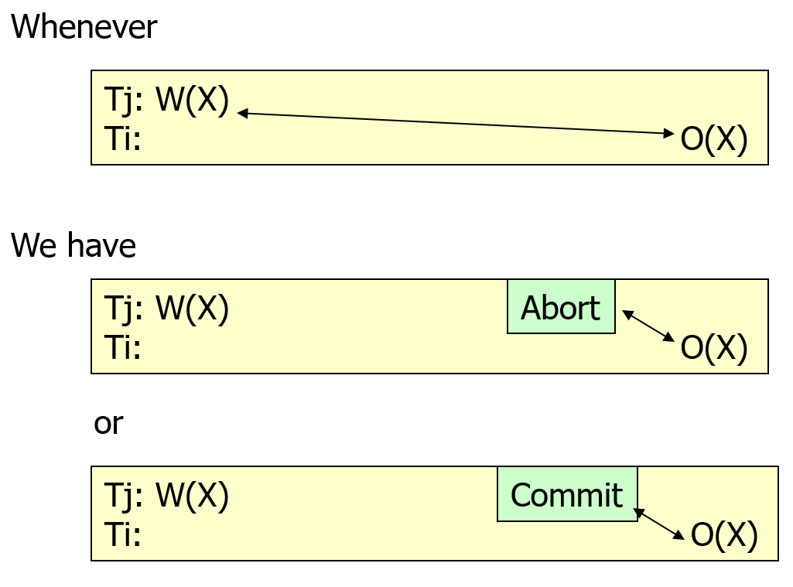
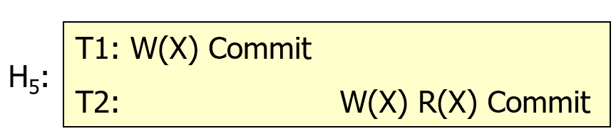
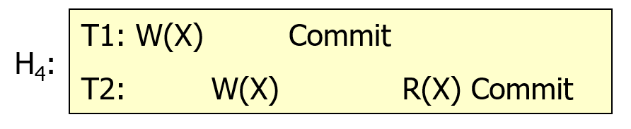
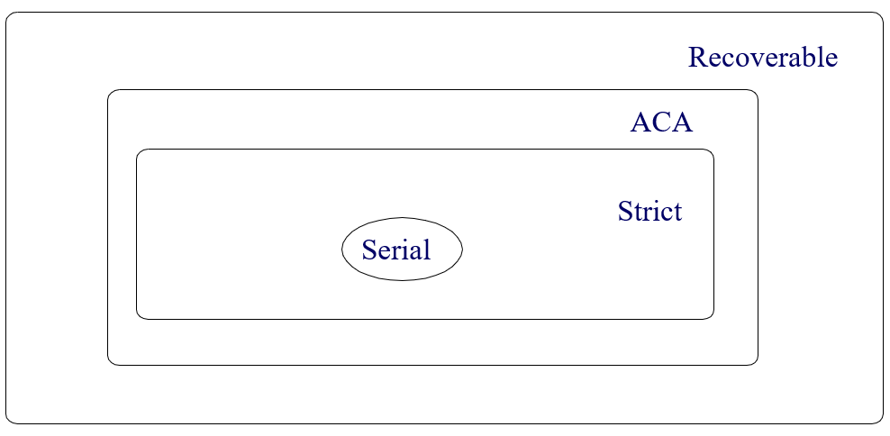

## 18.0 Preface
并发控制

目标是给定一个non-serial schedule，我们想要得到对应的serialization order

最常用的两种是：
- two-phase locking
- snapshot isolation

## 18.1 Lock-Based Protocols
为了保证当一个transaction正在访问一个data item的时候，没有其他的transaction可以修改这个data item，我们可以规定，只有当前拥有一个**lock**的transaction才能够访问这个数据

transaction完成的时候我们就release掉这个lock

### 18.1.1 Locks
两种不同的锁：
- **Shared-mode lock (Lock-S)**

    $T_i$ can read but cannot write $Q$

    就是==只读==
- **Exclusive-mode lock (Lock-X)**

    $T_i$ can both read and write $Q$

    就是==读写都行==

正常使用的情况：

优缺点如下：
- Advantage:

    Allow only conflict serializable schedules
- Disadvantage:

    Deadlock may occur

    

    大概意思就是两个transaction互相锁住的死锁情况

我们至今为止学过的概念关系如下：

   

也就是说view serializable的概念最为宽泛

### 18.1.3 The Two-Phase Locking Protocol
在[17.7.2](ch17-transactions.md) 中，我们介绍过cascading rollback的预防方法。实际上这种约束还是不够强力，我们介绍一种叫**strict execution**的概念。
> **strict execution** ensures that any data written by an ==uncommitted== transaction are locked in ==exclusive mode== until the transaction commits, preventing any other transaction from reading/writing the data.

也就是说，只要前一个transaction写入了某个变量，我们就必须等待这个transaction结束(commit或abort)，才能够继续访问这个变量，也就是下图的意思：

e.g.

strict execution:

not strict:

学过知识的关系图：

ACA指的是avoid cascading aborts

这个关系图和之前的那个图是不同的分类方式

## 18.5 Timestamp-based Protocols
### 18.5.1 Timestamps
之前，我们确定serialization order的方法是two-phase locking，也就是==运行时==根据transaction得到lock的先后顺序

这里介绍另一种确定serialization order的方法，在==运行前==就通过timestamp决定

> With each transaction $T_i$ in the system, we associate a unique fixed timestamp, denoted by $\text{TS}(T_i)$

假如$\text{TS}(T_1)<\text{TS}(T_2)$，那么serialization order就是$T_1T_2$

除此之外，==每一个data item==都要额外存储两个属性：
- **Write timestamp**

    写过该data item的transaction对应的最大的timestamp
- **Read timestamp**

    读过该data item的transaction对应的最大的timestamp

> 最大timestamp就是最近一次的操作

### 18.5.2 The Timestamp-Ordering Protocol
> The **timestamp-protocol** ensures that any ==conflicting $\text{read}$ and $\text{write}$ operations are executed in timestamp order==

比如$T_i$中的action $a_i$和$T_j$中的action $a_j$冲突，我们就需要保证，假如$\text{TS}(T_i)<\text{TS}(T_j)$，那么$a_i$就必须在$a_j$之前先被执行

更加具体一点的场景如下：
- Suppose that transaction $T_i$ issues $\text{read}(Q)$

    - if $\text{TS}(T_i)<\text{W-timestamp(Q)}$

        意味着$T_i$原本应该在时间$\text{W-timestamp(Q)}$之前就读取数据的，然而当时的数据显然是已经被覆盖掉了，我们也没有time machine，所以这个读取操作会被rejected，然后$T_i$会被回滚(回滚完之后我们会给这个transaction分配一个新的、更大的timestamp，然后重新执行)
    - if $\text{TS}(T_i)\ge\text{W-timestamp(Q)}$

        这是我们允许的正常行为，timestamp大的操作本来就应该在后面发生。

        注意操作完之后，我们需要更新$\text{R-timestamp}(Q)$的值，假设$\text{TS}(T_i)$的值更大，则更新为该值

        > 这意味着$\text{R-timestamp}(Q)$的值其实有可能不需要更新(原来的值更大)，稍微想想感觉也没啥问题。因为两个read operation之间并不是conflict的关系，所以是允许timestamp更小的read操作发生在更大的之后的
- Suppose that transaction $T_i$ issues $\text{write}(Q)$

    - if $\text{TS}(T_i)<\text{R-timestamp}(Q)$

        意味着这个写入操作原本应该发生在更早的时间点的，然而之前的值已经被人读取了，再写入的话读取的值就会变成错误的。所以我们会reject这个写入操作，并且回滚$T_i$

    - if $\text{TS}(T_i)<\text{W-timestamp}(Q)$

        意味着它试图写入一个理论上已经被覆盖掉的值，这显然是我们不能允许的，所以我们也会reject掉并回滚
    - Otherwise

        只有这个世界线是正常的

        执行完写入操作之后，我们需要将$\text{W-timestamp}(Q)$更新为$\text{TS}(T_i)$

        > 可以看到这里和读取操作的逻辑有一点区别，读取操作是允许timestamp小的后执行的，而写入操作不能允许

