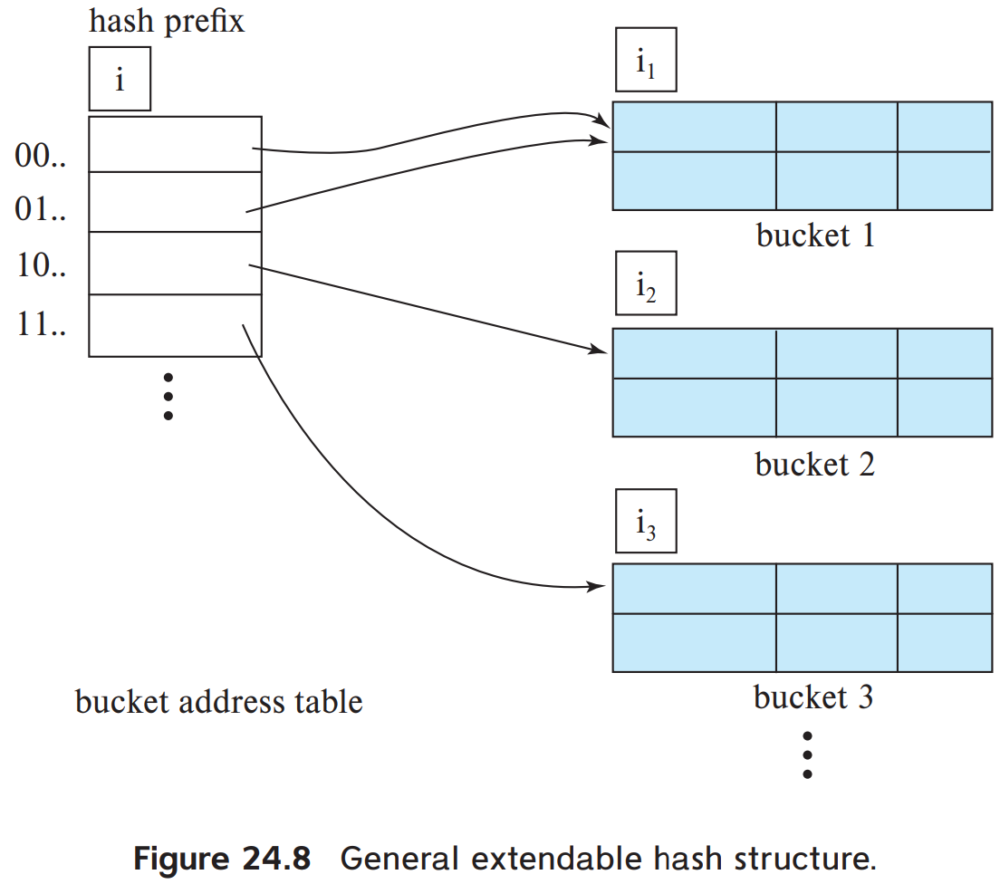
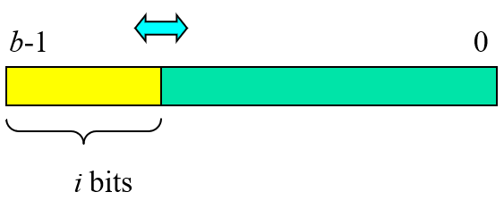
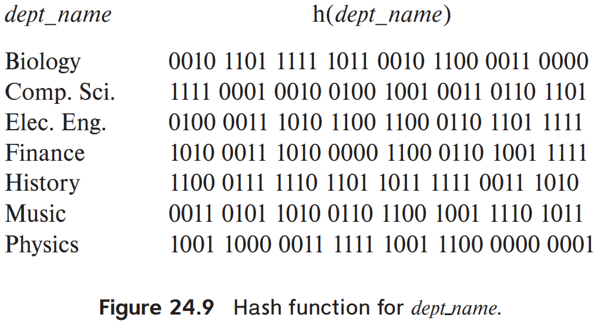
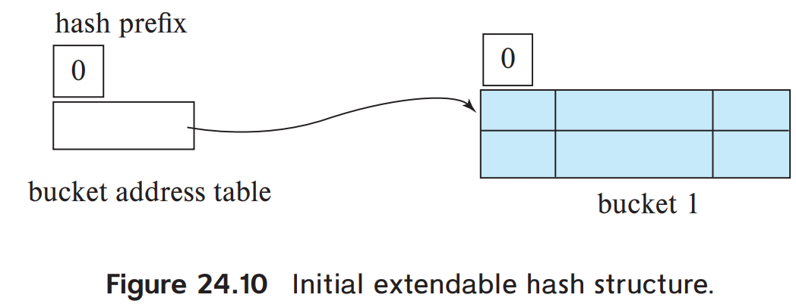
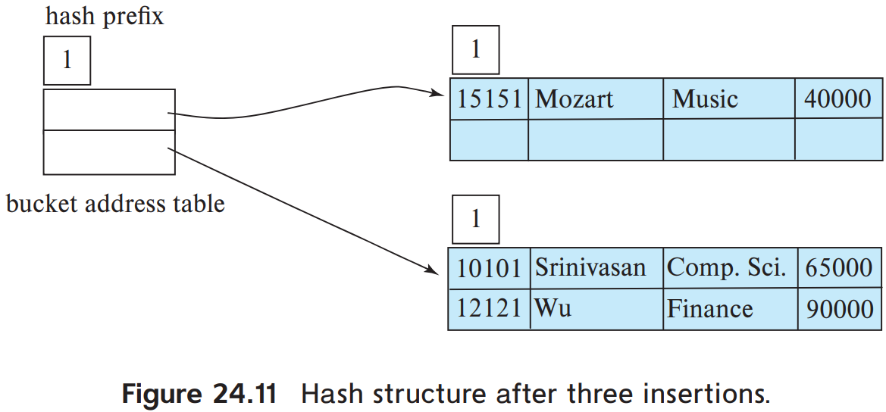
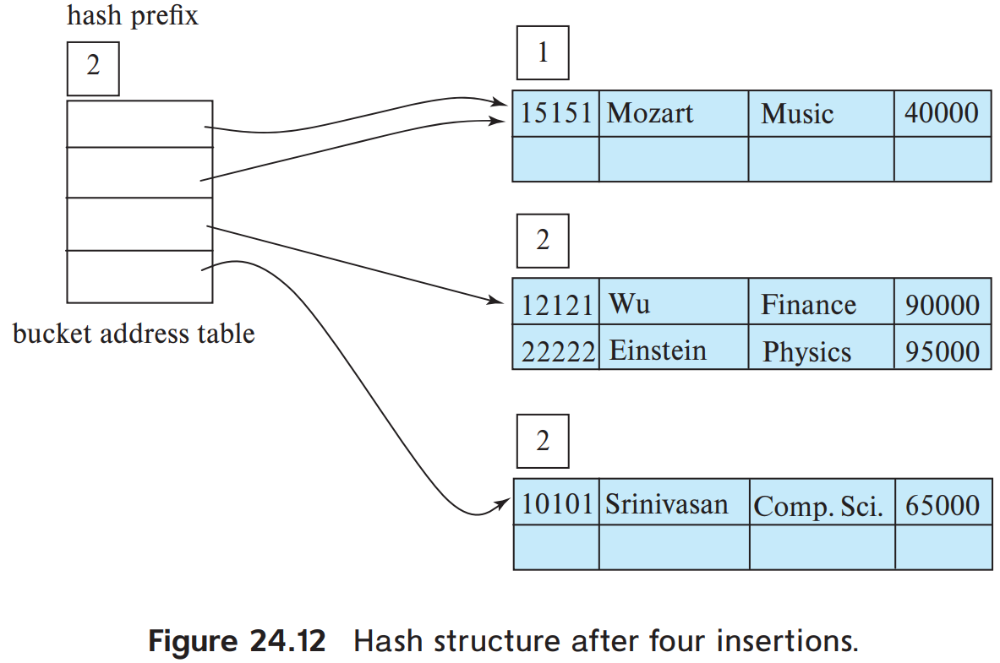
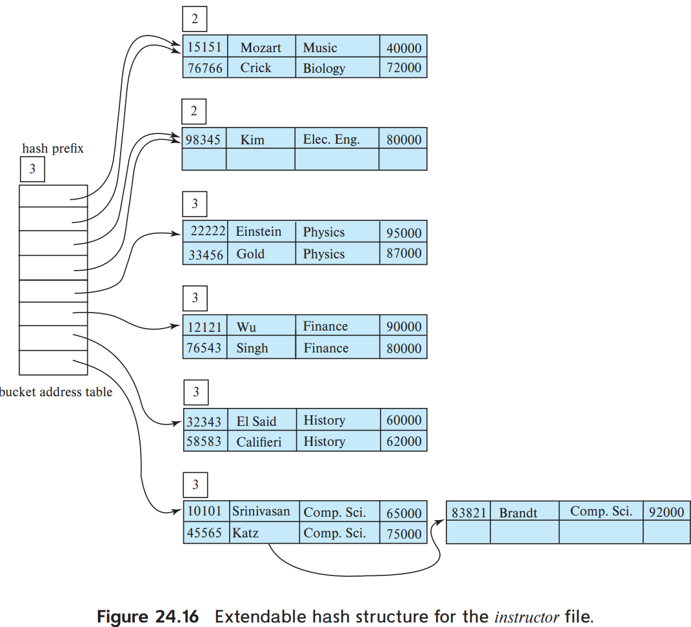

## 24.5 Hash Indices
想不到吧，这里才是正经介绍*hash indices*的地方，14.5只是这节的冰山一角(所以为什么要写14.5？？？)

### 24.5.1 Static Hashing
见[14.5](ch14-indexing.md#145-hash-indices)
#### 24.5.1.1 Hash Functions
一个优秀的*hash function*具备以下特点:
- The distribution ==uniform==

    说人话就是每个bucket对应的==数值区间的宽度==是相同的
- The distribution is ==random==

    each bucket will have nearly the same number of values assigned to it, regardless of the actual distribution of search-key values
#### 24.5.1.2 Handling of Bucket Overflows

### 24.5.2 Dynamic Hashing
这节我们讨论的是*dynamic hashing*的其中一种，叫**extendable hashing**
#### 24.5.2.1 Data Structure
*extendable hashing*会随着database大小的改变而拆分或者合并buckets

上图就是个常见的结构。可以看到*bucket address table*里面的每一个entry都是一串二进制地址。

这个地址实际上可以放置$b$-bit的二进制整数，对应可以映射$2^b$个不同的bucket。我们不会把这$b$个bit都用满，而是根据bucket当前的数量，选择一部分$i$-bit来使用即可(比如图中只有3个bucket，那么就只需要使用$2^2$对应的2位来作为地址)

每一个bucket头上的$i_1,i_2...$是$i$位的哈希值之中，需要用来区分出该bucket中的元素实际需要使用到的$i$位中的前$i_n$位($i_n<i$)。也就是说，对于bucket $j$来说，其对应了bucket-address-table之中的$2^{(i-i_j)}$行。这个定义看着也许很疑惑，看接下来的例子可能好理解一些

#### 24.5.2.2 Queries and Updates
用实例来说明

假设每个bucket的容量为2，哈希函数如下：

- initial

    

    ==一开始$i=0$==
- three insertion

    

    可以看到在第三次插入的时候，一个bucket已经装不下了。此时==验证一下$i$和$i_n$之间的关系==，为相等，所以我们应该让$i$+1，拆分出一个新的bucket(假如$i_n<i$，我们也需要分配一个新的bucket，只不过这时候$i_n$会对应增加，而$i$不需要增加，不再有那么多的bucket address table中的entry指向这个bucket)
- four insertions

    

    在插入爱因斯坦的时候，我们发现它按照哈希函数，应该属于$i_1$那个拥有两个entry的bucket。这就不得不再一次拆分（尽管第一个bucket实际上并没有满。

    插入完可以发现，第一个bucket==被两个东西指了==，这也是为什么$i_0=1$（只需要哈希结果的第一位是0，不管第二位是什么，都会属于第一个bucket），而其它bucket都等于2的原因(一个是10一个是11)
- eleven insertions

    

    可以发现有一个家伙被放在了==overflow bucket==里，因为那三个entry的哈希值完全一样，而bucket的大小又只有2，所以只能放在overflow里了

