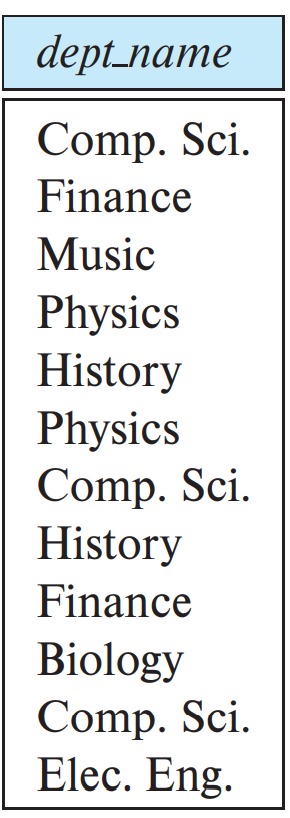

## 3.1 Overview of the SQL Query Language

SQL包含以下部分:
- **D**ata-**d**efinition **l**anguage(**DDL**)

    The SQL DDL provides commands for defining relation schemas, deleting   relations, and modifying relation schemas
- **D**ata-**m**anipulation **l**anguage(**DML**)

    The SQL DML provides the ability to query information from the database and to insert tuples into, delete tuples from, and modify tuples in the database.

## 3.2 SQL Data Definition
The set of ==relations== in a database are specified using a data-definition language (DDL).

The SQL DDL allows specification of not only a set of relations, but also ==information== about each relation, including:
- The **schema** for each relation
- The **types** of values associated with each attribute
- The **integrity** constraints
- The set of **indices** to be maintained for each relation
- The **security** and **authorization** information for each relation
- The **physical storage structure** of each relation on disk


### 3.2.1 Basic Types
- **char**($n$)

    A *fixed-length* character string with user-specified length $n$. The full form, **character**, can be used instead.

    反正一般来说不建议使用这种类型，用*varchar*好一点
- **varchar**($n$)

    A *variable-length* character string with user-specified maximum length $n$. The full form, **character varying**, is equivalent.
- **int**

    也可以用**integer**
- **smallint**
- **numeric**($p,d$)

     A fixed-point number with user-specified precision. The number consists of $p$ digits (plus a sign), and $d$ of the $p$ digits are to the right of the decimal point. Thus, **numeric**(3,1) allows 44.5 to be stored exactly, but neither 444.5 nor 0.32 can be stored exactly in a field of this type
- **real, double precision**

    Floating-point and double-precision floating-point numbers with machine-dependent precision
- **float**($n$)

    A floating-point number with precision of at least $n$ digits

每一种数据类型都可能有`null`这种取值

### 3.2.2 Basic Schema Definition
#### 3.2.2.1 `create table`
创建SQL *relation*的时候，用的是`create table`命令。eg:
```sql{.line-numbers}
create table department
    (dept_name varchar(20),
    building varchar(15),
    budget numeric(12,2),
    primary key(dept_name));
```
general form长下面这样:
```sql{.line-numbers}
create table r
    (A1 D1,
    A2 D2,
    ...,
    An Dn,
    <integrity-constraint1>,
    ...,
    <integrity-constraintk>);
```
至于这里面提到的integrity constraint，常见的有如下:
- **primary key**$(A_{j_1},A_{j_2},...,A_{j_m})$

    $A_{j_1},A_{j_2},...,A_{j_m}$代表的就是*attributes*。这些*attributes*的要求是*nonnull* and *unique*。也就是说，没有任何一行有*attribute*的值为*null*，也没有任何两行在所有的*primary-key attributes*上是完全相同的

    虽说*primary-key*可写可不写，一般来说写了不亏
- **foreign key**$(A_{k_1},A_{k_2}),...,A_{k_n}$ references $s$
- **not null**

    null value is not allowed for that attribute
#### 3.2.2.2 `drop table`, `delete from`
```sql{.line-numbers}
drop table r;
```
`drop table`会直接把一个*relation*从数据库中删除掉，相当于是`create table`的逆向过程了

```sql{.line-numbers}
delete from r;
```
`delete from`则是相对没那么离谱的删除，它会删除掉*relation*中的所有tuple，但不会删除掉*relation*自身
#### 3.2.2.3 `alter table`
用来向现有的*relation*里添加或者删除*attribute*，默认新的*attribute*的值是*null*
```sql{.line-numbers}
alter table r add A D;
alter table r drop A;
```
其中A是名字，D是类型

## 3.3 Basic Structure of SQL Queries(`select`, `from`, `where`)
基本结构是由`select`, `from`, `where`组成的，语句的返回值是一个新的*relation*
### 3.3.1 Queries on a Single Relation
```sql{.line-numbers}
select dept_name
from instructor;
```
结果如下



> `select`相当于*relation algebra*的==project==


可以看到，SQL允许表达式的返回结果里面包含==重复的值==，因为消除重复结果的操作比较费事。理论上来说，其实*relation*就是数学上的集合，集合并不允许重复元素的存在

默认情况下，结果都是重复的，等价于`select all`语句

假如我们比较刁钻，就是想要不重复的结果呢?
```sql{.line-numbers}
select distinct dept_name
from instructor;
```
多加一个`distinct`，这样子就可以满足不重复的需求

我们可以通过`where`语句来给搜索结果添加一些“条件”:
```sql{.line-numbers}
select name
from instructor
where dept_name = 'Comp.Sci.' and salary > 70000;
```
> `where`相当于*relation algebra*的==select==

可以看到我们添加了住址和工资的筛选条件。不光是`and`，其它逻辑`or`, `not`也是可以使用的

### 3.3.2 Queries on Multiple Relations
就是说`from`后面跟了很多个*relation*

书上讲的很费劲，其实就是以下几点：
- Generate a *Cartesian product* of the relations listed in the `from` clause
- Apply the predicates specified in the `where` clause on the result of Step 1.
- For each tuple in the result of Step 2, output the attributes (or results of expressions) specified in the `select` clause.

其实实际实现之中，并不会真的把所有的*product*全部都列出来，毕竟太费事了

至此，我们可以知道，SQL语句和*relation algebra*有如下的对应关系:
```sql{.line-numbers}
select distinct a1,a2,...an
from R1,R2,...,Rm
where P
```
等于
$$
\Pi_{a_1,a_2,...a_n}(\sigma_P(R_1\times R_2\times ... \times R_m))
$$

## 3.4 Additional Basic Operations
### 3.4.1 The Rename Operation(`as`)
语法是：
```sql{.line-numbers}
old-name as new-name
```
新的名字叫做**correlation name / table alias / correlation variable / tuple variable**

`as`可以出现在`select`或者是`from`语句

出现在`select`之中:
```sql{.line-numbers}
select name as instructor_name, course_id
from instructor, teaches
where instructor.ID=teaches.ID;
```
这里只是把`name`改名为了`instructor_name`

出现在`from`中:
```sql{.line-numbers}
select T.name, S.course_id
from instructor as T, teaches as S
where T.ID=S.ID;
```
可以看到这么替换名字的目的就是==减少字数==

有的时候我们希望比较==同一个*relation*里面==的不同*tuple*，这时候就必须rename:
```sql{.line-numbers}
select distinct T.name
from instructor as T, instructor as S
where T.salary > S.salary and S.dept_name = 'Biology';
```
"Find the names of all instructors whose salary is greater than at least one instructor in the Biology department."

### 3.4.2 String Operations(`%`, `_`)
SQL中，string的声明是使用==单引号==。有时候这就很无语，比如要显示"It's right"的话，需要输入的是`'It"s right'`

SQL标准虽然是要求区分大小写，但是很多gb软件就是不区分

有非常多的操作，具体看软件，比如连接两个string使用`||`

Pattern matching 用`like`关键词来声明，有两种模式匹配的字符:
- `%`

    matches ==any substring==
- `_`

    matches ==any character==

一些比较神奇的例子：
- `'___'`会匹配长度为3的字符串
- `'___%'`会匹配长度至少为3的字符串

放到完整的语句里面就是:
```sql{.line-numbers}
select dept_name
from department
where building like '%Watson$';
```
假如我们就是想匹配百分号和下划线呢？可以通过`escape`关键词来声明:
- `like 'ab\%cd%' escape '\'`

    必须这样子声明escape的字符标识是`\`，会匹配所有以"ab%cd"开头的词
- `like 'ab\\cd%' escape '\'`

    匹配以"ab\cd"开头的词

### 3.4.3. Attribute Specification in the Select Clause(`*`)
`*`表示选择所有attribute:
```sql{.line-numbers}
select instructor.*
from instructor, teaches
where instructor.ID=teaches.ID;
```

### 3.4.4 Ordering the Display of Tuples(`order by`)
`order by`控制用哪个attribute作为排序的依据:
```sql{.line-numbers}
select name
from instructor
where dept_name = 'Physics'
order by name;
```
默认情况下是==升序排列==，假如我们想要直接声明升序或者降序，就需要`asc` / `desc`:
```sql{.line-numbers}
select *
from instructor
order by salary desc, name asc;
```
### 3.4.5 Where-Clause Predicates
`between` / `not between`关键词可以简化一些范围的书写：
```sql{.line-numbers}
select name
from instructor
where salary between 90000 and 100000;
```
多个相同的比较运算可以通过小括号`()`简化:
```sql{.line-numbers}
select name, course_id
from instructor, teaches
where (instructor.ID, dept_name) = (teaches.ID, 'Biology')
```
上面的语句等价于`where instructor.ID=teaches.ID and dept_name = 'Biology';`

## 3.5 Set Operations
### 3.5.1 `union`
```sql{.line-numbers}
(select course_id
from section
where semester = 'Fall' and year = 2017)
union
(select course_id
from section
where semester = 'Spring' and year = 2018);
```
小括号可写可不写。结果会自动==消掉重复==

假设我们就是想要包含重复的结果呢？
```sql{.line-numbers}
(select course_id
from section
where semester = 'Fall' and year = 2017)
union all
(select course_id
from section
where semester = 'Spring' and year = 2018);
```
`union all`帮你解决烦恼

### 3.5.2 `intersect`
```sql{.line-numbers}
select course_id
from section
where semester = 'Fall' and year = 2017
intersect
(select course_id
from section
where semester = 'Spring' and year = 2018);
```
同样也会在结果里==消除重复==

同样是用`intersect all`来保留重复的结果
### 3.5.3 `except`
同样是不保留重复，同样是`except all`

## 3.7 Aggregate Functions
吃很多个值，返回一个值
- `avg`
- `min`
- `max`
- `sum`
- `count`

### 3.7.1 Basic Aggregation
```sql{.line-numbers}
select avg(salary) as avg_salary
from instructor
where dept_name = 'Comp.Sci'
```
注意这里选择salary的时候，是允许salary的值重复的，不然显然是会得到错误的结果

但有时候，我们又希望在喂给函数之前，把属性的值消除掉重复:
```sql{.line-numbers}
select count(distinct ID)
from teaches
where semester = 'Spring' and year = 2018;
```
`distinct`在这里就可以消除烦恼

假如我们想数一下relation里面总共有多少个tuples:
```sql{.line-numbers}
select count(*)
from course;
```
默认情况下这样写是会把重复的也算进去，然而SQL并==不允许==写出`count(distinct *)`这种东西

### 3.7.2 Aggregation with Grouping(`group by`)
"Find the average salary in each department":
```sql{.line-numbers}
select dept_name, avg(salary) as avg_salary
from instructor
group by dept_name;
```
可以看到`group by`根据特定的*attribute*把tuple进行了分组

有一个细节，就是`select`后面跟的表达式，除了`dept_name`这个出现在*attribute*里面的的东西外，其它表达式都==不是裸露的*attribute*==(salary被裹在了`avg()`里面)。否则是非常危险的，比如下面的代码是不允许的:
```sql{.line-numbers}
/*erroneous query*/
select dept_name, ID, avg(salary)
from instructor
group by dept_name;
```
可以顺带看到，SQL的注释是用`/**/`包裹起来的，`--`放在行首也行
### 3.7.3 `having`
`having` does not apply to a single tuple;
rather, it applies to ==each group== constructed by the `group by` clause
```sql{.line-numbers}
select course_id, semester, year, sec_id, avg(tot_cred)
from student, takes
where student.ID=takes.ID and year = 2017
group by course_id, semester, year, sec_id
having count (ID) >= 2;
```
我们可以借此重新理解一下语句的执行顺序:
- As was the case for queries without aggregation, the `from` clause is first evaluated to get a relation
- If a `where` clause is present, the predicate in the `where` clause is applied on the result of the `from` clause
- Tuples satisfying the `where` predicate are then placed into groups by the `group by` clause if it is present. If the `group by` clause is absent, the entire set of tuples satisfying the `where` predicate is treated as being in one group 
- The `having` clause, if it is present, is applied to each group; the groups that do not satisfying the `having` clause predicate are removed
- The `select` clause uses the remaining groups to generate tuples of the result of the query, applying the aggregate functions to get a single result tuple for each group
> 可以思索一下，其实`having`的作用和`where`并不太一样

### 3.7.4 Aggregation with Null and Boolean Values
- **null**

    面对null的时候，aggregate functions一般有如下表现:
    - 除了`count(*)`以外的所有functions都会忽略null的value，也因此collection of value可能是完全空的
    - `count()`面对空的collection时返回null，其余的function直接返回null
- **boolean**

    可能的取值有:
    - true
    - false
    - **unknown**

    可以施加的运算符包括`some, every, or, and`

## 3.8 Nested Subqueries
### 3.8.1 Set Membership(`in`)
`in`和`not in`可以分辨一个relation之中的元素在不在另一个relation之中:
```sql{.line-numbers}
select distinct course_id
from section
where semester = 'Fall' and year = 2017 and
      course_id in (select course_id
                    from section
                    where semester = 'Spring' and year = 2018);
```
之前我们通过将两端代码取intersect也达到了同样的效果。注意这里用了`distinct`，因为结果没有重复的

枚举的情况也可以用:
```sql{.line-numbers}
select distinct name
from instructor
where name not in ('Mozart', 'Einstein')
```
选择多个性质也是可以的:
```sql{.line-numbers}
select count(distinct ID)
from takes
where (course_id, sec_id, semester, year) in (select course_id, sec_id, semester, year
    from teaches
    where teaches.ID='10101')
```
### 3.8.2 Set Comparison(`some`, `all`)
之前的一段代码:
```sql{.line-numbers}
select distinct T.name
from instructor as T, instructor as S
where T.salary > S.salary and S.dept_name='Biology';
```
可以等价为:
```sql{.line-numbers}
select name
from instructor
where salary > some (select salary
                     from instructor
                     where dept_name = 'Biology');
```
可以看到，"greater than at least one"被`> some`表达了出来
> `= some`等价于`in`，而`<>some`并不等价于`not in`

另一种需求, "greater than any one"，被`> all`表达:
```sql{.line-numbers}
select name
from instructor
where salary > all (select salary
                    from instructor
                    where dept_name = 'Biology');
```
### 3.8.3 Test for Empty Relations(`exists`)
`exists`: testing whether a subquery has any tuples in its result

假如exists的参数列表是nonempty，则返回true

"Find all courses taught in both the Fall 2017 semester and in the Spring 2018 semester"又可以如下表达:
```sql{.line-numbers}
select course_id
from section as S
where semester = 'Fall' and year = 2017 and 
      exists (select *
              from section as T
              where semester = 'Spring' and year = 2018 and S.course_id = T.course_id);
```
可以看出来，外面声明的alias其实是可以在subquery之中使用的，我们称这样的subquery为**correlated subquery**

至于`not exists`，就有一些奇怪的用法。想要表达"relation A contains relation B"的时候，可以写`not exists(B except A)`。比如:
```sql{.line-numbers}
select S.ID, S.name
from student as S
where not exists((select course_id
                  from course
                  where dept_name = 'Biology')
                  except
                  (select T.course_id
                   from takes as T
                   where S.ID = T.ID));
```
“选了Biology所有课程的所有学生”

实际上这个操作是**Division**：操作结果是除法的结果，`except`的后一个relation是被除数，前一个relation是除数。

反正认真想的话就很绕

### 3.8.4 Test for the Absence of Duplicate Tuples(`unique`)
subquery不包含重复的tuple就返回true:
```sql{.line-numbers}
select T.course_id
from course as T
where unique(select R.course_id
             from section as R
             where T.course_id = R.course_id and
                   R.year = 2017);
```
然而这在逻辑上有点bug，就是假如subquery的结果是空的话，这东西返回的还是true。显然很多时候选择一些根本不存在的course是不合理的。

上面`unique`的位置甚至可以用`1 >= `来代替

同样`not unique`也是存在的

### 3.8.5 Subqueries in the From Clause(`from`)
既然query返回的就是relation，那么显然是可以放在`from`的后面的，比如：
```sql{.line-numbers}
select dept_name, avg_salary
from (select dept_name, avg(salary) as avg_salary
      from instructor
      group by dept_name)
where avg_salary > 42000;
```
subquery在这种时候也可以重新命名一下：
```sql{.line-numbers}
select dept_name, avg_salary
from (select dept_name, avg(salary)
      from instructor
      group by dept_name)
      as dept_avg (dept_name, avg_salary)
where avg_salary > 42000;
```
有些奇怪的SQL实现会要求你必须给subquery起一个名字，即使永远也用不到这个名字

### 3.8.6 `with`
用来定义一个==临时的==relation:
```sql{.line-numbers}
with max_budget (value) as
     (select max(budget)
     from department)
select budget
from department, max_budget
where department.budget = max_budget.value;
```
只有个别能访问得到

## 3.9 Modification of the Database
之前一直都是在提取数据，这节就学习怎么修改数据
### 3.9.1 `delete from`
```sql{.line-numbers}
delete from instructor
where dept_name = "Finance"
```
显然之前已经学过了
### 3.9.2 `insert into`
```sql{.line-numbers}
insert into course
    values ('CS-437','Database Systems','Comp.Sci.',4)
```
为了防止用户忘记数据库里面的*attribute*是怎么样的排列的，SQL允许添加一个参数列表:
```sql{.line-numbers}
insert into course(course_id,title,dept_name,credits)
    values ('CS-437','Database Systems','Comp.Sci.',4)
```
其实可以用query的返回结果来插入:
```sql{.line-numbers}
insert into instructor
    select ID,name,dept_name,18000
    from student
    where dept_name='Music' and tot_cred > 144;
```
假设我们没有把所有*attribute*的值指定清楚，那么剩下的值就默认是*null*
### 3.9.3 `update`
```sql{.line-numbers}
update instructor
set salary = salary * 1.03
where salary > 10000;
```
我们甚至可以搞点条件选择:
```sql{.line-numbers}
update instructor
set salary = case
        when salary <= 100000 then salary * 1.05
        when ... then ...
        else ...
    end
```


