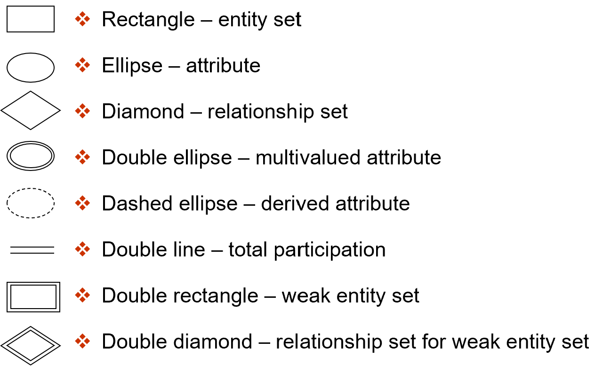
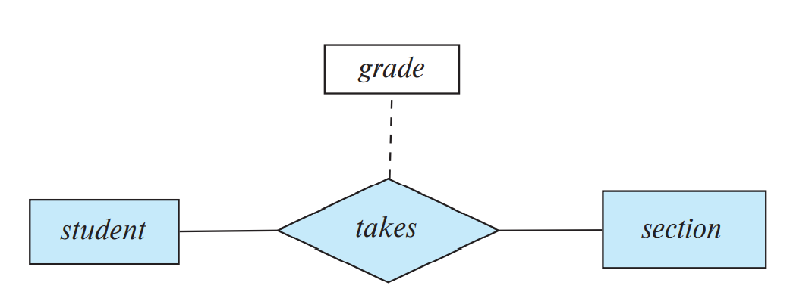
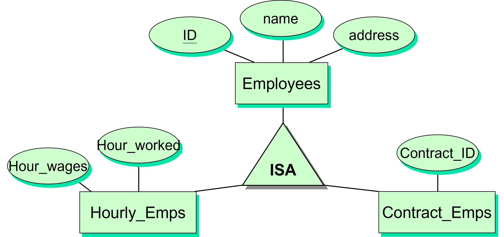
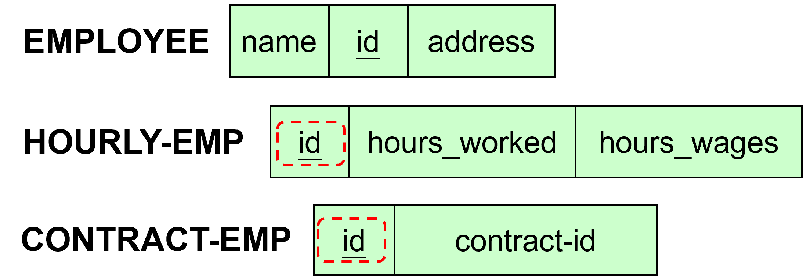

## 6.2 The Entity-Relationship Model
### 6.2.1 Entity Sets
- **entity**

    就是个体
    - **attributes**

        性质，每个*attribute*对应一个**value**
- **entity set**

    相同类型的entity
    - **extension**

        大概意思是，“老师”这个概念是*entity set*，而实际上的“老师们”是*extension*
    

图中每个矩形为一个*entity set*

关于E-R diagram的图例:

### 6.2.2 Relationship Sets

- 中间的菱形代表**relationship set**

    假如$E_1, E_2,...,E_n$是*entity sets*，那么*relationship set* R就是以下的子集：
    $$\{(e_1,e_2,...,e_n)|e_1\in E_1,e_2\in E_2,...e_n\in E_n\}$$
    我们说*entity sets* **participate** in *relationship set* R

这张图中的关系处多了用虚线连接的方框**descriptive attributes**

关系可以发生在多个*entity set*之间，有多少的*entity set*就是多少==degree==; 两个*entity*之间的话就是*binary*，三个叫*ternary*

然而，有时候relationship发生在同一个*entity set*之中，这时候叫**recursive relationship**
## 6.3 Complex Attributes
每个*attribute*都有对应的**domain**

*attribute* types:
- **Simple** and **Composite**

    上图中的就是复合型的attribute
- **Single-valued** and **multi-valued**

    比如一个人可以有多个手机号
- **Derived attributes**

    衍生性质，可以从已有的性质中推理出来

有个可能*attribute*的值为**null**

## 6.4 Mapping Cardinalities
感觉就是映射关系
- **One-to-one**
- **One-to-many**
- **Many-to-one**
- **Many-to-many**

至于图怎么表示：

也有类似满射一样的概念：
- **total participation**

    E中的每一个*entity*都参与了至少一个关系

    不然就是**partial participation**

这个图中的==双线就是表明*total*==

比较诡异的是，线上的数字左边代表minimum cardinality，右边是maximum cardinality。反直觉的事情是，这个图对应的是==One-to-many==!!!

## 6.5 Primary Key
### 6.5.1 Keys for entity set
- **superkey**

    可以区分出来一个*entity set*里面的不同*entity*的*key*
- **candidate key**

    一个子集不可能有superkey的superkey就是*candidate key*
- **primary key**

    被程序设计者选中的幸运*candidate key*
### 6.5.2 Keys for relationship set
这是建立在*entity set*的*key*的基础之上的

对于binary relationship:
- one-to-many/many-to-one

    ==many==那一侧entity set的primary key就是这个relationship的primary key

    比如，对于student, instructor和它们之间的关系advisor，假设from student to instructor是many-to-one，即一个学生顶多选一个导师，那么作为many一侧的student的primary key即是这个relationship的primary key
- one-to-one

    哪边的primary key都可以成为relationship的primary key
- many-to-many

    双方primary key的==union==即为relationship的primary key

## 6.6 Weak/Strong Entity Set
- **weak entity set**

    一个entity set中的所有自带的属性，都不足以把其中的entity都唯一的区分出来。

    注意*weak entity set*和*owner entity set*的关系必定是==many-to-one==的
- **identifying entity set**

    weak entity set所依赖的entity set，借助这个set的属性，weak entity set中的元素才能够唯一地区分开来
- **discriminator attributes**

    discriminator attributes和identifying entity的primary key俩东西，uniquely identify a weak entity
- **strong entity set**

    只要不是weak entity set

> the *weak entity set* is said to be **existence dependent** on the *identifying entity set*. The *identifying entity set* is said to **own** the *weak entity set* that it identifies. The relationship associating the *weak entity set* with the *identifying entity set* is called the **identifying relationship**

> 其实*existence dependent*所包含的概念相比于*weak entity*更加地宽泛，比如其实*existence dependency*是==允许存在primary key的==

eg.

section和course的关系。section假如没有course_id这个来自于course的属性，就没有办法唯一地确定。因为别的course也许有section和这个course的section同名。于是乎，section就是weak entity，course是identifying entity，*course_id*是course的primary key，*sec_id、year、semester*是discriminator attributes。于是section的primary key就是{*course_id, sec_id, year, semester*}

可以看到weak entity set用==双方框==框住。discriminator用==虚线==标注，weak entity set 和identifying entity set的关系也是==双菱形==。identifying entity set的primary key则是用==实线下划线==标明
## 6.7 Reducing E-R Diagrams to Relational Schemas
和第二章联系起来

两类事情：
- E-R schema to relation schema
- constraints from the E-R design to constraints on relation schemas

### 6.7.1 Representation of Strong Entity Sets
非常无脑，每一个*entity*都对应于表格里的一行(也就是*tuple*)

而且primary key也不变

然而可能遇到三个问题：
- 假如有*derived attribute*

    两种办法：
    - 包含进来

        - 缺点：可能遇到一些data inconsistencies问题
    - 不包含
        - 优点：避免data inconsistencies
        - 缺点：需要做一些操作来获取这项属性的值（也就是==函数==）
- 假如有*composite attribute*

    两种办法：
    - 只包含high-level *attribute*
    - 包含所有low-level *attribute*
- 假如有*multi-valued attribute*

    两种办法：
    - 只包含这一个属性（怎么听都不对吧）
    - 创建另一个表，包含该*entity set*的*primary key*, 和这个*multi-valued attribute*

### 6.7.3 Representation of Weak Entity Sets
表格包含所有*attributes*，顺带包含owners的*primary key*

### 6.7.4 Representation of Relationship Sets
假设对于关系*R*，$\{a_1,a_2,...,a_m\}$是每个参与关系的*entity sets*的*primary key*的集合，$\{b_1,b_2,...b_n\}$是*R*的*descriptive attributes*的集合，那么对应的表格中的每一列就对应下面这集合的每一个元素:
$$
\{a_1,a_2,...a_m\}\cup \{b_1,b_2,...,b_n\}
$$

说白了把所有*primary key*和*descriptive attributes*统统塞进来就对了

> 对于identifying relation来说，其实我们不需要为他们之间的关系创建table，因为这个关系已经隐藏在其它table里面的了。注意其它包含weak entity的relation在table的时候，需要加入weak entity的primary key，而这个primary key则是由宿主的primary key和weak entity的discriminator attributes共同组成的

## 6.8 Extended E-R Features
### 6.8.3 Attribute Inheritance

反正和类的继承非常相似

### 6.8.6 Reduction to Relation Schemas
也是和第二章联系起来的
#### 6.8.6.1 Representation of Generalization

有两种做法：
- 都创建表格

    这时*lower-level entity set*就需要额外包含他爸的所有*primary key*

    

    - 优点：

        更通用
    - 缺点：

        需要多一个relation
- 只创建低等级的*entity set*的表格

    并不是什么时候都可以实现的，只有儿子包含爸爸的所有属性的情况下才成立

    低等级的表格需要包含他爸的==所有==属性

    

    - 优点：

        每个低等级*entity set*更加容易被访问到（不需要经过爸爸）
    - 缺点：
        - 有可能实现不了
        - 假设有entity属于爸爸那个级别，则每个儿子都必须存一份这entity的信息

## 6.9 Entity-Relationship Design Issues
### 6.9.4 Binary versus $n$-ary Relationship Sets
it is always possible to ==replace a nonbinary== (n-ary, for n > 2) relationship set
by a number of distinct ==binary== relationship sets

比如图中这样，把一个三元关系拆成了三个二元关系
