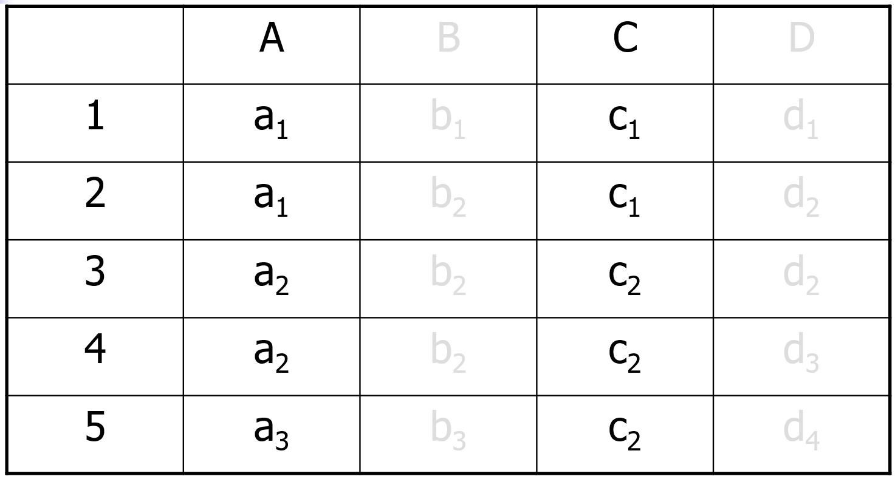
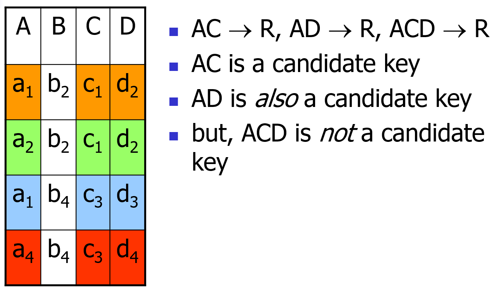
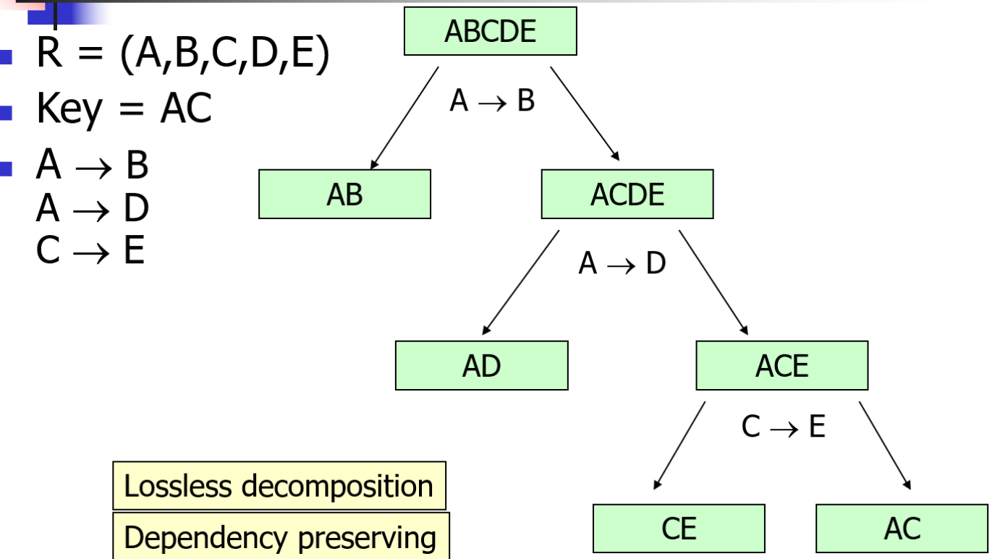

## 7.1 Features of Good Relational Design
有时候我们合并两个schema的时候，会造成存储空间的redundancy（比如会存储同一个attribute两次）。除此之外，还有可能造成数据不一致等问题

### 7.1.1 Decomposition
解决重复问题的唯一办法就是decomposition。至于怎么样把当前的schema拆分成多个schema，得以后再学。

并不是所有的decomposition都是有益的
### 7.1.2 Lossless Decomposition
> We say that the decomposition is a *lossless decomposition* if there is ==no loss of information== by replacing $R$ with two relation schemas $R_1$ and $R_2$

其实说的还是很含糊，我们可以用algebra和SQL来更加严谨地说明：
$$
\Pi_{R_1}(r)\Join\Pi_{R_2}(r)=r
$$
```sql
select *
from (select R1 from r)
    natural join
    (select R2 from r)
```
意思已经很明白了，就是把$R$分成$R_1$和$R_2$之后，对两者进行==natural join==的操作，我们最终还是会得到$R$

那么什么时候我们的decomposition是lossy的呢？
$$
r\subset\Pi_{R_1}(r)\Join\Pi_{R_2}(r)
$$
就是说我们最终计算得到了$r$的==超集==

ppt上用了一些非常诡异的方法来区分是否是lossless

## 7.2 Decomposition Using Functional Dependencies
- **legal instance of a relation**

    An instance of a relation that satisfies all real-world constraints
- **legal instance of a database**

    All the relation instances in the database are legal instances

### 7.2.1 Notational Conventions
- **sets of attributes**

    ==小写希腊==字母(e.g.,$\alpha$)

    sets of attributes并不表明这一定对应着一个schema，然而当我们需要表明这的确是对应着schema的时候，我们会用==罗马字母==

    - **superkey**

        当a set of attributes恰好是superkey的时候，我们可以用$K$来标记
- **relation schema**

    ==大写罗马==字母

    为了表明schema $R$和relation $r$之间的关系，我们会写$r(R)$
- **relation**

    ==小写名字==(e.g.,$instructor$)

    在定义和算法中，可能会用单个字母
> 当我们写$AB$的时候，我们指的是$A\cup B$
### 7.2.2 Keys and Functional Dependencies
**Functional dependency** is a type of *constraint* that is a *generalization* of the notation of *key*
> If $R$ is a relation schema, and $\alpha \subseteq R$, $\beta\subseteq R$。The functional dependency $\alpha\rightarrow\beta$ is satisfied if for any relation $r$ on $R$, for any two ==tuples== $t_1,t_2$ on $r$, if $\Pi_\alpha (t_1)=\Pi_\alpha (t_2)$, then $\Pi_\beta (t_1)=\Pi_\beta (t_2)$ holds.

e.g. 这么一个relation



$A\rightarrow C$在这个relation之中是成立的（比如第一行和第二行的A属性值相同，则C属性的值也必定会相同），而$C\rightarrow A$却是不成立的（比如第四行和第五行的C的值相同，对应的A的值却不同）。
> 需要注意的是，尽管这里$A\rightarrow C$对于这个==relation instance==是成立的。但是我们还是不能断定它在某个==schema==上一定成立，因为定义要求必须在这个schema对应的==所有==relation instance上都成立，$A\rightarrow C$才能被称作在schema上成立

- **trivial**

    > a functional dependency of the form $\alpha\rightarrow\beta$ is ==trivial if $\beta\subseteq\alpha$==

    比如说$\alpha\rightarrow\alpha$显然是满足functional dependency的

### 7.2.? Information deduced from functional dependencies
- $\alpha$ is a *superkey* for $R\Leftrightarrow\alpha\rightarrow R$
- $\alpha$ is a *candidate key* for $R\Leftrightarrow\alpha\rightarrow R$, there is no $\gamma$ s.t. $\gamma\subset\alpha$, $\gamma\rightarrow R$

e.g.



## 7.3 Normal Forms
有很多种不同的normal forms，这一节介绍两种最常用的
### 7.3.1 Boyce-Codd Normal Form(BCNF)
理论上它可以去除掉所有通过functional dependencies发现的redundancy，反正有可能会有其它类型的redundancy去除不掉
#### 7.3.1.1 Definition
> A relation schema $R$ is in BCNF with respect to a set $F$ of functional dependencies if, for all functional dependencies in $F^+$ of the form $\alpha\rightarrow \beta$, where $\alpha\subseteq R$ and $\beta\subseteq R$, at least one of the following holds:
> - $\alpha\rightarrow\beta$ is a ==trivial== functional dependency (i.e.,$\beta\subseteq\alpha$)
> - $\alpha$ is a ==superkey== for schema $R$

听着就非常抽象，我们来看一点更加具体的问题：

$R=(A,B,C)\\F=\{A\rightarrow B,B\rightarrow C\}\\Key=\{A\}$

这个时候，$R$ is not in BCNF，因为:
- 关于$F$中的第二个functional dependency，两种情况都没有满足($B$既不是superkey，$C$也不是$B$的子集)

### 7.3.2 Third Normal Form(3NF)
就是在BCNF的基础之上稍稍放宽了一点，多了一条可能的条件。也就是说，一个满足了BCNF的relation schema也就顺便满足了3NF

> A relation schema $R$ is in *third normal form* with respect to a set $F$ of functional dependencies if, for all functional dependencies in $F^+$ of the form $\alpha\rightarrow \beta$, where $\alpha\subseteq R$ and $\beta\subseteq R$, at least one of the following holds:
> - $\alpha\rightarrow\beta$ is a trivial functional dependency (i.e.,$\beta\subseteq\alpha$)
> - $\alpha$ is a superkey for schema $R$
> - ==Each== attribute $A$ in $\beta-\alpha$ is contained in a ==candidate key== for $R$

新增加的这个条件看起来很玄乎。需要注意的是它说的是，每一个attribute并不一定会被包含在同一个candidate key里面，是可以被包含在==多个==candidate keys里面的

e.g.

$R=(A,B,C,D,E)\\F=\{AE\rightarrow BCD,D\rightarrow A\}\\Key=\{AE,DE\}$

这个时候$R$就是满足3NF的(第一个满足$AE$是superkey，第二个满足$A$属于键$AE$的一部分)


## 7.4 Functional-Dependency Theory
### 7.4.1 Closure of a Set of Functional Dependencies
- **logically implied**

    > a ==functional dependency== $f$ on $R$ is *logically implied* by a set of functional dependencies $F$ on $R$ if every instance of a relation $r(R)$ that satisfies $F$ also satisfies $f$

    e.g. $$A\rightarrow B\\B\rightarrow H\\\rArr A\rightarrow H$$
- **closure of ==a set of functional dependencies==**

    > *closure* $F^+$ contains all of the functional dependencies ==logically implied== by $F$
- **Armstrong's axioms**

    axioms就是rules of inference。不断使用这些axioms，我们就可以得到所有$F^+$

    e.g. $F=\{A\rightarrow B\}$, then $$F^+=\\\{\\A\rightarrow A, \\B\rightarrow B, \\A\cup B\rightarrow A\cup B,\\A\rightarrow B,\\A\rightarrow A\cup B,\\A\cup B\rightarrow A,\\A\cup B\rightarrow B\\\}$$
    - **Reflexivity rule**

        > If $\alpha$ is a set of attributes and $\beta \subseteq \alpha$, then $\alpha \rightarrow \beta$ holds.
    - **Augmentation rule**

        > If $\alpha\rightarrow\beta$ holds and $\gamma$ is a set of attributes, then $\gamma\cup\alpha\rightarrow\gamma\cup\beta$ holds
    - **Transitivity rule**

        > If $\alpha\rightarrow\beta$ holds and $\beta\rightarrow\gamma$ holds, then $\alpha\rightarrow\gamma$ holds

    这仨规则是==正确==且==完备==的。然而直接使用的话又会非常麻烦，所有就有了如下的推论:
    - **Union rule**

        > If $\alpha \rightarrow\beta$ holds and $\alpha\rightarrow\gamma$ holds, then $\alpha\rightarrow\beta\cup\gamma$ holds
    - **Decomposition rule**

        > If $\alpha\rightarrow\beta\cup\gamma$ holds, then $\alpha\rightarrow\beta$ holds and $\alpha\rightarrow\gamma$ holds
    - **Pseudotransitivity rule**

        > If $\alpha\rightarrow\beta$ holds and $\gamma\cup\beta\rightarrow\delta$ holds, then $\alpha\cup\gamma\rightarrow\delta$ holds
### 7.4.2 Closure of Attribute Sets
- **Functionally determined**

    > if $\alpha$ is a set of attributes, $B$ is one attribute, $\alpha\rightarrow B$, then we say $B$ is *functional determined* by $\alpha$

为了测试特定的attribute set $\alpha$是不是superkey，我们需要知道所有被该集合*functionally determined*的attributes(也就是$\alpha^+$)。固然，对包含所有$\alpha$的set of functional dependencies $F$ 进行$F^+$的运算，最终固然是可以得到结果。但是这样子的运算开销太大了，我们需要点简单点的方法。
- **Closure of a set of attributes**

    > We call the set of all attributes functionally determined by $\alpha$ under a set $F$ of functional dependencies the closure of $\alpha$ under $F$, denoted by $\alpha^+$

至于$\alpha^+$到底要怎么计算，是有个伪代码算法的:
```cpp
result := α;
repeat
    for each functional dependency β → γ in F do
        begin
            if β ⊆ result then result := result ∪ γ;
        end
until (result does not change)
```

e.g.

$R(A,B,C,D)\\F=\{A\rightarrow B,B\rightarrow C\}$

为了计算$A^+$:
```cpp
result = A
result = A∪B//(A→B)
result = A∪B∪C//(B→C)
```
### 7.4.3 Canonical Cover
- **extraneous**

    > An attribute of a functional dependency is said to be *extraneous* if we can ==remove== it without changing the closure of the set of functional dependencies.

说白了就是有他没他都不影响functional dependencies的closure
- **canonical cover**

    > A *canonical cover* $F_c$ for $F$ is a set of dependencies such that $F$ logically implies all dependencies in $F_c$, and $F_c$ logically implies all dependencies in $F$. Furthermore, $F_c$ must have the following properties:
    > - No functional dependency in $F_c$ contains an ==extraneous== attribute
    > - Each ==left side== of a functional dependency in $F_c$ is ==unique==. That is, there are ==no== two dependencies $\alpha_1\rightarrow\beta_1$ and $\alpha_2\rightarrow\beta_2$ in $F_c$ such that $\alpha_1=\alpha_2$

意思大概是，$F$和$F_c$可以相互推导，且$F_c$当中不包含*extraneous attribute*，且dependencies的左侧值必定是唯一的。

生成这么个$F_c$的好处当然是去掉不必要的东西，减少验证的工作量

至于生成$F_c$的伪代码是:

> **repeat**<br>
>       Replace any $\alpha_1\rightarrow\beta_1$ and $\alpha_1\rightarrow \beta_2$ by $\alpha_1\rightarrow\beta_1\beta_2$<br>
> Delete any **extraneous attribute** from any $\alpha\rightarrow\beta$<br>
> **until** $F$ does not change


### 7.4.4 Dependency Preservation
> The **restriction of $F$ to $R_i$** is the set $F_i$ of all functional dependencies in $F^+$ that include ==only== attributes of $R_i$

也就是说，$F_i$ is the ==projection== of $F$ on $R_i$

> If $F'=F_1\cup F_2\cup ... \cup F_n$, $F'^+=F^+$, then this is a **dependency-preserving decomposition**

也就是说，所有儿子们的set of dependencies并起来，再取closure，和原来relation的closure一模一样

至于满足这个性质的decomposition有啥好处：假设不满足的话，我们还得每次都把所有儿子再合并起来，验证一下数据库的更新是否是合法的。这样的效率显然太低了

## 7.5 Algorithms for Decomposition Using Functional Dependencies
### 7.5.1 BCNF Decomposition
#### 7.5.1.2 BCNF Decomposition Algorithm
> Suppose relation $R$ is not in BCNF, $A$ is an attribute, and $X\rightarrow A$ is a functional dependency that violates the BCNF condition. Then ==decompose $R$ into $X\cup A$ and $R-A$== until all the relations become BCNF 

e.g.



需要注意的是，虽然这个方法是lossless的，但却不能保证==dependency preserving==

### 7.5.2 3NF Decomposition
伪代码如下：
```cpp
let Fc be a canonical cover for F;
i := 0;
for each functional dependency α → β in Fc
    i := i + 1;
    Ri :=αβ;
if none of the schemas Rj, j = 1, 2, …, i contains a candidate key for R
    then
        i := i + 1;
        Ri := any candidate key for R;
/* Optionally, remove redundant relations */
repeat
    if any schema Rj is contained in another schema Rk
        then
        /* Delete Rj */
        Rj := Ri;
        i := i - 1;
until no more Rjs can be deleted
return (R1, R2, …, Ri)
```
核心大概就是，对于canonical cover $F_c$ 中的每一个functional dependency $\alpha\rightarrow\beta$，我们都生成一个对应的==新relation $R_i=\alpha\cup \beta$==。这么一通生成子relation的操作之后，还得确定新的relation之中包含着==candidate key==才行，假如没有得再添加一个candidate key到儿子里。这时候其实已经完成了，我们可以选择检查一下有没有==冗余==的儿子，有的话就删掉。

这个decomposition的方法就可以保证==lossless且dependency preserving==

## 7.? Design Goal
究极目标是:
- BCNF
- Lossless
- dependency preservation

假设BCNF做不到的话，3NF也可以接受
