
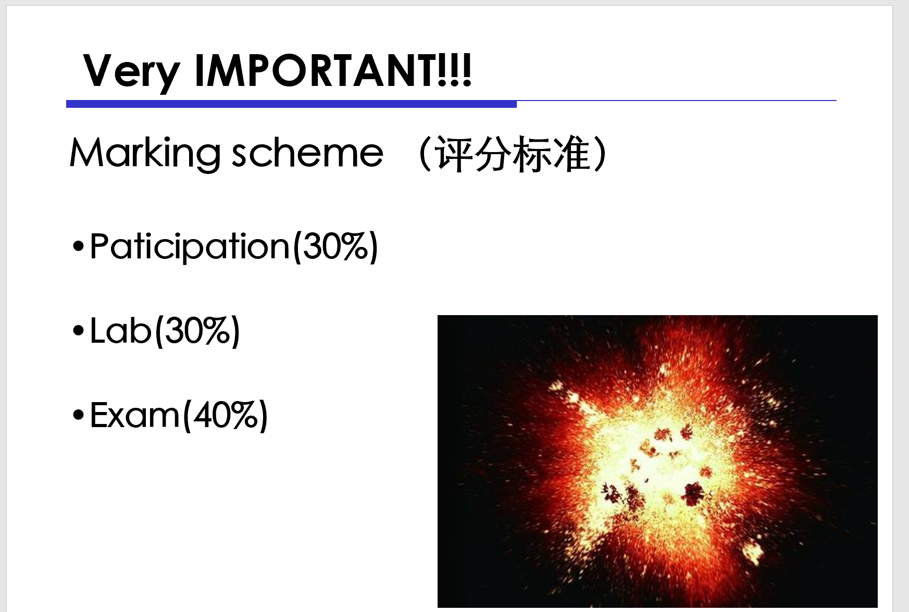

# Introduction

大概会覆盖这些内容:

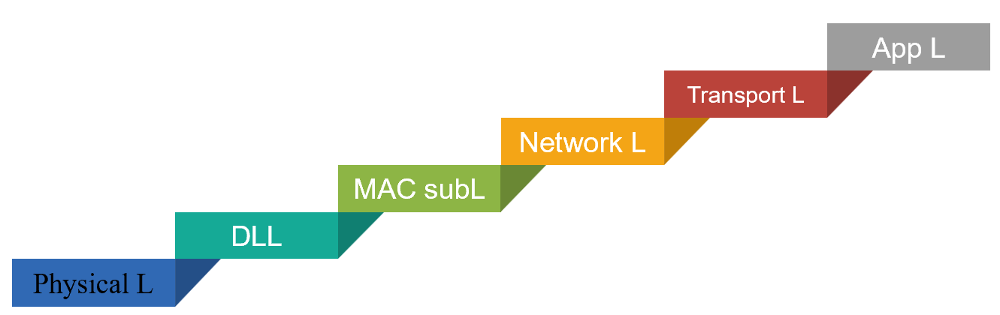

一张似乎很重要的图：

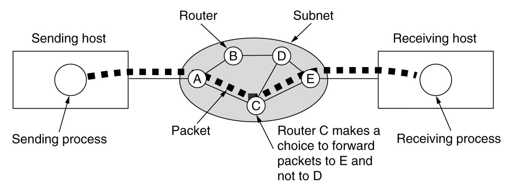

- **computer network**

    > a collection of autonomous computers interconnected by a single technology

    - interconnected

        Be able to exchange information
    - Autonomous

        Be able to handle independently

经常混淆的概念是computer network和**distributed system**:

The key distinction is that in a *distributed system*, a collection of independent computers appears to its users as a ==single coherent system==.

World Wide Web 就是最经典的*distributed system*, It runs on top of the Internet and presents a model in which everything looks like a document (Web page)

## 2. Network Hardware

不同范围内的网络都不一样：

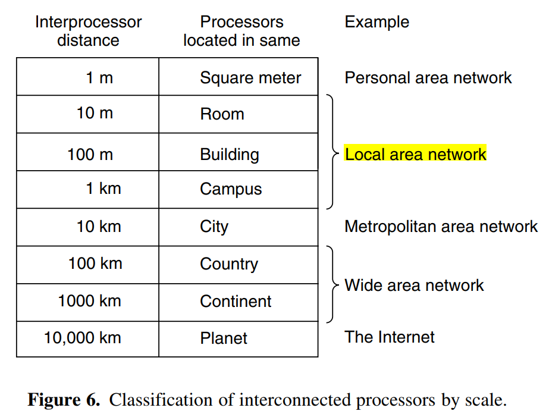

果然我只知道LAN

### 2.2 Local Area Networks
熟悉的LAN

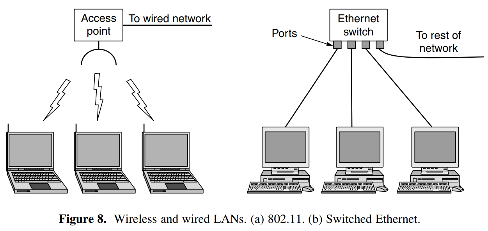

- **Wireless LANs**

    电脑会和一个设备联系，一般会是：
    - AP (Access Point)
    - wireless router
    - base station

    这东西的standard之一就是 IEEE 802.11，就是**WiFi**
- **Wired LANs**

    大部分都是基于点对点通信，其中一种是 IEEE 802.3，就是**Ethernet**

需要注意的是，LAN其中一个特点是"Control the network privately under local administration"，所以大学城岛实际上用的是WAN而不是LAN

### 2.4 Wide Area Networks
**WAN** 顾名思义会覆盖很大的区域，一般会覆盖一个国家甚至大陆

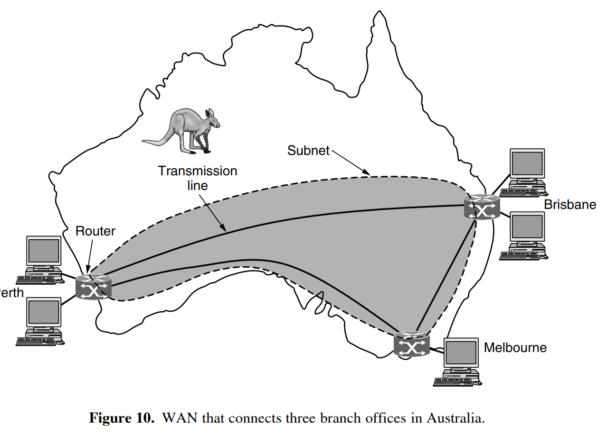

- **throughput**

    > Usually refers to actually measured bandwidth, at a specific time of day.

    吞吐量

    和bandwidth的区别是，throughput小于等于bandwidth

插入个小结：**communication mode**
- Point-to-Point
- Multicast

    > transmission to a subset of the machines
- Broadcast

一个不知道放在哪里的network topology:

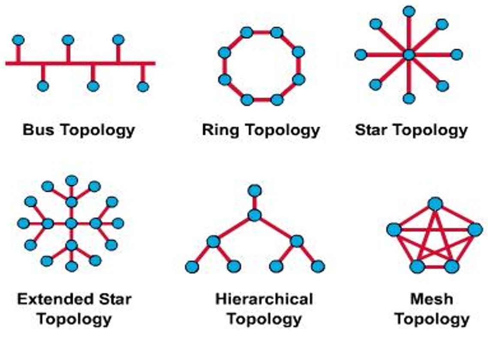

Mesh虽然看起来各个节点之间交流很稳定，但是维护成本太高了。

正常来说，我们会把家里的局域网划分为Bus Topology，因为大家都是共用的一根网线通道

需要注意的是，kbps是==十进制的==，不是二进制！
## 3. Network Software
### 3.1 Protocol Hierarchies
To reduce design complexity, most networks are organized as a stack of **layers** or **levels**

The purpose of each layer is to offer certain services to the higher layers while ==shielding those layers from the details== of how the offered services are actually implemented.

每层做抽象，生活更快乐

**protocol**:
>  a **protocol** is an agreement between the communicating parties on how communication is to proceed

下面是一个5层的网络：

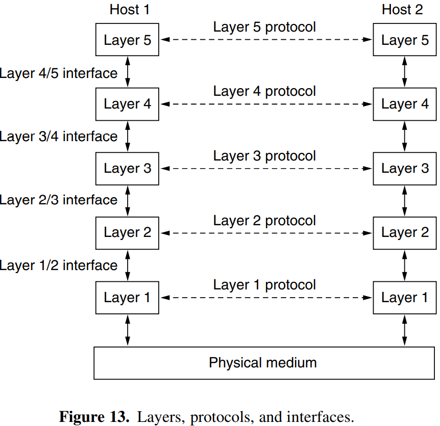

**peer**:
> The entities comprising the corresponding layers on different machines.

peers可以是软件的进程、硬件设备、甚至人。

从上图中可以看到，peers之间就是通过该层的protocol来进行通信的

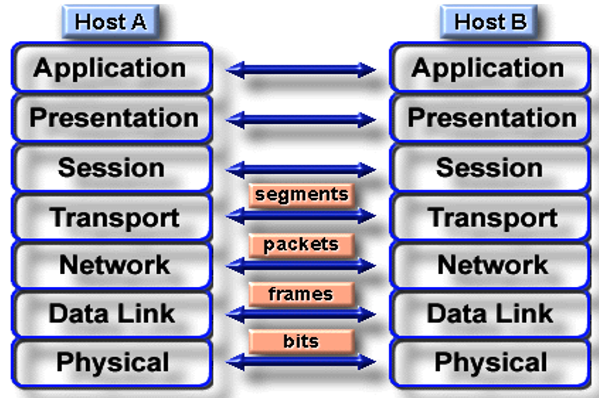

实际上，各个层之间的数据并不是直接这么隔着空气就传过去了，显然是需要向下走到**Physical medium**，然后才能过去。我们用虚线表示virtual communication，实线表示physical communication

不同层之间的通信是通过**interface**进行的

了解这这些概念之后，就可以介绍**network architecture**:
> A set of layers and protocols is called a **network architecture**

**protocol stack**:
> A list of the protocols used by a certain system, one protocol per layer, is called a **protocol stack**

### 3.2 Design Issues for the Layers
- Addressing
- Error control 
- flow control
- routing
- multiplexing and de-multiplexing

### 3.3 Connection-Oriented Versus Connectionless Services 
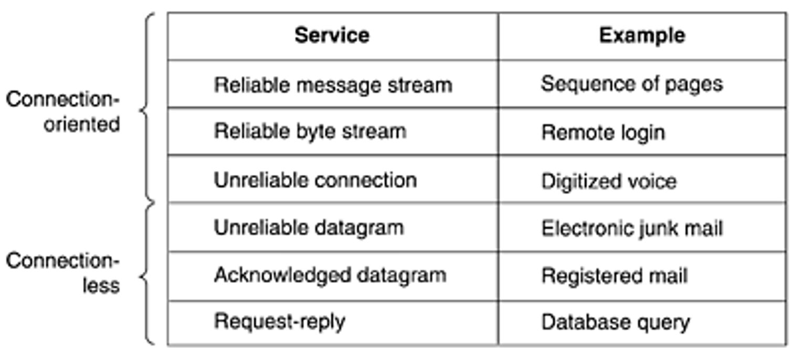

### 3.4 Service Primitives
A **service** is formally specified by a set of **primitives** (==operations==) available to user processes to access the service

These primitives tell the service to perform
some action or report on an action taken by a peer entity

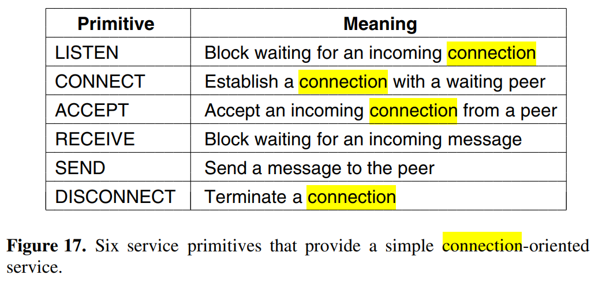

### 3.5 The Relationship of Services to Protocols
service
: A *service* is a set of primitives (operations) that a layer provides to the layer above it

下层是service provider，上层是service user

service虽然定义了提供哪些operation，但是完全没有说明这些操作到底是怎么实现的

protocols
: is a set of rules governing the ==format and meaning== of the packets, or messages that are exchanged by the peer entities ==within a layer==

Entities use protocols to ==implement== their service definitions

They are free to change their protocols at will, provided they do not change the service visible to their users

所以，可以看出来 service 和 protocol 的最大区别在于：

- **services** relate to the interfaces ==between layers==
- **protocols** relate to the packets sent ==between peer entities== on different machines

## 4. Reference Models
我们将要介绍两种network architectures:
- **OSI**

    protocol没用，但是model很值得研究
- **TCP/IP**

    protocol广泛使用，但是model没啥用

### 4.1 The OSI Reference Model
**O**pen **S**ystems **I**nterconnection

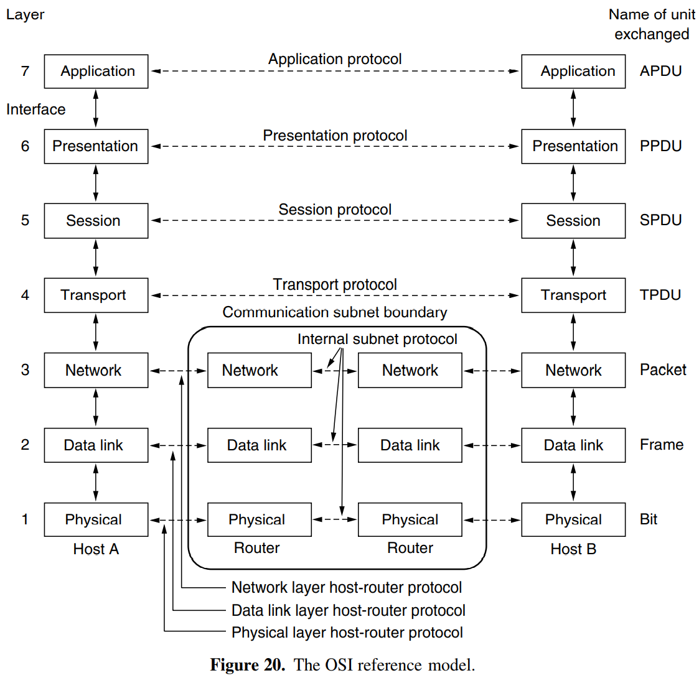

可以看到这玩意一共有7层，其中1-3层是**chained**，4-7是**end-to-end**

从整体上来说，要这样分层的目的是（benefit of layered structure）：
- Reduces complexity
- Standardizes interfaces
- Facilitates modular engineering
- Ensures interoperable technology
- Accelerates evolution
- Simplifies teaching and learning

还有另一张PPT上的图：

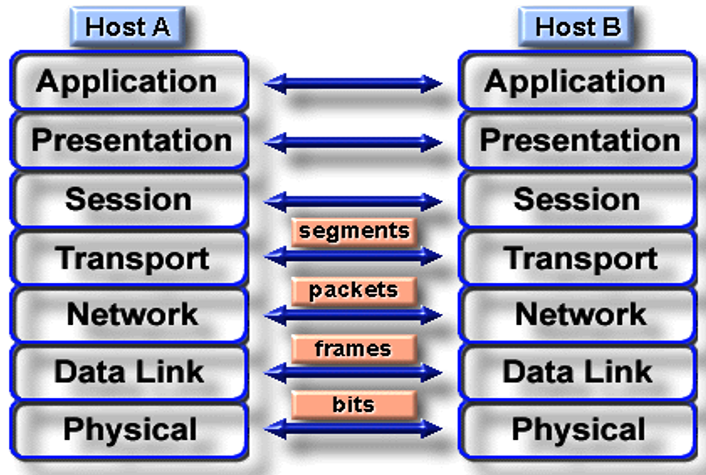

这里比较清楚地能看到，不同层之间交流的时候，数据是以什么为单位的，上下图都展示了

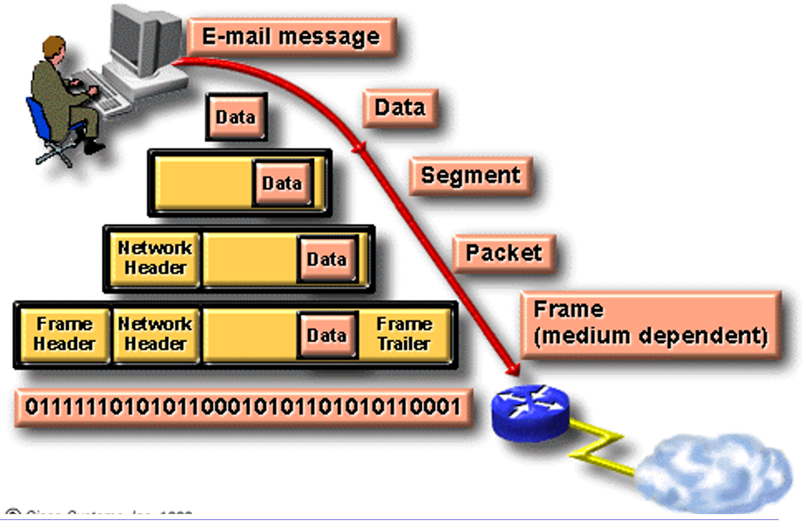

上图从上到下的过程称为encapsulation

我们从下往上一个个来说：

#### 4.1.1 The Physical Layer
> The **physical layer** is concerned with transmitting raw bits over a communication channel

单位是**bits**

就是交换二进制

#### 4.1.2 The Data Link Layer
> The main task of the **data link layer** is to transform a raw transmission facility into a line that appears free of undetected transmission errors

单位是**frames**

这一层对network layer隐藏了实际发生的错误：
> ... having the sender break up the input data into **data frames** (typically a few hundred or a few thousand bytes) and transmit the frames sequentially. If the service is reliable, the receiver confirms correct receipt of each frame by sending back an **acknowledgement frame**

PPT上的描述是：

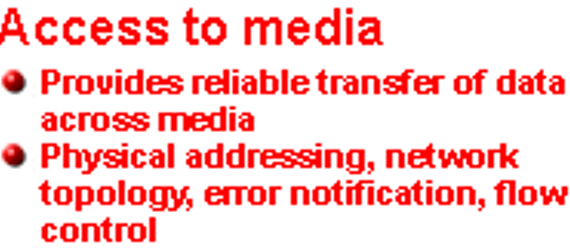

#### 4.1.3 The Network Layer
> The **network layer** controls the operation of the subnet

单位是**packets**

传输时候的速度、延迟啥的都是和这一层有关

#### 4.1.4 The Transport Layer
> The basic function of the **transport layer** is to accept data from above it, split it up into smaller units if need be, pass these to the network layer, and ensure that the pieces all arrive correctly at the other end

单位是**segments**

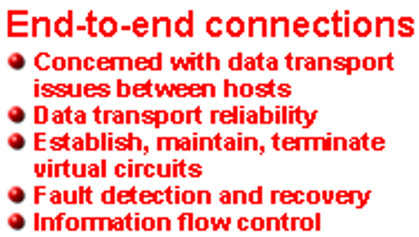

#### 4.1.5 The Session Layer
> The session layer allows users on different machines to establish **sessions** between them

**Sessions** offer various services:
- **dialog control**

    > keeping track of whose turn it is to transmit
- **token management**

    > preventing two parties from attempting the same critical operation simultaneously
- **synchronization**

    > checkingpointing long transmissions to allow them to pick up from where they left off in the event of a crash and subsequent recovery

#### 4.1.6 The Presentation Layer
> Unlike the lower layers, which are mostly concerned with moving bits around, the **presentation layer** is concerned with the ==syntax and semantics== of the information transmitted

因为不同的计算机可能内部的数据表示形式可能都不一样，做数据交换的时候就需要更加抽象的方式表达数据结构，比如银行的交易记录

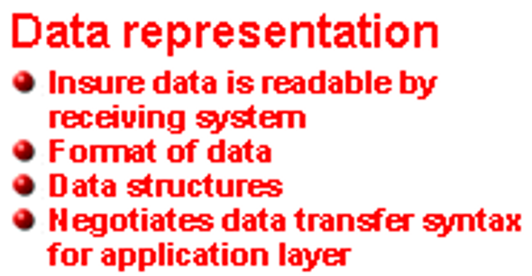

#### 4.1.7 The Application Layer
> The **application layer** contains a variety of protocols that are commonly needed by users

比如**HTTP** (**HyperText Transfer Protocol**)

#### 4.1.? e.g.
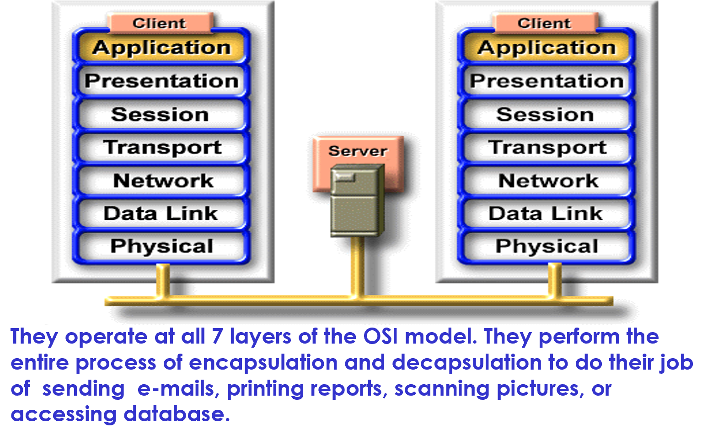

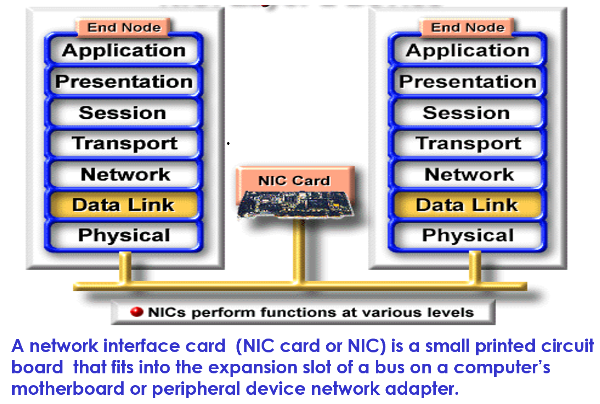

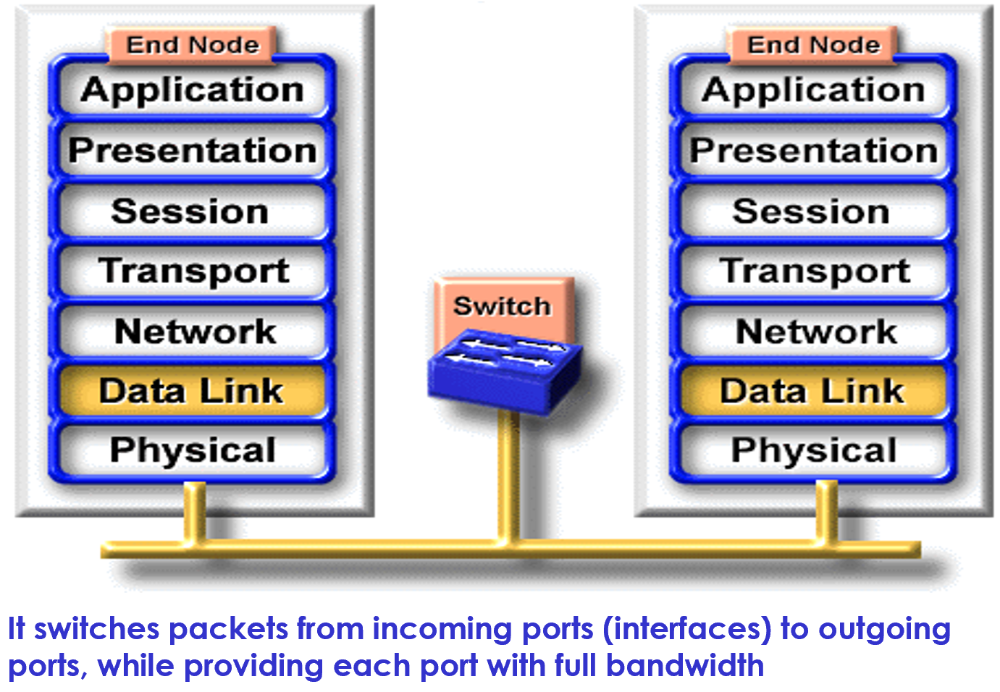

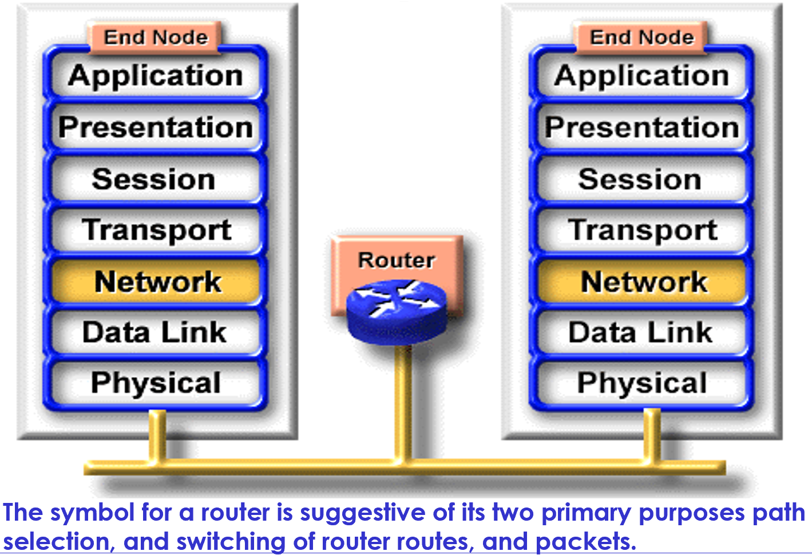

### 4.2 The TCP/IP Reference Model

!!! warning
    虽然名字里带个 TCP，但是实际上这玩意是同时包含了 TCP, UDP 和 IP 等等协议的！这玩意还有个名字叫做 **Internet protocol suite**[^1]

[^1]:[Internet protocol suite - Wikipedia..](https://en.wikipedia.org/wiki/Internet_protocol_suite)

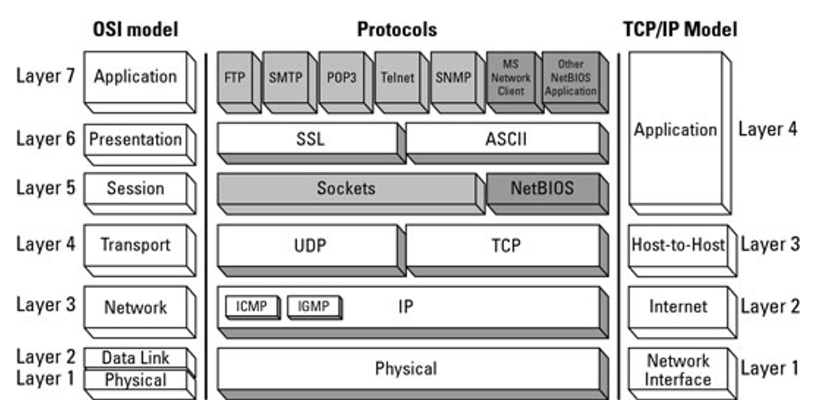

在线上题目之中，有观点认为 TCP/IP model==不存在"Network Layer"==，事实上在[wiki](https://en.wikipedia.org/wiki/Internet_protocol_suite)里，Layer1被称作了Link Layer

这些protocol之间的关系在TCP/IP Reference Model中的关系如下：

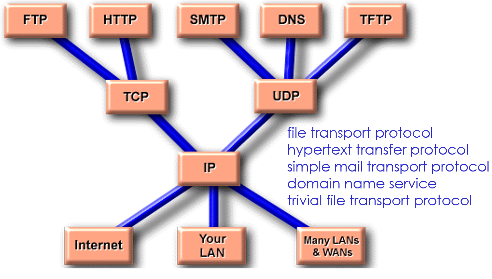

## 6. Network Standardization
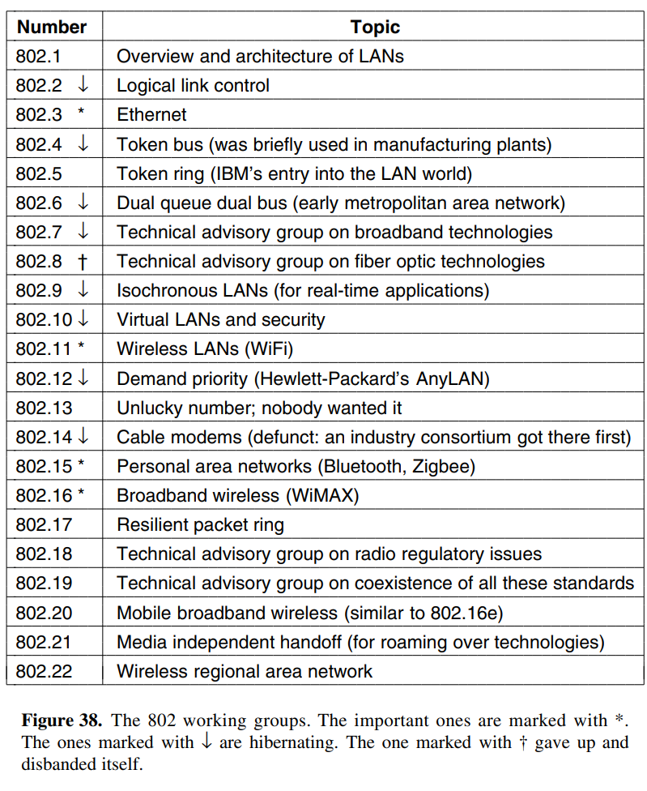

由以下组织来制定标准：
- ITU (International Telecommunication Union)
- ISO (International Standards Organization )
- ANSI (American National Standards Institute)
- NIST (National Institute of Standards and Technology)
- IEEE (Institute of Electrical and Electronics Engineers)
- RFCs  (Request For Comments). 
- IRTF (Internet Research Task Force)
