## 1. The Theoretical Basis For Data Communication
$f(t)$用来描述时间关于电压/电流的关系

### 1.1 Fourier Analysis
any reasonably behaved periodic function, $g(t)$ with period $T$, can be constructed as the sum of a (possibly infinite) number of sines and cosines:

$$
g(t)=\frac{1}{2}c+\sum_{n=1}^{\infty}a_n \sin(2\pi nft)+\sum_{n=1}^{\infty}b_n \cos(2\pi nft)
$$

where $f=1/T$ is the fundamental frequency, $a_n$ and $b_n$ are the sine and cosine amplitudes of the $n$th **harmonics** (terms) (谐波？？？). Such a decomposition is called a **Fourier series**

其中：

$$
\begin{align*}
a_n=&\frac{2}{T}\int_0^Tg(t)\sin(2\pi nft)dt\\
b_n=&\frac{2}{T}\int_0^Tg(t)\cos(2\pi nft)dt\\
c=&\frac{2}{T}\int_0^Tg(t)dt
\end{align*}
$$

### 1.2 Bandwidth-Limited Signals
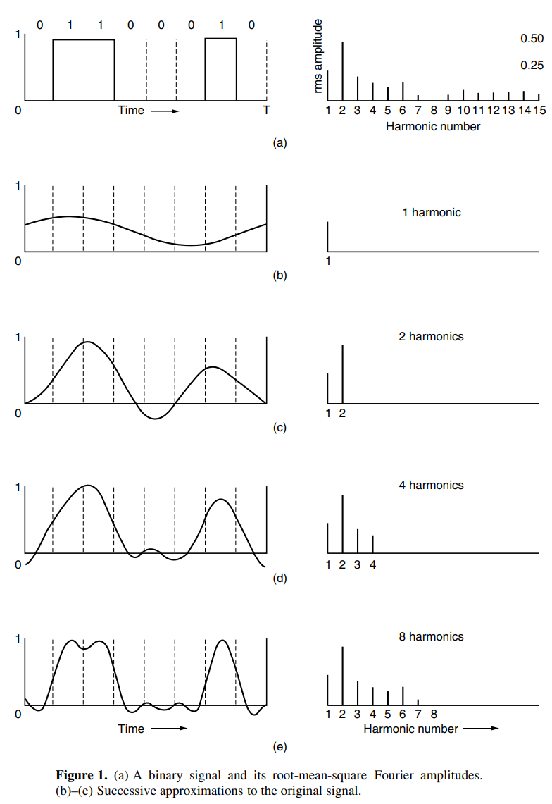

可以看到harmonic number越大，拟合的效果越好

**bandwidth**:
> The width of the frequency range transmitted ==without being strongly attenuated==(减弱)

The larger $n$ is, the higher the frequency $nf$ of the $n$th harmonic.

All transmission facilities diminish different Fourier components by different amounts, thus introducing distortion.

Usually, the amplitudes are transmitted undiminished from 0 up to some frequency $f_c$ (in Hertz, Hz) with all frequencies above this cutoff frequency截止频率 strongly attenuated.

关于bit rate和harmonics:

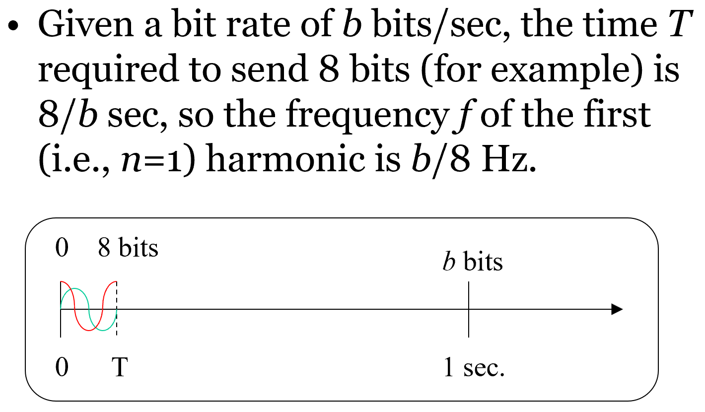

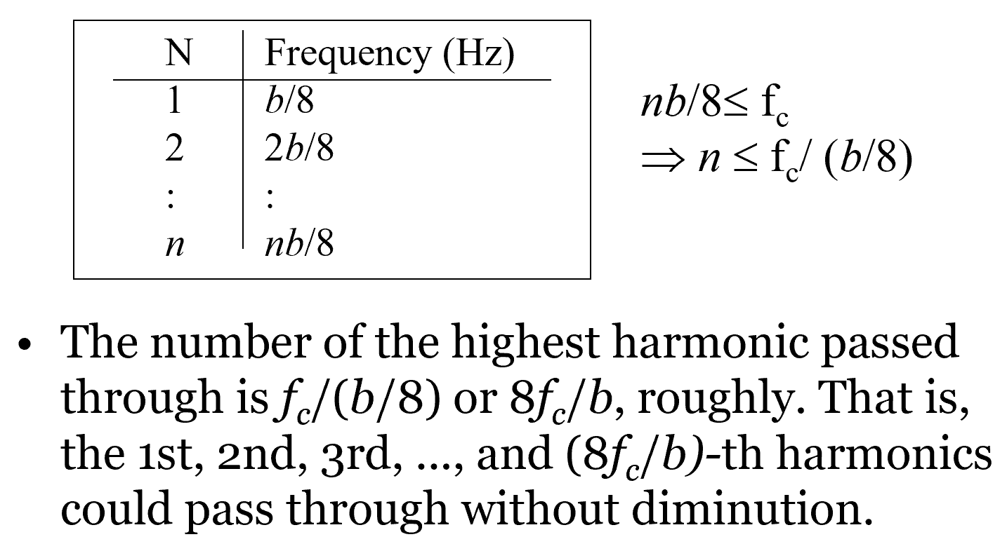

**analog bandwidth (Hz)** VS **digital bandwidth (bits/sec)**:

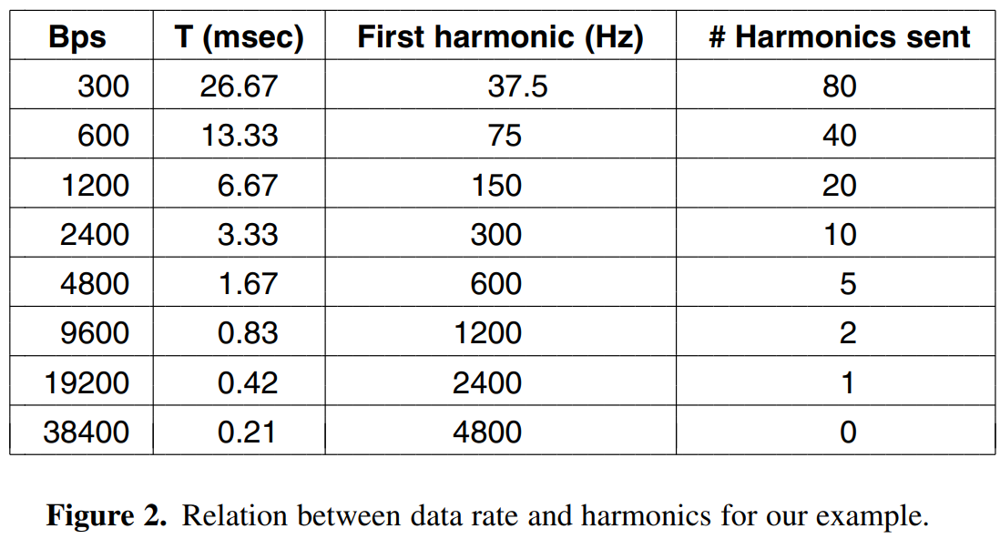

### 1.3 The Maximum Data Rate of a Channel
**SNR (Signal-to-Noise Ratio)**:
> The amount of thermal noise present is measured by the ratio of the signal power to the noise power

If we denote the signal power by $S$ and the noise power by $N$, the signal-to-noise ratio is $S/N$.

正常来说，这个数字因为过于庞大，所以我们会转换一下 成为**decibels (dB)**:
> $10\log_{10} S/N$
>
> with ‘‘deci’’ meaning 10 and ‘‘bel’’ chosen to honor Alexander Graham Bell, who invented the telephone

引出两个理论：

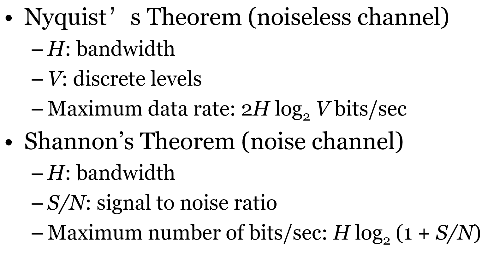

至于为什么不增大$V$，来无限增大Maximum data rate：现实中的最大电压是有限的，离散度增加，会导致每个类别的信号的电压范围减少。而现实中还存在失真之类的事情。反正假如不存在噪声的话，那增加离散度确实可以提高传输速率

!!! warning
    1.2 讲的应该是针对某一个信号而言的限制 (频率的范围限制)，而 1.3 讲的是针对整个 channel 而言的限制 (电压有上限)

## 2. Guided Transmission Media
### 2.2 Twisted Pairs
> A **twisted pair** consists of two insulated copper wires, which are twisted together in a helical form, just like a DNA molecule.

至于说为什么要这种方式缠绕一起，因为扭在一起可以消除两个线之间的辐射

一般来说，我们会使用==difference in voltage between the two wires==来传输信号，因为外界噪声想要干扰的话会同时干扰两个

这玩意一般用在电话系统，既可以传输模拟信号也可以数字信号

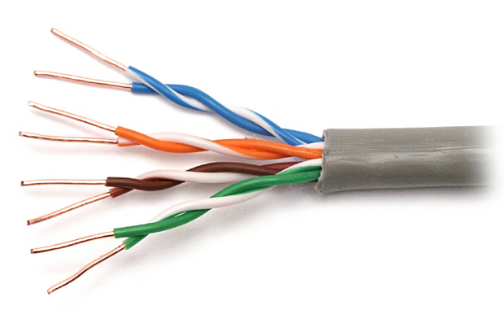

上图这种称作**Category 5**，有四个twisted pair放在一起

直到Category 6，这些标准的线都属于**UTP (Unshielded Twisted Pair)**，因为直到Category 7才加入了twisted pairs和整个cable之上的shielding，可以减少外界干扰，并且达到更高的性能

### 2.3 Coaxial Cable
同轴电缆

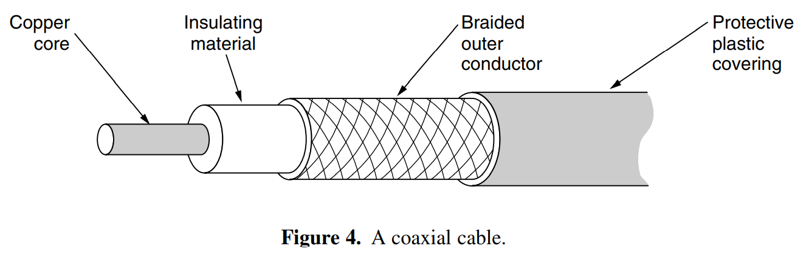

看结构就可以看出，这家伙相比twisted pair的优势是：
> It has better shielding and greater bandwidth than unshielded twisted pairs, so it can span longer distances at higher speeds

有两种不同的coaxial cable:
- **50-ohm cable**

    commonly used when it is intended for digital transmission from the start
- **75-ohm cable**

    commonly used for analog transmission and cable television

    早期的internet也是通过它传输数据的（和电视绑定）

### 2.5 Fiber Optics
Fiber optics are used for long-haul transmission in network backbones, high-speed LANs, and high-speed Internet access

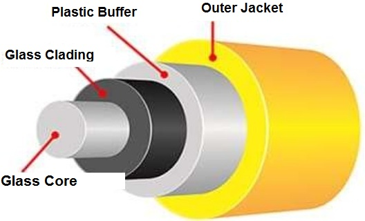

中间是玻璃做的，利用全反射

An optical transmission system has three key components:
- the light source
- the transmission medium
- the detector

众所周知，只要大于critical angle，就可以全反射。这也意味着可能会有很多种不同入射角度的光可以传输，这种叫做**multimode fiber**

但是假如我们把光纤的直径减小到几个波长的大小的话，光就只能基本沿着直线传播，这就成了**single-mode fiber**。这东西成本要高很多

## 5. Digital Modulation and Multiplexing
### 5.2 Passband Transmission
Digital data to analog signal:
- **Amplitude-shift keying (ASK)**

    two different amplitudes are used to represent 0 and 1
- **Frequency-shift keying (FSK)**

    two or more different tones are used
- **Phase-shift keying (PSK)**

    the carrier wave is systematically shifted 0 or 180 degrees at each symbol period.
    
    上描述的只是binary的情况，Quadrature的情况就是每次改变90度

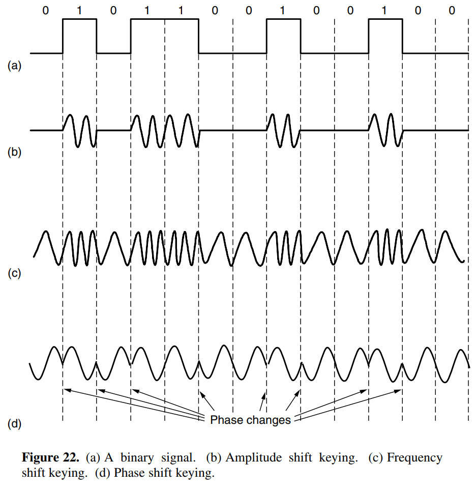

---

我们可以使用**constellation diagram**来描述相位和强度的组合：

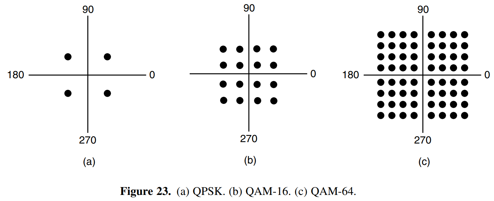

QAM-64 (Quadrature Amplitude Modulation正交幅度调制-64) allows 64 different combinations, so 6 bits can be transmitted per symbol ($\because 2^6=64$)

The number of samples/symbols per second is measured in **baud**.

In **quadrature phase-shift keying** (QPSK四相/正交相移键控), the four angles, usually out of phase by 90°, are used to transmit 2 bits/symbol. The bit rate is twice the baud rate.

## 6. The Public Switched Telephone Network
> The **PSTN (Public Switched Telephone Network)** is the world's collection of interconnected voice-oriented public telephone networks. It's also referred to as the **POTS (Plain Old Telephone Service)**. 

### 6.1 Structure of the Telephone System
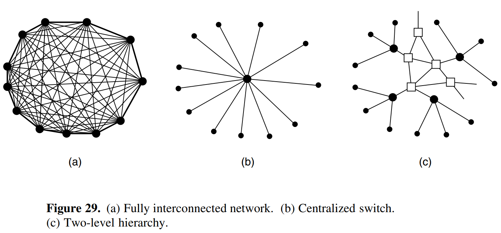

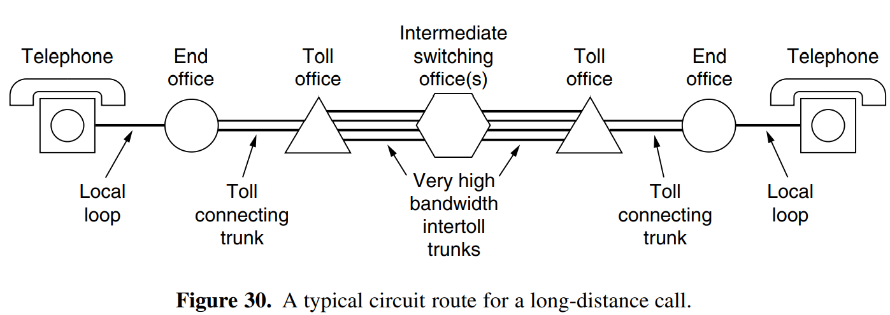

In summary, the telephone system consists of three major components:
- **Local loops** 

    > analog twisted pairs going to houses and businesses

- **Trunks**

    digital fiber optic links connecting the switching offices
- **Switching offices**

    where calls are moved from one trunk to another

### 6.3 The Local Loop: Modems, ADSL, and Fiber
Transmission lines suffer from three major problems:
- Attenuation
- Delay distortion
- Noise

The square waves used in digital signals have a wide frequency spectrum (usually, high frequency) and thus are subject to strong attenuation and delay distortion. 

#### Telephone Modems
> A device that converts between a stream of digital bits and an analog signal that represents the bits is called a **modem**, which is short for ‘‘**mo**dulator **dem**odulator.’’

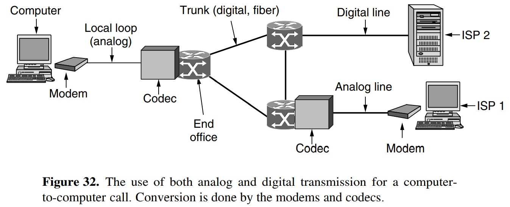

The modulation is introduced to solve this problem.
- Amplitude: two different amplitudes are used to represent 0 and 1.
- Frequency: different tones are used.
- Phase: the wave is systematically shifted (45, 135, 225, or 315º). 

A **modem** (modulator-demodulator) is a device that modulates outgoing digital signals to analog signals. 

### 6.4 Trunks and Multiplexing
Two categories of multiplexing schemes are used to multiplex many conversations over a single physical trunk:
- In **FDM (Frequency Division multiplexing)**, the frequency spectrum is divided into frequency bands. For fiber optic channels, **WDM (Wavelength Division Multiplexing)** is used.
- In **TDM (Time Division Multiplexing)**, the entire bandwidth is used for a chunk of time period. 

#### FDM
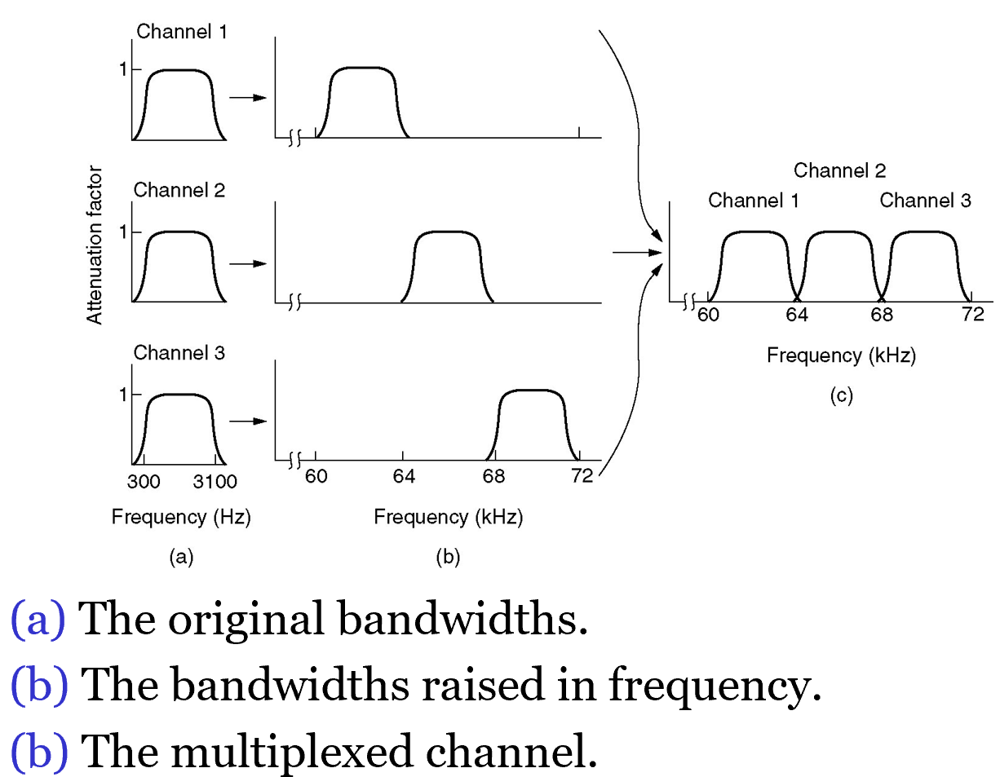

#### WDM
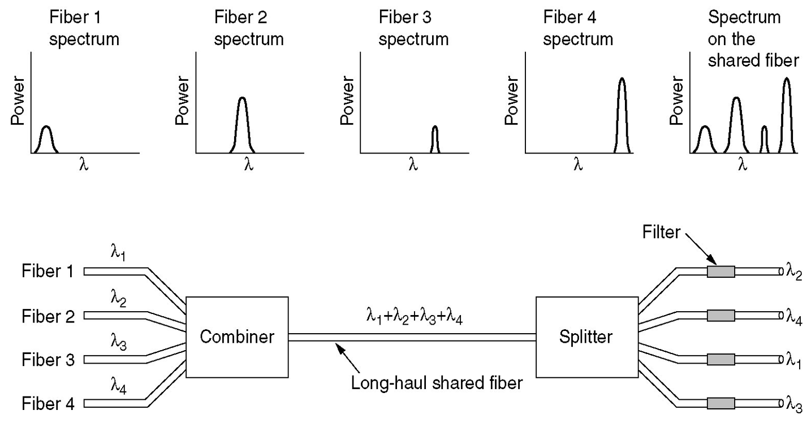

#### TDM
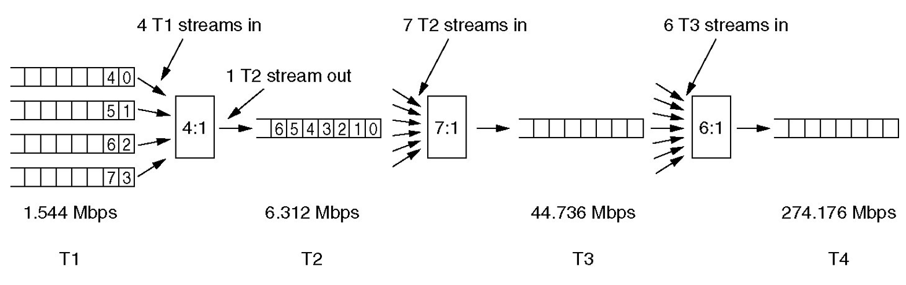

就是大家轮流来用所有的带宽

### 6.5 Switching
#### Circuit Switching
> seek out a ==physical path== from sender to receiver. An end-to-end path must be (conceptually) established before data is sent

#### Message Switching
> no path is established in advance. The message is ==stored== in the first switching office and forwarded later one hop at a time

- Example: store-and-forward network
- Problem: No restriction of block size

#### Packet Switching
> place a restriction on block size, to allow packets to be buffered in main memory at the switching office.

改进版本的Message Switching

Advantages:
- Well-suited for interactive traffic
- Improved response time and throughput

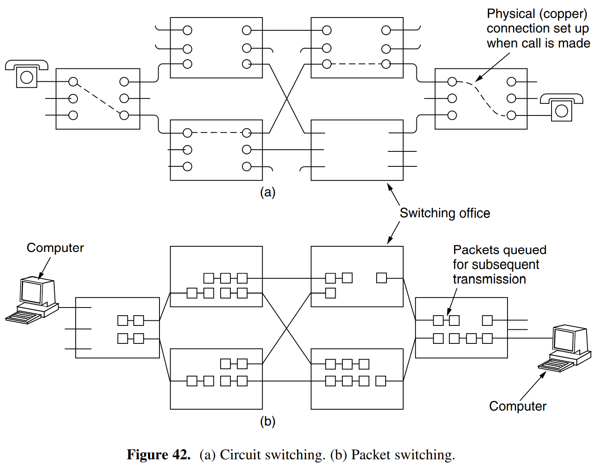

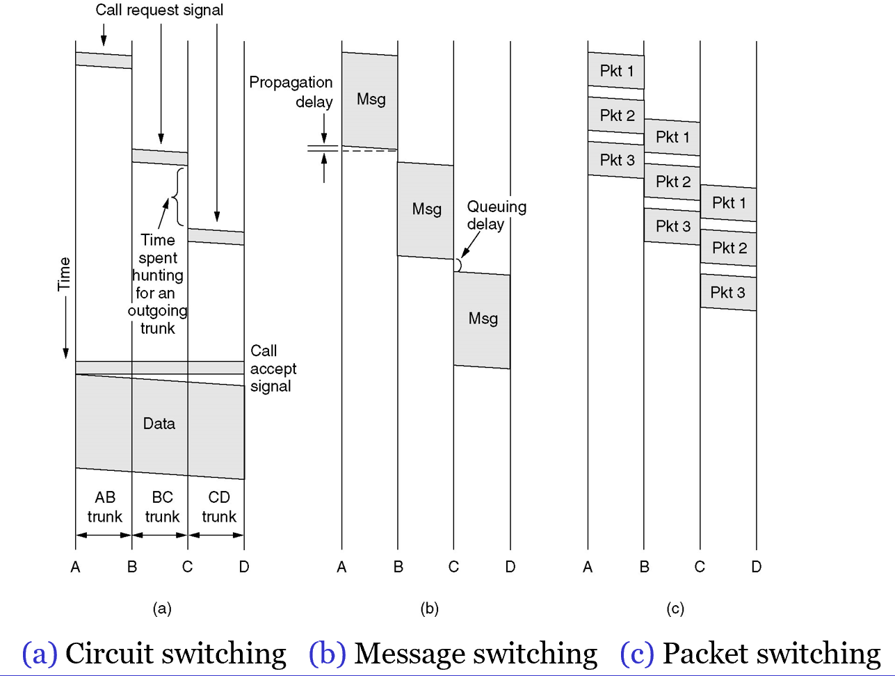

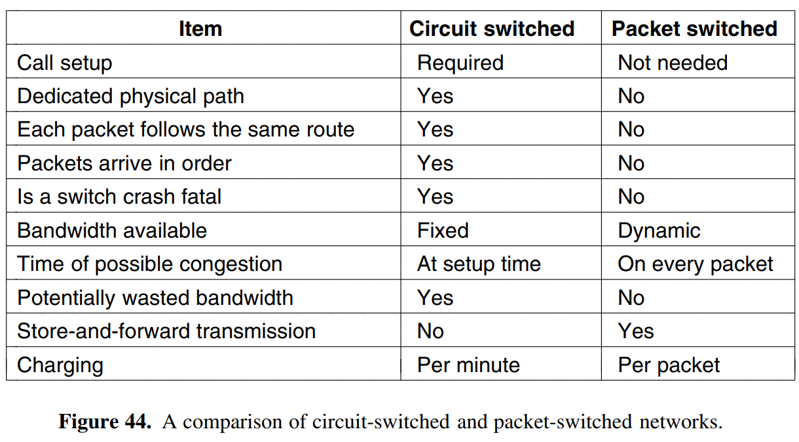

## 7. The Mobile Telephone System
总之人们显然不满足于固定位置的网络

### 7.1 First-Generation (1G) Mobile Phones: Analog Voice

最原始的通信当属呼叫机类似的 **push-to-talk system** ，因为sending and receiving用的是同一个频道

**IMTS** (Improved Mobile Telephone System)则是单纯分开了发送和接受的频道

#### Advanced Mobile Phone System (AMPS)
把一个区域划分成了许多小的**cell**，相邻的cell之间的频率不相同，但是不相邻的可以重复使用相同的频率：

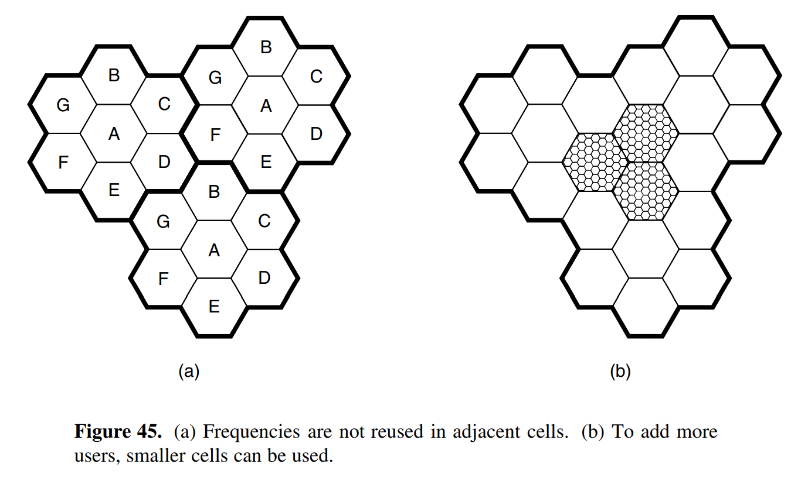

在使用人数增多后，还可以通过继续分隔每个单元格

每个单元格的圆心位置，都存在着一个**base station**

在一个小的信号网络里，所有base station都会连接到一个叫做**MSC** (Mobile Switching Center) or **MTSO** (Mobile Telephone Switching Office)，大的网络可能需要几个这样的设备，并且拥有层级结构

在不同的网格之间走动时，频道会进行切换，这个过程叫做**handoff**

### 7.2 Second-Generation (2G) Mobile Phones: Digital Voice
1G是analog，2G则是digital。这样有很多优势：

- It provides capacity gains by allowing voice signals to be digitized and compressed.
- It improves security by allowing voice and control signals to be encrypted. This in turn deters fraud and eavesdropping, whether from intentional scanning or echoes of other calls due to RF propagation.
- Finally, it enables new services such as text messaging

**DAMPS** (Digital Advanced Mobile Telephone System)是AMPS的digital version，不过后来被**GMS**取代了

懒得介绍了似乎考不了

### 7.3 Third-Generation (3G) Mobile Phones: Digital Voice and Data
能传输的东西变成了 digital voice and data

最重要的东西就是这个**CDMA** (Code Division Multiple Access)，考试会考！

和其他的通信方式比较的话：
- TDMA: take turns speaking
- FDMA: people in widely separated clumps, each clump holding its own conversation
- CDMA: all talking at once, but with each pair in a different language

反正CDMA能够从信号中提取出想要的，而忽略其他

In CDMA, each bit time is subdivided into m short intervals called chips. Typically, there are 64 or 128 chips per bit.

Each station is assigned a unique m-bit code called a **chip** sequence. ==To transmit a 1 bit, it sends its chip sequence. To transmit a 0 bit, it sends the 1’s complement of its chip sequence.==

这些个station的unique code之间是==相互垂直==的，所以两个向量的点乘的结果必定是0

根据相互垂直的特性，我们就可以放任不同的station发射的信号混杂在一起（相加），当我们想知道某个频道发射的信号到底是什么的时候，只需要我们==乘该station的unique code==，其它频道的信号全部都会被忽略

具体的计算解释可以看 [wiki](https://en.wikipedia.org/wiki/Code-division_multiple_access) 的例子，非常明了

