## 1. DLL Design Issues
DLL有很多功能，包括：
- Providing a well-defined service interface to the network layer.
- Dealing with transmission errors.
- Regulating the flow of data so that slow receivers are not swamped by fast senders.

为了达成这些目标，DLL会把packet进行封装：

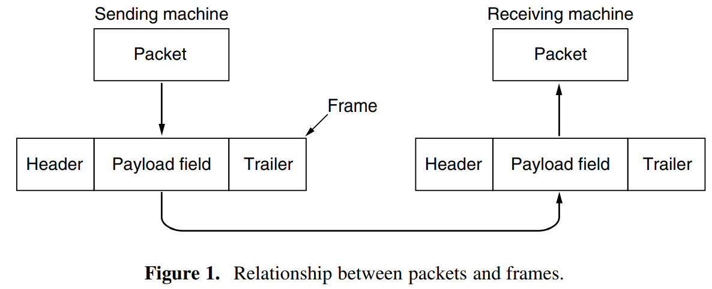

### 1.1 Services Provided to the Network Layer
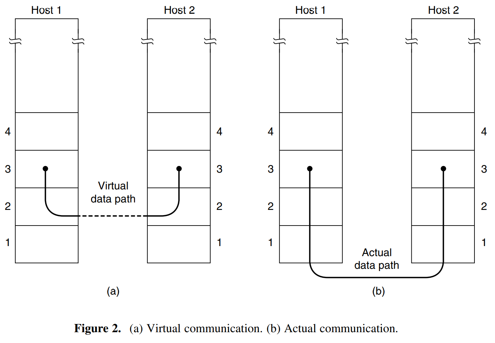

我们考虑三种服务：
- **Unacknowledged connectionless service**

    The source machine send independent frames to the destination machine, and there is ==no acknowledgement== from the destination machine.

    ==No logical connection== is established beforehand or released afterward.

    The DLL will ==make no attempt to detect the loss of or recover a lost frame==.

    This service is useful for ==low error rate== networks and for real-time traffic where ==late data is worse than no data==.


- **Acknowledged connectionless service**

    The receiver ==acknowledges== the arrival of each frame.

    > If it hasn’t arrived correctly (or within a specified time interval), it can be resent.

    This is a useful service when the connection is unreliable (such as wireless systems)

    There is no requirement for such an acknowledgement service to be implemented by the data link layer
- **Acknowledged connection-oriented service**

    A connection is established between the two machines, and the frames are then transmitted.

    Each frame sent over the connection is numbered and each frame is acknowledged.

    The frames are guaranteed to arrive only once and in order.

    The connection is released once the communication is complete.

    This is the same as a “reliable” bit stream.

### 1.2 Framing
虽然physical layer提供的是raw string，但是我们还是需要把这些数据进行分隔，因为这样方便进行error checking
> The usual approach is for the data link layer to break up the bit stream into discrete frames, compute a short token called a **checksum** for each frame, and include the checksum in the frame when it is transmitted. When a frame arrives at the destination, the checksum is recomputed

把stream拆分成frame其实并不容易，我们讨论四种方法：
#### Byte count
Uses a field in the header to specify the number of characters in the frame:

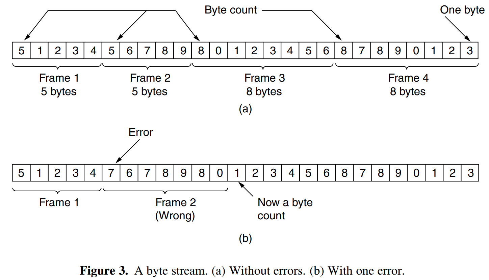

这方法的问题是，假如那个表示长度的数字发生了error，那就寄了
#### Flag bytes with byte stuffing
> Often the same byte, called a **flag byte**, is used as both the starting and ending delimiter

显然flag byte也可能出现在数据流的里面，这时候就需要**escape byte** (ESC)来标注出来

显然escape byte也可能出现在数据流的中间，所以再在前面加一个escape byte

上面的escape的做法叫做**byte stuffing**

#### Flag bits with bit stuffing
上面的方法还是不够好，因为数据只能以byte为单位传输

Allows data frames to contain an arbitrary number of bits and allows character codes with an arbitrary number of bits per character.

Each frame begins and ends with a special bit pattern, **01111110** (in fact, a flag byte). 

Whenever the sender's data link layer encounters five consecutive 1s in the data, it automatically stuffs a 0 bit into the outgoing bit stream.

With bit stuffing, the boundary between two frames can be unambiguously recognized by the flag pattern. 

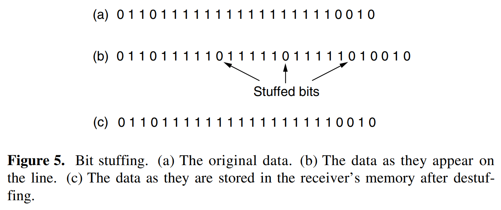

#### Physical layer coding violations
Only applicable to networks in which the encoding on the physical medium contains some ==redundancy==. 

For example, some LANs encode 1 bit of data by using 2 physical bits. Normally, a 1 bit is a high-low pair and a 0 bit is a low-high pair. 

Most DLL protocols use a combination of character count with another method for extra safety. This increases the chances of catching an error.

### 1.3 Error Control

focus on how to make sure all frames are eventually delivered to the network layer at the destination and in the proper order

the protocol calls for the receiver to send back special control frames bearing positive or negative ==acknowledgements== about the incoming frames.

A timeout can occur if the acknowledgement doesn’t arrive, resulting in the frame being resent. ==Timeout interval==

假如我们重新发，那么接收方就可能收到两个相同的包，可以用==sequence number==来区别

所以，综上所述，我们的任务是:
> Managing the timers and sequence numbers 

### 1.4 Flow Control
假如发送信息的人发送的速率比接受信息的人的接受速率还要高，就需要我们处理一下了

有两种办法来解决：
- **feedback-based flow control**

    feedback is used to tell the sender how the receiver is doing or to send another frame
- **rate-based flow control**

    the transfer rate is fixed by the sender

    实际上DLL从来不会用这种方法


## 2. Error Detection and Correction
Types of error:
- **errors comes in bursts**

    一连串的数据流里，至少第一位和最后一位出错了

    相比之下更难纠正
- **independent single-bit errors**

e.g.

block size is 1000 bits, so error rate is 0.001 per bit

处理error有两种不同的策略：
- **error-correcting codes**

    > include enough redundant information to enable the receiver to deduce what the transmitted data must have been

    使用这种玩意一般被称作**FEC (Forward Error Correction)**

    特点：
    - The ==overhead== is high but it reduces the need to resend frames.
    - best suited for networks with ==high error== (wireless).

- **error-detecting codes**

    > include only enough redundancy to allow the receiver to deduce that an error has occurred (but not which error) and have it request a retransmission

    特点：
    - suite for ==highly reliable== channel, such as fiber
    - just ==retransmit== when errors are found


### 2.1 Error-Correcting Codes
书上介绍了4种不同的，我们这里只介绍**Hamming Code**

见[这里](../../y2-spring/computer-organization/ch5-internal-memory.md#52-error-correction)

这次还多了个概念：

Hamming distance
: The number of bit positions in which two codewords differ

两个codeword到底有几位不一样。这个概念的重要之处在于，假如两个codeword的Hamming distance是$d$的话，那么就意味着他们==需要$d$位错误才能从一个codeword变成另一个==

这也意味着：
- 假如需要检测$d$位错误，我们需要Hamming distance至少为$d+1$

    保证$d$为半径的圆里面，除了圆心以外都是错误的，不会包含其它正确的点
- 假如需要纠正$d$位错误，我们需要Hamming distance至少为$2d+1$

    两个codeword以$d$为半径的圆没有相交，这样的话就可以知道离目前的错误结果最近的那个codeword是原来的正确答案

### 2.2 Error-Detecting Codes 
在有线连接等错误率低很多的情况下，用error-detecting code比correcting高效很多

书上介绍三种不同的code:
#### 2.2.1 Parity

> a single **parity bit** is appended to the data. The parity bit is chosen so that the number of 1 bits in the codeword is even (or odd)

even parity就是末尾塞个0，odd parity就是1

奇偶校验意味着，假设只发生==一位==的错误的话，就可以通过检查收到的序列的1的个数的奇偶来判断

通过一些小技巧，我们可以use $n$ parity bits on blocks of $kn$ data bits to detect ==a single burst error== of length $n$ or less:
- **interleaving**

    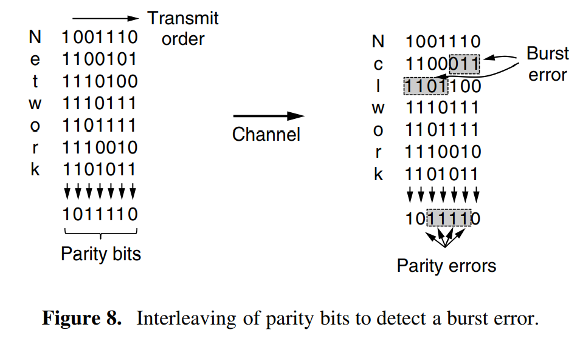

    如图所示，虽然我们传输的时候还是一行一行、每一行从左到右传输，但是我们计算parity bits的方向是==一列一列==求

    假如如图中所示，发生了$n=7$的burst error（只是代表7位里的头、尾两个bit一定是错的，并不代表所有bit都错了），恰好小于check bits的长度7，我们就可以检测出来发生burst error了


#### 2.2.2 Checksums

> The word ‘‘**checksum**’’ is often used to mean a group of check bits associated with a message, regardless of how are calculated

常见的可以是a group of parity bits
#### 2.2.3 Cyclic Redundancy Checks (CRCs)

也叫做**polynomial code**:
> **Polynomial codes** are based upon treating bit strings as representations of polynomials with coefficients of 0 and 1 only
>
> e.g.
> 
> $$110001\rightarrow1x^5+1x^4+0x^3+0x^2+0x^1+1x^0$$

大体上的思路是，发射方需要保证发射出去的信息能够被某个多项式整除，接收方则只需要检查一下收到的多项式是不是也能够被该多项式整除。能的话则没有发生错误

在讲到具体的做法之前还需要一点预备知识：

- 多项式的加减法

    计算的时候加减法都是==不需要进位或者退位==啥的，两者的计算结果甚至是==相同的==，都等于XOR的结果
- 多项式的除法

    除法的过程其实一样，只不过需要涉及到相减的时候，则是注意要使用多项式的减法法则

现在可以来说明具体流程了

- the sender and receiver must agree upon a **generator polynomial**, $G(x)$, in advance

    需要注意的是，这个generator的最高位和最低为都必须为1
- The idea is to append a CRC to the end of the frame in such a way that the polynomial represented by the checksummed frame is ==divisible by $G(x)$==

    需要在末尾添加一些个称为CRC的特殊bit，使得我们想要传输的数据变得可以被$G(x)$整除

    至于这些个CRC怎么计算出来：
    - Let $r$ be the degree of $G(x)$. Append $r$ zero bits to the low-order end of the frame so it now contains $m + r$ bits and corresponds to the polynomial $x^rM(x)$.
    - Divide the bit string corresponding to $G(x)$ into the bit string corresponding to $x^rM(x)$, using modulo 2 division.
    - Subtract the remainder (which is always $r$ or fewer bits) from the bit string corresponding to $x^rM(x)$ using modulo 2 subtraction. The result is the checksummed frame to be transmitted. Call its polynomial
    $T(x)$.

    !!! warning
        append 的时候 0 的个数并非是 generator 的位数！而是 generator 的 degree (位数减一)

    也就是如下图所示的过程：

    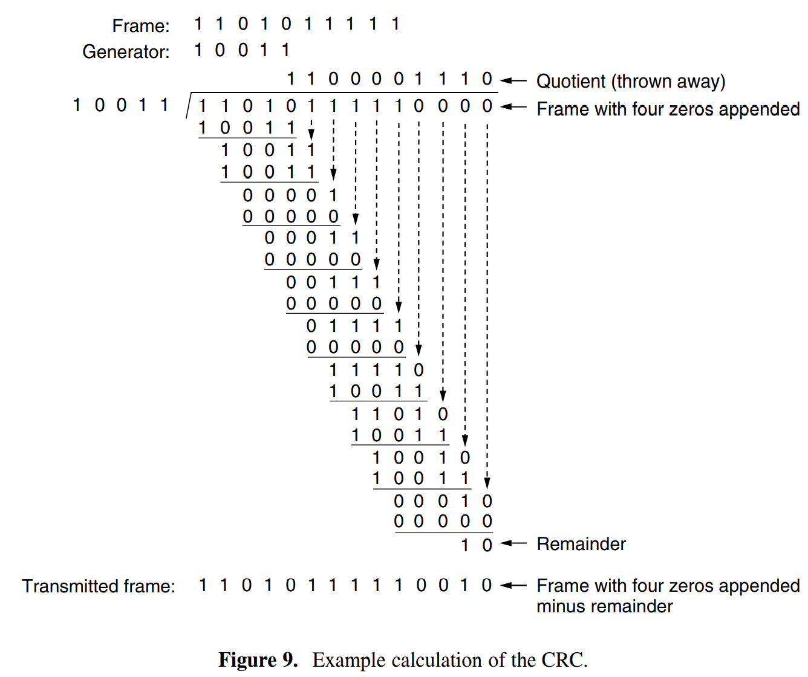


## 3. Elementary Data Link Protocols
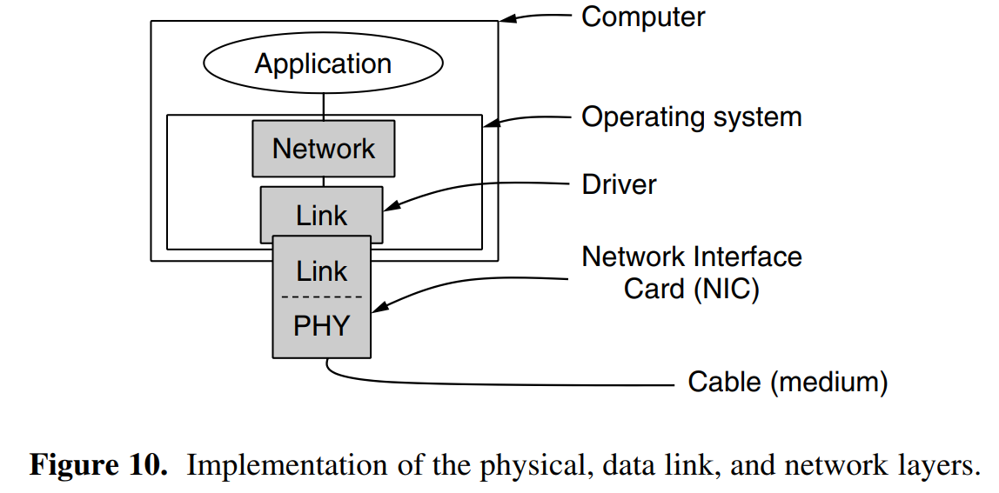

我们大致的结构就是这样分层的

讨论之前，我们先做出一些假设：
- The physical layer, data link layer, and network layer are ==independent== processes. 		
- Machine A wants to send a long stream of data to machine B, using a ==reliable, connection-oriented== service.
- A's data link layer asks for data, the network layer is ==always able== to comply immediately.
- These protocols deal with communication ==errors, but not the problems caused by computers== crashing and rebooting.
- As far as the data link layer is concerned, the packet passed across the interface to it from the network layer is ==pure data==.

通用的protocol结构：

```cpp{.line-numbers}
#define MAX_PKT 1024 /* determines packet size in bytes */
typedef enum {false, true} boolean; /* boolean type */
typedef unsigned int seq_nr; /* sequence or ack numbers */
typedef struct {unsigned char data[MAX_PKT];} packet; /* packet definition */
typedef enum {data, ack, nak} frame_kind; /* frame_kind definition */

typedef struct { /* frames are transported in this layer */
    frame_kind kind; /* what kind of frame is it? */
    seq_nr seq; /* sequence number */
    seq_nr ack; /* acknowledgement number */
    packet info; /* the network layer packet */
} frame;
/* Wait for an event to happen; return its type in event. */
void wait_for_event(event_type *event);
/* Fetch a packet from the network layer for transmission on the channel. */
void from_network_layer(packet *p);
/* Deliver information from an inbound frame to the network layer. */
void to_network_layer(packet *p);
/* Go get an inbound frame from the physical layer and copy it to r. */
void from_physical_layer(frame *r);
/* Pass the frame to the physical layer for transmission. */
void to_physical_layer(frame *s);
/* Start the clock running and enable the timeout event. */
void start_timer(seq_nr k);
/* Stop the clock and disable the timeout event. */
void stop_timer(seq_nr k);
/* Start an auxiliary timer and enable the ack_timeout event. */
void start_ack_timer(void);
/* Stop the auxiliary timer and disable the ack_timeout event. */
void stop_ack_timer(void);
/* Allow the network layer to cause a network_layer_ready event. */
void enable_network_layer(void);
/* Forbid the network layer from causing a network_layer_ready event. */
void disable_network_layer(void);
/* Macro inc is expanded in-line: increment k circularly. */
#define inc(k) if (k < MAX_SEQ) k=k+ 1; else k=0
```

我们接下来会介绍3个simplex (单工) protocols:
### 3.1 A Utopian Simplex Protocol
给定的假设非常理想化：
- Data are transmitted in one direction only
- Both the transmitting and receiving network layers are  always ready （随时待命）
- Processing time can be ignored （瞬间完成）
- Infinite buffer space is available （无限空间）
- The communication channel between the data link  layer never damages or loses of frames
- Both the sender and the  receiver are in an infinite while loop(无限的while循环)


```cpp{.line-numbers}
typedef enum {frame arrival} event type;
#include "protocol.h"

void sender1(void)
{
    frame s; /*buffer for an outbound frame */
    packet buffer; /*buffer for an outbound packet*/
    while (true) {
        from_network_layer(&buffer); /*go get something to send */
        s.info = buffer; /*copy it into s for transmission */
        to_physical_layer(&s); /*send it on its way*/
    }
}

void receiver1(void)
{
    frame r;
    event type event; /*filled in by wait, but not used here */

    while (true) {
        wait_for_event(&event); /*only possibility is frame arrival*/
        from_physical_layer(&r); /*go get the inbound frame */
        to_network_layer(&r.info); /*pass the data to the network layer*/
    }
}
```
循环里会干的事情就非常无脑

### 3.2 A Simplex Stop-and-Wait Protocol for an Error-Free Channel
这次我们不把receiver搞得太理想化，改成有限的能力：
> the receiver has only a ==finite== buffer capacity and a ==finite== processing speed.

需要注意我们依旧还是假设channel是error free的

那么针对这个假设，我们怎么防止receiver收到一大堆处理不过来的frame呢？
- simply insert a delay into protocol 1

    显然很浪费时间
- the receiver provide ==feedback== to the sender

    stop-and-wait
    : Protocols in which the sender sends one frame and then waits for an ==acknowledgement== edgement before proceeding are called **stop-and-wait** 

所以和上一个protocol相比，我们仅仅是让receiver多干了一件事：发送个acknowledgement回来

虽然会发送acknowledgement从receiver到sender，但是还是算simplex，因为数据流还是单向从sender到receiver的，acknowledgement只是个空的frame

这也意味着channel必须有能力支持双向通信，half-duplex（半双工） physical channel就够了

### 3.3 A Simplex Stop-and-Wait Protocol for a Noisy Channel
现在开始考虑存在噪音，也就是错误的情况了

其中一种方法，我们可以在前一种protocol的基础上再加上一个**timer**:
- The sender starts a timer after sending a frame. 
- The receiver sends back an acknowledgement only when the incoming frame were correctly received. 
- The sender will retransmit the frame if the timer expired before 

假如只这么做的话，问题也是很明显的：

因为channel是存在error的，所以从receiver发送给sender的acknowledgement也是可能丢失的！

假如acknowledgement丢失了，sender就会以为对方没有收到，于是又会发一份==重复==的。那么问题就出现了，receiver怎么知道收到的frame是不是重复发送的呢？

解决方法就是frame的头部加个**sequence number**，而且只需要**1 bit**就可以了（区分是否是重发）

这种protocol叫做:

ARQ/PAR
: Protocols in which the sender waits for a positive acknowledgement before advancing to the next data item are often called **ARQ (Automatic Repeat reQuest)** or **PAR (Positive Acknowledgement with Retransmission)**


## 4. Sliding Window Protocols
为了提高传输效率：
- **full-duplex**

    "全双工", data双向传输
- **piggybacking**

    : The technique of temporarily delaying outgoing acknowledgements so that they can be hooked onto the next outgoing data frame is known as **piggybacking**

    "捎带确认", 让acknowledgement搭便车回来

    至于允许等多久：

    > An ad hoc scheme: waiting a fixed number of milliseconds. （ACK-TIMER）
- **sliding window**

    "滑动窗口"

    几种不同的protocol
    - n=1——basic idea of sliding window
    - Go Back n （回退n帧）
    - Select Repeat （选择性重传）

---

关于sliding window的解释：

A **sequence number** is associated with each transmitted frame. Sequence numbers range from $0$ up to some maximum ($2^n - 1$) ==circularly==. 

window
: A **window** is a list of sequence numbers. 

sending window
: The sender maintains a **sending window** with sequence numbers corresponding to frames that ==have been sent but are as yet not acknowledged, or can be sent==.  
- Whenever a new packet arrives from the network layer, it is given the ==next highest sequence number==, and the ==upper edge is advanced by one==.        
- When an ==acknowledgement== comes in, the lower edge is advanced by one. 

receiving window
: The receiver maintains a **receiving window** with sequence numbers corresponding to frames it is ==permitted to accept==. 
- When a frame whose ==sequence number is equal to the lower edge== of the window is received, it is passed to the network layer, an acknowledgement is generated, and the ==window is rotated by one==. 

e.g.

假设window的大小都是1：

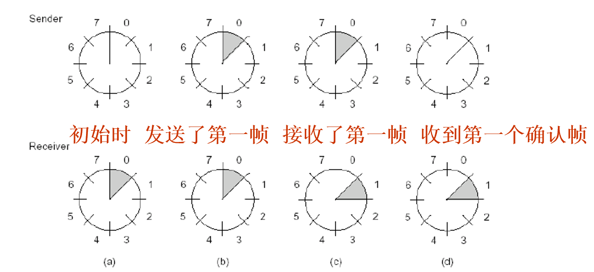

### 4.1 A One-Bit Sliding Window Protocol
其实上面举的这个例子就是one-bit

接下来将用另一种图来描述这个信息交换的过程：

---

正常情况：

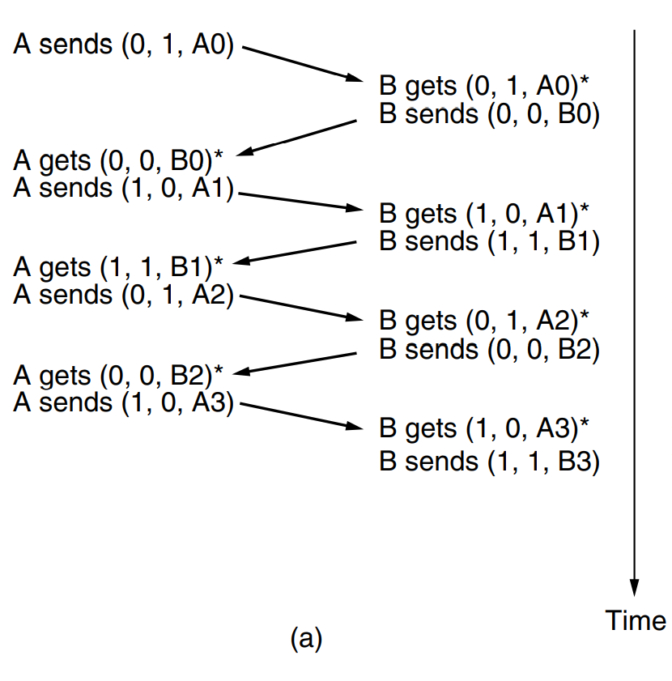

其中格式是 `(seq, ack, packet number)` ，ack表示的是最近一个==accept==的frame的sequence number，`*`表示accept

假如B在开始发送自己的第一个frame之前，会等待到接收到A发送的第一个frame，那么就是上图非常正常的情况

---

异常情况：AB同时开始发送first frame

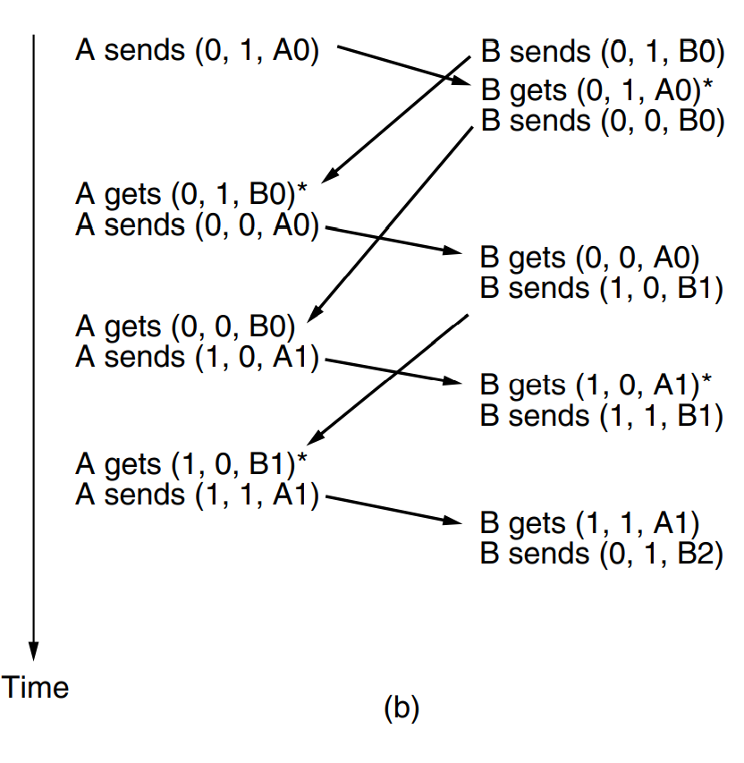

看着挺绕的，图中的三对交叉就是分别同时发送的

!!! note
    这里假设只要收到了frame，不管接不接受，都是要回复一个frame的！

这里的异常只是说，会发送重复的frame浪费带宽，实际还是能工作的

---

异常情况：timeout的时间设置得过于短

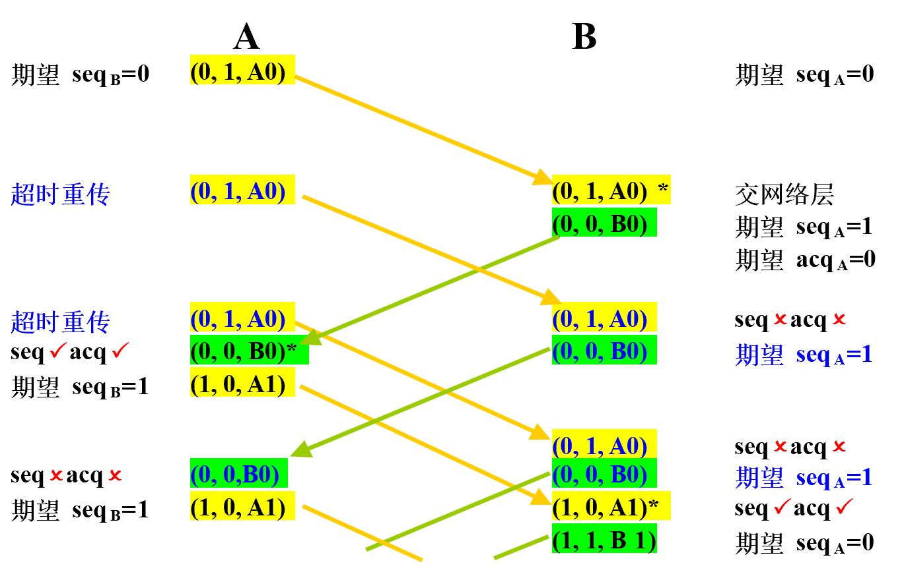

还算比较正常，只不过A这边发送重复frame过于频繁，B这边总是需要reject，一来一回浪费带宽

#### Line Utilization Rate
在前面的讨论中，我们实际上是忽略了一些时间的：
- 来回传输所需要花的时间
- receiver处理接收到的frame所需要花的时间

我们现在来看看考虑之后，效率究竟是怎么样的

**line utilization rate**
$$
\frac{w\cdot k/b}{(k/b+R)}
$$
其中：
- window size: $w$
- channel capacity: $b$ bps
- frame size: $k$ bits
- round-trip propagation time: $R$ sec

就是处理frame的时间在总时间中的占比

---

不难想象，当$R$大的离谱的时候，这个比值就会小得可怜，就像下图这样：

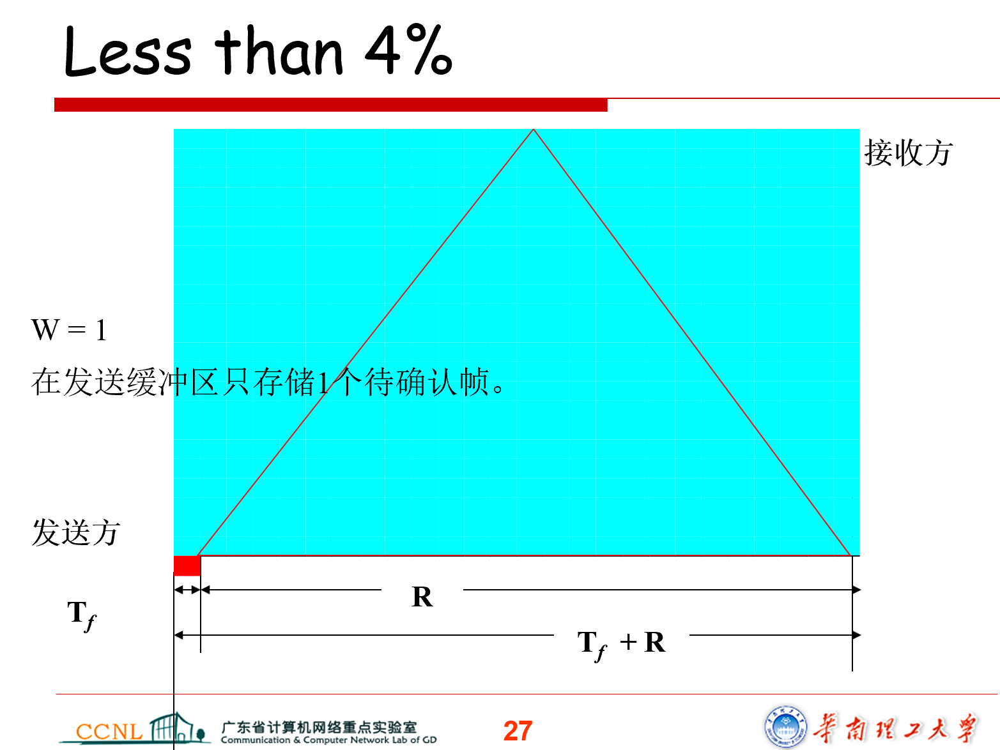

那怎么样增大这个比值呢？其中一种就是增大分子中的window size $w$的大小：

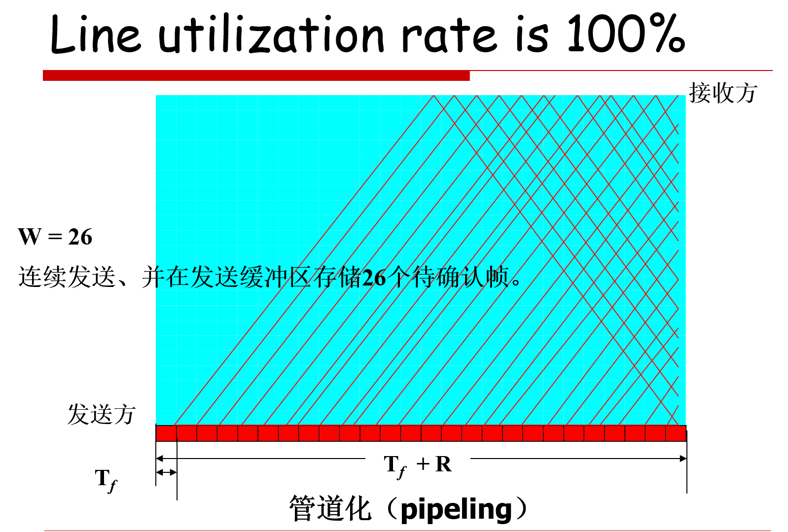

pipelining
: the technique of keeping multiple frames in flight

然而，假如我们这么一连串的frame，中间有一个损坏了咋办？这就需要接下来的两种方案go-back-n和selective repeat了

### 4.2 A Protocol Using Go-Back-N
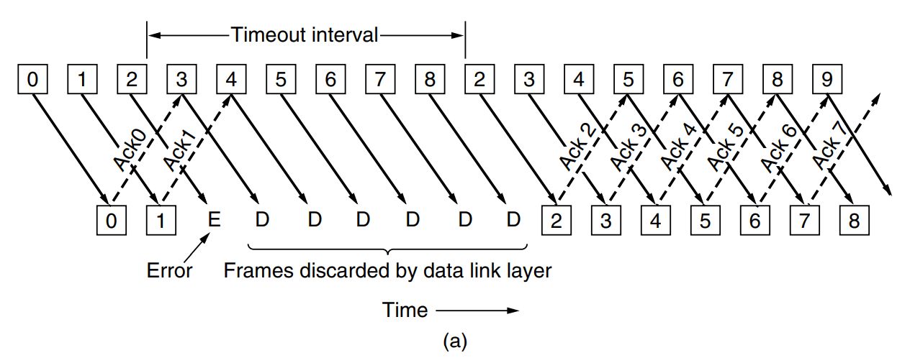

The receiver's ==window size is 1==, that is to say, the receiver only accepts frames ==in order==.

The receiver ==discards all frames following an error==, sending ==no acknowledgements==. 

After time out, the sender ==retransmits all unacknowledged frames in order==, starting with the damaged or lost one.

### 4.3 A Protocol Using Selective Repeat
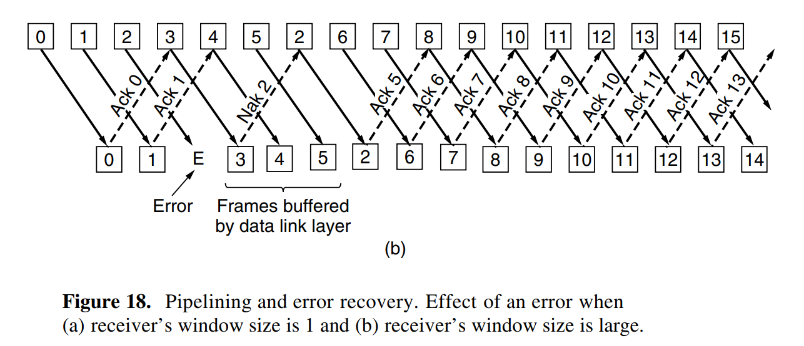

和前一种相比，我们这里只丢弃错误的那一个，缓存其后的，直到sender重传了那一帧过来后才一起交给network layer

!!! note
    发生错误之后，我们得到重传的帧后，只发送了Ack5，因为我们只需要发送序列里最后一个frame

---

这个方案一般还会再改进一下，加入**negative acknowledgement** (NAK) 的机制，一旦出现了错误，receiver就发个negative acknowledgement，立马让sender重发而不是等timeout

### 4.? Comparison
来比较下go-back-n和selective repeat

- **go-back-n**

    ==Sender== needs large buffer

    Repeat rate is large (waste bandwidth)，suit for ==low-error== rate environment

    MAX_SEQ = 7（ Seq=0～ MAX_SEQ ）

    W =  7

    ==W = MAX_SEQ (sending-window)==

    !!! note
        sequence number的总个数是MAX_SEQ + 1！别忘了0

假如W太大会发生啥呢：

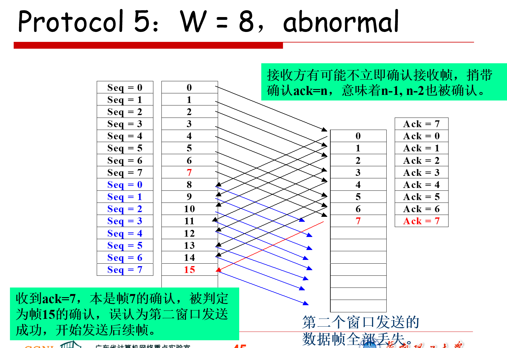

因为15号包和7号包的sequence number都是7，所以会误以为是15的确认

正常情况下：

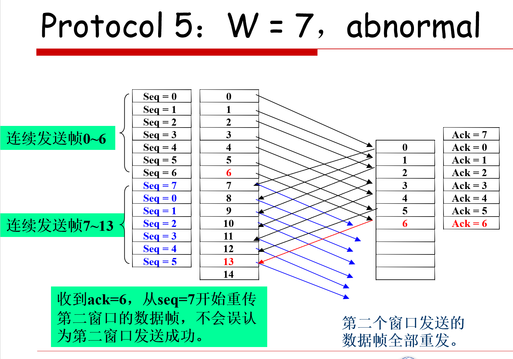

恰好错开，完美

- **selective repeat**

    ==Receiver== needs large buffer

    Repeat rate is small，suit for ==bad-quality== channel

    MAX_SEQ =7（ Seq=0～ MAX_SEQ ）

    W = 4 

    ==W= (MAX_SEQ + 1) / 2   (receiving-window)==

至于为什么要这么设计window size，主要是为了==确保新的window和旧的window的sequence number之间没有任何重复的==，这样就可以避免无法区分新的frame和重传的困境：

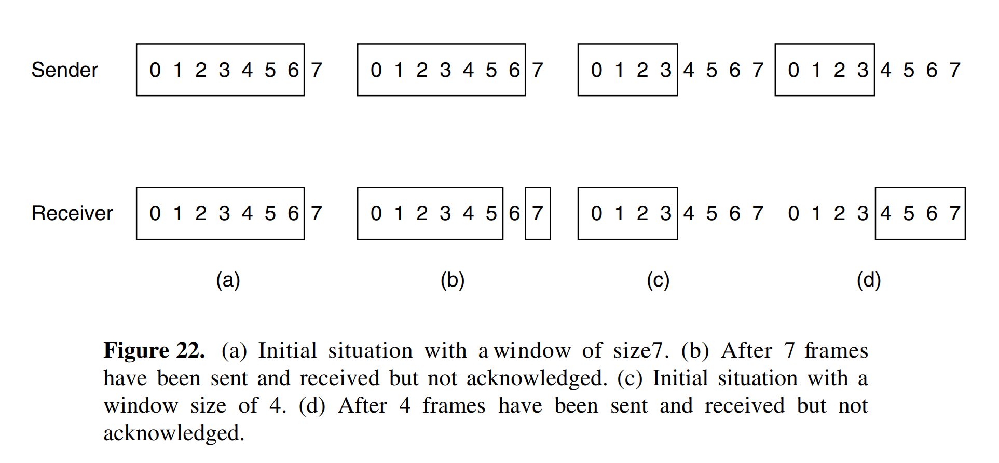

看c、d两个图，receiver的window向右滑动；a、b比较有迷惑性就别管了

