**M**edium **A**ccess **C**ontrol

网络连接被分成两类：
- **point-to-point connection**
- **broadcast channel**

这一章讲的是broadcast channel以及他们的protocols

---

> In any *broadcast network*, the key issue is how to determine ==who gets to use the channel== when there is competition for it.

In the literature, *broadcast channels* are sometimes referred to as **multiaccess channels** or **random access channels**

---

> The protocols used to ==determine who goes next== on a multiaccess channel belong to a sublayer of the data link layer called the **MAC (Medium Access Control)** sublayer

这层在模型中的位置：

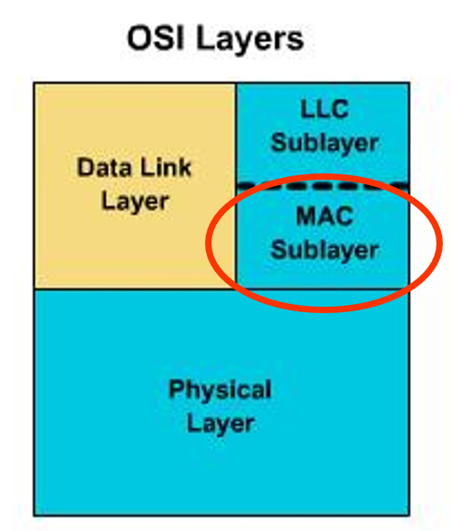

---

因为WAN除了卫星通信以外，都是point-to-point，而LAN里面无线通信天生就是broadcast，所以我们这章主要介绍LAN相关的

## 1. The Channel Allocation Problem
在决定谁来用channel这件事情上，有两种大的方向：static和dynamic:

### 1.1 Static Channel Allocation
这是传统方法。我们来看看他有啥缺点

我们会用 FDM (Frequency Division Multiplexing) 等方法，把capacity分割成$N$等分，分给$N$个用户

---

在用户数量少且固定的情况下（如FM收音机），这么做确实可行。但是一旦用户数量变化，且每个人的用量不同的时候，问题就大了

公式我就懒得抄了在P264，反正结论就是，分成$N$个不同的频道之后，延迟同时也高了$N$倍

### 1.2 Assumptions for Dynamic Channel Allocation
有5个key assumptions：
- **Independent Traffic**

    The model consists of $N$ ==independent stations== (also called "terminal". e.g., computers, telephones), each with a program or user that ==generates frames== for transmission.

    Once a frame has been generated, the station is ==blocked and does nothing== until the frame has been successfully transmitted.

- **Single Channel**

    A single channel is available for all communication. 
    
    The stations are assumed to be ==equally capable==, though protocols may assign them different roles (e.g., priorities).
- **Observable Collisions**

    collision
    : If two frames are transmitted simultaneously, they overlap in time and the resulting signal is garbled.

    All stations can ==detect collisions==
    
    A collided frame must be ==retransmitted== later.
    
    No errors other than collisions.

- **Continuous or Slotted Time**

    - **continuous time**

        frame transmission can begin at any instance
    - **slotted time**

        slots
        : time is divided into discrete intervals

        frame transmission must begin ==at the start of a slot==

        a slot may contain 0, 1, or more frames:
        - **0**

            idle slot
        - **1**

            successful transmission
        - **2+**

            collision occurs
- **Carrier Sense or No Carrier Sense**

    - **carrier sense** (载波监听)

        Stations ==can tell== if the channel is in use before sending

        If the channel is sensed as busy, no station will attempt to use it until it goes idle

    - **no carrier sense** (非载波监听)

        Stations ==do not sense== the channel before trying to use it

        They just go ahead and transmit. Only later can they determine whether the transmission was successful.

    一般来说LAN都是carrier sense

## 2. Multiple Access Protocols
compete using channel, maybe result in collision

### 2.1 ALOHA
接下来的两种ALOHA的区别在于：时间是否是连续的

Pure ALOHA 是连续的，而Slotted ALOHA是分段的

#### Pure ALOHA
> Let users transmit whenever they have data to be sent.

想发就发

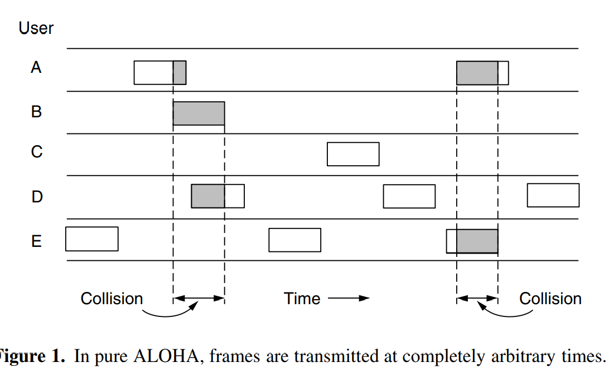

A sender can always find out whether or not its frame was destroyed by listening to the channel output .（假如发生了冲突的话，不同frame的bit之间会有重叠） 

If the frame was destroyed, the sender just waits a ==random== amount of time and sends it again.（重发）

有关line-utility的推导太复杂了就不记了

#### Slotted ALOHA
slot
: divide time into discrete intervals

each slot corresponds to ==one frame==. 

> A terminal (station) is not permitted to send whenever the user types a line. Instead, it is required to ==wait for the beginning of the next slot==

Collision can only be occurred at the very beginning of slot

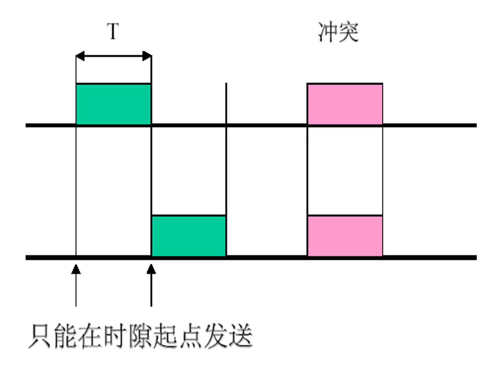

要么完全错开，要么开头重叠

---

来对比下两个ALOHA的吞吐量：

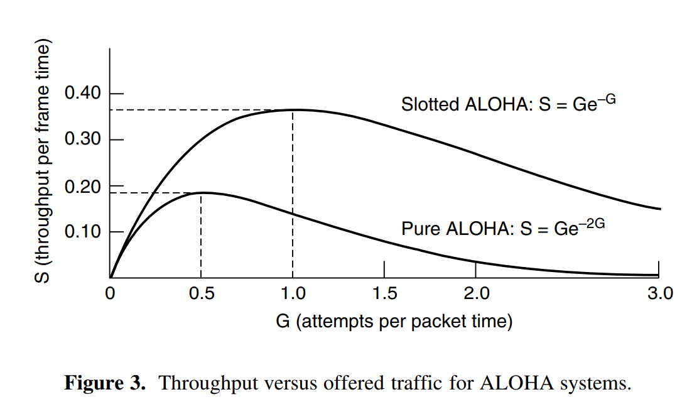

### 2.2 Carrier Sense Multiple Access Protocols

carrier sense protocols
: Protocols in which stations listen for a carrier (i.e., a transmission) and act accordingly

特征是"先听后发"，改进ALOHA里面collision概率过高的问题

#### 2.2.1 Persistent and Nonpersistent CSMA

##### Nonpersistent CSMA

A station sense channel, if no one else is sending, then it begin sending

If the channel is already in use, it doesn't sense it, instead, it ==waits a random time== and repeats the first step

- **Advantage**

    Waiting for a random time can reduce the probability of collision
- **Disadvantage**

    longer delay (random time, maybe no data is transmitted)

##### Persistent CSMA (1-persistent)

A station sense channel, if no one else is sending, then it begin sending

If channel is busy, the station waits and ==sense it continually==, once the channel becomes idle, it begin transmitting

If collision is occurred, waits a random time and repeats the first step

- **Advantage**

    shorter delay than non-persistent
- **Disadvantage**

    if two or more stations are waiting at the same time, once the channel becomes idle, the ==collision is unavoidable==

##### P-persistent CSMA

A station sense channel, if no one else is sending, then it ==transmits with probability p==, and delay one unit-time to transmit with probability (1–p) 

If channel is busy, the station waits and sense it continually, once the channel becomes idle, repeats the first step。

If a station has delayed its transmission 1 unit time, repeat the first step

可以看到，1-persistent 就是 p=1 的特殊情况

##### Problem: Propagation delay

除了多个station在等待channel这个问题外，还有传输延迟的问题

> There is a chance that just after a station begins sending, another station will become ready to send and sense the channel. If ==the first station’s signal has not yet reached the second one==, the latter will sense an idle channel and will also begin sending, resulting in a collision

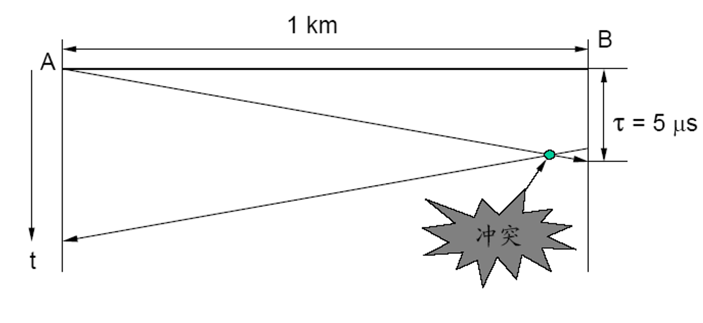

---

接下来我们来计算一下collision window (所以到底什么是collision window???)

Assume：signal’s propagation speed $v$ is about: $v = 200m /\mu s$，NIC delay is $t_{\text{PHY} }$，(似乎station之间的距离是$S$？)then：
$$
t= S/v，
$$
**Collision window** (slot time): 
$$
2t + 2t_{\text{PHY} }
$$

If repeater (这又是啥？？？) is used, assume delay caused by repeater is $t_{中继器}$, then Collision window (slot time):
$$
2\times(t + t_{\text{PHY} }+ N\times t_{中继器}）
$$

---

假设A发送了一个非常小的帧，小到远小于round trip time，这时候假设发生了冲突，则发送方是完全无法检测的（接受方能检测）

因为检测冲突的方法是==比较channel的输出和自己想发送到的frame==，结果得到channel输出的时候，frame已经发完了，就没法进行比较了

所以说，frame的最小长度，需要保证传输frame消耗的时间，必须要大于round trip time（最远的station之间的）

---

随便看一眼性能对比：

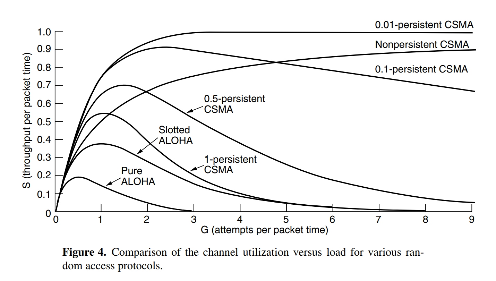

#### 2.2.2 CSMA with Collision Detection

先听后发，边发边听

诚然persistent/nonpersistent CSMA相比ALOHA已经有了很大的改进，但是避免不了两个station同时传输的collision

> Another improvement is for the stations to ==quickly detect the collision and abruptly stop transmitting==, (rather than finishing them) since they are irretrievably garbled anyway

就是增加了发送过程中的监听操作，只要发现错误立刻终止发送来止损

广泛应用于Mac sublayer的LAN上

---

来看看图画表示：

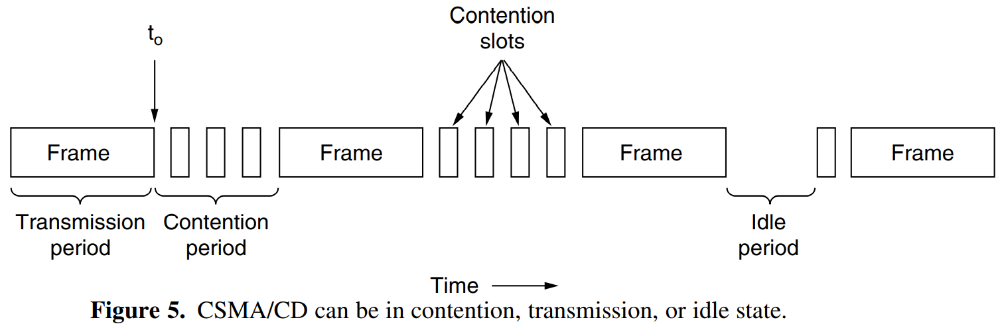

可以看到channel存在三种不同的period:
- **transmission**

    争抢到channel的station在发送frame

- **contention**

    几个station争抢channel，因为发生collision所以都很破碎
- **idle**

    并没有人有东西要发送

---

我们来讨论图中的contention period，他们的时长到底是多少呢？

书上这段话解释了为什么发送方最少需要$2\tau$的时间，才能确信没有collision发生：

> Let the time for a signal to propagate between the two farthest stations be $\tau$. At $t_0$ , one station begins transmitting. At $t_0 + \tau − \varepsilon$, an instant before the signal arrives at the most distant station, that station also begins transmitting. Of course, it detects the collision almost instantly and stops, but the little noise burst caused by the collision does not get back to the original station ==until time $2\tau − \varepsilon$==. In other words, in the worst case a station cannot be sure that it has seized the channel until it has transmitted for $2\tau$ without hearing a collision.

这也意味着slot的最大长度是$2\tau$

那slot最短会是多少呢？是$\varepsilon=\tau$的情况，也就是双方同时发送信号，此时slot长度为$\tau$

### 2.3 Collision-Free Protocols

之前有冲突的protocol在传输的距离太长（$\tau$太大）的情况下，就会显得非常低效

接下来介绍一些完全无冲突的protocol，虽然他们大多并没有应用于主要的系统里

---

来介绍一下这里的假设：
- **stations**: $N$
- **unique address for each station**: from $0$ to $N-1$

#### 2.3.1 A Bit-Map Protocol

流程如下：
- Each contention period consists of exactly $N$ slots, with one slot time being at least $2τ$. 
- If station $i$ ($0\le i \le N -1$) has a frame to send, it transmits $1$ bit during the $i$th slot; otherwise, it transmits $0$ bit during the ith slot. 
- After all slots have passed by, stations begin transmitting in numerical order.

大概就像是假如班上要发言的话，我们就先给全班传一个名单，想发言的人就在名单上对应的时间上打勾。这样一轮下来就可以知道谁要在啥时候发言

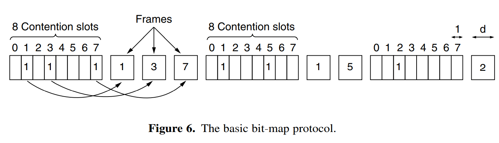

---

现在来进行一波性能分析

We will measure time in units of the contention bit slot, with data frames consisting of $d$ time units. $N$ is the number of stations or slots

不同负载下的efficiency (channel的效率，不是每个station的，所以高负载下效率高):
- low load:  $d/(N+d)$
- high load:  $d/(1+d)$

Mean frame delay (high load): $N(d+1)/2$ (说实话我不知道这玩意咋得出来的)

---

这玩意的缺点是，发送的的东西不存在priority

#### 2.3.3 Binary Countdown

过程如下：
- Each station has a binary address. All addresses are the ==same length==. 
- To transmit, a station broadcasts its address as a binary bit string, starting with ==high-order== bit. 
- The bits in each address position from different stations are **BOOLEAN OR**ed together (so called Binary countdown). 
- As soon as a station sees that a high-order bit position that is 0 in its address has been overwritten with a 1, it ==gives up==

下图展示这个过程：

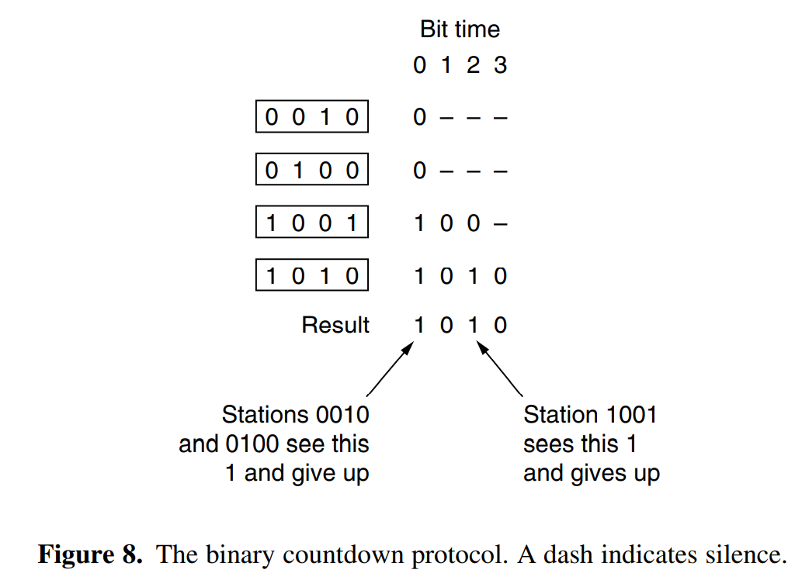

---

下面分析下efficiency

$N$个station需要的用来表示地址的位数是$\log_2N$

所以，效率是$$d/(d+\log_2N)$$

甚至还可以通过奇葩方法改进效率：

> If, however, the frame format has been cleverly chosen so that the ==sender’s address is the first field in the frame==, even these $\log_2 N$ bits are not wasted, and the efficiency is 100%

直接把地址算作要传输的frame的一部分，狡猾狡猾

## 3. Ethernet

We have now finished our discussion of channel allocation protocols in the abstract, so it is time to see how these principles apply to real systems

Ethernet有两种：
- **classic Ethernet**

    solves the multiple access problem using the techniques we have studied in this chapter
- **switched Ethernet**

    devices called **switches** are used to connect different computers

### 3.1 Classic Ethernet Physical Layer

在发明之初，**Ethernet**的标准为**DIX** standard。这个标准后来在经过了一点微调之后，成为了**IEEE 802.3**

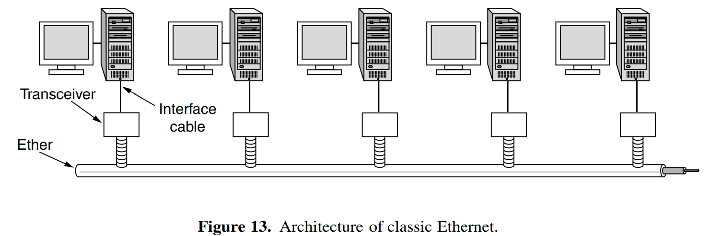

最最古早的就长上图这样

---

cable的长度并不能设计得无限长。为了实现更加庞大的网络结构，多个不同的cable可以由**repeater**连接起来

repeater
: a physical layer device that ==receives, amplifies (i.e., regenerates), and retransmits== signals in both directions

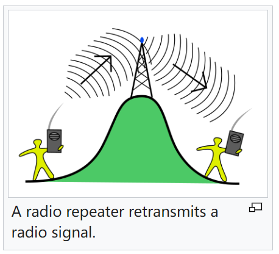

图中的repeater和书上讲的严格来说不是一种，但是效果差不多是这意思

当然这样做会增加延迟就是了，而且并不能无限多地用，原因和下一小节的MAC protocol有关

---

在通过repeater传输信号的cable之上，信息是用**Manchester encoding**编码的

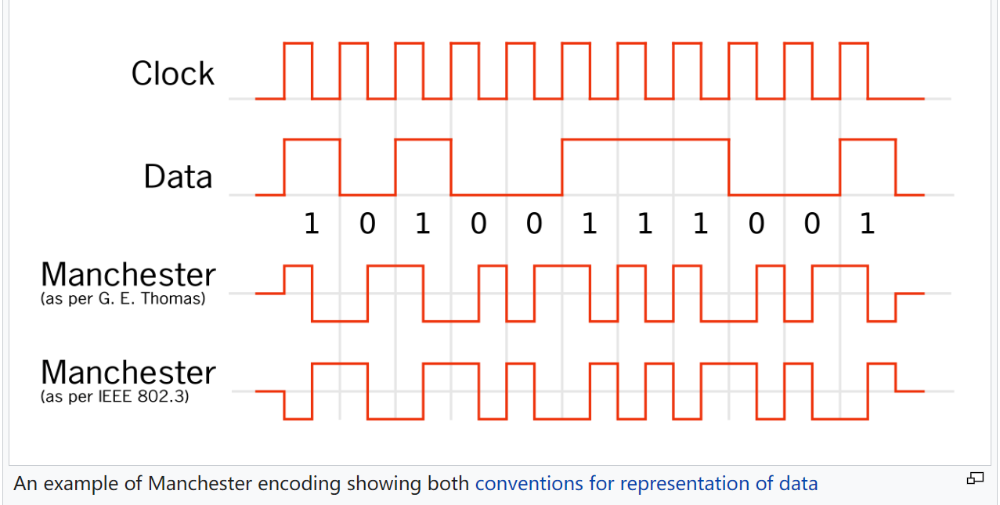

通过高低位的==变化==来表征0和1，不同标准下可能不太一样

period的中间时刻表示数据的传输，在边界上的电位变化并不传输信号

### 3.2 Classic Ethernet MAC Sublayer Protocol
DIX和IEEE 802.3传输的frame的格式分别如下图：

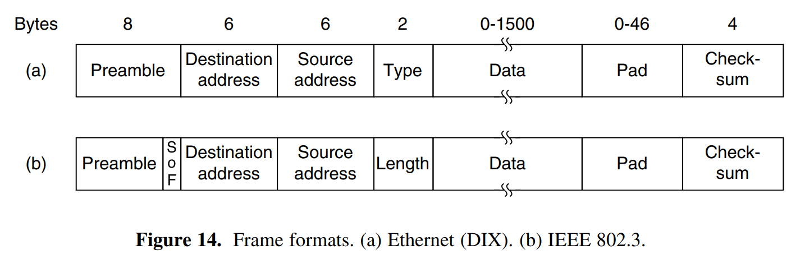

我们一个个来看看每个field是干啥的

#### 3.2.1 Preamble/SoF

- **DIX**

    包含8 bytes，每个byte包含的bit为 $10101010$
- **IEEE 802.3**

    前7个byte同上，而最后一个byte是**Start of Frame** (SoF) byte，变成 $10101011$

#### 3.2.2 Destination address & Source address

两个field的长度都为 $6$ bytes (也就是都为 $6\times 8=48$ bits)

---

destination address的第一个byte的最后一个bit可以分为：
- 0: **ordinary address**
- 1: **group address** (multicast address)

    > When a frame is sent to a group address, all the stations ==in the group== receive it

    比如 `01-00-5E-00-11-22` 就是 multicast

假如destination address全部都是1的话 ($6\times 8=48$ 个 $1$)，那么对应的则是**broadcasting**的特殊情况

!!! note
    multicasting和broadcasting是不同的：multicasting是只有处于group内的station才能接收到，broadcasting则谁都可以

---

source address有个特性：==globally unique==

这玩意似乎就是**MAC address** (?)

为了让世界上任何两个station都有完全不同的address，地址如下设计：

- 前 $3$ 个bytes

    叫做**OUI (Organizationally Unique Identifier)**

    这将会指代一个生产厂商
- 后 $3$ 个bytes

    厂商自己设定

    在销售之前，厂商会将完整的address编程进NIC里

#### 3.2.3 Type/Length

- **DIX**

    DIX里这个filed为**Type** field

    > specifies ==which network-layer process== to give the frame to (for supporting ==multi-protocols== at network-layer).

- **IEEE 802.3**

    IEEE 802.3里则是**Length** field

    > is the length of the data field

那我怎么区分这是type还是length呢？

假如field里面的数字：
- less than or equal to 1536 (0x600) $\rightarrow$ Length
- greater than 1536 $\rightarrow$ Type

#### 3.2.4 Data

- **Maximum** length: $1500$ bytes

    因为设定标准的时候transceiver的RAM还是太小了，装不下太大的frame
- **Minimum** length: $64$ bytes

    假如小于46 bytes的话，甚至需要用Pad field来填充至最小长度

    设定这个下界的其中一个原因是：
    > prevent a station from completing the transmission of a short frame before $2\tau$ ($51.2\mu s$ when line rate is $10\text{Mbps}$ and distance is $5\text{km}$)

    其实就是和本章2.2.1最后提到的round trip time相关

    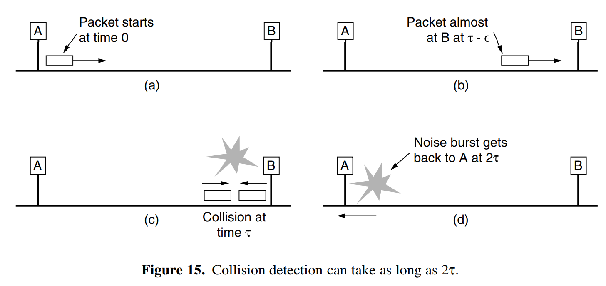

    书上P289底下的解释是：
    > If a station tries to transmit a very short frame, it is conceivable that a collision will occur, but the transmission will have completed before the noise burst gets back to the station at $2\tau$. The sender will then incorrectly conclude that the frame was successfully sent.

    看来sender发送完后是真的记不住自己发送过的frame？

#### 3.2.5 Checksum

ppt没讲，略

#### 3.2.6 CSMA/CD with Binary Exponential Backoff

对frame结构的解释已经结束了。现在来看看关于CSMA/CD的一点小问题

之前不是提到过，CSMA/CD在发生了collision之后，会等待一个随机的时间，再次尝试发送吗。那问题是这个随机的时间怎么选择呢？

结论上就是：
> After $i$ collisions, a random number between $0$ to $2^i-1$ is chosen, and that number of slots (each slot is $2\tau$) is skipped

在10次collision之后，这个间隔的上线会被锁定在1023

假如连续发生了16次collision，则会直接宣告失败

### 3.3 Ethernet Performance

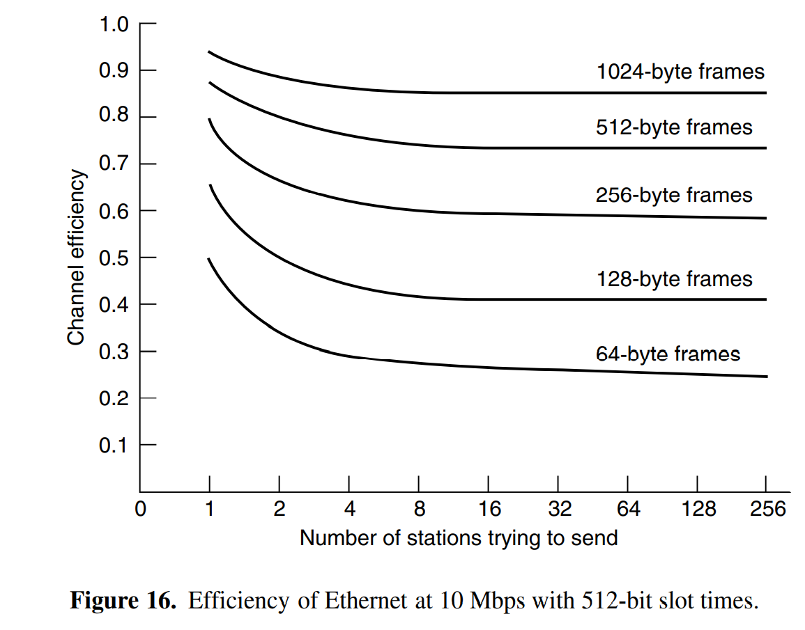

### 3.4 Switched Ethernet

在早些时候，为了能够方便地断开有线网的连接（把网线从RJ45端口上拔下来），所有的线都会连接到**Hub**上，而Hub做的事情仅仅是简单把所有线连接到一起

然而，随着越来越多的station连接到hub上，由于Hub的总带宽有限，这数据传输速度就不太够看了

于是，**switch**出现了：

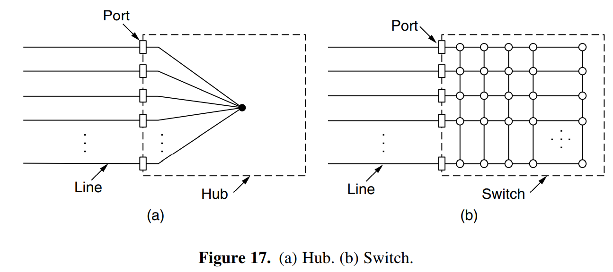

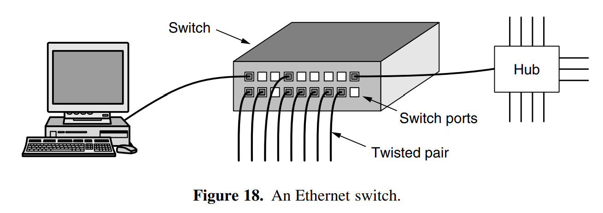

switch
: containing a high-speed (typically over 1 Gbps) **backplane** and room for multiple **plug-in cards** (typically 4 to 32)

!!! warning
    从这里可以看出，switch 属于 DLL 层！当然也存在通过提供 routing 服务来同时工作在网络层的 switch

> **Switches** only output frames to the ports for which those frames are destined

其它端口甚至不知道这么个输入的frame的存在

---

假如多个station/port想要同时发送frame的话会发生啥呢？

对于传统的Hub来说，所有的station处在同一个 **collision domain** 之下，这就必须使用CSMA/CD这种算法来计划一下

对于switch来说：
> each port is its own independent collision domain

假如cable是full duplex的（station和port可以同时反向发信息），那么啥问题都没有

假如是half duplex的，那么同一根线上的station和port就要来用CSMA/CD之类的方法争夺一下这跟线的使用权了

### 3.5 Fast Ethernet (802.3u)

100Mbps

特性为：
- **backward compatible**

    The old packet formats, interfaces, and procedural rules are kept
- **Faster**

    The bit time is reduced from 100 (10 Mbps) nsec to 10 nsec (100 Mbps).

可用线材如下：

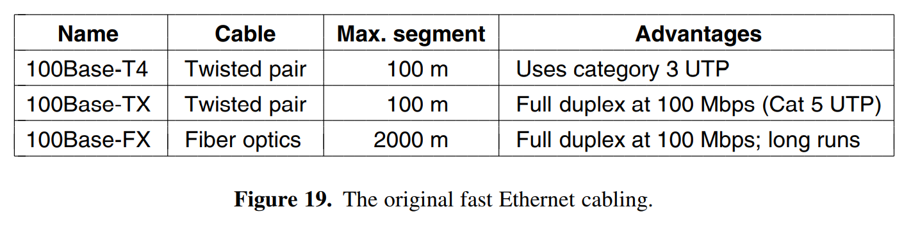

### 3.6 Gigabit Ethernet (IEEE 802.3z)
特性为：
- backward compatible
- faster than the existing 802.3 and 802.3u standards. 

> Like fast Ethernet, all configurations of gigabit Ethernet use point-to-point links.

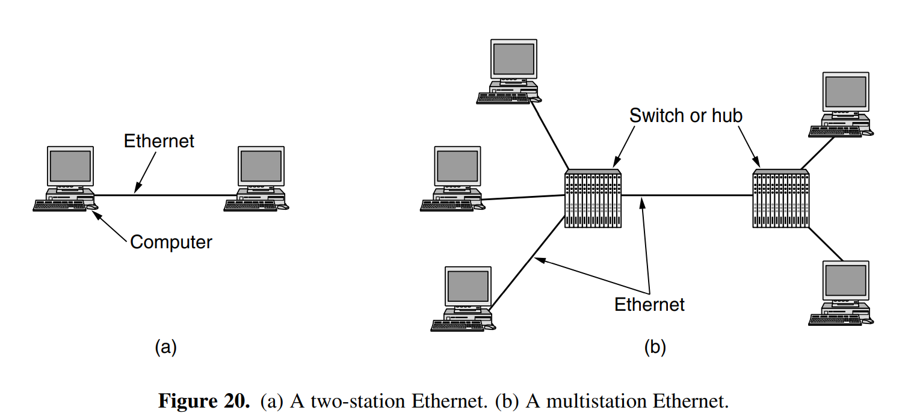

> Also like fast Ethernet, gigabit Ethernet supports two different modes of operation: **full-duplex mode** (使用switch时) and **half-duplex mode** (使用hub时)

supports **flow control**: one end can send a special control frame to the other end  telling it to pause for some period of time

---

为了让cable的长度能够增加到200m，增加了两个新的feature:

- carrier extension

    : tells the hardware to add its own ==padding== after the normal frame to extend the frame to 512 bytes

    坏处是line efficiency降低到了9\%
- frame bursting

    : allows a sender to transmit a ==concatenated sequence of multiple frames== in a single transmission. If the total burst is less than 512 bytes, the hardware ==pads== it again.

    假如有非常多frame在等待传输的话，那么这个效率就比carrier extension高得多

### 3.? Logical Link Control (LLC) (IEEE 802.2)

书上压根没有，干脆直接贴ppt

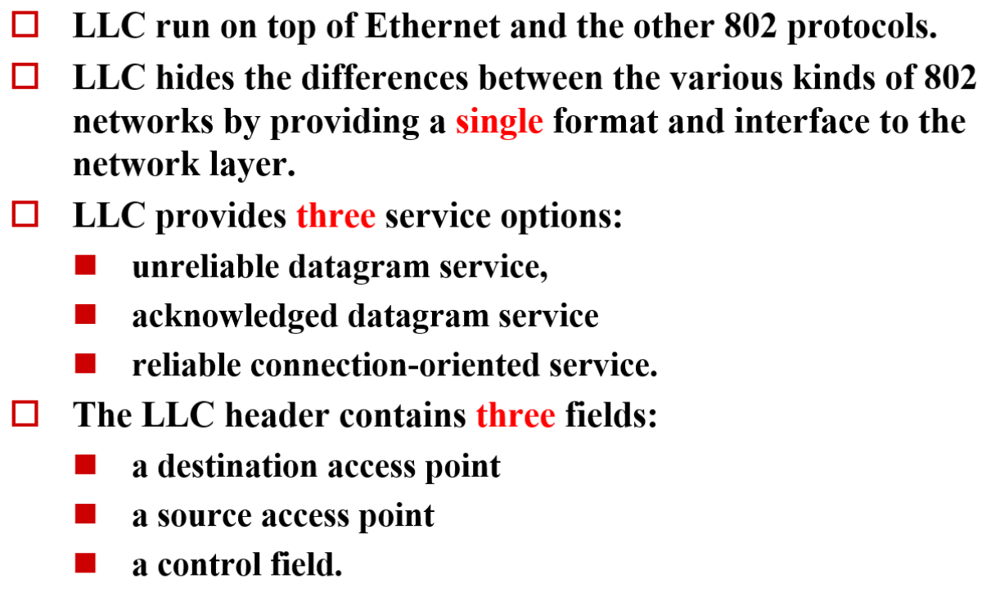

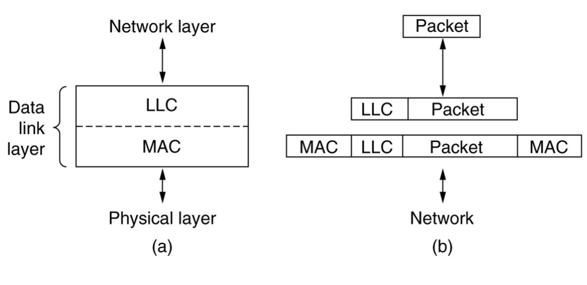

## 8. Data Link Layer Switching

> Ethernet **switches** are a modern name for **bridges**

就是把好多LAN连接到一起

### 8.1 Uses of Bridges

书上这里介绍了一些个需要使用bridge的场景

一个理想的bridge应该是==transparent==的。比如可以任意多加入bridge而不影响现有的网络，也不需要调整硬件和软件，插上就行了

为了实现transparent这个目标，我们需要两个算法：
- **backward learning**

    to stop traffic being sent where it is not needed
- **spanning tree algorithm**

    to break loops that may be formed when switches are cabled together willy-nilly (不管愿不愿意) 

### 8.2 Learning Bridges

两种网络拓扑结构：

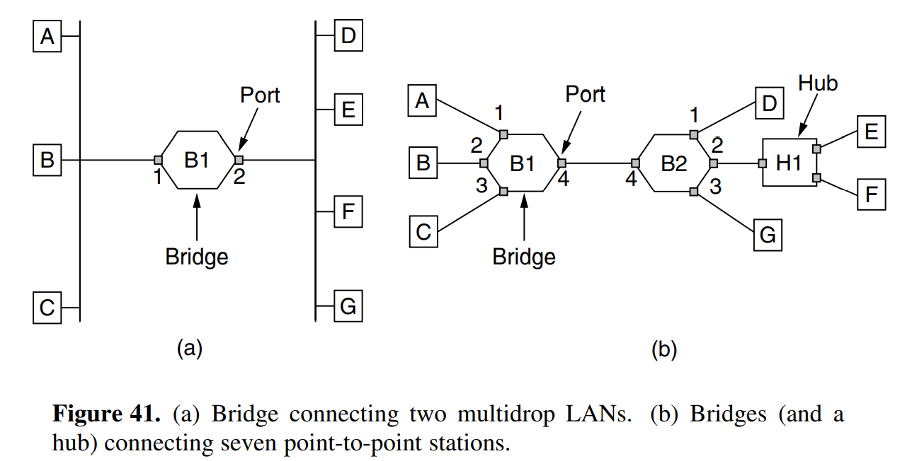

左边只是传统的Ethernet结构上加入了bridge，而右边则使用了更为推荐的point-to-point cables来连接设备

只要属于同一个端口，那么连接到该端口的设备就处在同一个collision domain里

---

现在来考虑下bridge里面到底发生了啥

每个bridge都运行在==promiscuous mode== [prəˈmɪskjuəs] (混杂模式)之下，也就是他们接受所有station发来的frame

面对一大堆的frame，bridge就必须决定一下，是要传输这个frame (要传到哪个port里？)还是直接丢弃 (本来就不是想传输给bridge的，只是恰好随便广播的时候收到了)

想要实现上述的操作的话，我们需要**backward learning**算法的帮助：

首先，bridge会自己维护一个超大的==hash table==，来记录哪个MAC address是对应哪个port。最开始的时候，table里啥也没有。在没有对应的表格的entry的情况下，bridge就只能够用**flooding algorithm**来转发信息：给所有其他端口都发一遍

那backward learning到底咋学习呢？比如当它发现$A$从port 3发来了frame的时候 (==source address==可以看出来)，他就会在hash table里记下$A$对应port 3。下次当他需要将frame转发到$A$的时候，他就知道应该转发给port 3了

总结一下bridge的转发策略就是：
- If the port for the destination address is the ==same== as the source port:

    discard the frame.
- If the port for the destination address and the source port are ==different==:

    forward the frame on to the destination port.
- If the destination port is ==unknown==:

    use flooding and send the frame on all ports except the source port.

会有特殊的VLSI芯片来执行上述的算法

---

你可能会想，这hash table到底要咋更新？

事实上，table的每个entry还会额外记录frame的==最近一次的到达时间==。这样的话，bridge会周期性地扫描一遍hash table，并清除掉比较老旧的entry

### 8.3 Spanning Tree Bridges

为了提高可靠性，我们经常会添加一些冗余的线路在bridge之间：

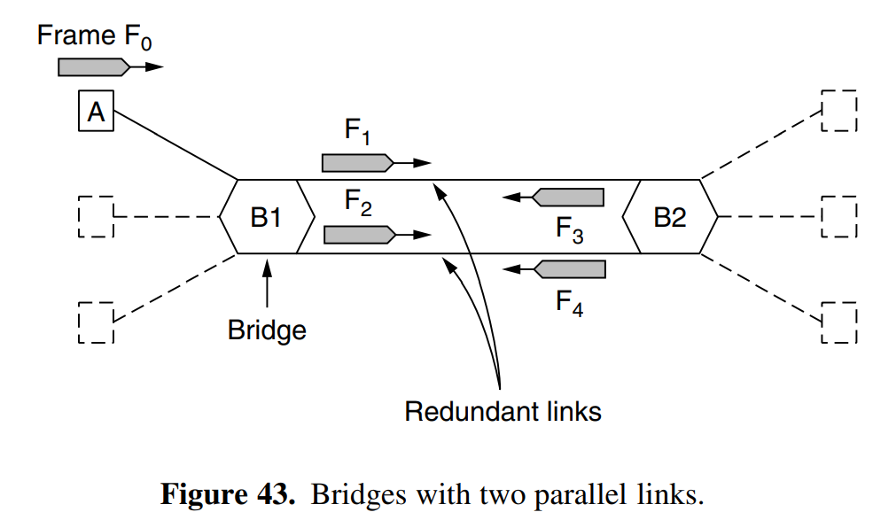

但是这会带来问题。因为这个线路里出现了==回路==，所以frame就可能受flooding策略的影响在回路里无限循环

---

咋解决呢？其实非常简单，就是构建出==spanning tree==，让所有的bridge都同意只走spanning tree上的节点：

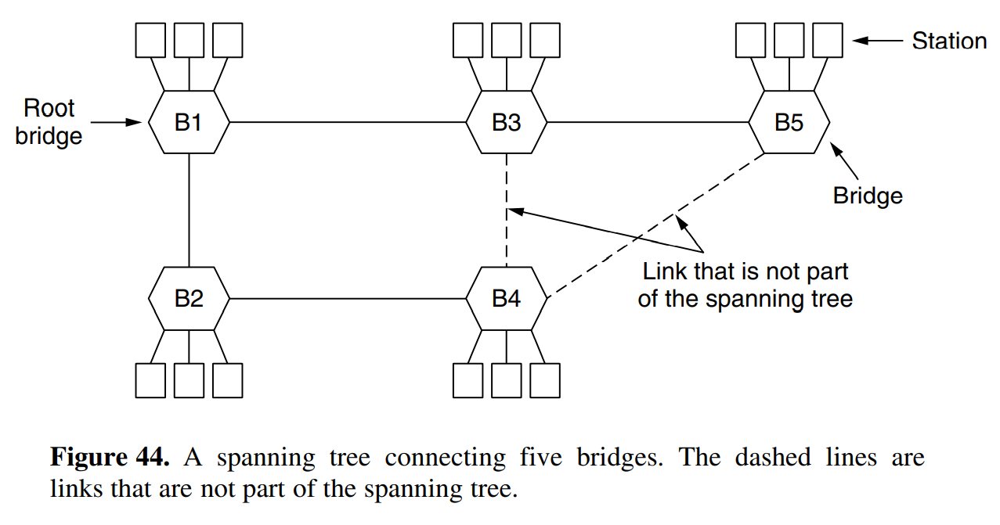

建树的大概流程是：
- Choose one bridge to be the root of the tree

    The bridge with the ==lowest serial number== becomes the root.
- A tree of shortest paths from the root to every bridge and LAN is constructed.
- If a bridge or LAN fails, a new spanning tree is computed.

### 8.4 Repeaters, Hubs, Bridges, Switches, Routers, and Gateways

来看看这些设备都是工作在哪个层之中的：

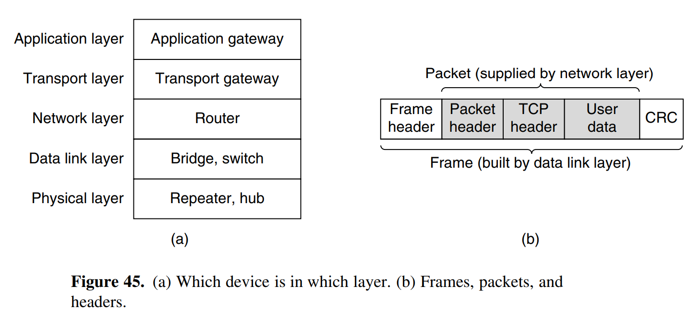

NIC其实也属于DLL

