# The Network Layer

> The network layer is concerned with getting ==packets== from the source all the way to the destination

和DLL不同，DLL关心的只是怎么样把frame从线的一端送到另一端，而网络层则是关注更宏观的，怎么把packet从一个设备发送到另一个设备，中间可能要通过router进行几次跳跃

> The network layer is the lowest layer that deals with ==end-to-end transmission==

## 1. Network Layer Design Issues

### 1.1 Store-and-Forward Packet Switching

来了解一下网络层大概是什么个工作环境：

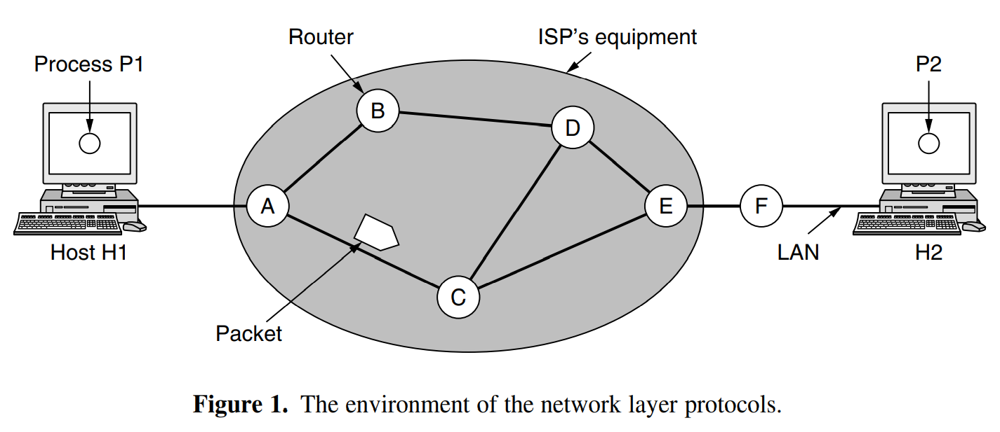

其中：
- **ISP**

    指的是Internet Service Provider
- 其实 F 也是个router，只不过因为它属于用户自己的，所以就没有划入灰色的椭圆里。但是在讨论算法的时候，我们暂时将他纳入灰色的椭圆中进行考虑，毕竟使用的算法是同一个

这些设备如下使用：
- A host with a packet to send transmits it to the ==nearest router==, either on its own LAN or over a point-to-point link to the ISP
- The packet is stored there until it has ==fully arrived== and the link has finished its processing by ==verifying the checksum==.
- Then it is forwarded to the next router along the path until it reaches the destination host, where it is delivered

### 1.2 Services Provided to the Transport Layer

网络层需要对上面的transport layer提供服务：
- **Connection oriented service**

    X.25, ATM (不知道是什么缩写)
- **Connectionless service**

    IP

    !!! warning
        IP 是 connectionless 的服务！

---

知道了他能提供什么服务之后，我们来看看网络层内部是怎么实现的

不同的service对应了不同的organization:
- **datagram network**

    对应connectionless service

    datagram
    : packets are injected into the network individually and routed independently of each other. These packets are called **datagrams**
- **virtual-circuit network**

    对应connection-oriented service

    virtual circuit (VC)
    : a path from the source router all the way to the destination router must be established before any data packets can sent. This connection is called a **virtual circuit (VC)**

### 1.3 Implementation of Connectionless Service (datagram)

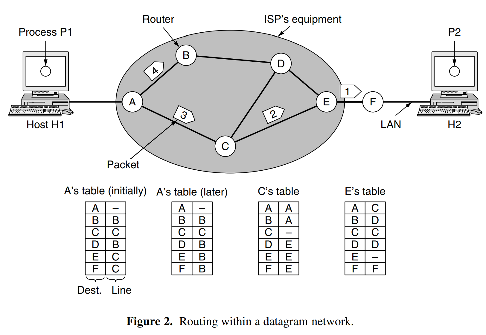

每个router维护一个table。table的两项分别是destination router和next router

比如packet传到A的时候，这时候会查看packet的==destination address==，既然他是想去F的，那么下一步就是传去C

table是动态变化的（比如根据流量负载的分布），所以每个packet的路线==不尽相同==

### 1.4 Implementation of Connection-Oriented Service (virtual-circuit)

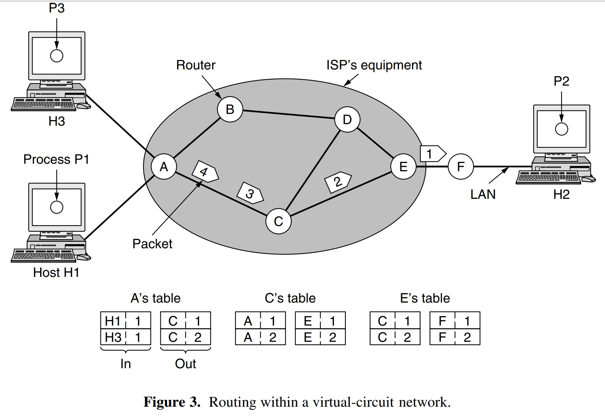

通信的细节如下：

> Here, host $H1$ has established ==connection 1== with host $H2$. This connection is remembered as the first entry in each of the routing tables. The first line of $A$’s table says that if a packet bearing connection identifier 1 comes in from $H1$, it is to be sent to router $C$ and given connection identifier 1. Similarly, the first entry at $C$ routes the packet to $E$, also with connection identifier 1.

可以看到每个线路都有自己的id，比如这里$H1$到$H2$的线路叫做 1

那假如这时候$H3$也想和$H2$建立通信呢？

> $H3$ chooses connection identifier 1 (==because it is initiating the connection and this is its only connection==) and tells the network to establish the virtual circuit. This leads to the second row in the tables. Note that we have a ==conflict== here because although $A$ can easily distinguish connection 1 packets from $H1$ from connection 1 packets from $H3$, $C$ cannot do this. For this reason, ==$A$ assigns a different connection identifier to the outgoing traffic for the second connection==

想要避免上述的路线的id冲突的话，router是需要有更改connection id的能力的

当connection结束的时候，virtual circuit 也会被移除

### 1.5 Comparison of Virtual-Circuit and Datagram Networks

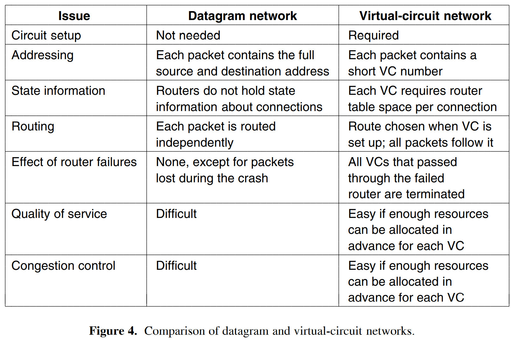

## 2. Routing Algorithms

这里插入了书上没有的两个概念的区分：

routing protocol[^1]
: specifies how routers communicate with each other to distribute information that enables them to ==select routes== between nodes on a computer network

e.g., distance vector, link state

routed protocol
: is used to ==deliver application traffic==. It provides appropriate addressing information in its network layer to allow a packer to be forwarded from one network to another

e.g., IPv4, IPv6

[^1]:[Routing protocol - Wikipedia..](https://en.wikipedia.org/wiki/Routing_protocol#:~:text=A%20routed%20protocol%20is%20used,Internetwork%20Packet%20Exchange%20(IPX).)

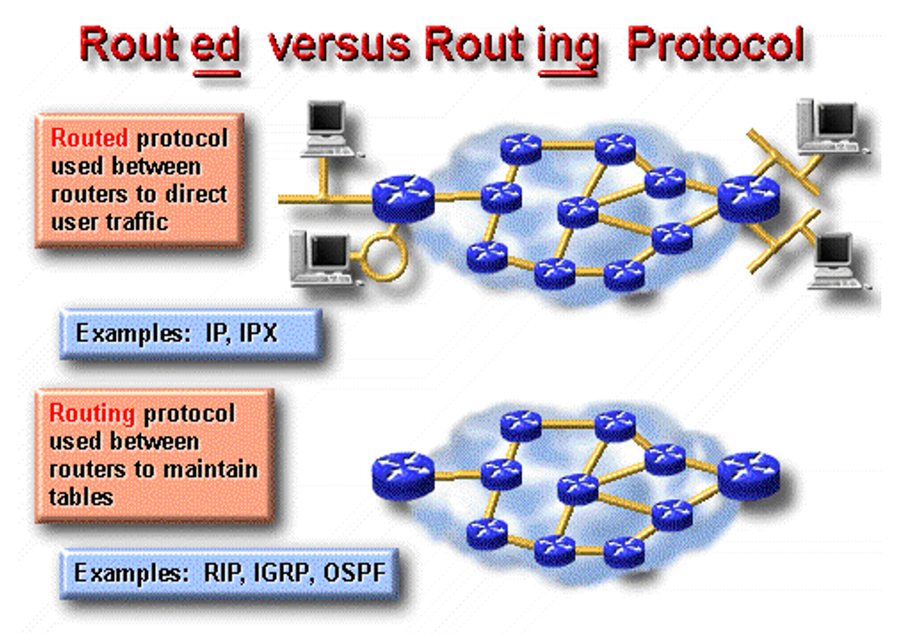

如图中所说，routed 是发送用户的流量的，而 routing 是用于路由器之间维护 table 建立连接用的

---

routing algorithm
: part of the network layer software responsible for ==deciding which output line== an incoming packet should be transmitted on

算法需要保证一些特性：
- **correctness**
- **simplicity**
- **robustness**
- **stability**
- **fairness**
- **efficiency**

---

这些算法可以分成两个大类：
- static routing

    : do not base their routing decisions on any measurements or estimates of the current topology and traffic. Instead, the choice of the route to use is ==computed in advance==, offline, and downloaded to the routers when the network is booted

    e.g.

    - IP (Internet Protocol)
    - IPX (Internetwork Packet Exchange)

    适用于小型、稳定的网络，花费较少

- dynamic routing

    : change their routing decisions to reflect changes in the topology, and sometimes changes in the traffic as well

    另外还有些奇特的限制：
    - A new router must introduce itself in it’s own initiative (say hello)
    - Send hello packets periodically to learn other’s health (keep alive) 

    e.g.

    - Distance vector routing

        e.g., RIP
    - Link state routing

        e.g., OSPF
    - Hybrid routing

        e.g., IGRP

第二节接下来介绍的都是基于topology的routing algorithm

### 2.1 The Optimality Principle

最优化原理

optimality principle
: if router $J$ is on the optimal path from router $I$ to router $K$, then the optimal path from $J$ to $K$ also falls along the same route

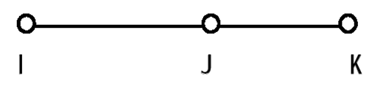

听起来是废话系列

---

sink tree
: as a direct consequence of the optimality principle, we can see that the set of optimal routes from all sources to a given destination form a ==tree rooted at the destination==

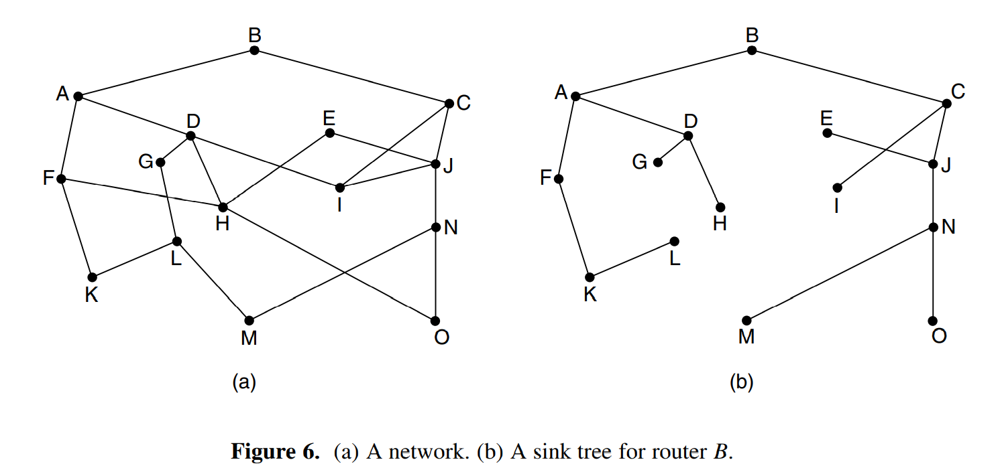

sink tree其实并不一定唯一

> The goal of all routing algorithms is to discover and ==use the sink trees for all routers==

### 2.2 Shortest Path Algorithm

[Dijkstra](../../y2-fall/data-structures/11-graph.md) 再次见面

边的权重 (metric) 可能有很多种，一般来说会选择hop或者distance

### 2.3 Flooding

flooding
: every incoming packet is sent out on every outgoing line except the one it arrived on

这显著的问题就是产生一堆重复的packet

解决方法有：
- Add a counter in packet-header ，reduce 1 when pass a node， packet is discarded when counter is zero
- Each node set up a register table, packet is discarded when it arrives a node again
- Flooding selectively

这玩意居然也是有好处的：

reliability high，path short，use in military affairs frequently

### 2.4 Distance Vector Routing

其中一种dynamic routing的算法

distance vector routing algorithm
: operates by having each router maintain two ==vectors (tables) giving the best known distance to each destination and which link to use to get there==.

> These tables are updated by exchanging information with the ==neighbors==. Eventually, every router knows the best link to reach each destination

经常用于小型网络，**RIP (Routing information protocol)** 就是其中的一种算法 (限制hop数量小于等于15，其实很不合理，这样太远的就到不了了)

---

书上说只有一个table (两列)，而ppt上说有两个vector，这里以两个vector为例再次说明一下vector到底是个什么格式:

$$
D_i=
\begin{bmatrix}
    d_{i1}\\
    d_{i2}\\
    d_{i3}\\
    \dotsb\\
    d_{in}
\end{bmatrix}
S_i=
\begin{bmatrix}
    s_{i1}\\
    s_{i2}\\
    s_{i3}\\
    \dotsb\\
    s_{in}
\end{bmatrix}
$$

- $d_{i1}$: the distance (e.g., delay) from node $i$ to node 1
- $s_{i1}$: the next node along the best way from node $i$ to node 1
- $n$: node number of network

---

现在来看看这些table是如何更新的。光看定义描述太抽象了，干脆来看例子：

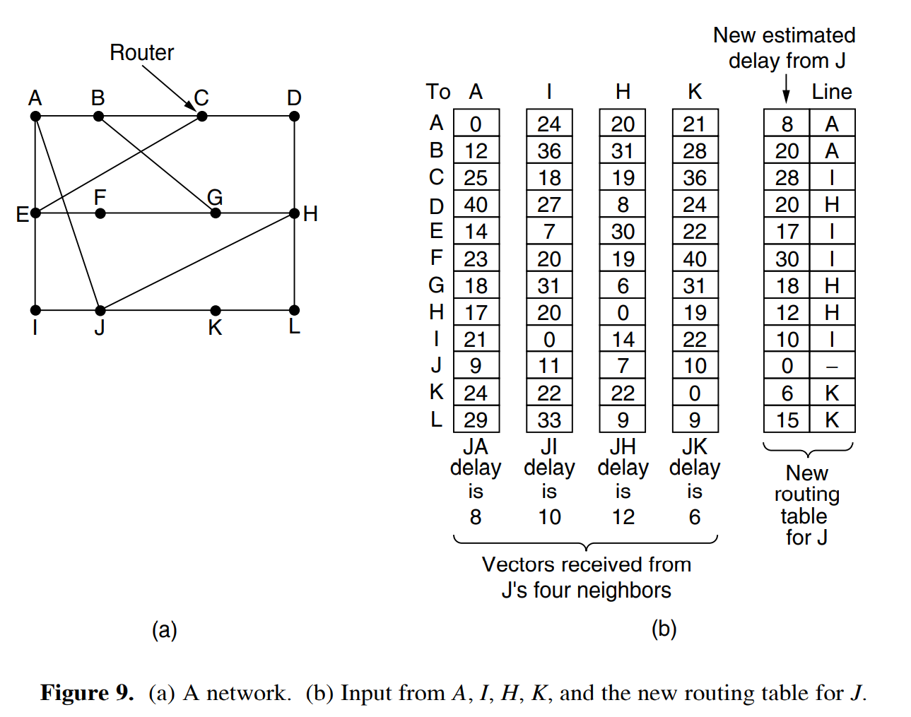

我们现在想要更新一下$J$的table。于是乎他收到了来自四个邻居$A, I, H, K$的table的第一列。

只要将自己到邻居的距离，再加上邻居到目的地的距离，就是自己到目的地的距离了。于是乎，最右边的新routing table就通过对每个目的地都比较一遍走哪个邻居最快，来更新table

---

**Advantages**
- Algorithm is simple

**Disadvantages**
- Exchanged information is too big
- Path information propagates slowly and path information may be different
- Convergence speed is slow, leads to infinite count issue

    convergence
    : the ==settling== of routes to best path across the network
- Not fit for big network

#### 2.4.1 The Count-to-Infinity Problem

> it ==reacts rapidly== to good news, but ==leisurely== to bad news

让我们来看看好消息和坏消息传播的区别：

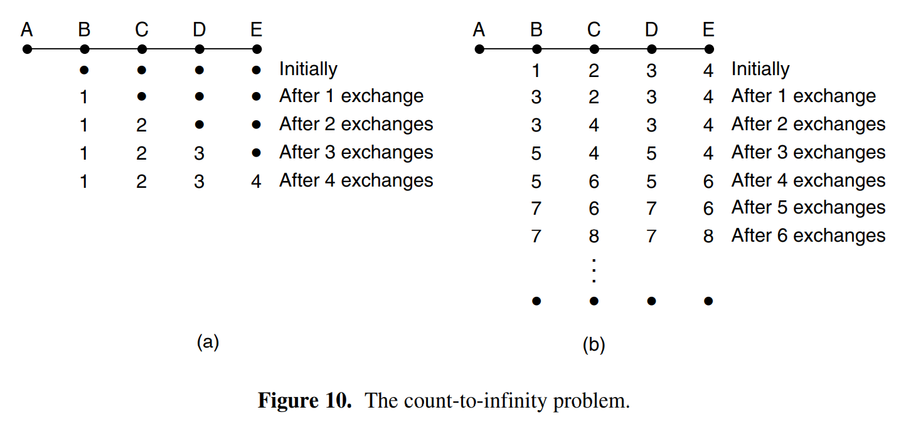

(a)中，router $A$新加入了网络，然后只需要4次exchange，最远的$E$就可以知道自己和$A$之间的距离

(b)中，router $A$突然寄了：
> $\quad$At the first packet exchange, ==$B$ does not hear anything from $A$==. Fortunately, $C$ says ‘‘Do not worry; I have a path to $A$ of length 2.’’ Little does $B$ suspect that $C$’s path runs through $B$ itself. As a result, ==$B$ thinks it can reach $A$ via $C$==, with a path length of 3. $D$ and $E$ do not update their entries for $A$ on the first exchange
> 
> $\quad$On the second exchange, ==$C$ notices that each of its neighbors claims to have a path to $A$ of length 3 (自己比邻居小，这很不合理)==. It picks one of them at random and makes its new distance to $A$ 4, as shown in the third row of Fig. 10(b)

搞了半天是$B, C$之间互相欺骗，导致死循环

### 2.5 Link State Routing

distance vector后来就因为收敛太慢被这个算法取代了

link state routing的变种：IS-IS和OSPF现在被广泛使用

Each router must do the following things to make it work:
- Discover its neighbors and learn their network address
- Set the distance or cost metric to each of its neighbors
- Construct a packet telling all it has just learned
- Send this packet to and receive packets from all other routers
- Compute the shortest path to every other router

我们接下来研究这5步的细节：

#### 2.5.1 Learning about the Neighbors

When a router is booted, its first task is to learn who its neighbors are, by ==sending a special HELLO packet== on each point-to-point line. 

The router on the other end is expected to send back a replay giving its name (==globally unique name==)

当网络中出现LAN的时候，情况就稍稍复杂一点：

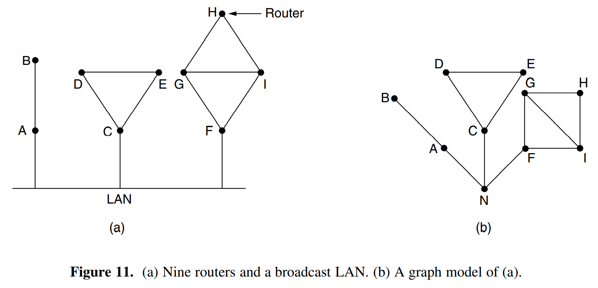

为了简化模型，我们可以把==LAN视作一个artificial node==, $N$

实际中，一个**designated router**会被选中来扮演$N$的角色，比如这里是$A, C, F$中的一个

#### 2.5.2 Setting Line Costs

在距离比较长的网络里，delay一般会被用作line cost的指标。

> The most direct way to determine this delay is to send over the line a ==special ECHO packet== that the other side is required to send back immediately
> 
> By ==measuring the round-trip time and dividing it by two==, the sending router can get a reasonable estimate of the delay

一般来说，会在load in过程中ECHO packet进入queue排队等待发送就开始计时，而非等待ECHO packet已经到了queue的头部

#### 2.5.3 Building Link State Packets

前一步中每个router已经将自己与邻居之间的cost摸清楚了，现在可以来准备**link state packet**了

e.g.

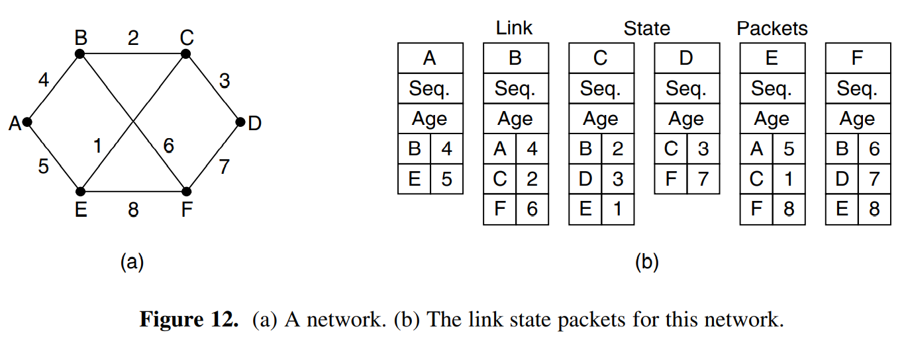

可以看到每个link state packet的组成是：
- ID of the sender
- sequence number
- age
- a list of neighbors, including:
    - neighbors' IDs
    - costs

---

构建这么一个packet其实还算是容易的，难的在于什么时候构建：
> One possibility is to build them ==periodically==, that is, at regular intervals. 
> 
> Another possibility is to build them when some ==significant event occurs==, such as a line or neighbor going down or coming back up again or changing its properties appreciably.

#### 2.5.4 Distributing the Link State Packets

最难的部分就是分发这些link state packets

最基本的想法就是用flooding来分发，再加上一些限制：
> To keep the flood in check, each packet contains a **sequence number** that is incremented for each new packet sent
>
> Routers keep track of all the ==<source router, sequence>== pairs they see
>
> When a new link state packet comes in, it is checked against the list of packets already seen:
> - If it is new, it is ==forwarded== on all lines except the one it arrived on
> - If it is a duplicate, it is ==discarded==
> - If a packet with a sequence number lower than the highest one seen so far ever arrives, it is ==rejected== as being obsolete as the router has more recent data

这个算法是有一些问题的：
- > First, if the sequence numbers wrap around, confusion will reign

    解决方法就是增加sequence number的长度到32-bit
- > Second, if a router ever crashes, it will lose track of its sequence number. If it ==starts again at 0==, the next packet it sends will be rejected as a duplicate
- > Third, if a sequence number is ever corrupted. e.g., 65540 is received instead of 4 (a 1-bit error), packets 5 through 65540 will be rejected as obsolete

总的解决方法就是在packet的sequence number后面再添加一个**age** (e.g., 60)，然后每秒减一。当age变成0的时候，那个router发来的信息就会被抛弃

鉴于每10秒发一个新的packet，所以假如真的能timeout的话，那么只能是router寄了或者是更不可能发生的连续的6个packet全部丢失了

---

我们还可以进行一些修改，让这个算法更加robust

> When a link state packet comes in to a router for flooding, it is ==not queued for transmission immediately==. Instead, it is put in a ==holding area== to wait a short while in case more links are coming up or going down
>
> If another link state packet from the same source comes in before the first packet is transmitted, their sequence numbers are compared:
> - If they are equal, the duplicate is ==discarded==
> - If they are different, ==the older one is thrown out==
>
> To guard against errors on the links, all link state packets are ==acknowledged==

---

来看看具体的packet buffer里面装的是啥，对应上面图中的router B

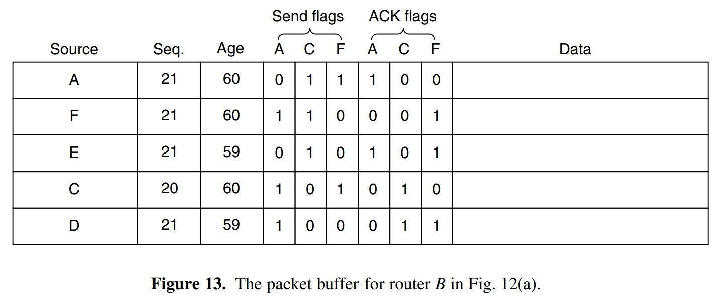

可以看到多了6个bit (因为有3个邻居):
- **Send flags**

    the packet must be sent on the indicated link
- **ACK flags**

    it must be acknowledged there

总的来说就是，发送者到B的路上假如经过了B的三个邻居router中的某些，那么这些router收到的就是ACK flags=1，假如没经过，那就是Send flags=1 (恰好完全互补)

#### 2.5.5 Computing the New Routes

一旦router收集齐了所有的link state packets，他就可以构建整个网络的地图了

鉴于同一个线路反向的cost可能不同，所以从$A$到$B$和从$B$到$A$的线路是可能不同的

> Now ==Dijkstra's== algorithm can be run locally to construct the shortest paths to all possible destinations. This information is installed in the ==routing tables==, and normal operation is resumed

**Advantages**
- Consistency of every router is good
- Convergence is good
- Fit for big network

**Disadvantages**
- Each router requires bigger storage-space
- Computing workload is great

### 2.7 Broadcast Routing

broadcasting
: sending a packet to all destinations

## 6. The Network Layer in the Internet

Design principles for Internet:
- Make sure it works.
- Keep it simple.
- Make clear choices.
- Exploit modularity.
- Expect heterogeneity /ˌhetərədʒəˈniːəti/ (the state of consisting of many different kinds of people or things)
- Avoid static options and parameters.
- Look for a good design; it need not be perfect.
- Be strict when sending and tolerant when receiving.
- Think about scalability.
- Consider performance and cost.

---

ASes (Autonomous Systems)
: the Internet is made up of a large number of independent networks or **ASes** that are operated by different organizations, usually a company, university, or ISP

> In the network layer, the Internet can be viewed as a ==collection== of networks or *ASes (Autonomous Systems)* that are interconnected

比如下面这样的集合：

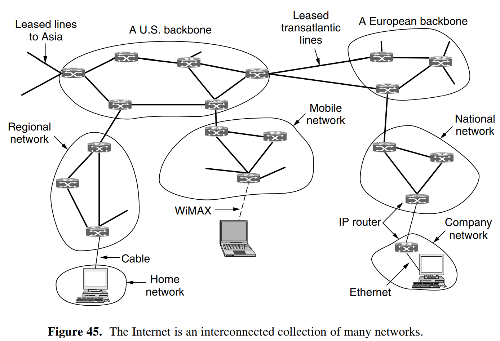

> The ==glue== that holds the whole Internet together is the network layer protocol, **IP (Internet Protocol)**
> 
> A good way to think of the network layer is this: its job is to provide a ==best-effort (i.e, not guaranteed)== way to transport packets from source to destination, ==without regard to whether these machines are on the same network or whether there are other networks in between them==

### 6.? Network Address[^2]

[^2]: [What is a Network Address? - GeeksforGeeks..](https://www.geeksforgeeks.org/what-is-a-network-address/)

书上没有

network address
: A **network address** is a logical or physical address that uniquely identifies a host or a machine in a telecommunication network

包括但不限于：
- **Internet Protocol (IP) address**
- **Media Access Control (MAC) address**

### 6.1 The IP Version 4 Protocol (IPv4)

来看看IPv4的datagram都是个啥结构

datagram由header和body (payload)两个部分组成。我们先来看看header:

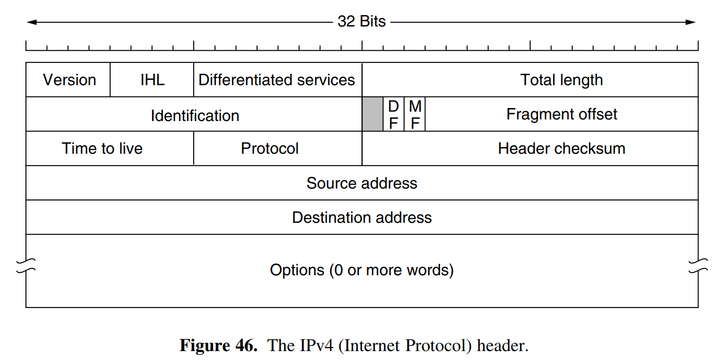

header由20-byte固定长度的部分和一个可选的可变长度部分组成。传输的时候，遵从从左到右、从上到下的顺序。

!!! note
    图中每32个bit被定义为一个word

来看看每个field都是干啥的：
- **Version** (4 bits)

    > keeps track of which version the protocol the datagram belongs to

    - IPv4: 0100
    - IPv6: 0110
- **IHL (IP Head Length)** (4 bits)

    鉴于header的长度并不是固定的，所以IHL用来说明header到底有多长（有多少个每个32-bit的word）
- **Differentiated services** (8 bits)

    specifies the level of importance that has been assigned by a particular upper-layer protocol

    - Precedence
    - Reliability
    - Speed
- **Total length** (16 bits)

    同时包括了header和data的长度 (单位是byte)
- **Identification** (16 bits)

    sequence number
- **DF (Don't Fragment)** (1 bit)

    sender可以根据这个来期望一个packet是否被fragmented，否则就会收到报错
- **MF (More Fragments)** (1 bit)

    > All fragments except the last one have this bit set

    判断是否所有fragment都到了
- **Fragment offset**

    ppt上直接跳过了
- **TtL (Time to Live)** (8 bits)

    > is a counter used to limit packet lifetimes
- **Protocol** (8 bits)

    > tells the network layer which transport process to give the packet to

    可能的接受方是：
    - TCP
    - UDP

- **Header checksum** (16 bits)

    鉴于header传输的信息非常重要，我们需要检查header自身的状态，来保证header integrity
- **Source address & Destination address** (32 bits each)

    [6.2](#62-ip-addresses)中讲解
- **Options** (0 or more)

    > Allows IP to support various options, such as security, route, error report

    无论如何他都会保证填入的东西是32bit的倍数

### 6.2 IP Addresses

32-bit

!!! note
    IP address并不是指代一个host，而是指代一个network interface。所以说，同一个host在不同的网络中会有不同的IP，比如router

#### 6.2.1 Prefixes

IP address是hierarchical的：

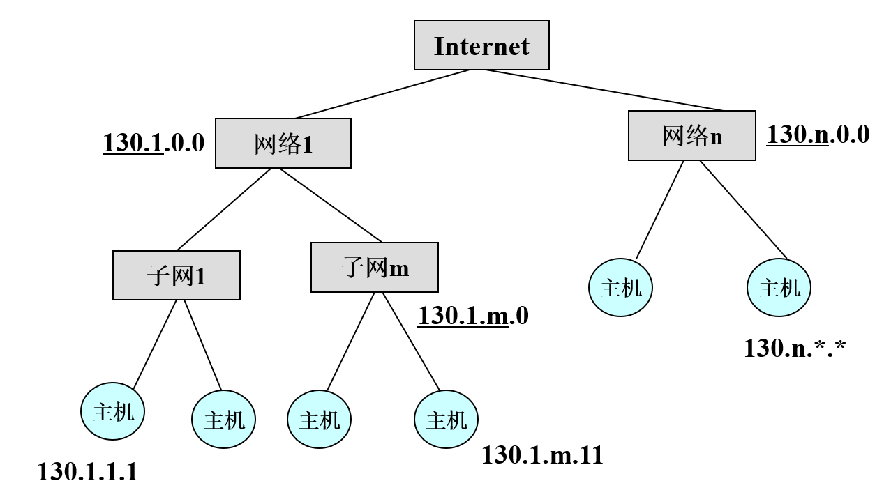

每个IP address都包含：
- network portion

    也叫prefix
- host portion

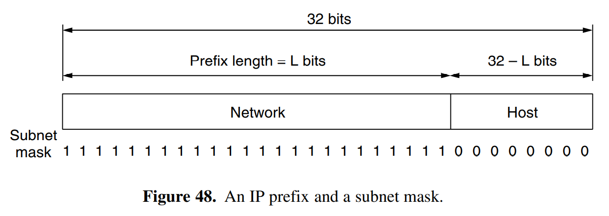

---

dotted decimal notation
: each of the 4 bytes is written in decimal, from 0 to 255

虽然说这样可以更加方便记忆，但是并没办法确定network和host两部分各有多长

因此，我们会==在IP后面跟上`/`和数字表示network部分的长度==

e.g.

128.208.0.0/24 表示network部分有24bit长

---

我们怎么传输prefix长度这个信息给router呢？

subnet mask
: The length of the prefix corresponds to a binary mask of 1s in the network portion

参见上面Figure 48里，图中为255.255.255.0对应的subnet mask

这么做的好处是，我们只要将subnet mask和IP address按位取AND，就可以得到network portion了

#### 6.2.2 Subnets

subnetting
: allow the block of addresses to be split into several parts for internal use as multiple networks, while still acting like a single network to the outside world

!!! note
    subnet在这里的含义发生了变化。以前是指代"the set of all routers and communication lines in a network"

可以解决一些闲置地址浪费、添加新的网络的问题

e.g.

我们现在有单个 `/16` 的网络地址，现在想要分配一下给三个不同的学院。最终的分配方案是：
- 计算机分得$\frac{1}{2}$的地址：`a/17`
- 电气工程分得$\frac{1}{4}$的地址：`a/18`
- 艺术学院分得$\frac{1}{8}$的地址：`a/19`
- 剩下$\frac{1}{8}$的地址空闲

让我们看看二进制下这是啥意思：

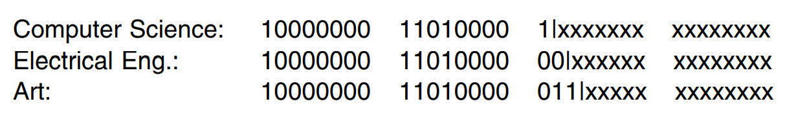

其中`|`是subnet number和host之间的分界线

没那么直观的图：

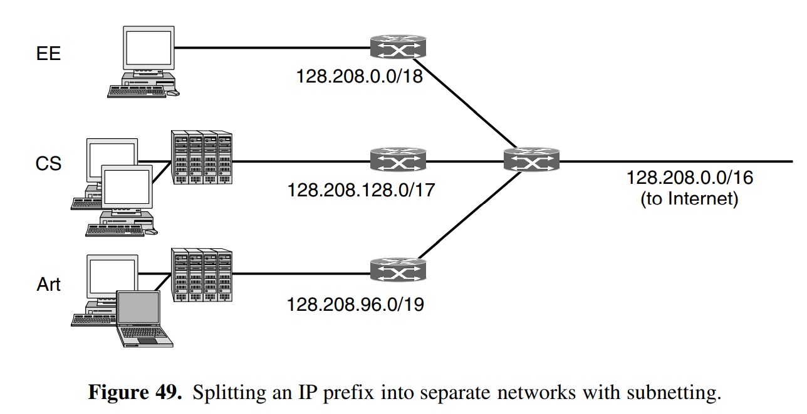

---

那对于上图中最右边的router而言，他咋知道应该把packet送到哪个subnet去呢？

相比于用一个拥有$2^{32}$个entry的routing table，显然router只需要知道**subnet mask**会更加高效

> When a packet arrives, the router ==AND the destination address with the mask for each subnet== and checking to see if the result is the corresponding prefix

e.g.

现有一个要去128.208.2.151的packet

为了看看是不是去CS的，我们将这个address和CS那个subnet的掩码255.255.128.0 (前面17位是1) 取AND，得到了地址的前17位，结果是128.208.0.0，显然和目标地址的prefix不同

后面以此类推

#### 6.2.3 CIDR (Classless InterDomain Routing)

处于核心骨干网络的router面临一个问题：假如把每个host的ip都写进routing table的话，那大小就会爆炸

咋办呢？我们可以使用subnetting的逆过程：

route aggregation
: combine multiple small prefixes into a single larger prefix

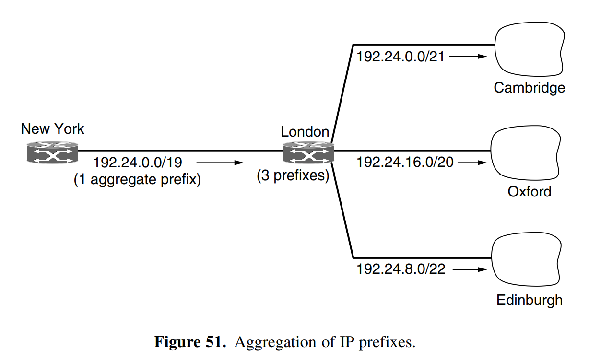

比如图中，New York就只需要存储一个aggregate prefix，而不是三个prefix，这样显著减少了需要存储的entry数量

实际上，prefix之间是允许有重叠的。规则是，packet会被送往最精确的那个route，也就是**longest matching prefix**

#### 6.2.4 Classful and Special Addressing

在CIDR诞生之前，IP地址被分为了5类，叫做**classful addressing**:

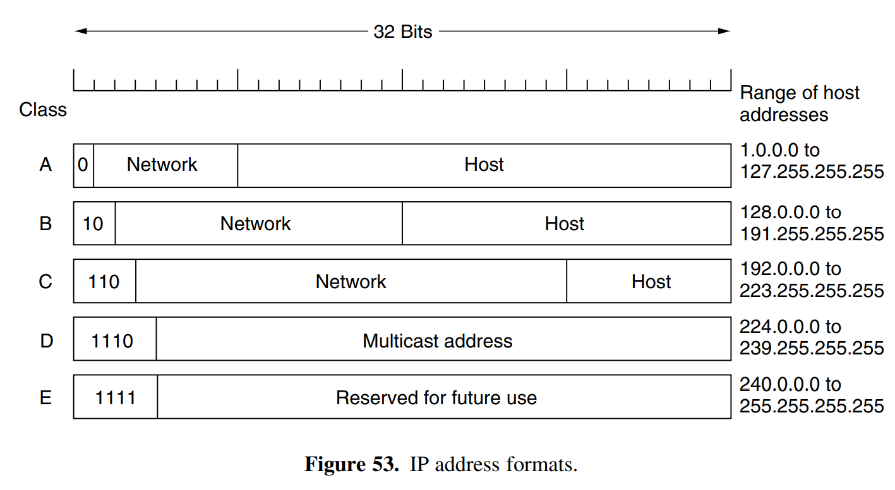

- **A**

    适合大规模网络

    鉴于network部分有7 bit，所以能表示的网络数量是128个

    每个网络可以容纳$2^{24}-2$个host (不知道为什么-2)

**B**, **C**情况类似

<!-- 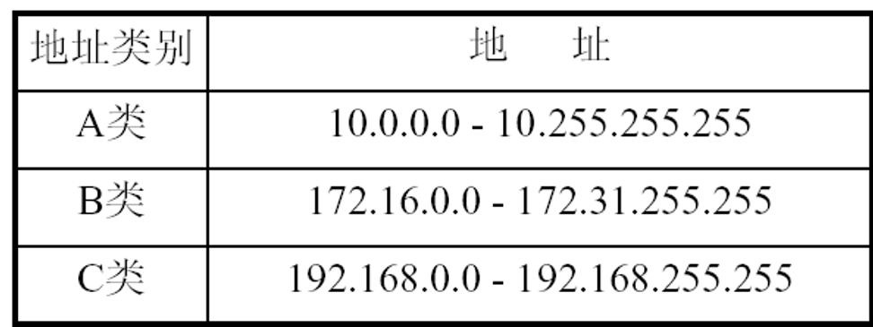 -->

对应的子网掩码分别是255.0.0.0, 255.255.0.0, 255.255.255.0

可以稍微记一下区间

---

有一些有特殊含义的地址：

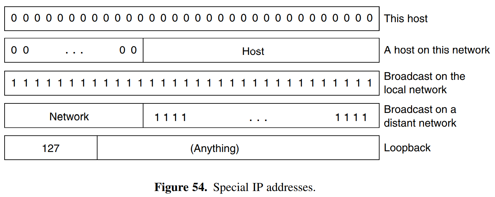

Loopback
: Packets sent to that address are not put out onto the wire; they are processed locally and treated as incoming packets

方便测试时发送给自己

---

e.g.

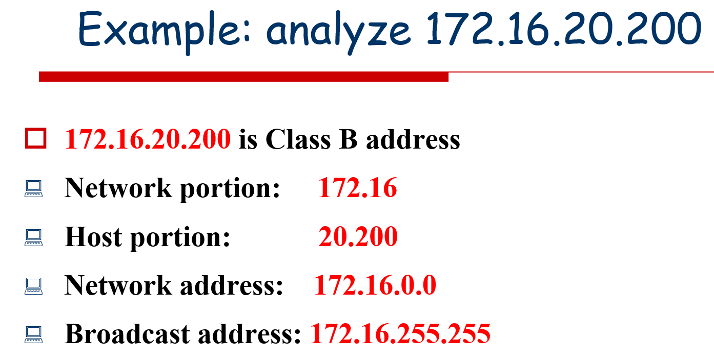

#### 6.2.5 NAT (Network Address Translation)

IP地址无论何时都是非常稀缺的。在迁移到IPv6之前，需要点解决方案

NAT (Network Address Translation)
: The basic idea behind NAT is for the ISP to assign each home or business a ==single IP== address (or at most, a small number of them) for Internet traffic. ==Within== the customer network, every computer gets a ==unique IP address==, which is used for routing intramural traffic. However, just before a packet exits the customer network and goes to the ISP, an ==address translation== from the unique internal IP address to the shared public IP address takes place

private IP可以声明三个范围之一：
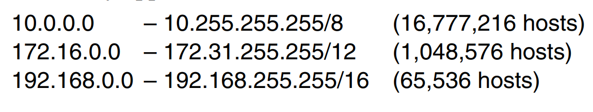

!!! note
    这三个范围其实是和classful addressing里面的A, B, C三个类的范围不同的！那三个是8, 16, 24。出于神秘的原因，ppt上似乎在讲classful addressing的时候使用了同样的范围，非常误导人

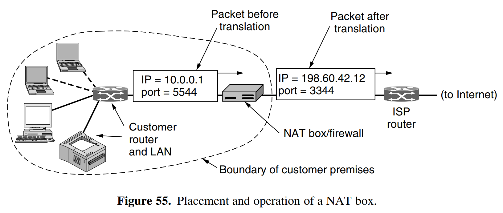

上图中，private IP 10.0.0.1被**NAT box**翻译成了public IP 198.60.42.12

---

讨论到现在，我们其实一直忽略了一个问题：NAT从外向里发送数据的时候，他咋知道应该发给哪个private IP？

现实中的解决方法是利用TCP/UDP的==port== field。port的长度是16-bit，这就足以区分每个private IP

同时，NAT box会存储一个==translation table==。当一个packet从外面进来的时候，他就以source port field作为index，来在translation table中查找，找到internal IP address

---

即便如此，NAT有很多硬伤：
- NAT ==violates the architectural model== of IP - every IP address uniquely identifies a single machine worldwide.
- It ==changes the Internet into a “connection-oriented” network==. The NAT box maintains the state of the connection, and if it crashes, so does the link.
- Protocol layer $k$ makes assumptions about what protocol layer $k+1$ has put in the payload, ==violating layer independence==.
- NAT may fail if ==some protocols other than TCP or UDP are used==.
- If IP addresses are ==inserted into the payload data== (i.e. text of the message), then the NAT table will not translate that information and trouble could occur.
- The limit of a NAT machine is 61,440 （65536-4096）machines.

### 6.3 IP Version 6

IPv4地址空间短缺的问题，从长期来看只有IPv6能解决

IPv6的设计之初的目标是：

- Support ==billions of hosts==, even with inefficient address allocation.
- ==Reduce the size of the routing tables.==
- ==Simplify== the protocol, to allow routers to process packets faster.
- Provide better ==security== (authentication and privacy).
- Pay more attention to the ==type of service==, particularly for real-time data.
- Aid ==multicasting== by allowing scopes to be specified.
- Make it possible for a host to roam without changing its address.
- Allow the protocol to ==evolve== in the future.
- Permit the old and new protocols to coexist for years.

尽管IPv6和IPv4不兼容，但是IPv6兼容其他的auxiliary Internet protocols，比如TCP, UDP

#### 6.3.1 The Main IPv6 Header

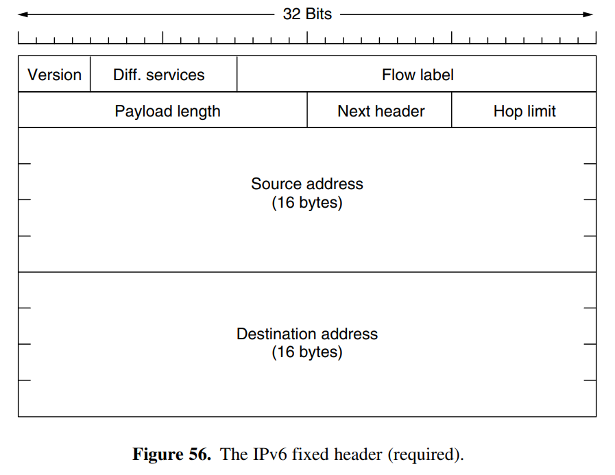

- **Flow label**

    新增的field
    > provides a way for a source and destination to mark groups of packets that have the same requirements and should ==be treated in the same way by the network==, forming a ==pseudoconnection==.

    比如说，假如一些packets有很高的延迟的要求，我们可以设置这个field，让router们留出带宽

    > flows are an attempt to have it both ways: the flexibility of a *datagram network* and the guarantees of a *virtual-circuit network*.
- **Payload length**

    替代了IPv4中的Total length  
    > tells how many bytes follow the 40-byte header 

    名字变化是因为，header自身40 byte的长度不再算入在内（==以前header长度不固定，现在固定是40 byte==）
- **Next header**

    替代了IPv4中的protocol
    > tells which of the (currently) six extension headers, if any, follow this one

    假如这个header是最后一个IP header，那么这个field会记录要把packet传送给哪个protocol handler (e.g., TCP, UDP)
- **Hop limit**

    替代IPv4中的time to live
    > keep packets from living forever

    原本以为生命周期会用秒来计算，后来发现大家都用hop，所以干脆改个名字
- **Source address** and **Destination address**

    由32 bit变成了==128 bit== (16 byte)

    !!! note
        不要以为上图中地址是32 bit，地址有四层！所以是128 bit！

    原本是8-bit为一组，以十进制表示，4组，`.`分割；现在是16-bit一组，以16进制表示，8组，`:`分割：

    $$
    8000:0000:0000:0000:0123:4567:89\text{AB}:\text{CDEF}
    $$

    鉴于地址太长而且包含很多0，有一些优化：
    - leading zeros within a group can be omitted
    - one or more groups of 16 zero bits can be replaced by a pair of colons

    所以上个地址可以简化为：
    $$
    8000::123:4567:89\text{AB}:\text{CDEF}
    $$

除此之外还有一些field从IPv4中移除：
- **IHL**

    鉴于IPv4是变长才需要，IPv6这个40 byte定长的就不需要了
- 和fragmentation相关的field全部移除

    因为对于太大的packet直接换了一种做法：与其让router把它分成fragment，不如让router直接返回一个报错信息，告诉host自己把所有将来的packet都拆分得更小

    这样子其实是效率更高的
- **Checksum**

    由于计算checksum非常影响性能，干脆直接移除了

    DLL和transport layer一般都有checksum，所以再多加一个似乎没啥用

#### 6.3.2 Extension Headers

有些时候，相比于IPv4少掉的field还是需要用到的，所以有了**extension header**这么一个可加上的东西

现阶段有6种extension header:

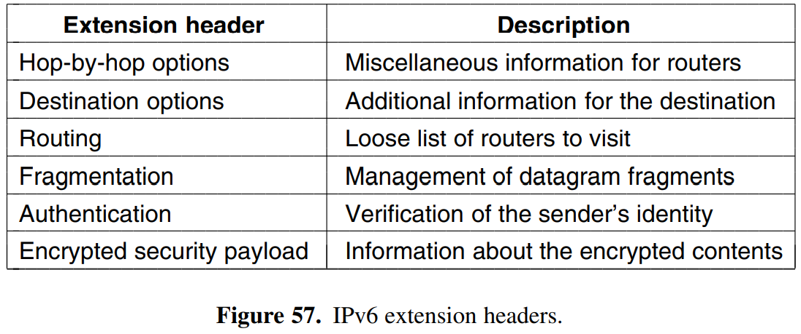

这些里面有些是有固定格式的，其它的则是包含了可变数量的变长的option，以`(Type, Length, Value)`的格式

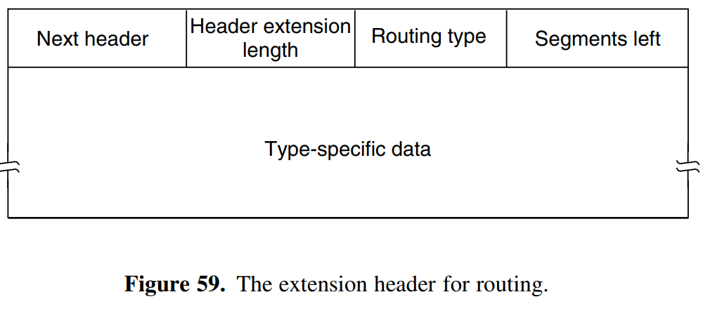

### 6.4 Internet Control Protocols

IP是用来做数据传输的，除此之外网络层还有许多伴生的控制协议，包括：
- **ICMP** (Internet Control Message Protocol)
- **ARP** (Address Resolution Protocol)
- **DHCP** (Dynamic Host Configuration Protocol)

#### 6.4.2 ARP (Address Resolution Protocol)

当我们考虑到data link layer的时候，会意识到网卡其实是完全不认识这些32 bit的IP address的，他们只关心自己的48 bit的MAC address

那怎么让这些IP address映射到MAC address上呢？

e.g.

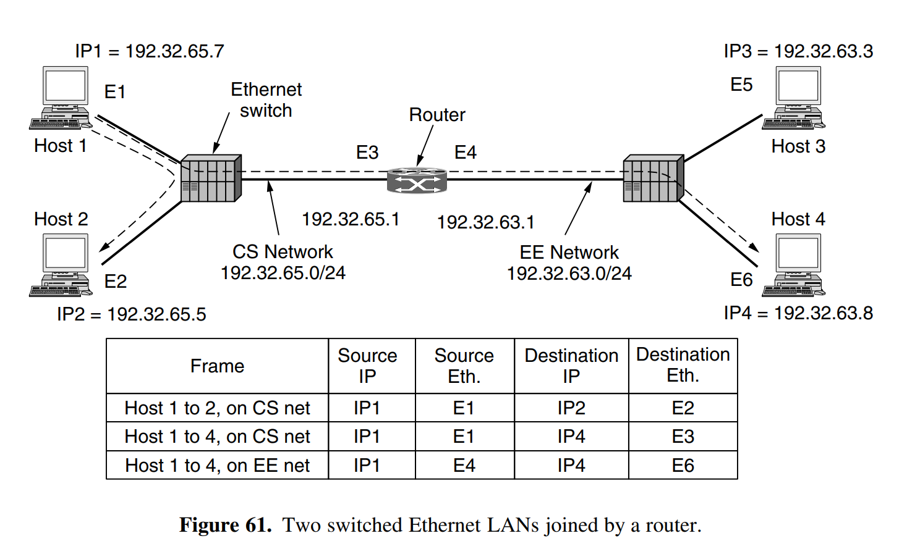

假设现在Host 1想要给Host 2发个消息，虽然它通过DNS知道了IP地址是多少，而且，通过IP地址，他还知道了Host 2和他处在同一个局域网内，但是发送东西是需要知道MAC地址的

所以，host 1干脆直接在Ethernet上进行广播，询问谁的IP地址是192.32.65.5。只有host 2会响应这个广播，所以host 1就这么知道了host 2的MAC地址是$E2$

这些信息同样会和routing table类似，记录在ARP table中

#### 6.4.3 DHCP (Dynamic Host Configuration Protocol)

大部分如ARP之类的Internet protocol都做了个假设：host都有IP address。然而这个IP address到底咋分配呢？显然由人来分配的话非常不现实，这就需要DHCP了

大概的意思是：每个network上需要有一个DHCP server负责分配地址。每个host启动之后，虽然拥有MAC address，但是不具有IP address。于是它会广播一个DHCP DISCOVER packet，DHCP server收到之后，会回复一个DHCP OFFER packet，从剩余的IP address里分配一个告诉他

为了动态更新IP address，**leasing** (租赁)机制会让IP address保持一个固定时长，在租赁就要到期的时候，host必须请求续租

---

DHCP已经大多取代了更早期的RARP (Reserve Address Resolution Protocol) 和BOOTP等功能更加有限的协议

### 6.6 OSPF-An Interior Gateway Routing Protocol

属于[2.5](#25-link-state-routing)中介绍的link state protocol

interior gateway protocol (IGP)
: Inside of its own network, an organization can use its own algorithm for internal routing, called **interior gateway protocol**

exterior gateway protocol
: routing between independently operated network

### 6.7 BGP-The Exterior Gateway Routing Protocol

在单个AS (Autonomous System)里，OSPF和IS-IS是常用的protocol。而在不同的AS之间，我们需要用不同的protocol来完成，称为**BPG (Border Gateway Protocol)**

我们需要这个额外的protocol的理由也很简单，因为interior gateway protocol和exterior gateway protocol的目的是不同的：
> All an interior protocol has to do is move packets as efficiently as possible from the source to the destination. It does not have to worry about politics

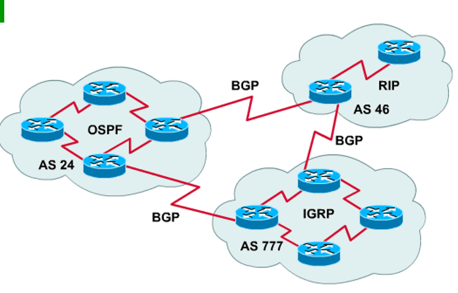

---

Typical policies involve:
- political
- security
- economic

Given BGP's special interest in transit traffic, networks are grouped into one of three categories:
- stub networks
- multiconnected networks
- transit networks

---

看看BGP怎么工作的

Pairs of BGP routers communicate with each other by establishing ==TCP connections==

BGP is fundamentally a ==distance vector protocol==, but quite different from most others such as RIP: BGP router ==keeps track of the exact path==

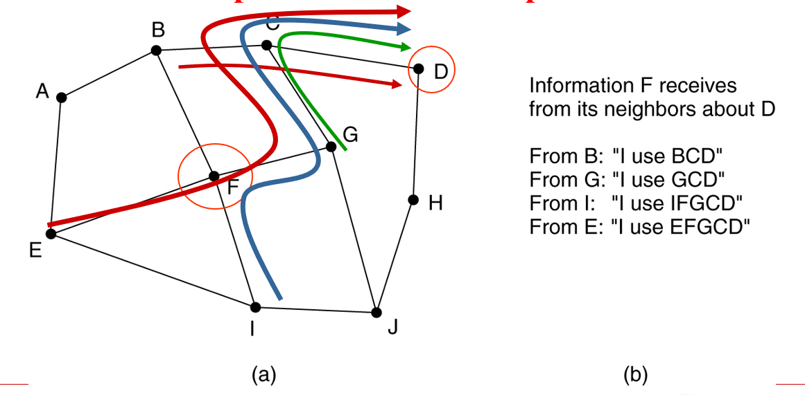

