# The Transport Layer

> Together with the network layer, the transport layer is the ==heart== of the protocol hierarchy
>
> The transport layer builds on the network layer to provide data transport from a process on a source machine to a process on a destination machine with a desired level of reliability that is ==independent of the physical networks== currently in use

## 1. The Transport Service

### 1.1 Services Provided to the Upper Layers

> The ultimate goal of the transport layer is to provide efficient, reliable, and cost-effective data transmission service to its users, normally processes in the application layer
>
> The software and/or hardware within the transport layer that does the work is called the **transport entity**

transport entity 可以分布在：
- OS kernel
- library package bound into network applications
- separate user process
- on the network interface card

前两种较为常见

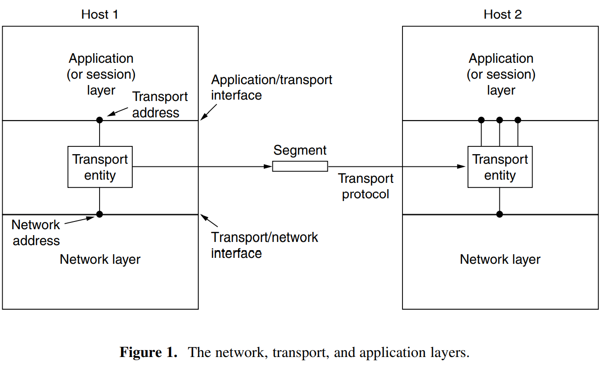

---

network layer有两种不同的service类型：
- connection-oriented
- connectionless

非常巧的是，transport layer同样有非常类似的这两种类型的service

那为啥还要分开network layer和transport layer？干脆合在一起得了？
- > The *transport* code runs entirely on the ==users' machines==, but the *network* layer mostly runs on the ==routers==, which are operated by the carrier

    The users have no real control over the network layer

    > The only possibility is to put on top of the network layer another layer that improves the ==quality of the service== (QoS)
- > The transport primitives can be implemented as calls to library procedures to make them ==independent== of the network primitives. The network service calls may vary considerably from one network to another

    比如有线网和无限网的实现可能差别很大，在此之上做一层抽象更好

---

据此，人们把OSI模型里的底下四层称为**transport service provider**，而其它上面的层称为**transport service user**

### 1.2 Transport Service Primitives

The transport service primitives allow application programs to access the transport service.

尽管transport service和network service有很多相似之处，但是还是有区别的：
- > The *network* service is intended to model the service offered by real networks, warts and all. (Real networks can lose packets, so the network service is generally unreliable), while the connection-oriented *transport* service is ==reliable==

    用户可以相信他们使用的service是非常可靠的，而不是像network layer的service一样可能发生各种奇怪错误的
- > The *network* service is used only by the transport entities, while the *transport* service is used by application programs directly and must be convenient and easy to use 

来看看例子可能的primitive有哪些：

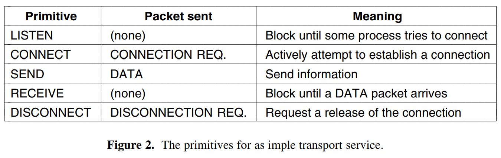

---

segment
: ==messages== sent from transport entity to transport entity

TCP, UDP和一些其它Internet protocol用的都是这个名字。一些更加古早的protocol会用**TPDU** (Transport Protocol Data Unit)来称呼

所以说，segment, packet, frame之间的关系如图：

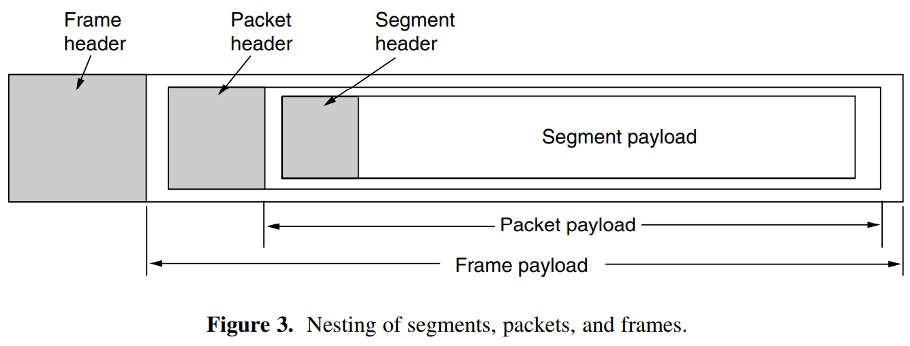

---

e.g.

非常长

- Connection establishment
    - The server executes a LISTEN primitive, which blocks the server until a client turns up.
    - A client executes a CONNECT primitive, which blocks the client, and sends a packet (encapsulating a CONNECTION REQUEST TPDU) to the server via the underlying network layer.
    - When the packet arrives at the server side, the transport entity checks to see that whether the server is blocked on a LISTEN (i.e., interested in handling requests). It then unblocks the server and sends a CONNECTION ACCEPTED TPDU back to the client.
    - When this TPDU arrives at the client side, the client is unblocked and the connection is established.
- Data exchange
    - Either party can do a (blocking) RECEIVE to wait for the other party to do a SEND.
    - When the DATA TPDU arrives, the receiver is unblocked.
    - As long as both sides can keep track of whose turn it is to send, this scheme works fine.
    - Every packet sent will be (eventually) acknowledged by the underlying network layer. 
    - These acknowledgements, timers, and re-transmissions are managed by the transport entities using the network layer protocol and are not visible to the transport users.
- Connection release
    - **Asymmetric disconnection**: either transport user can issue a DISCONNECT primitive, which results in a DISCONNECT TPDU being sent to the remote transport entity. Upon arrival, the connection is released.
    - **Symmetric disconnection**: When one side does a DISCONNECT, that means it has no more data to send, but is still willing to accept data from its partner. A connection is released when both sides have done a DISCONNECT.

## 2. Elements of Transport Protocols

### 2.3 Connection Release

there are two styles of terminating a connection:
- **asymmetric release**

    > is the way the telephone system works: when one party hangs up, the connection is broken
- **symmetric release**

    > treats the connection as two separate unidirectional connections and requires each one to be released separately.

asymmetric release太过于突然，可能会导致对面最后传输的信息丢失:

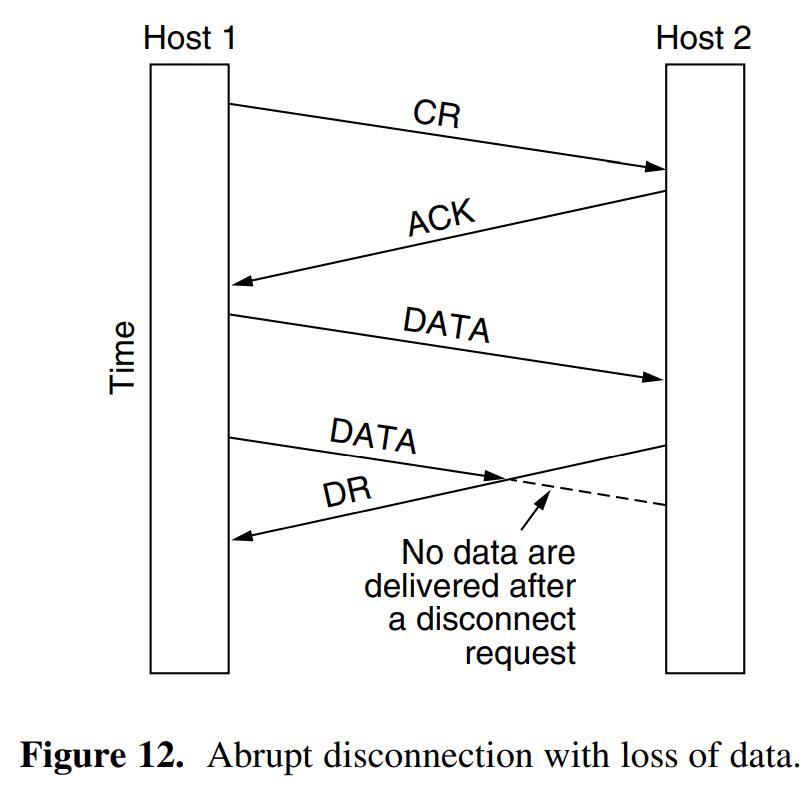

所以能够避免data loss的symmetric release更加合理

---

然而，symmetric release面临一个比较大的问题：**two-army problem**

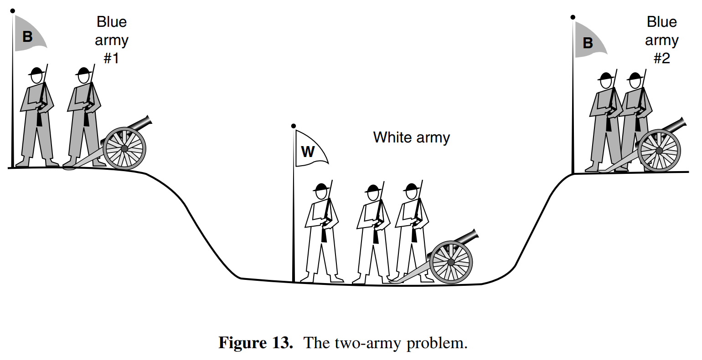

现在White army恰好比其中一边的Blue army要更强，但是假如两边的Blue army联合的话，就可以打败White army

所以说，现在两边的Blue army必须要交流，约定个时间来同时攻打中间，然而唯一的通信方式是走过中间的这么一个unreliable channel来通信（信息可能丢失）

> Suppose that the commander of blue army #1 sends a message reading: ‘‘I propose we attack at dawn on March 29. How about it?’’ 
> 
> Now suppose that the message arrives, the commander of blue army #2 agrees, and his reply gets safely back to blue army #1. 
> 
> Will the attack happen? Probably not, because ==commander #2 does not know if his reply got through==. If it did not, blue army #1 will not attack, so it would be foolish for him to charge into battle

即便提出建议的#1方再次发送确认回复，这次就会变成#1感到疑惑有没有送到

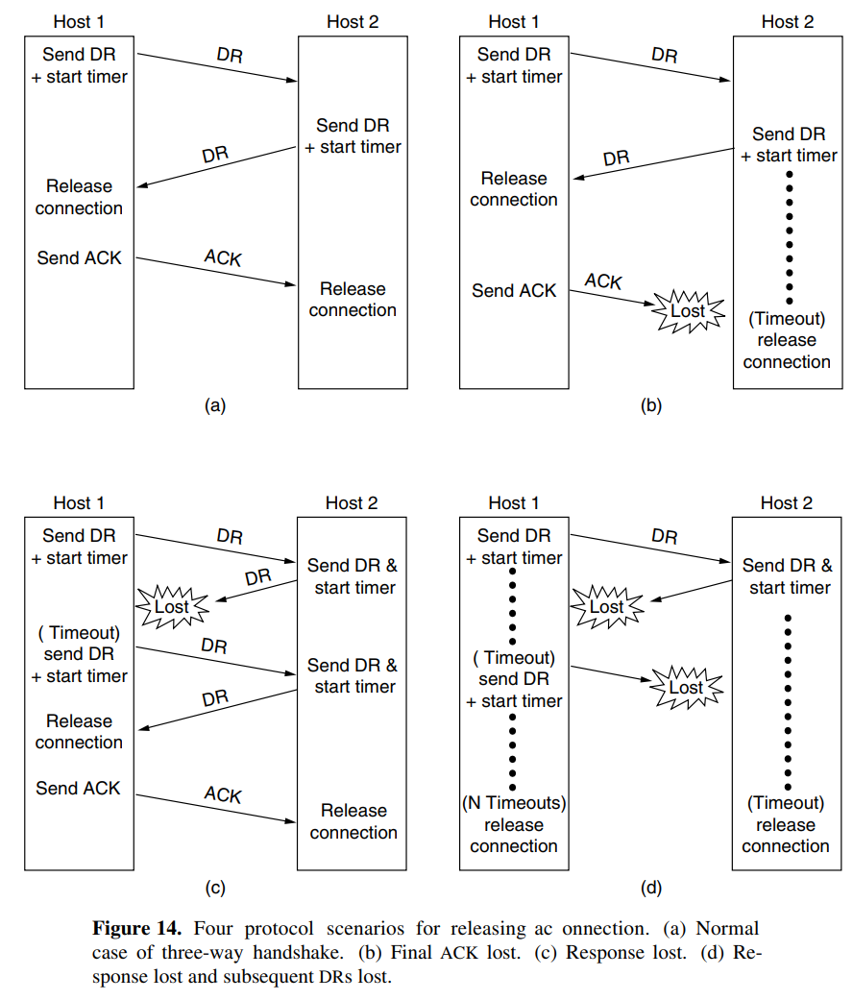

总之，不存在一个protocol可以保证他们可以同时进攻

视线回到TCP connection release上。上面的问题说明了，不存在一个protocol可以保证两边能同时结束

---

那到底咋对付tow-army problem呢？
> ==timers== are used. If a response to a *FIN* is not forthcoming within two maximum packet lifetimes, the sender of the *FIN* release the connection
>
> The other side will eventually notice that nobody seems to be listening to it anymore and will time out as well

这玩意可能导致**half-open connection**:
> it can fail if the initial DR and $N$ retransmissions are all lost. 
> 
> The sender will give up and release the connection, while the other side knows nothing at all about the attempts to disconnect and is still fully active.

其中一种解决方法：
> If no TPDUs have arrived for a certain number of seconds, the connection is automatically disconnected.
> 
> It is necessary for each transport entity to have a timer that is stopped and then restarted whenever a TPDU is sent. If this timer expires, a dummy TPDU is transmitted 

## 4. UDP (User Datagram Protocol)

属于connectionless protocol

client-server和multimedia用到这玩意

### 4.1 Introduction to UDP

> UDP provides a way for applications to send encapsulated IP datagrams without having to establish a connection

UDP传输的自然是segment，header长度为==8 bytes==

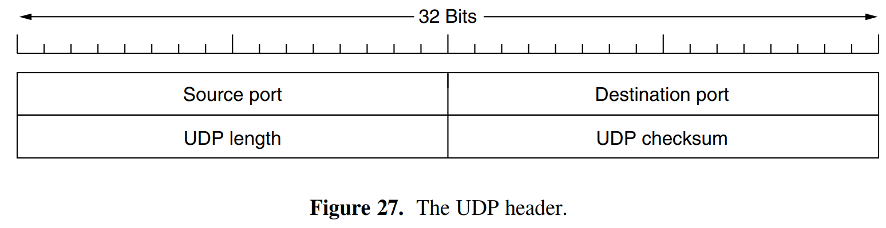

两个port field没啥特别的，只不过有些个预留的：

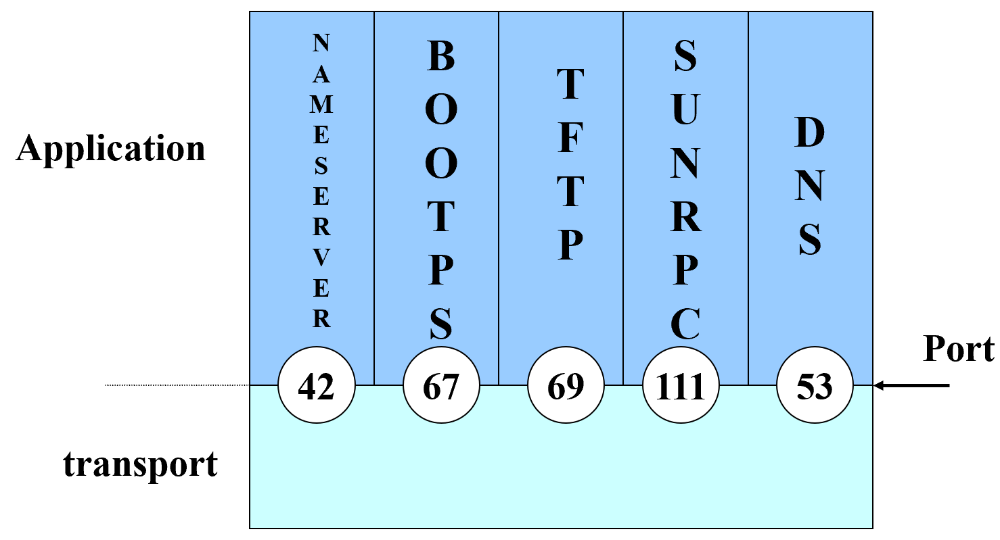

- **UDP length**

    ==包括了header的长度==
- **UDP checksum**

    > It checksums the header, the data, and a conceptual IP pseudoheader

    ==optional== and stored as 0 if not computed (a true computed 0 is stored as all 1s).

    没读懂书上这段

!!! note
    the advantage of UDP over IP packets is the use of the ==source and destination ports==.

---

计算checksum的时候，TCP 和 UDP 都会涉及到了一个奇葩的设计，**pseudo header**，这玩意会被 ==prepend 到 segment 之前==：

我们其实需要在这一层获得关于 IP address 的信息（来在计算 checksum 的时候包含这些相对重要的信息）。然而这些信息其实已经包含在了网络层的 packet 里了，于是我们就从那边借用点信息：

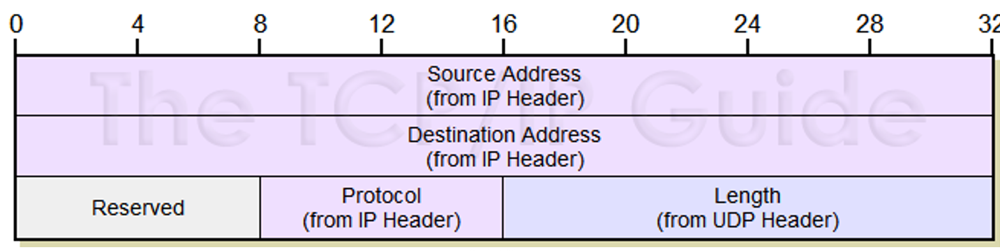

图中是 UDP 的情况，protocol 一栏填的是17（指代UDP），后面跟着 UDP 数据报长度

假如是 TCP 的话，protocol 一栏填的就是 6 (指代 TCP)，后面跟着 TCP segment length

> Including the pseudoheader in the UDP checksum computation helps detect misdelivered packets, but including it also violates the protocol hierarchy since the IP addresses in it belong to the IP layer, not to the UDP layer

## 5. TCP (Transmission Control Protocol)

> UDP is a simple protocol and it has some very important uses, but for most Internet applications, reliable, sequenced delivery is needed

这就需要TCP登场了

### 5.1 Introduction to TCP

TCP
: **TCP** (Transmission Control Protocol) was specifically designed to provide a ==reliable== end-to-end byte stream over an ==unreliable== internetwork

> TCP must dynamically adapt to different topologies, bandwidths, delays, packet sizes, etc and must be robust to failures

封装：
> A TCP entity accepts user data streams from local processes, breaks them up into pieces not exceeding 64K bytes (in practice, usually about 1460 bytes in order to fit in a single Ethernet frame with the IP and TCP headers), and sends each piece as a separate IP datagram.	

解封装：
> When IP datagrams containing TCP data arrive at a machine, they are given to the TCP entity, which reconstructs the original byte streams

### 5.2 The TCP Service Model

socket
: TCP service is obtained by both the sender and the receiver creating end points (端点？), called **sockets**

书上是1.3有socket的详细介绍，反正没看懂

根据使用经验来看，socket应该是再上一层的抽象，属于 session layer

port
: Each socket has a socket number (address) consisting of the IP address of the host and a 16-bit number local to that host, called a **port**

> Connections are identified by the socket identifiers at both ends, that is, `(socket1, socket2)`. No virtual circuit numbers or other identifiers are used.

well-known port
: Port numbers below 1024 are reserved for standard services that can usually
only be started by privileged users (e.g., root in UNIX systems)

比如：

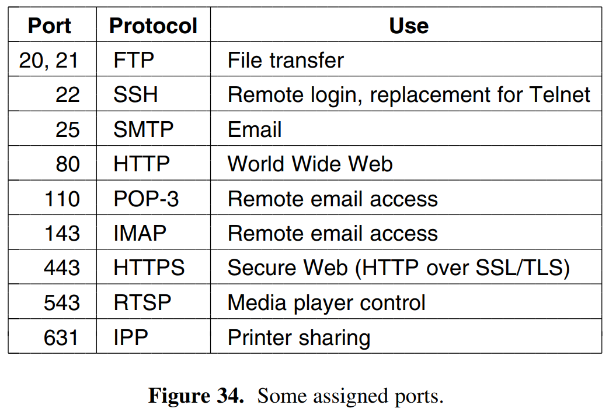

---

> All TCP connections are **full-duplex** (which means that traffic can go in both directions at the same time) and **point-to-point** (which means each connection has exactly two end points). 

!!! note
    TCP does not support multicasting or broadcasting

> A TCP connection is a ==byte stream==, not a message stream.

### 5.3 The TCP Protocol

> A **TCP segment** consists of a ==fixed 20-byte header== (plus an ==optional== part) followed by zero or more data bytes

由TCP软件来决定segment的大小

然而有两个因素限制了segment size:
- each segment, including the TCP header, must fit in the 65,515-byte IP payload.
- Each segment must fit in the **MTU** (Maximum Transfer Unit) at the sender and receiver so that it can be sent and received in a single, unfragmented packet

    e.g.

    1500 bytes – the Ethernet payload size

> The basic protocol used by TCP entities is the sliding window protocol with a dynamic window size

### 5.4 The TCP Segment Header

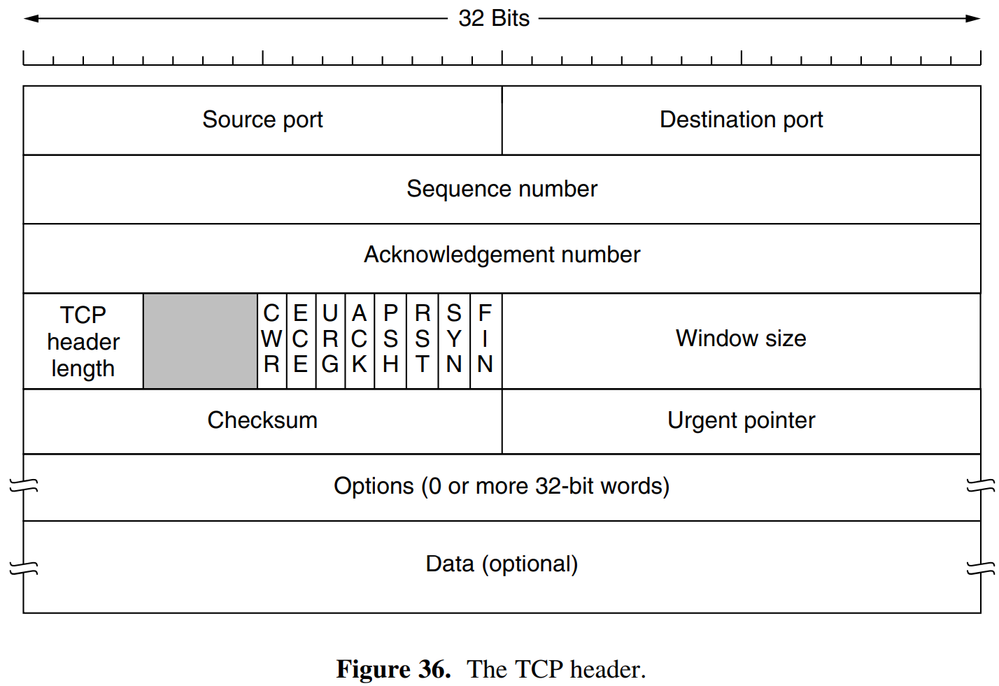

- **Source port** & **Destination port**

    > identify the local end points of the connection. A TCP port plus its host’s IP address forms a 48-bit unique end point
- **Sequence number**

    ISNs(initial sequence numbers ): random produce

    SYN: A segment with ISNs and SYN control-bit
- **Acknowledgement number**

    > The next byte expected, not the last byte correctly received

    !!! warning
        和 DLL 里面 sliding window 的 acknowledgement 不一样！那个是 last byte correctly received！太坑爹了
- **TCP header length**

    > tells how many 32-bit words are contained in the TCP header

    鉴于*Option* field是变长的，所以这个field可以记录header总长度
- eight 1-bit flags

    - **URG**

        > is set to 1 if the *Urgent pointer* is in use, which indicates a byte offset from the current sequence number at which urgent data are to be found. 
    - **ACK**

        - 1 : indicate that the Acknowledgment number is valid
        - 0: invalid. 
    - **PSH**

        > indicates PUSHed data

        =1: The receiver is requested to deliver the data to the application upon arrival and not buffer it
    - **RST**

        > is used to reset a connection that has become confused due to a host crash or some other reason
    - **SYN**

        > is used to establish connections

        - When SYN=1，ACK=0， CONNECTION REQUEST
        - When SYN=1，ACK=1， CONNECTION CONFIRM
    - **FIN**

        > is used to release a connection. It specifies that the sender has no more data to ==transmit==, but may continue to ==receive== data indefinitely.
- **Window size**

    Flow control in TCP is handled using a variable-sized sliding window.

    > tells how many bytes may be sent starting at the byte acknowledged. （up to receiver）

- **Checksum**

    > provide extra reliability

    checksums the header, the data, and the conceptual pseudoheader
- **Options**

    > provides a way to add extra facilities not covered by the regular header

    e.g.

    - The most important option is the one that allows each host to specify the maximum TCP payload it is willing to accept. 
        - Using large segments is more efficient than using small ones
        - During connection setup, each site can announce its maximum TCP payload in the Option field and see its partner's. The smaller of two numbers wins. 
        - The default is 536 bytes. All Internet hosts are required to accept TCP segments of 536 + 20 = 556 bytes. 
    - For lines with high bandwidth and/or high delay, the 64 KB window size is often a problem. A Window scale option allows the sender and receiver to negotiate a window scale factor. This number allows both sides to shift the Window size field up to 14 bits to the left, thus allowing windows of up to 230 bytes. Most TCP implementations support this option.
    - Another option proposed by RFC 1106 and now widely implemented is the use of the selective repeat instead of go back n protocol

### 5.5 TCP Connection Establishment

The three-way handshake is used to establish connections:
- One side (the server) passively listens for incoming connections
- The other side (the client) connects to the server with a connection request and sets out the parameters.
- The server replies with an acknowledgement and the connection is set.

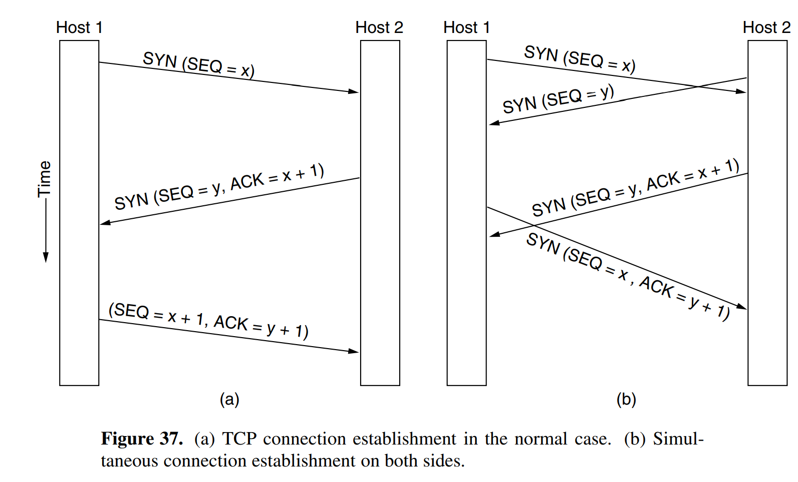

### 5.6 TCP Connection Release

正常来说，为了release一个connection:
> - Either party can send a TCP segment with the FIN bit set, which means that it has no more data to transmit. 
> - When the FIN is acknowledged, that direction is shut down. 
> - When both directions have been shut down, the connection is released. 

不正常的情况见[2.3](#23-connection-release)

为了避免two-army problem，我们需要使用timer:
- If a response to a FIN is not forthcoming within two maximum packet lifetimes, the sender of the FIN releases the connection. 
- The other side will eventually notice that nobody seems to be listening to it any more, and time out as well.

---

其实，这个protocol依然可能失效。只要initial DR和retransmission都丢包了，就会出现sender关闭了链接，但是另一边毫不知情地等待着接收。这种情况叫**half-open**

为了避免上述问题:
- If no TPDUs have arrived for a certain number of seconds, the connection is automatically disconnected.
- It is necessary for each transport entity to have a timer that is stopped and then restarted whenever a TPDU is sent. If this timer expires, a dummy TPDU is transmitted 

### 5.8 TCP Sliding Window

考虑下面这张图：

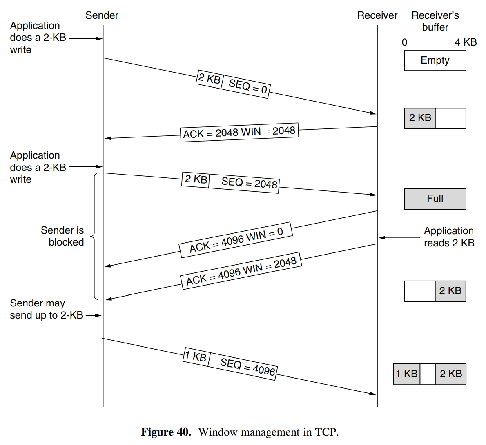

图中值得注意的点在于`WIN`这个东西，指的是剩余的可用buffer大小

当`WIN=0`的时候，sender就不继续传东西了

当然，事情总是有些例外的，有两种情况下sender依旧会继续传：
- **urgent data**

    > urgent data may be sent, for example, to allow the user to ==kill the process== running on the remote machine
- **window probe**

    > the sender may send a 1-byte segment to force the receiver to ==reannounce the next byte expected and the window size==

    防止window announcement的packet中途丢失了导致死锁

---

发送方和接受方都并没有被要求尽快处理拿到的数据，这样是可以有效提高性能的，具体表现如下：

- **receiver**

    delayed acknowledgement
    : delay acknowledgements and window updates for up to 500 msec in the hope of acquiring some data on which to ==hitch a free ride==

    有 piggybacking 的意思了
- **sender**

    Nagle's algorithm
    : when data come into the sender in small pieces, just send the first piece and ==buffer all the rest== until the first piece is acknowledged. Then send all the buffered data in one TCP segment and start buffering again until the next segment is acknowledged

    攒的足够多碎片之后一起发

    当然，有时候我们也需要禁用这个算法，来提高响应速度，比如在玩联机且需要实时决策的游戏的时候

---

会降低TCP性能的另一个问题是**silly window syndrome**

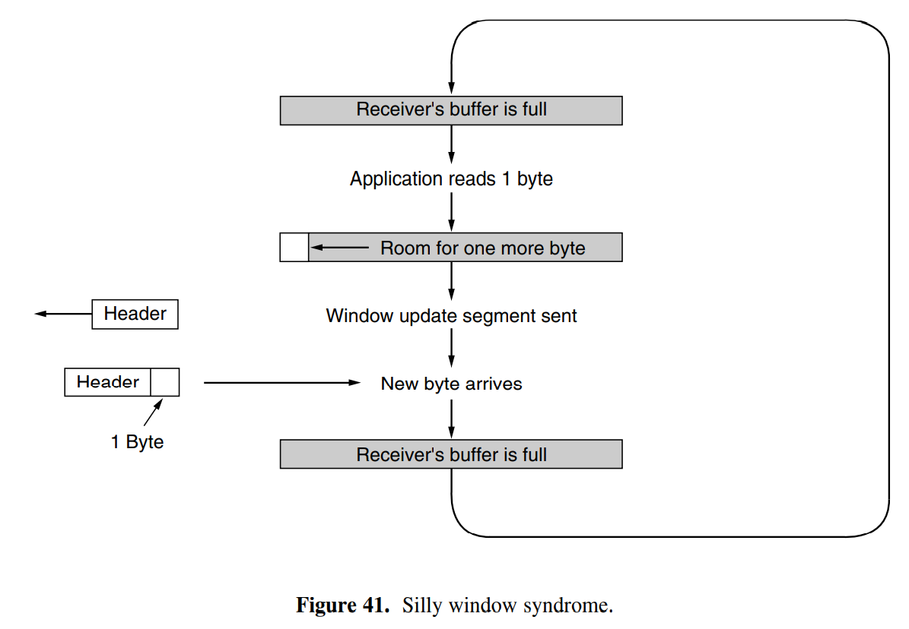

情景如下：sender发送的数据非常大，把receiver的buffer填满了，然而receiver这边的程序每次只读取一丢丢数据

一开始receiver的buffer满了，sender也很识相停止了发送数据；接着receiver的buffer因为读取了一点点数据然后空出了一个位置，于是非常高兴地告诉sender我有空位了，sender于是送了一点数据过来，于是buffer又满了

听起来就很低效，让我们看看怎么解决：

Clark's solution

: prevent the receiver from sending a window update for 1 byte; the sender can also help by not sending tiny segments

进一步限制了receiver发送window大小更新的信息，反正就是双方都攒够了再行动

