# The Application Layer

从TCP/IP的视角来看，大概是这样：

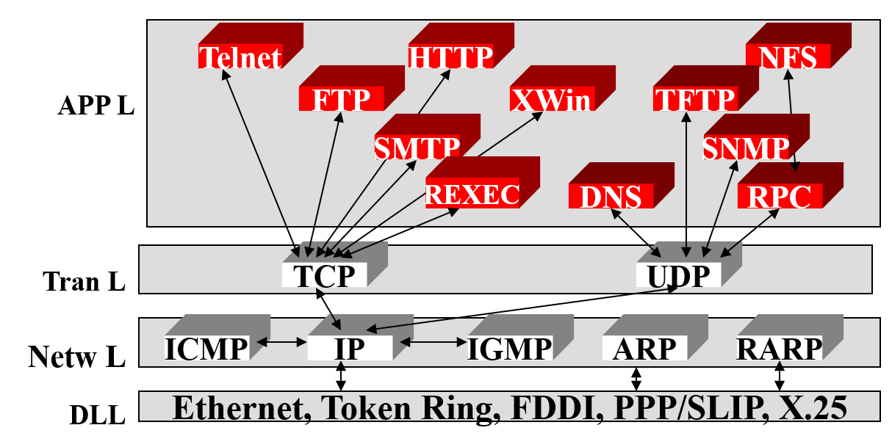

即便在应用层，也需要protocol来让程序正常运行。接下来就会介绍其中一种——DNS

## 1. DNS——The Domain Name System

尽管我们确实可以通过访问IP地址，来直接访问网站等，但是这有很多问题：
- computers can frequently ==change IPs==
- be not easy to ==remember IP==
- ==multiple servers== doing the same thing is not possible

我们需要更加高层的抽象方式

---

在还在使用ARPANET的年代，有一个`host.txt`的文件，会保存着所有电脑的名字及对应的IP地址。

对于小型网络来说，这倒是可行，但是一旦规模大起来，命名冲突等问题就非常棘手

---

为了解决上述问题，DNS就亮相了

DNS (Domain Name System)
: a hierarchical, domain-based naming scheme and a distributed database system for implementing this naming scheme

具体工作流程如下：
> Map name onto an IP address, an application program calls an library procedure, called **resolver**, passing it the name as a parameter
>
> The resolver sends ==UDP== packet to a local DNS server which looks up the name and returns the IP address to the resolver
>
> The resolver returns the IP address to the application

### 1.1 The DNS Name Space

命名的hierarchy是由ICANN (Internet Corporation for Assigned Names and Numbers)管理的

总的来说，Internet被分成了250多个**top-level domains**，然后domain底下又会有subdomain

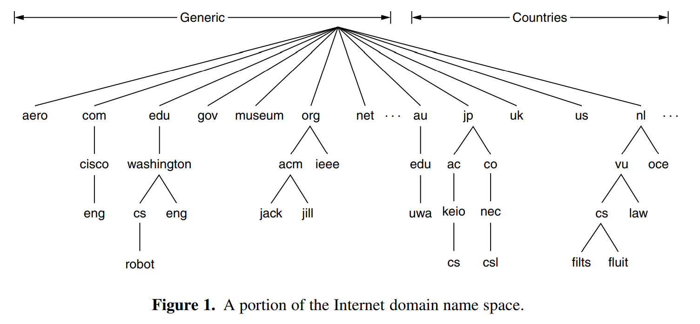

上图中可以看出，大体上可以分成Generic和Countries两种

!!! note
    虽然图中hierarchy是从上到下的，但是top-level其实是出现在url的==最右边==的那个！

---

domain命名规则如下：
> Each domain is named by the path upward from it to the (unnamed) root. The components are separated by periods

显然是常识

有以下特点：
- 分成相对和绝对两种
- ==case insensitive==
- component names can be up to 63 characters long, and full path names must not exceed 255 characters
- Each domain controls how it allocates the domains under it
- To create a new domain, permission is required from the domain that will include it; once created, it can create sub-domains without having to ask permission from the higher up domains.
- Naming follows organizational boundaries, not physical networks.

### 1.2 Domain Resource Records

DNS怎么知道域名和IP之间的映射关系呢？集中存在一起前面说了并不现实，实际上数据库来源于resource record

resource record
: Every domain, whether it is a single host or a top-level domain, can have a set of *resource records* associated with it

所以DNS的首要工作，其实是先将域名映射到resource record，才能进一步得到IP

resource record由以下五个tuple组成：
- Domain_name

    : tells the domain to which this record applies

    > Normally, many records exist for each domain and each copy of the database holds information about multiple domains. 
    > 
    > This field is thus the ==primary search key== used to satisfy queries.
    >
    > The order of the records in the database is ==not significant==.

- Time_to_live

    : gives an indication of how stable the record is

    稳定的记录会给一个很大的值，比如86400 (一天中有多少秒)
- **Class**

    : for Internet information, it is always IN

    一般不会出现non-Internet information
- **Type**

    : tells what kind of record this is

    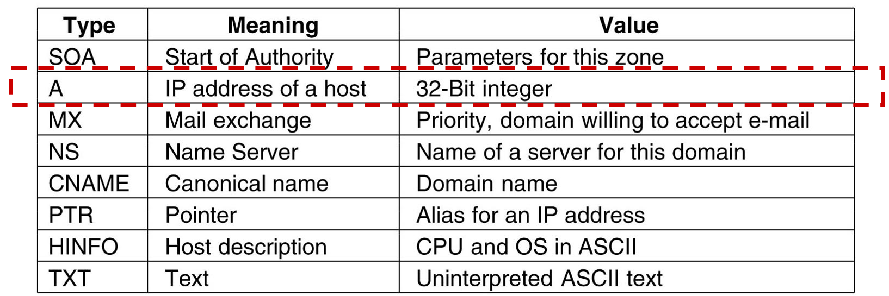
- **Value**

    如上图

总之resource record的一堆例子如下：

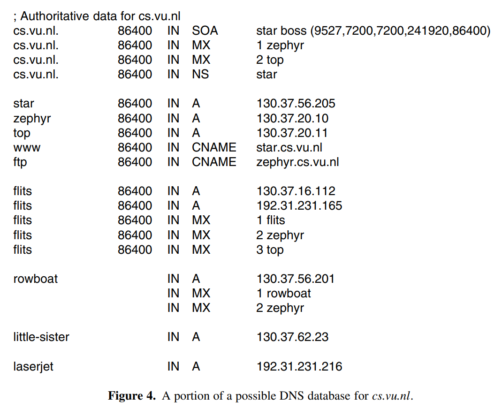

### 1.3 Name Servers

显然，将整个DNS数据库都放在一个server里，是非常不理智的行为

zones
: the DNS name space is divided into ==nonoverlapping== *zones*

其中一种可能的划分zone的方式如下：

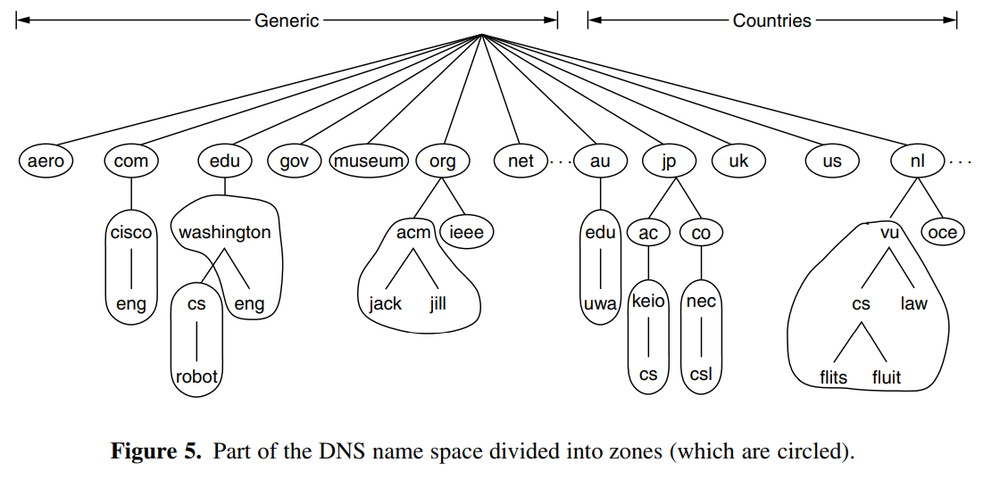

---

> Where the ==zone boundaries== are placed within a zone is up to that zone's administrator

比如说，华盛顿大学拥有`washington.edu`的域名，至于它要怎么继续划分zone的界限，就是它的意愿了。CS部门假如想要单独的一个DNS server的话，完全就可以单独给它划一个zone

---

每一个zone里，可能包含了一个或者多个的name server

primary name server
: gets its information from a file on its ==disk==

secondary name server
: gets their information from the ==primary name server==

一般是一个primary name server，多个secondary name server

为了提高稳定性，有时候name server甚至可以位于zone之外

---

name resolution
: The process of looking up a name and finding an address is called *name resolution*

我们来看看这个过程是如何根据域名找到地址的

事情分为了两种情况：
- authoritative record

    : is one that comes from the authority that manages the record and is thus always correct
- **cached record**

    不是自己直接管理的地址

显然，假如不管是哪种record，只要有记录，事情直接就结束了。但假如没有记录怎么办呢？这时候会发起remote query：

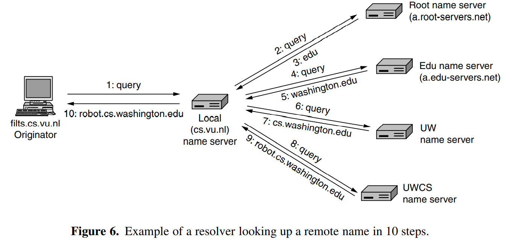

图中的数字代表了步骤。它会先从**root name server**开始询问，然后沿着hierarchy一层一层往下问

上述操作体现了两种不同的query mechanism：
- recursive query

    :  When the host `flits.cs.vu.nl` sends its query to the local name server, that name server handles the resolution on behalf of `flits` until it has the desired answer to return. It does not return partial answers.

    从左到右的每一层视为一次递归，想象一下越往左边是父进程，越往右边是子进程
- iterative query

    : the root name server (and each subsequent name server) does not recursively continue the query for the local name server. The local name server is responsible for continuing the resolution

    其实就是每个父节点会遍历一遍自己所有的子节点这个意思

假如整个流程都是recursive query的话，那么上图就会变成从左到右的一根直线了

## 2. Electronic Mail

### 2.1 Architecture and Services

email系统由两个子系统组成：
- user agent

    : which allow people to read and send email

    > The user agent is a program that provides a graphical interface, or sometimes a text- and command-based interface that lets users interact with the email system
- message transfer agent

    : move the messages from the source to the destination

    > The message transfer agents are typically system processes. They run in the background on mail server machines and are intended to be always available.

    也叫mail server

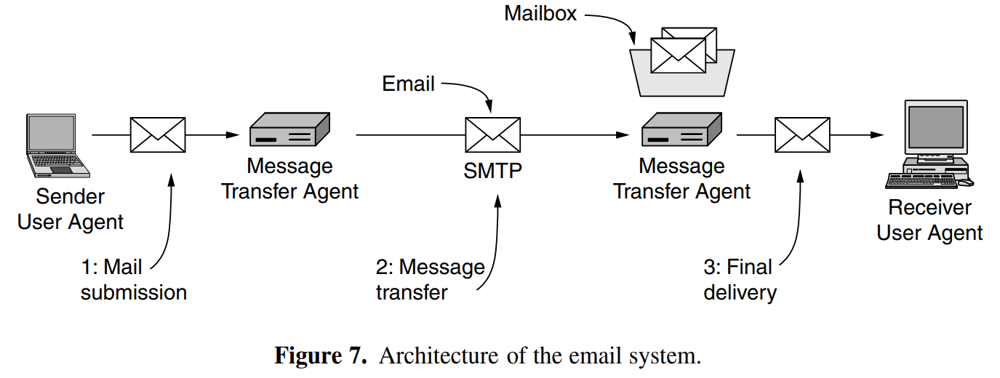

### 2.3 Message Formats

#### 2.3.1 RFC 5322——The Internet Message Format

message在这种标准下，由以下部分构成：
- **primitive envelope**

    described as part of SMTP in RFC 5321 (RFC 821的后人)
- **header fields**

    好几个不同field

    每个header field理论上包含了一行ASCII text，由以下构成：
    - **field name**
    - **colon**

        `(:)`
    - **value**

        大多情况下有
- **blank line**
- **message body**

由于RFC 822设计年代比较久远，并==没有清楚划分开envelope field和header field==。虽然在RFC 5322中进行了修改，但因为使用的太广泛了，以至于没法完全重做

一些常见的header field：

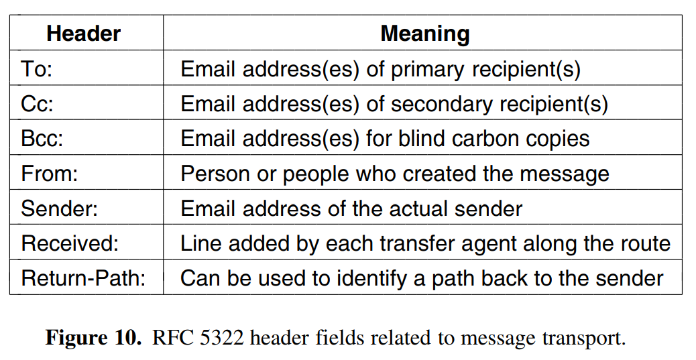

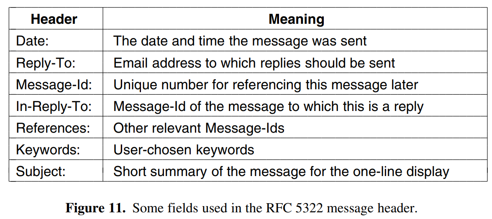

甚至于，其实用户可以创造自己使用的header，只需要用`X-`作为开头就行

#### 2.3.2 MIME——The Multipurpose Internet Mail Extensions

以前的email还只包含单纯的ASCII字符，然而由于要包含非ASCII字符以及一些多媒体文件，就需要新的变化

MIME
: The basic idea of MIME is to continue to use the RFC 822 format (the precursor to RFC 5322 the time MIME was proposed) but to add structure to the message body and define encoding rules for the transfer of non-ASCII messages. 

兼容RFC 822让它能够利用现有的mail transfer agent实现传输，只需要接受方和发送方的程序支持，就可以发送额外的那些信息

MIME为此定义了5种不同的header:

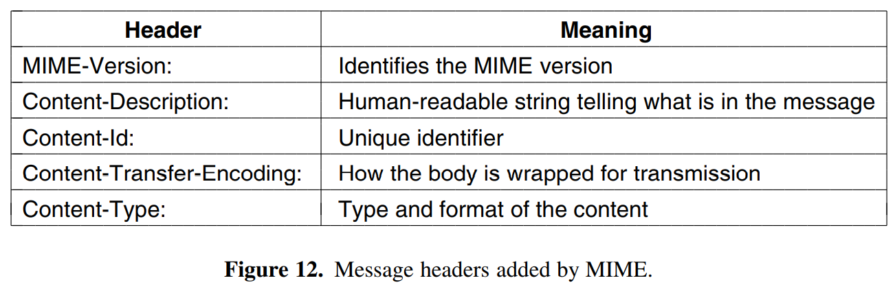

其中比较重要的是

Content-Transfer-Encoding 
: tells how the body is wrapped for transmission through a network that may object to most characters other than letters, numbers, and punctuation marks.

因为通信设计原本只是为了ASCII设计的，而非这些多媒体，所以需要对内容进行特殊的encoding

### 2.4 Mail Transfer

#### 2.4.1 SMTP (Simple Mail Transfer Protocol) and Extensions

> Source machine establishes a TCP connection on ==port 25== on destination machine, where ==SMTP daemon== listens

假如信息没有发送成功的话，包含第一部分未发送信息的错误报告就会发送给sender

详细的步骤就是：
- Connection establishment (on port 25)
- Data exchange

    - the client machine (operating as a client) waits for the destination machine (operating as a server) to talk first;

    - the server begins by sending a line of text giving its identity and telling whether is prepared to receive mail;

        if it is not, then the client releases the connection and tries again latter

    - If the server is willing to accept mail, then the client announces whom the e-mail is coming from and whom it is going to

    - If such recipient exists at the server end, then the client get the go-ahead to send the message

    - The client sends the message, server acknowledges it
- Connection is released

---

由此可见，这个协议只会在发送和接受双方都在线的时候，才会有效；也就是说，一旦接收者离线了，那就发不了了

其中一种解决方案是ISP (Internet Service Provider)提供一个message transfer agent，作为中转站；服务器当然可以24小时在线，所以就可以随时发送

那新的问题就来了：接受方怎么样从message transfer agent里复制他的邮件呢？

这就需要用另一个协议：**POP3 (Post Office Protocol Version 3)**，现在已经有了更先进的IMAP

示意图如下：

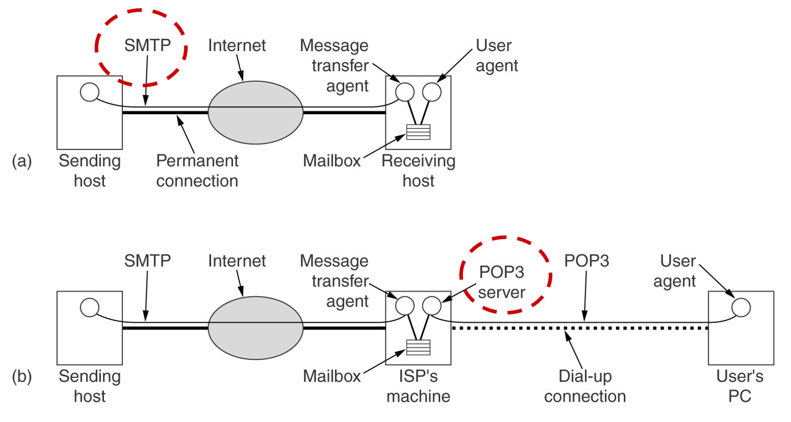

---

POP3具体工作流程如下：

- Starts when the user starts the mail reader
- Mail reader calls up the ISP (if there is no connection) and establishes a TCP connection with the message transfer agent on port 110;
- The POP3 protocol goes through three states in sequence:
    - Authorization

        Having user logged in by sending its username and password
    - Transactions

        User collecting the e-mails and marking them for deletion
    - Update

        Causes the e-mails to be deleted 

涉及如下指令：

- `USER userid` 

    This must be the first command after the connect. Supply your e-mail userid (not the full e-mail address).
    
    Example: USER john.smith
- `PASS password` 

    This must be the next command after `USER`. Supply your e-mail password. The password may be case sensitive.
- `STAT`

    The response to this is: `+OK #msgs #bytes` Where `#msgs` is the number of messages in the mail box and `#bytes` is the total bytes used by all messages. 
    
    Sample response: `+OK 3 345910`
- `LIST`

    The response to this lists a line for each message with its number and size in bytes, ending with a period on a line by itself. 
- `RETR msg#`

    This sends message number `msg#` to you (displays on the Telnet screen). You probably don't want to do this in Telnet (unless you have turned on Telnet logging). 
    
    Example: `RETR 2`
- `TOP msg# #lines`

    This is an optional POP3 command. Not all POP3 servers support it. It lists the header for `msg#` and the first `#lines` of the message text. 
    
    For example, `TOP 1 0` would list just the headers for message 1, where as `TOP 1 5` would list the headers and first 5 lines of the message text.
- `DELE msg#`

    This marks message number `msg#` for deletion from the server. This is the way to get rid a problem causing message. It is not actually deleted until the `QUIT` command is issued. If you lose the connection to the mail server before issuing the `QUIT` command, the server should not delete any messages. 
    
    Example: DELE 3
- `RSET`

    This resets (unmarks) any messages previously marked for deletion in this session so that the `QUIT` command will not delete them.
- `QUIT`

    This deletes any messages marked for deletion, and then logs you off of the mail server. This is the last command to use. This does not disconnect you from the ISP, just the mailbox.

