# Review

根据 Review.ppt 来整理答案

## Chapter 1 Introduction

### 1.1 ppt

**What is computer network?**

A collection of autonomous computers interconnected by a single technology

---

**Network category?**

PAN (personal), LAN (local), MAN (metropolitan), WAN (wide), Internet

---

Reference model

**TCP/IP VS. OSI?**

- TCP/IP: model没用，protocol广泛使用（network interface, internet, host-to-host, application）
- OSI: model有用，protocol没用（physical, dll, network, transport, session, presentation, application）

**Benefits of layered structure?**

- Reduce complexity
- Standardize interface
- Facilitate modular engineering
- Ensures interoperable technology
- Accelerate evolution
- Simplifies teaching and learning

**PDU names?**

PDU应该是protocol data unit，也就是从上往下是segment, packet, frame, bit

!!! warning
    是 packet 不是 package

---

**Service VS. Protocol?**

service
: A service is a set of operations that a layer provides to the layer above it

protocol
: is a set of rules governing the format and meaning of the packets, or messages that are exchanged by the peer entities within a layer

最大区别在于：
- **services** relate to the interfaces ==between layers==
- **protocols** relate to the packets ==between peer entities== on different machines

### 1.2 课后习题

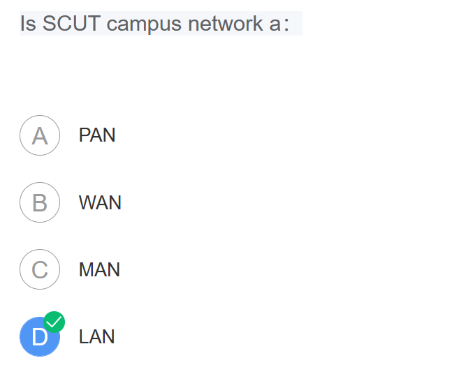

---

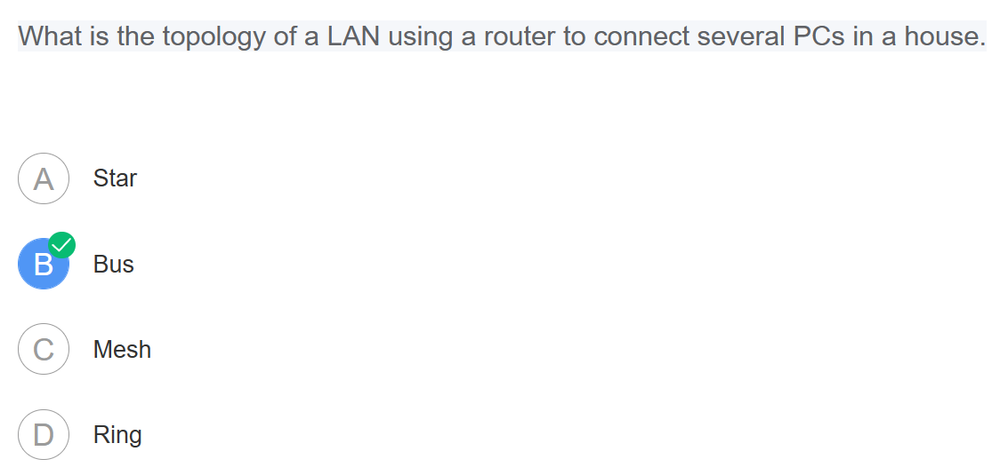

---

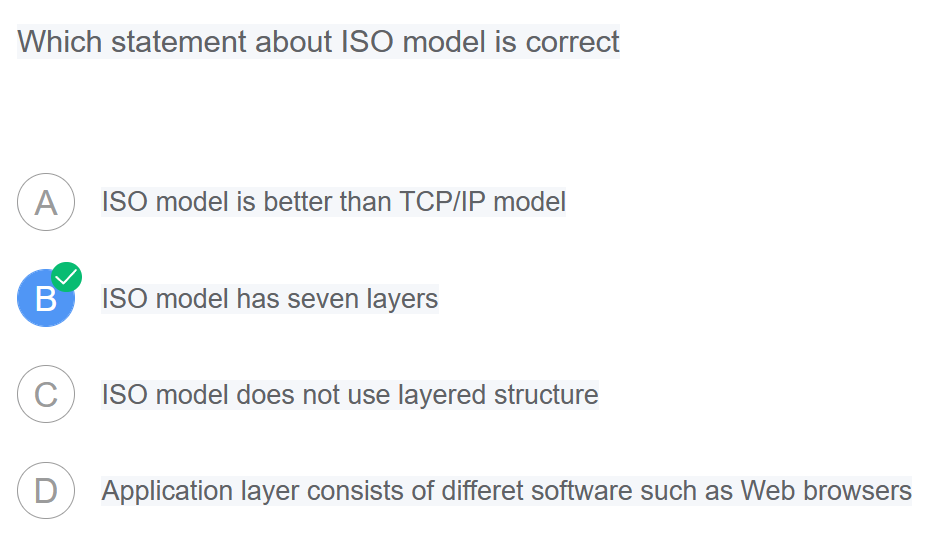

D 居然是错的。。。难道 FTP 这种 protocol 才算 application？

---

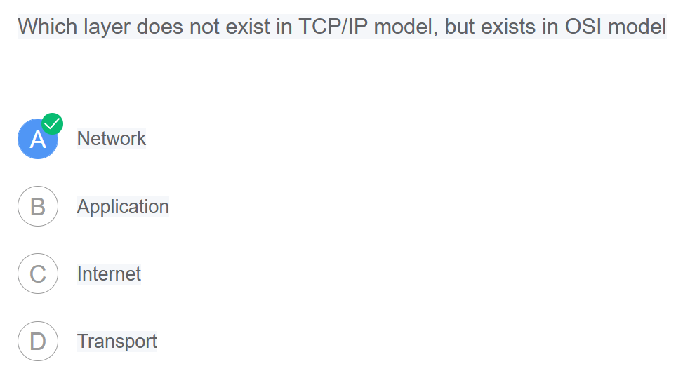

TCP/IP 里叫做 network，OSI里叫做 internet

---

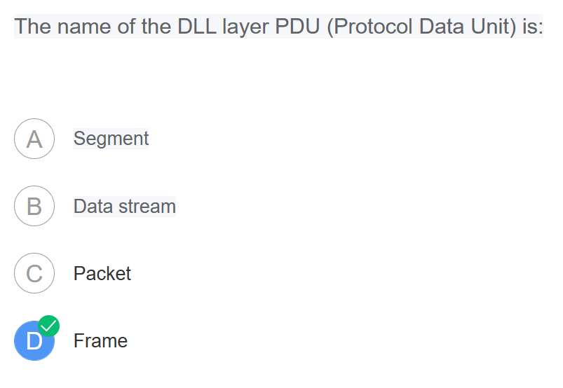

## Chapter 2 Physical Layer

### 2.1 ppt

**analog bandwidth (Hz) VS digital bandwidth?**

见 [1.2](ch2-the-physical-layer.md#12-bandwidth-limited-signals)

假设：
- $b$ bits/s: bit rate (digital bandwidth)
- $T$: time required to send 8 bits (周期)
- $f_c$: 截止频率

核心的关系式就是：
$$
nb/8\le f_c
$$

---

**Nyquist theorem** (==noiseless channel==)

- $H$: bandwidth
- $V$: discrete levels

maximum data rate:

$$
2H\log_2V\text{ bits/s}
$$

**Shannon theorem** (==noisy channel==)

- $H$: bandwidth
- $S/N$: signal to noise ratio

maximum number of bits/sec:
$$
H\log_2(1+S/N)
$$

!!! warning
    记得带==计算器==

---

**UTP?**

全称为 Unshielded Twisted Pair

---

**copper wires?**

twisted pairs 里面有铜线，coaxial cable 里面也是有铜芯的

见 [2.3](ch2-the-physical-layer.md#23-coaxial-cable)

---

**optical fiber**

见 [2.5](ch2-the-physical-layer.md#25-fiber-optics)

---

modem
: A device that converts between a stream of digital bits and an analog signal that represents the bits is called a modem, which is short for ‘‘modulator demodulator.’’

**Amplitude shift keying** & **Frequency shift keying** & **Phase shift keying?**

见 [5.2](ch2-the-physical-layer.md#52-passband-transmission)

相位的一个例子就是 **Quadrature Phase Shift Keying (QPSK)**

---

**FDM? TDM?**

见 [6.4](ch2-the-physical-layer.md#64-trunks-and-multiplexing)

!!! note
    shift keying 只是为了数字转模拟，这里的分路复用则是为了多个 channel 一起使用一个物理的通道

---

**circuit switching** & **message switching** & **packet switching?**

circuit switching
: seek out a physical path from sender to receiver. An end-to-end path must be (conceptually) established before data is sent

message switching
: no path is established in advance. The message is stored in the first switching office and forwarded later one hop at a time

packet switching
: place a restriction on block size, to allow packets to be buffered in main memory at the switching office

packet 就是 message 的改进版本

---

**CDMA?**

Code Division Multiple Access

据说很重要，见 [7.3](ch2-the-physical-layer.md#73-third-generation-3g-mobile-phones-digital-voice-and-data)

### 2.2 课后习题

---

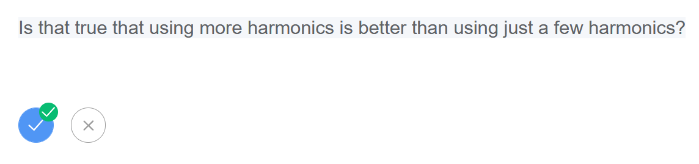

多几个 harmonics 确实可以提高拟合度

---

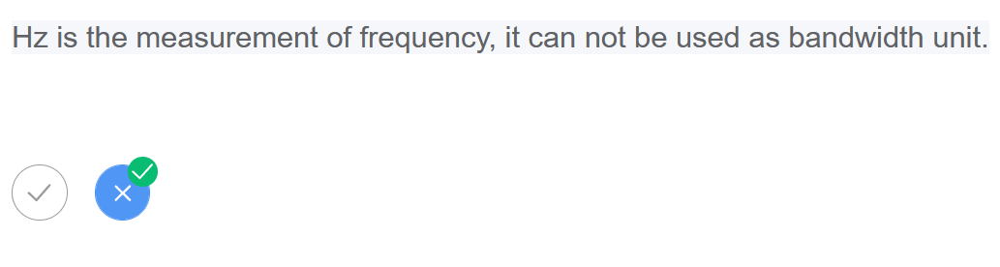

---

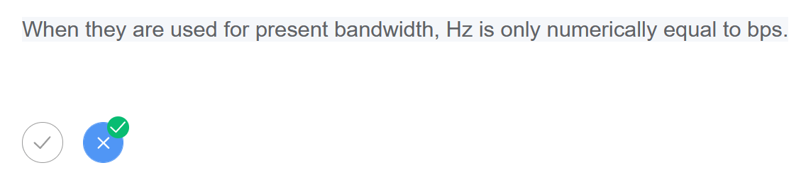

---

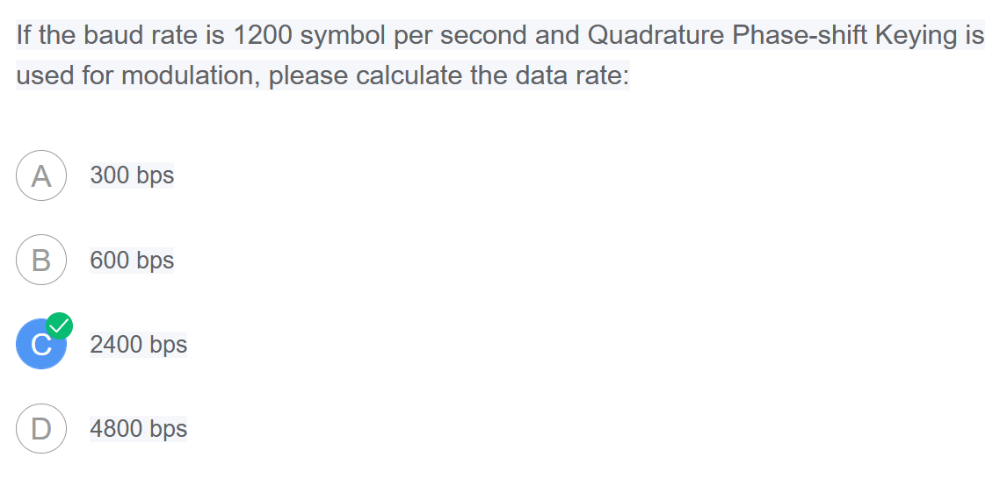

---

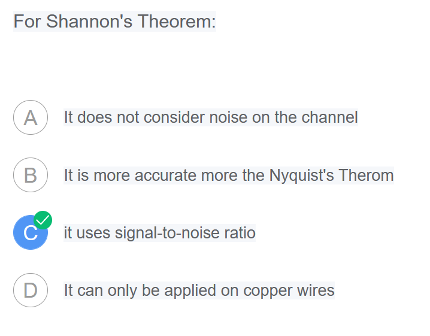

---

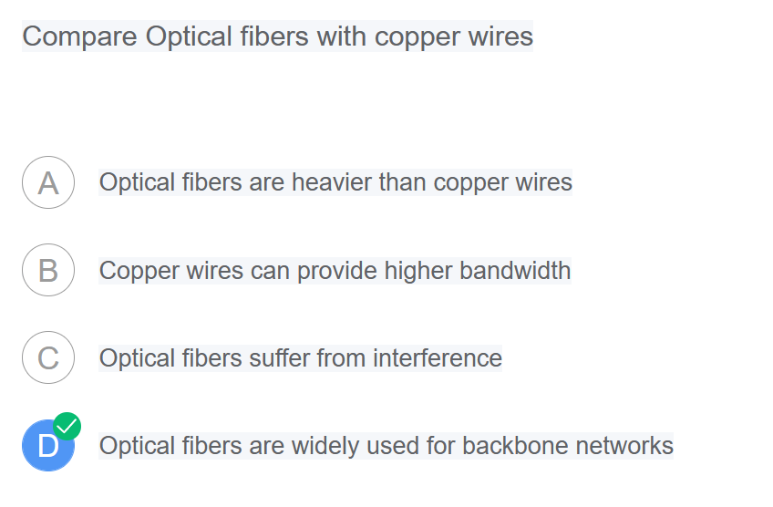

---

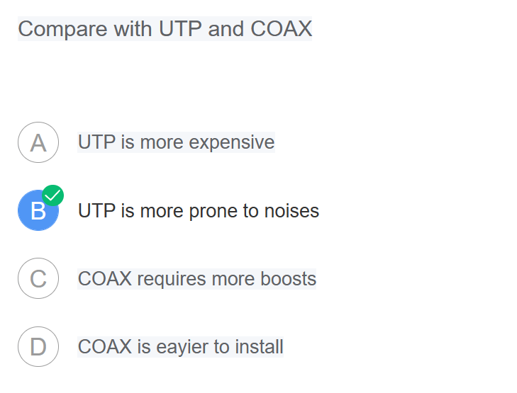

---

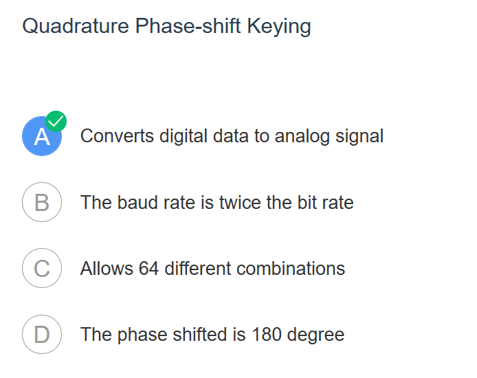

---

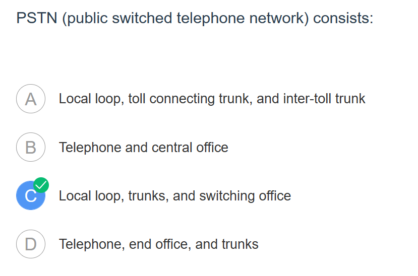

---

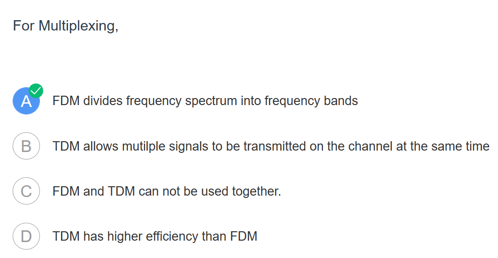

---

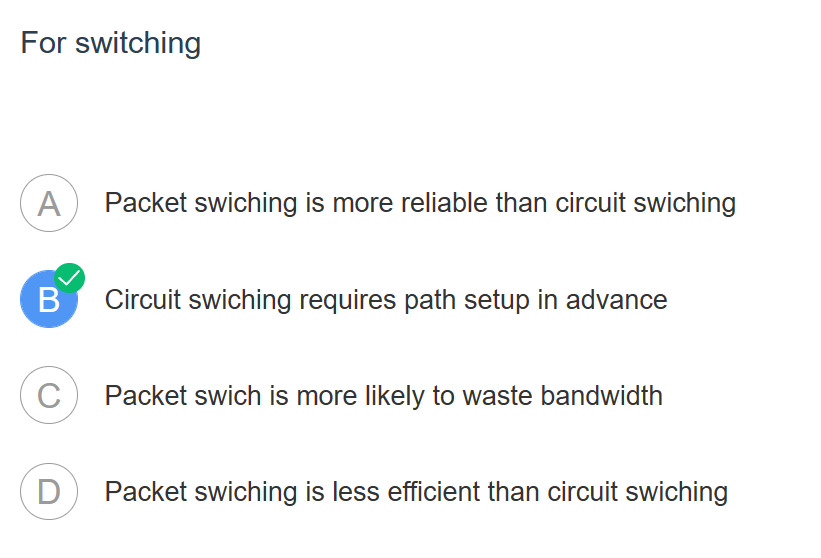

circuit switching 的固定线路才容易浪费带宽，毕竟人不可能 24 小时在线

## Chapter 3 Data Link Layer

### 3.1 ppt

**framing?**

为了方便对 bit stream 进行拆分

下面是几种具体的方法：

**Byte count** (character count)

在 frame 的头部添加一个 field 来记录这个 frame 到底包含了多少个 byte (包括这个 field 自己)

**Flag bytes with byte stuffing**

通过特殊的分隔字符来分隔

**Flag bits with bit stuffing**

解决了只能以 byte 为单位传输的问题

在 5 个连续的 1 后面添加一个 0，挺怪的，见 [1.2](ch3-the-data-link-layer.md#12-framing)

**Physical layer coding violations**

需要有冗余，比如用 2 physical bits 来 encode 1 bit of data

---

**Error-Correcting Codes?**

关于 Hamming distance 和 Hamming Code 见 [2.1](ch3-the-data-link-layer.md#21-error-correcting-codes)

---

**Error-Detecting Codes?**

重点在 Cyclic Redundancy Checks (CRC)，见 [2.2.3](ch3-the-data-link-layer.md#223-cyclic-redundancy-checks-crcs)

---

Data Link Protocols

从 [3.1](ch3-the-data-link-layer.md#31-a-utopian-simplex-protocol) 开始

**A Utopian Simplex Protocol**

最理想化的

**A Simplex Stop-and-Wait Protocol for an Error-Free Channel**

多了 receiver 的处理能力有限这个假设

相比于上一个只是多了个 acknowledgement

**A Simplex Stop-and-Wait Protocol for a Noisy Channel**

现在开始考虑 channel 是 noisy 的了，也就是说，frame 可能会传输到一半就丢失

具体的名字为ARQ (Automatic Repeat reQuest) 或者叫 PAR (Positive Acknowledgement with Retransmission)

添加一个 timer 来记录超时，frame 的头部添加 sequence number 来表明是不是重发的 frame

**A One-Bit Sliding Window Protocol**

开始变成 data 双向传输

即便发生异常，其实也只是重复发送，实际还是可以工作的

**A Protocol Using Go-Back-N**

开始使用 pipeling 来提高 channel 的 utilization rate

发生错误之后直接抛弃之后一段时间内的 frame，然后 sender 会把没有 acknowledge 的所有 frame 一起重发

**A Protocol Using Selective Repeat**

不像上一个做的这么绝，我们这里只丢弃错误的那一个，缓存其后的，直到sender重传了那一帧过来后才一起交给network layer

两者的对比见 [comparison](ch3-the-data-link-layer.md#4-comparison)。简而言之就是：

go back n: sender 一方需要大的 window，大小为 MAX_SEQ

selective repeat: receiver 一方需要大的 window，大小为 (MAX_SEQ + 1) / 2

### 3.2 课后习题

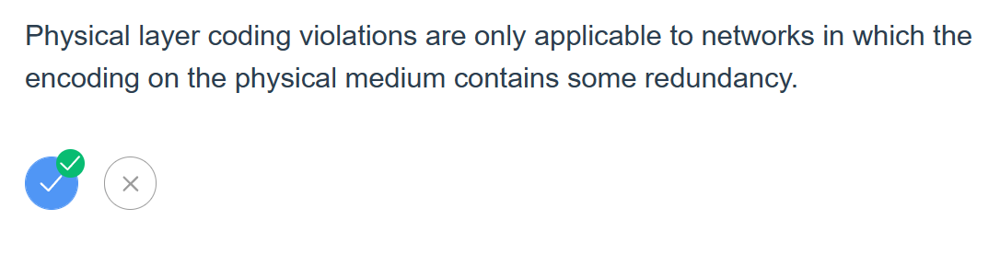

---

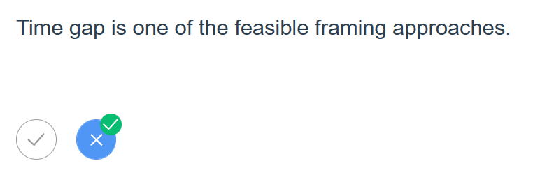

确实 feasible，但是太低效率了

---

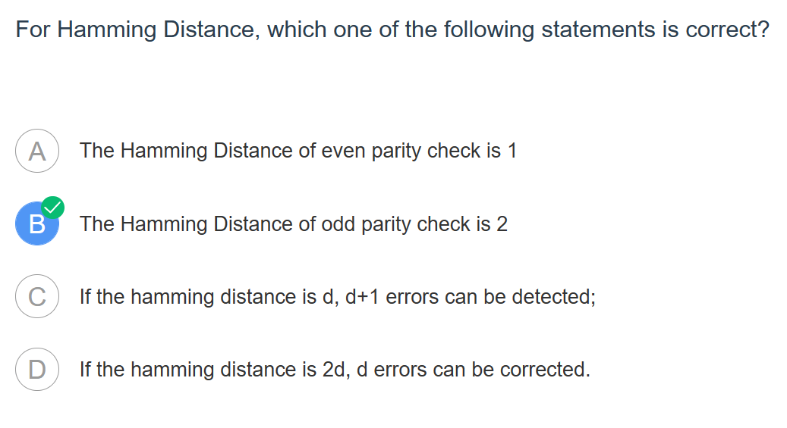

能检查一位的错误，所以 distance 是 2

---

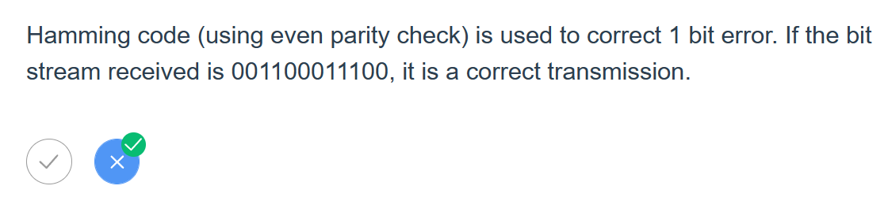

奇数个 1，错的

---

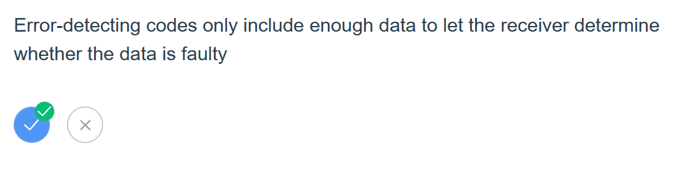

---

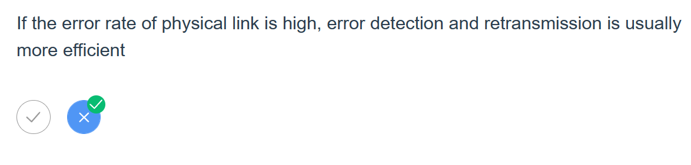

错误率高的情况下，重传效率很低

---

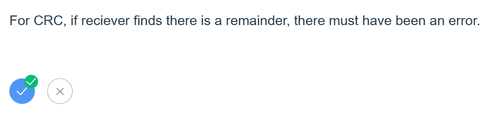

能整除才是对的

---

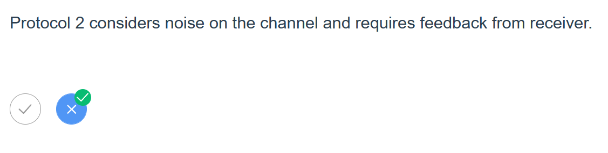

后半句是对的，然而并没有考虑 noise

---

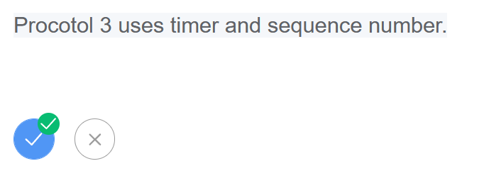

---

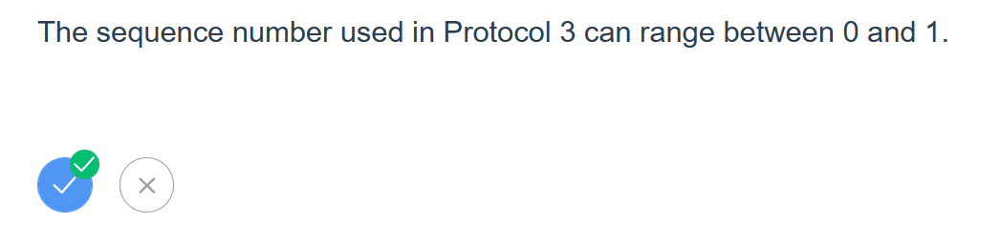

只需要标记是否是重传的

---

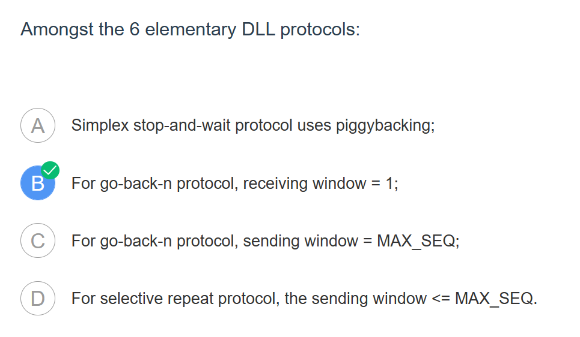

C 应该也是对的

---

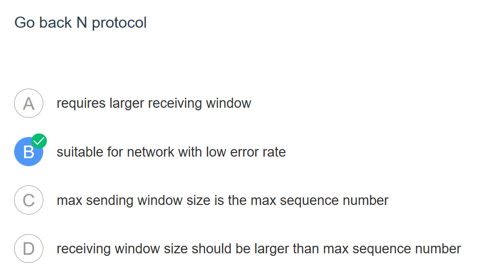

## Chapter 4 Medium Access Control Sublayer

**ALOHA?**

都不会监听 carrier 里面是否真的有东西正在传输

Pure ALOHA: 时间连续的。“想发就发”

Slotted ALOHA: 时间分段的。只能在时间段的起点发送

---

**Carrier Sense Multiple Access Protocols?**

这下就会监听 carrier 里面是否真的正在传输了

Nonpersistent CSMA: 假如有人在使用，则等待随机时间后再次

1-persistent CSMA: 假如有人在使用，则==连续地==监听，一旦空闲了则马上发

p-persistent CSMA: 假如空闲，则有 p 的概率马上传送，(1-p) 的概率等待 1 unit-time 再看

就是试图解决 1-persistent 里面，两个都在监听，然后一空闲了就打架

CSMA with Collision Detection (CSMA/CD): 增加了发送过程中的监听操作，一旦撞车了马上停止

---

**DIX** and **IEEE 802.3?**

好像 minimum length 会考，反正必须要大于 64 bytes (大于 round trip time $2\tau=51.2\mu s$, 10Mbps 的情况下就是 $10Mbps\times 2\tau / 8=64 bytes$)

---

**Manchester encoding?**

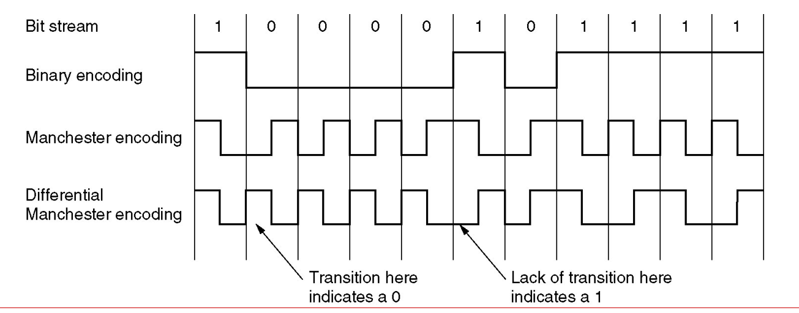

manchester encoding: 判定在 interval 的中间，向下为1

differential: 判定在边界，不变化为1

见 [3.1](ch4-the-medium-access-control-sublayer.md#31-classic-ethernet-physical-layer)

---

**Flooding** and **backward learning?**

见 [8.2](ch4-the-medium-access-control-sublayer.md#82-learning-bridges)

### 4.2 课后习题

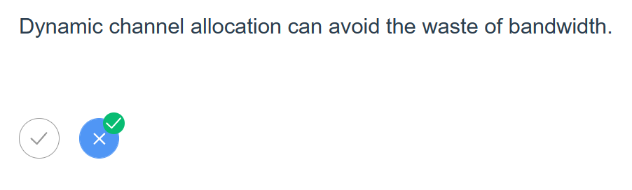

还是可能会浪费

---

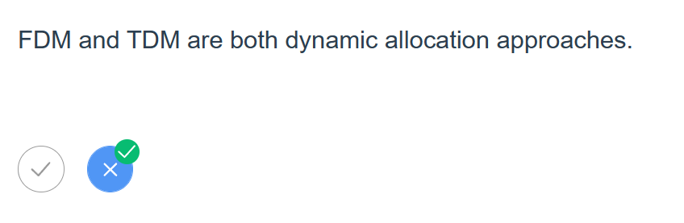

frequency division multiplexing & time division multiplexing

都是把 capacity 进行等分的时候用的，属于 static

---

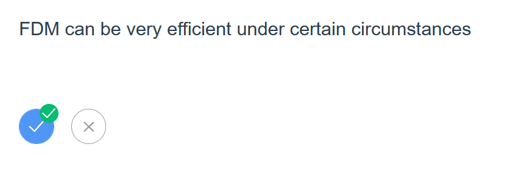

用户固定的时候可能可以

---

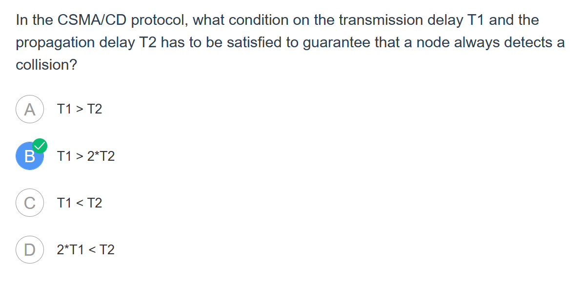

---

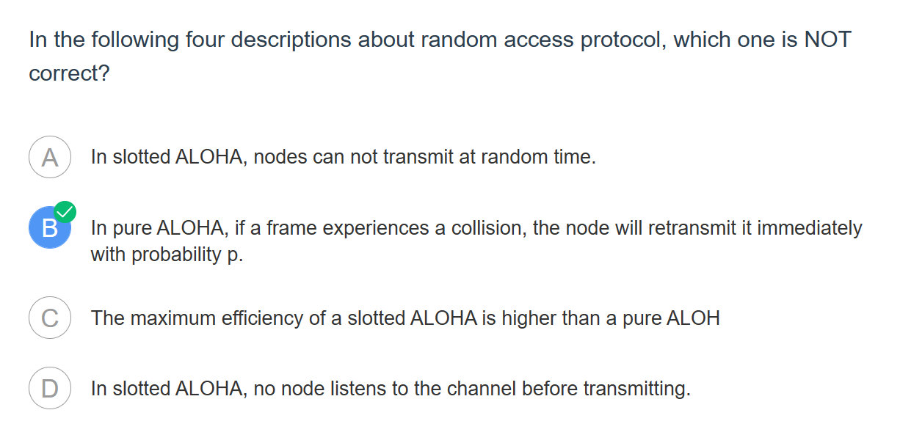

---

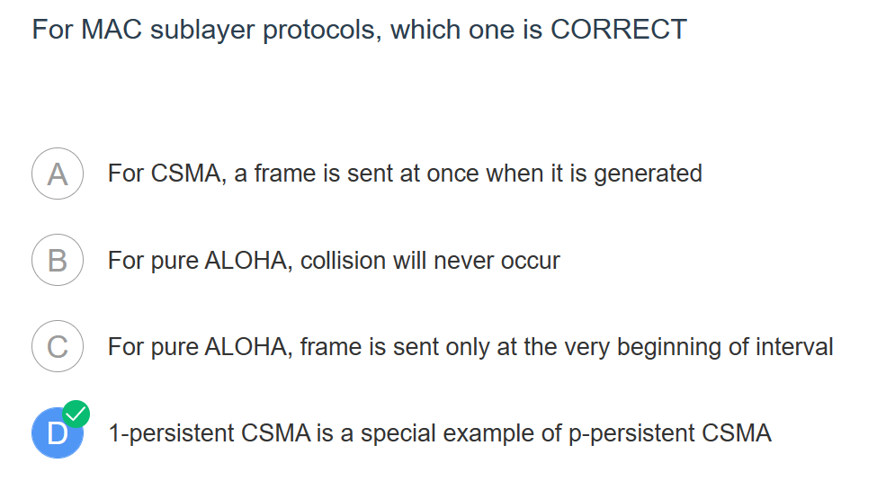

---

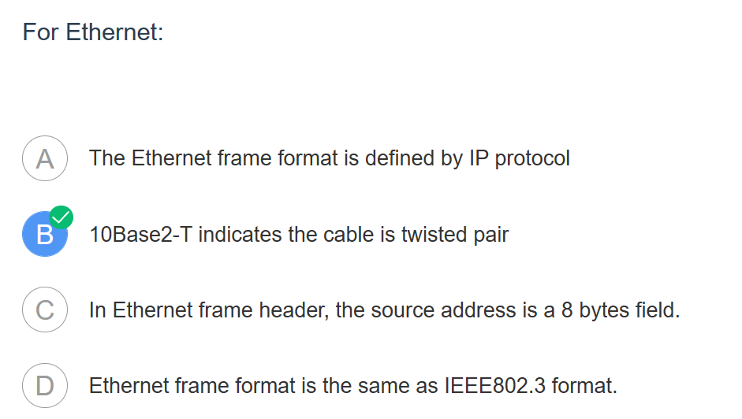

B居然是对的。。。

source address 6 bytes

---

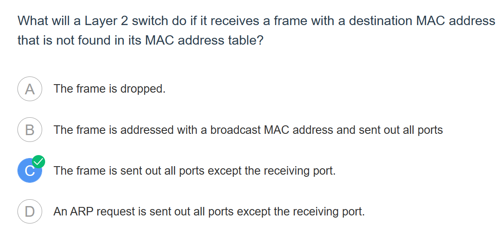

flooding？注意B, D都错

## Chapter 5 Network Layer

### 5.1 ppt

**Routing Protocol?**

distance vector: e.g., RIP. 见 [2.4](ch5-the-network-layer.md#24-distance-vector-routing)

link state routing: e.g., OSPF. 见 [2.5](ch5-the-network-layer.md#25-link-state-routing)

---

**Routed Protocol?**

IPv4: 见 [6.1](ch5-the-network-layer.md#61-the-ip-version-4-protocol-ipv4)

IPv6: 见 [6.3](ch5-the-network-layer.md#63-ip-version-6)

---

**BGP?**

border gateway protocol，见 [6.7](ch5-the-network-layer.md#67-bgp-the-exterior-gateway-routing-protocol)

用于在不同的 autonomous system 之间传输

---

**static routing algorithm**

Dijkstra: 你懂的

flooding: 你懂的

---

**Main function of router?**

router
: A router is a networking device that forwards data packets between computer networks

我也不知道他想我回答什么

---

**Subnets?**

就是对 IP 地址进行再分割，见 [6.2.2](ch5-the-network-layer.md#622-subnets)

---

**CIDR?**

Classless InterDomain Routing

将不同前缀大小的聚合到一起，见 [6.2.3](ch5-the-network-layer.md#623-cidr-classless-interdomain-routing)

---

**Classful and Special Addressing?**

ABCDE 五类，见 [6.2.4](ch5-the-network-layer.md#624-classful-and-special-addressing)

---

**NAT** and **PAT**

Network Address Translation，私有到共有网络的地址转换，见 [6.2.5](ch5-the-network-layer.md#625-nat-network-address-translation)

Port Address Translation: Map many IP addr. to one IP addr. with different port

书上似乎并没有提到 PAT 相关的东西

### 5.2 课后习题

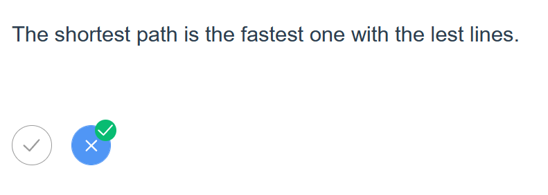

时间上最短

---

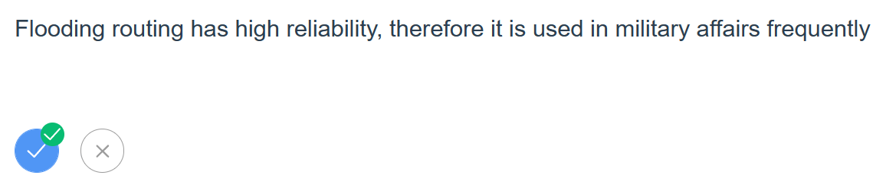

居然是对的？？？

---

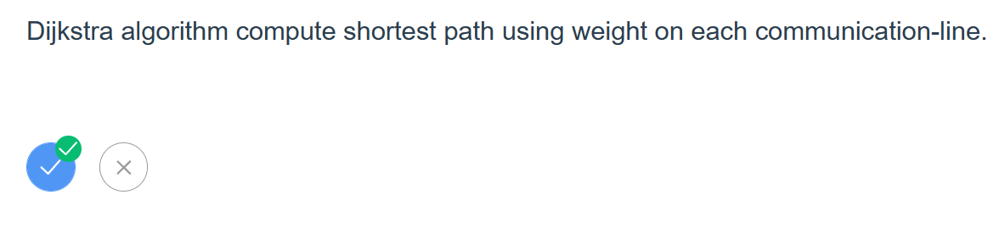

---

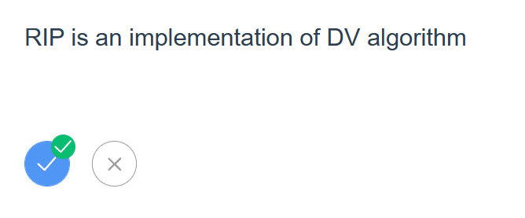

Routing Information Protocol 属于 Distance Vector

---

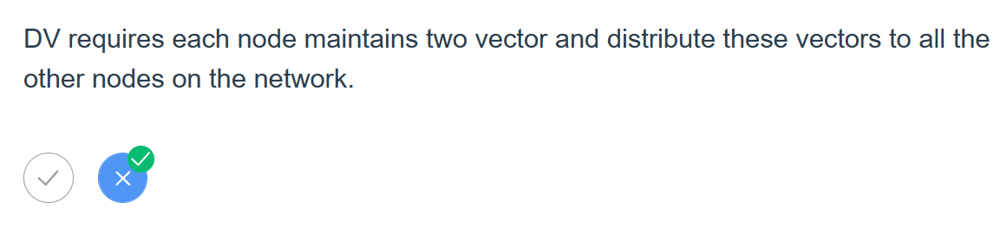

确实有俩 vector，但是不需要分发给所有其他的节点，顶多就是邻居会要

---

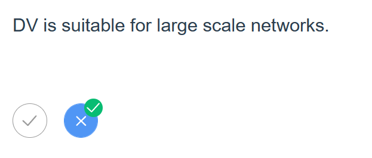

distance vector 就是因为适应不了大网络才被 link state 代替的

---

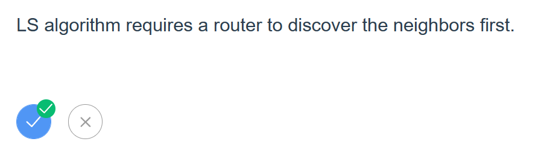

---

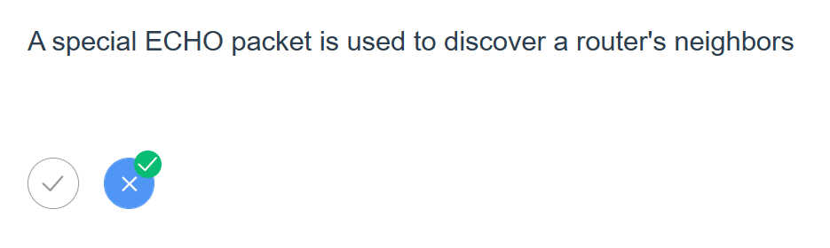

实际上是 HELLO packet。。。这题目真的无聊

ECHO 是第二步的时候用来测量 line cost 的

---

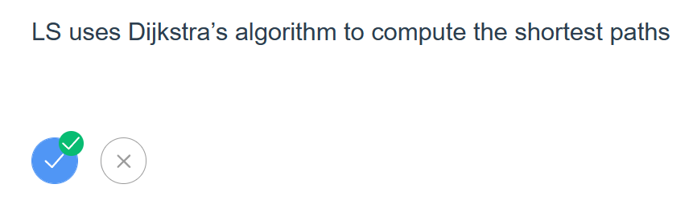

还真是用了 Dijkstra。。。

---

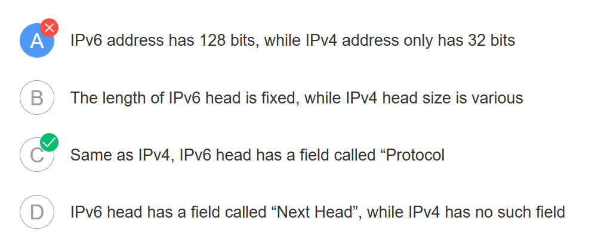

IPv6 并没有 protocol，倒是多了 next head，用于支持 extension header

---

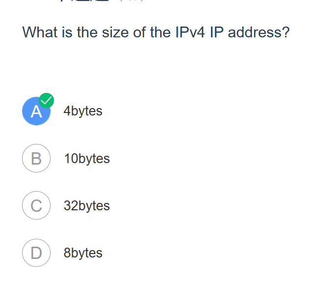

32 bits, 4 bytes，玩阴的是吧

---

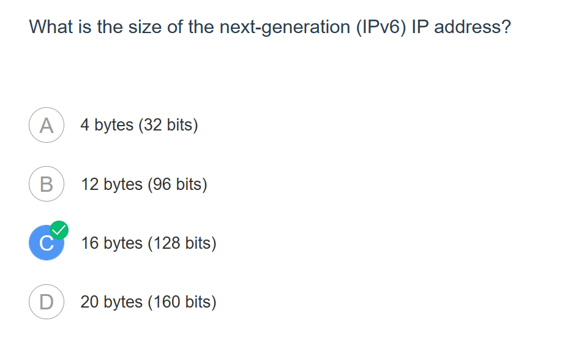

---

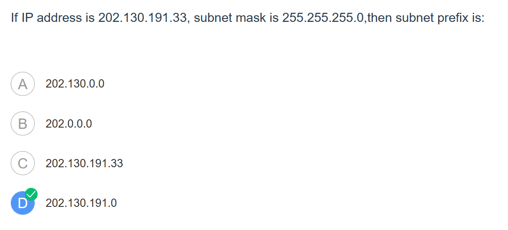

---

---

127 开头的就是 loopback，172 才是正经的 b 类地址

---

classful 的做法会让 IPv4 地址的分配非常不合理，比如给一个企业一个非常大的地址空间才能满足上一个 class 不能满足的需求，但是很多都会被浪费掉

CIDR 能够让地址的分配更加的精准，浪费的更少

## Chapter 6 Transport Layer

### 6.1 ppt

**UDP?**

见 [4](ch6-the-transport-layer.md#4-udp-user-datagram-protocol)

---

**TCP?**

见 [5](ch6-the-transport-layer.md#5-tcp-transmission-control-protocol)

---

**Pseudo header?**

见 [4.1](ch6-the-transport-layer.md#41-introduction-to-udp)，为了计算 checksum 的时候包括上 IP address

!!! note
    总结一下各个 header 到底都有多长：

    - IPv4: 5 words (最少，可能还有 optional)
    - IPv6: 10 words
    - UDP: 2 words
    - TCP: 5 words
    - pseudo header: 3 words

---

**socket?**

TCP service is obtained by both the sender and the receiver creating end points (端点？), called *sockets*

### 6.2 课后习题

虽然功能比较重复，但是品质更好

---

---

---

---

---

原来对？client-server 喜欢 UDP

---

57-43=14

---

---

port number 的长度是 16-bit。。。好无聊的题目

---

低于 1024。。。

---

看着很绝对，实际是对的

---

## Chapter 7 Application Layer

### 7.1 ppt

**DNS?**

见 [1](ch7-the-application-layer.md#1-dnsthe-domain-name-system)

### 7.2 课后习题

UDP

---

不区分大小写

---

domain resource record

## Lab 1

ICMP (Internet Control Message Protocol)
: It is used by network devices, including routers, to send error messages and operational information indicating success or failure when communicating with another IP address, for example, an error is indicated when a requested service is not available or that a host or router could not be reached

说人话：ping

