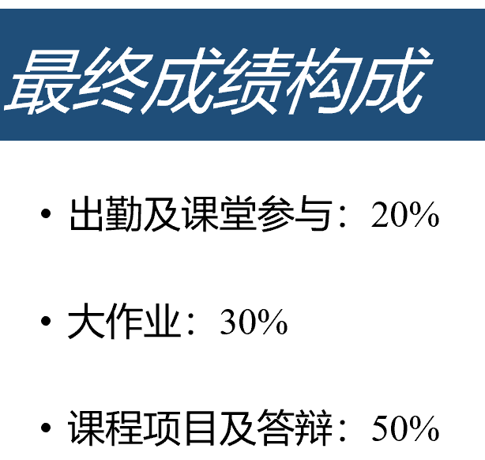
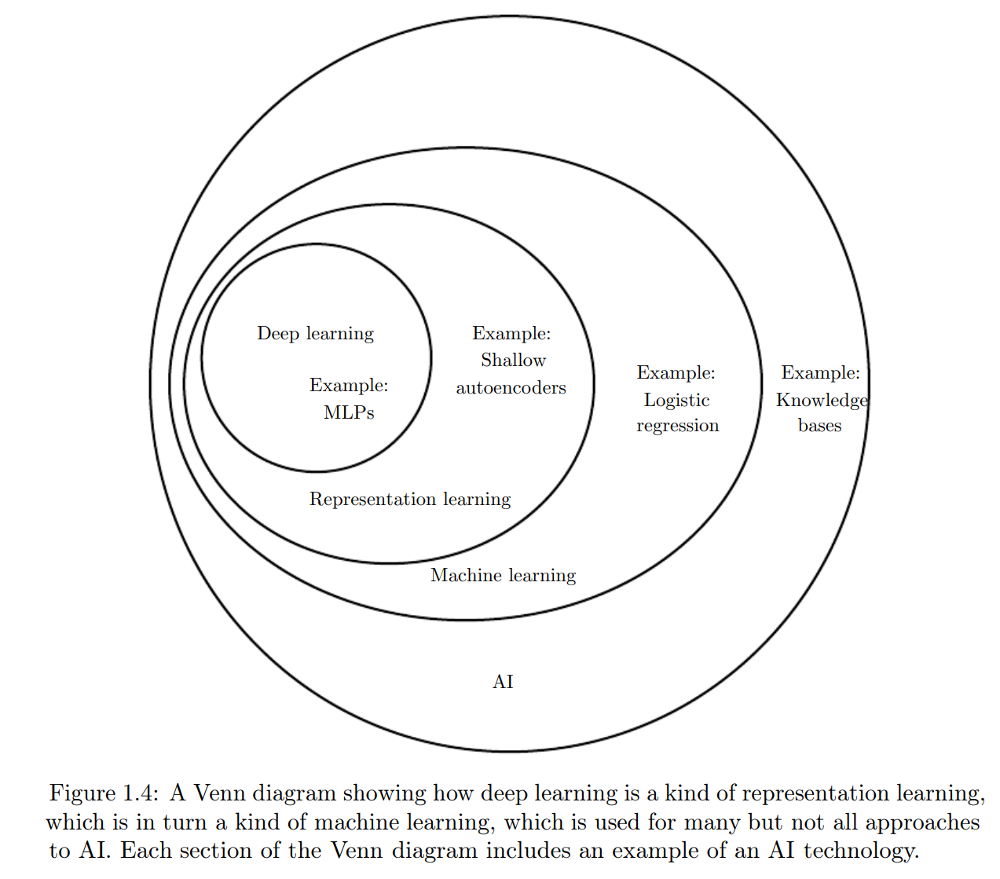
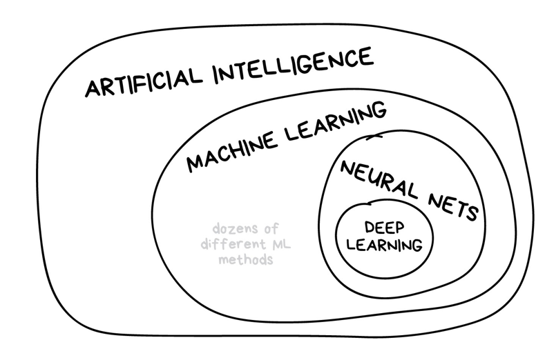
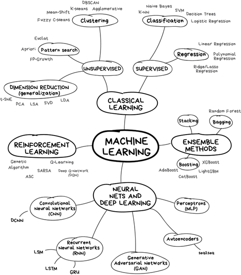
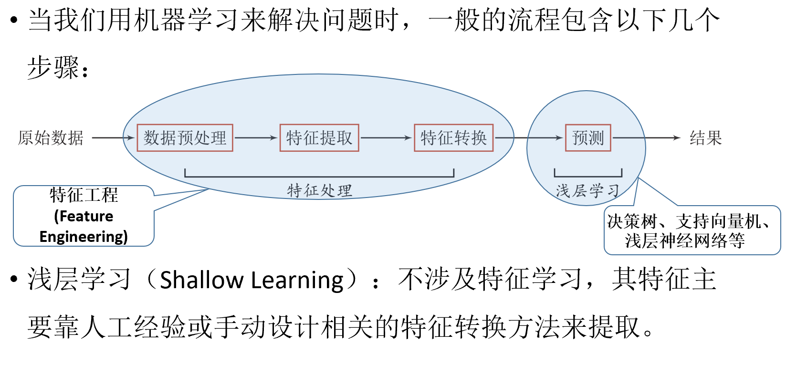
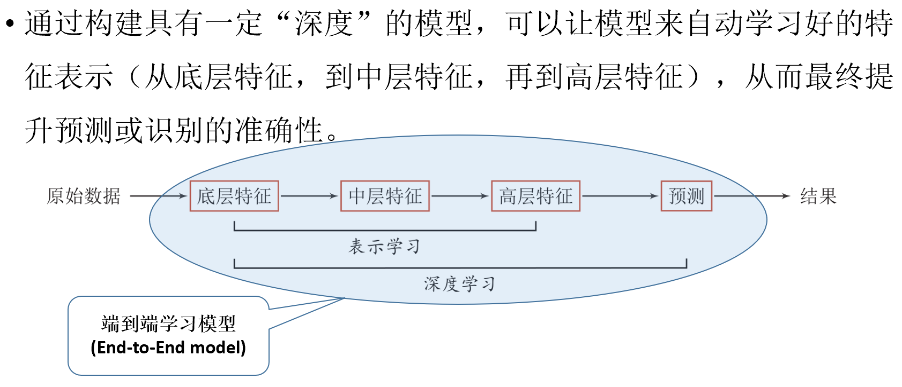
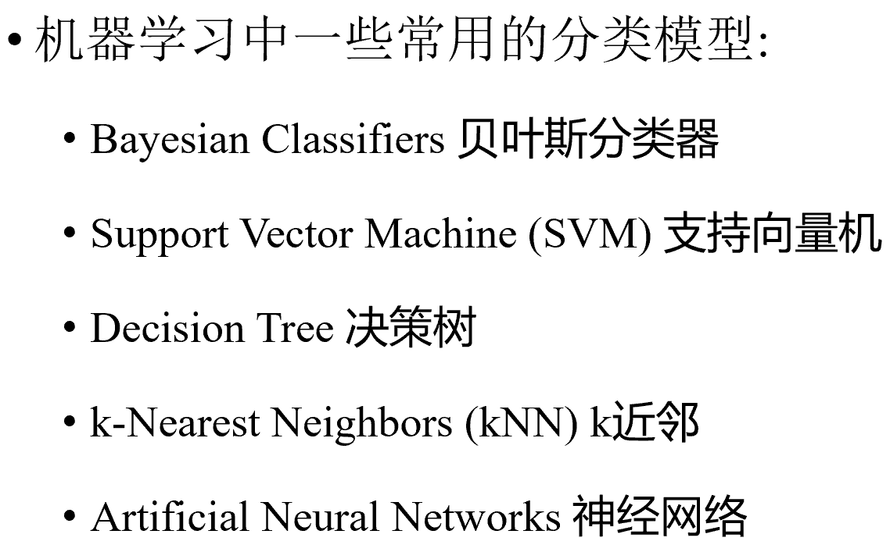
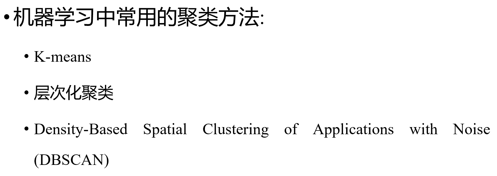
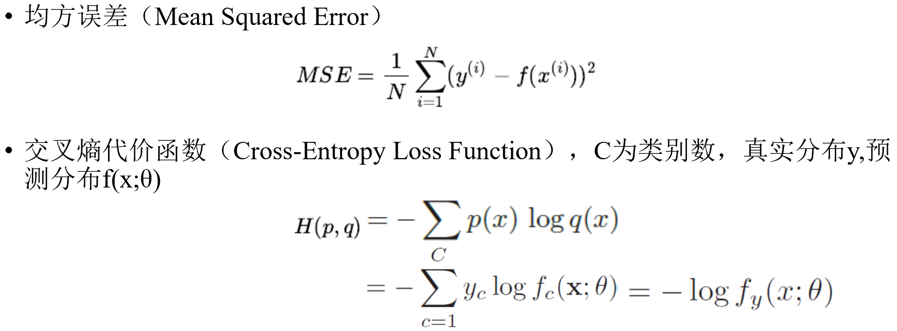
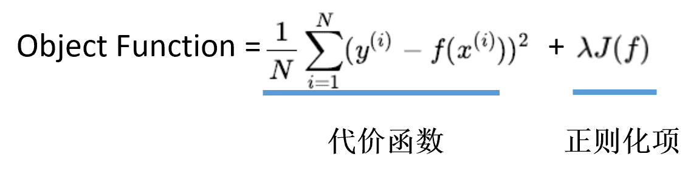

# 1. Introduction
 

## 深度学习和浅层学习的区别
- 浅层学习：

  

  可以看到，特征的提取主要依赖于人工
- 深度学习：

    省去了人工筛选，可以自己提取特征

    

## 几个需要区分的概念
### 学习类型
- **监督学习（Supervised Learning）**

    > 通过==标注==的数据来学习，对应于**分类**问题
    
    例如，程序通过学习标注了正确答案的手写数字的图像数据，它就能认识其他的手写数字。

    

- **无监督学习（Unsupervised Learning）**

    > 通过==没有标注==的数据来学习，对应于**聚类**问题
    
    这种算法可以发现数据中自然形成的共同特性（聚类），可以用来发现不同数据之间的联系，例如，买了商品A的顾客往往也购买了商品B。

    

- **强化学习（Reinforcement Learning）**

    我们可以让程序选择和它的环境互动（例如玩一个游戏），环境给程序的反馈是一些“奖励”（例如游戏中获得高分），程序要学习到一个模型，能在这种环境中得到高的分数，不仅是当前局面要得到高分，而且最终的结果也要是高分才行。

### Loss, Cost, Object
- **Loss** (损失)

    定义在==单个==样本上

    由Loss Function计算具体的值

    符号规则：$a$ 是预测值，$y$ 是样本标签值，$loss$ 是损失函数值。

    - Gold Standard Loss，又称0-1误差
    $$
    loss=\begin{cases}
    0 & a=y \\\\
    1 & a \ne y 
    \end{cases}
    $$

    - 绝对值损失函数

    $$
    loss = |y-a|
    $$

    - Hinge Loss，铰链/折页损失函数或最大边界损失函数，主要用于SVM（支持向量机）中

    $$
    loss=\max(0,1-y \cdot a) \qquad y=\pm 1
    $$

    - Log Loss，对数损失函数，又叫交叉熵损失函数(cross entropy error)

    $$
    loss = -[y \cdot \ln (a) + (1-y) \cdot \ln (1-a)]  \qquad y \in \\{ 0,1 \\} 
    $$

    - Squared Loss，均方差损失函数
    $$
    loss=(a-y)^2
    $$

    - Exponential Loss，指数损失函数
    $$
    loss = e^{-(y \cdot a)}
    $$
- **Cost** (代价)

   是定义在==整个训练集==上的，是所有样本误差的平均，也就是所有Loss Function平均

    

- **Object Function**

    一般来说是经验风险+结构风险，也就是代价函数+正则化项

    e.g.

    

### 梯度下降法 (Gradient Descent)
梯度方向是函数上升最快的方向，沿着梯度方向可以最快地找到函数的最大值，而我们要求误差的最小值，所以在梯度下降中我们要==沿着梯度相反的方向==（负梯度方向）

### 全局极小和局部极小

### 欠拟合和过拟合

    