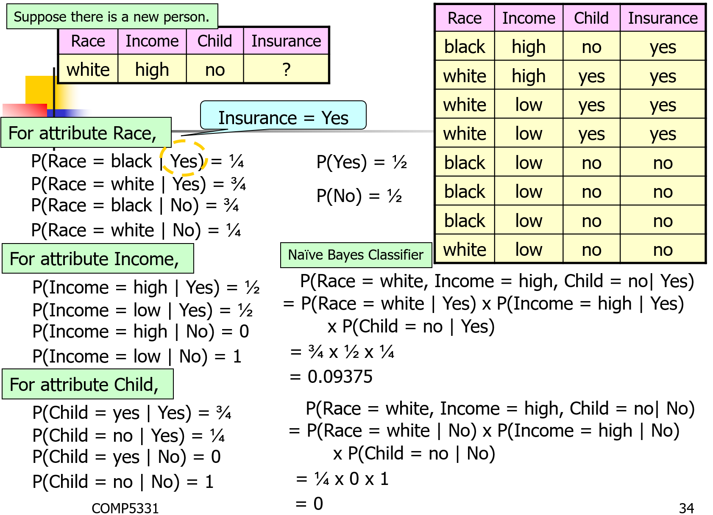
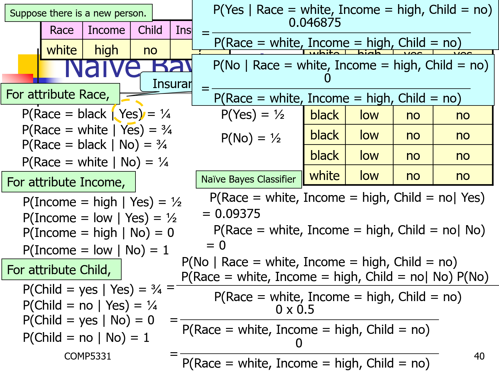
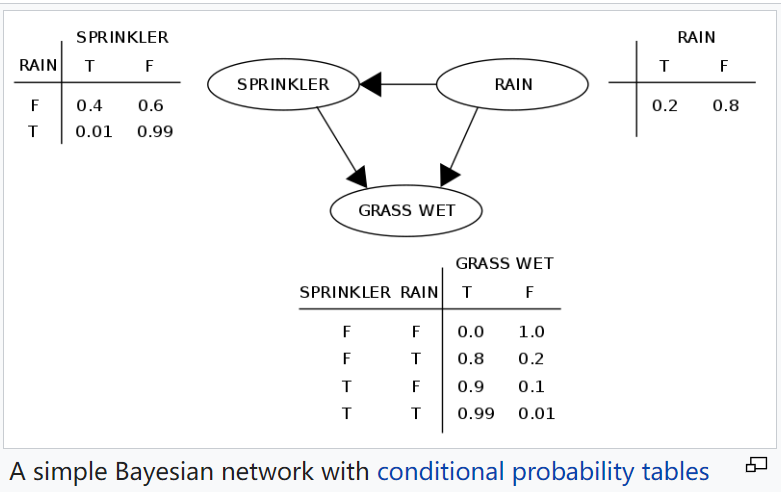
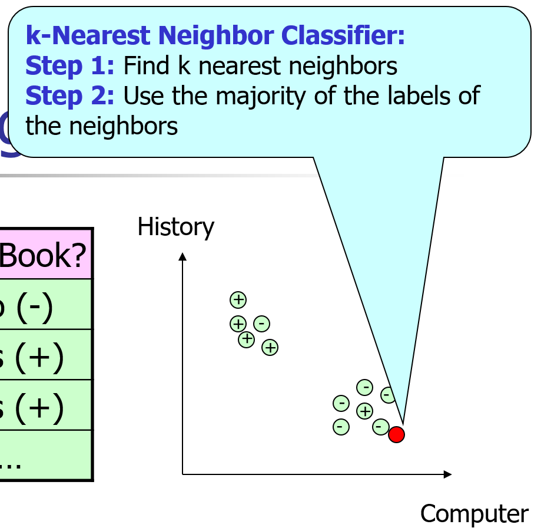

# Classification Methods
## Decision Tree
### ID3
**I**terative **D**ichotomiser **3**

> **ID3** is an algorithm used to generate a decision tree from a dataset

关于**entropy**和**information gain**的内容，上学期的 AI 课上[已经讲过](../../y2-spring/ai/ch18-learning-from-examples.md)，其实连建树的过程都一模一样

wiki的话来说就是：
> The ID3 algorithm begins with the original set ${\displaystyle S}$ as the root node. On each iteration of the algorithm, it iterates through every unused attribute of the set ${\displaystyle S}$ and calculates the entropy ${\displaystyle \mathrm {H} {(S)} }$ or the information gain ${\displaystyle IG(S)}$ of that attribute. It then selects the attribute which has the smallest entropy (or largest information gain) value. The set ${\displaystyle S}$ is then split or partitioned by the selected attribute to produce subsets of the data.

### C4.5
是ID3的拓展算法

比较直观的区别是，评判标准从information gain变成了**information gain ratio**:
> $$IGR(T,a)=IG(T,a)/SplitInformation(T)$$
> 其中：
> $$SplitInformation(T)=-\sum_{V\in T}p(v)\log p(v)$$

可以看作是标准化后的IG

### CART
**C**lassification **A**nd **R**egression **T**ree

反正信息熵的计算变成了：
$$
I(P)=1-\Sigma_jp_j^2
$$
然后还是以ID3相同的方法计算information gain

## Bayesian Classifier
### Naive Bayes Classifier
首先理论基础是我们的**Bayes' theorem**:
$$
P(A|B)=\frac{P(B|A)P(A)}{P(B)}
$$
证明起来也很简单，根据条件概率的定义$P(A|B)=\frac{P(A\cap B)}{P(B)}$

然后就可以来看看主角了。它之所以叫naive，因为它做了个非常简化的假设：
> all naive Bayes classifiers assume that the value of a particular feature is ==independent== of the value of any other feature, given the class variable

e.g.
> a fruit may be considered to be an apple if it is red, round, and about 10 cm in diameter. A naive Bayes classifier considers each of these features to contribute independently to the probability that this fruit is an apple, regardless of any possible correlations between the color, roundness, and diameter features

听着确实很离谱，但是据wiki说效果其实出奇的好

可以看到，我们直接就把三个项相乘得到了概率

为了由此得到前提条件对调的结果，这时候就要请出我们的贝叶斯定理了：

### Bayesian Belief Networks
这下子，我们就不假设他们全部相互独立了
> A **Bayesian network** is a probabilistic graphical model that represents a set of variables and their ==conditional dependencies== via a ==directed acyclic graph (DAG)==

需要个预备知识**conditional independence**:
> if
> $$P(A|B,C)=P(A|C)$$
> then $A$ and $B$ are said to be conditionally independent given $C$

也就是$C$成立的情况下，$B$对于certainty of $A$没有任何贡献

这也意味着：
$$
P(A,B|C)=P(A|C)P(B|C)
$$

至于例子嘛。。。看2.1ppt p47~51好了，太复杂了

## Nearest Neighbor Classifier
