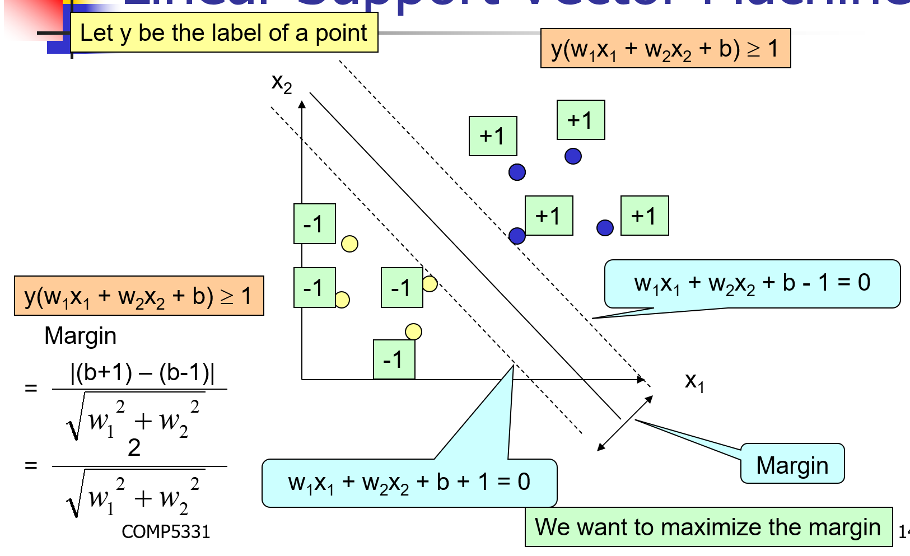

上一节讲了三种不同的分类器，除此之外还有几种分类模型：
## SVM
**S**upport **V**ector **M**achine

这玩意的优点是：
- can be visualized
- accurate when the data is well partitioned
### Linear Support Vector Machine

用一条直线把两类点分隔开，并且使得分隔尽可能大

反正最后会变成目标是最小化$w_1^2+w_2^2$

假如是高维空间的划分的话，那就是超平面来分隔了

### Non-linear Support Vector Machine
- Transform the data into a higher dimensional space using a “nonlinear” mapping
- Use the Linear Support Vector Machine in this high-dimensional space

## Neural Network
优点：
- **Parallel Processing**

    each neuron operates individually
- **Fault tolerance**

    if a small number of neurons break down, the whole system is still able to operate with slight degradation in performance.
        
感觉都是讲过的

