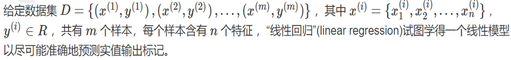
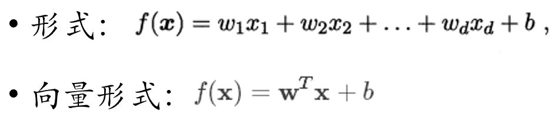
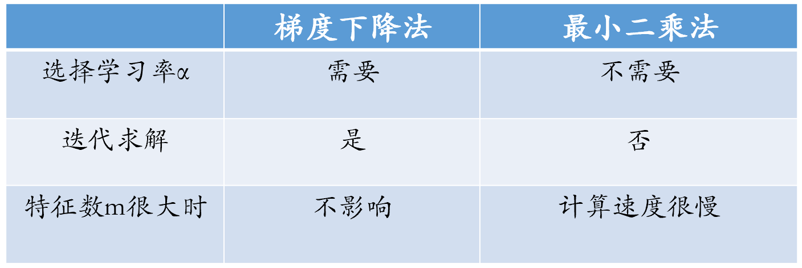
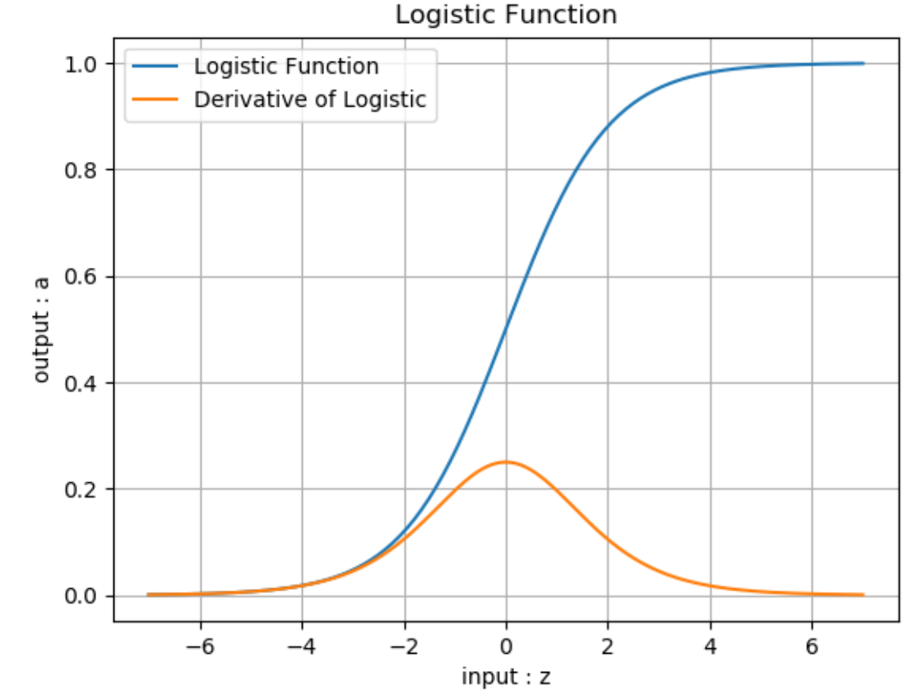
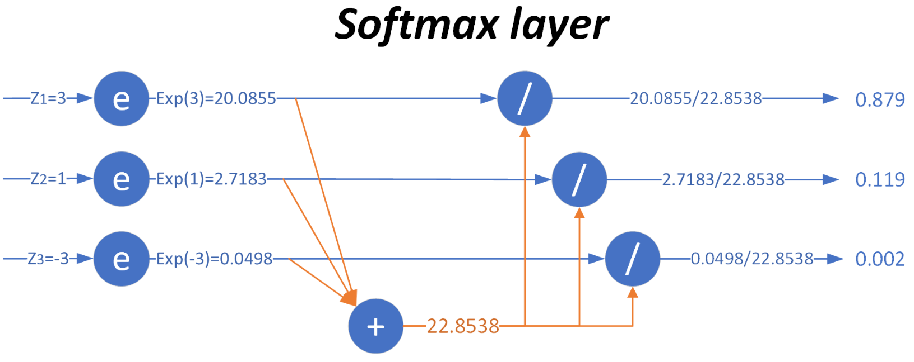
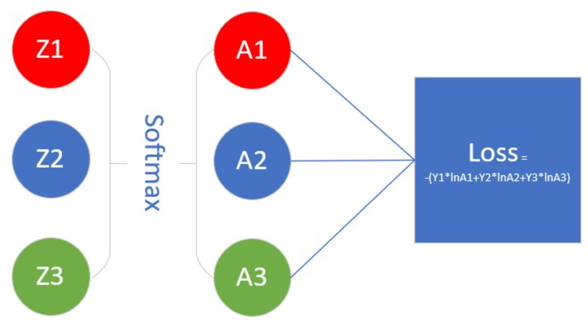

## 线性回归

> 

向量形式可能有很多种，取决于矩阵是怎么排布的

我们会使用多种不同的方法来解这个问题

### 最小二乘法

Least Square

线性回归试图学得：

$$
z_i=w \cdot x_i+b \tag{1}
$$

使得：

$$
z_i \simeq y_i \tag{2}
$$

其中，$x_i$ 是样本特征值，$y_i$ 是样本标签值，$z_i$ 是模型预测值。

如何学得 $w$ 和 $b$ 呢？**均方差**(MSE - mean squared error)是回归任务中常用的手段：

$$
J = \frac{1}{2m}\sum_{i=1}^m(z_i-y_i)^2 = \frac{1}{2m}\sum_{i=1}^m(y_i-wx_i-b)^2
$$

$J$ 称为损失函数。实际上就是试图找到一条直线，使所有样本到直线上的残差的平方和最小。

### 梯度下降法

在下面的公式中，我们规定 $x$ 是样本特征值（单特征），$y$ 是样本标签值，$z$ 是预测值，下标 $i$ 表示其中一个样本。

#### 预设函数（Hypothesis Function）

线性函数：

$$
z_i = x_i \cdot w + b \tag{1}
$$

#### 损失函数（Loss Function）

均方误差：

$$
loss_i(w,b) = \frac{1}{2} (z_i-y_i)^2 \tag{2}
$$

与最小二乘法比较可以看到，梯度下降法和最小二乘法的模型及损失函数是相同的，都是一个线性模型加均方差损失函数，模型用于拟合，损失函数用于评估效果。

区别在于，==最小二乘法从损失函数求导，直接求得数学解析解，而梯度下降以及后面的神经网络，都是利用导数传递误差，再通过迭代方式一步一步（用近似解）逼近真实解==。

## 线性分类

感知机只能够对物体做出1/-1这样的判断。我们更进一步推广，就是**逻辑回归 (Logistic Regression)**，激活函数改成了Logistic，而输出结果变成了类别隶属度的概率

> 虽然它名字看起来写着回归，但是其实并不是真正的回归问题，而是属于分类问题

### 二分类函数

这一节最详细的描述见**6.1节**

对率函数Logistic Function，既可以作为激活函数使用，又可以当做二分类函数使用。

> 在很多不太正规的文字材料中，把这两个概念混用了，比如下面这个说法：“我们在最后使用Sigmoid激活函数来做二分类”，这是不恰当的。==在二分类任务中，叫做Logistic函数，而在作为激活函数时，叫做Sigmoid函数。==

- **函数公式**

  $$
  Logistic(z) = \frac{1}{1 + e^{-z} }
  $$

  以下记 $a=Logistic(z)$
- **导数**

  $$
  Logistic'(z) = a(1 - a)
  $$

  具体求导过程可以参考**8.1节**
- **输入值域**

  $$
  (\infty, \infty)
  $$
- **输出值域**

  $$
  (0,1)
  $$
- **函数图像**

  

此函数实际上是一个概率计算，它把 $(-\infty, \infty)$ 之间的任何数字都压缩到 $(0,1)$ 之间，返回一个概率值，这个概率值接近 $1$ 时，认为是正例，否则认为是负例。

#### 正向传播

- **矩阵运算**

  $$
  z=x \cdot w + b \tag{1}
  $$
- **分类计算**

  $$
  a= Logistic(z)=\frac{1}{1 + e^{-z} } \tag{2}
  $$

  > 这个$a$对于美化后面的运行结果有很重要作用
  >
- **损失函数计算**

  交叉熵损失函数的通用记法为：

  $$
  loss(p,q)=\sum_i p_i \cdot \ln {1 \over q_i} = - \sum_i p_i \ln q_i \tag{1}
  $$

  可以用来衡量$p$和$q$的相似程度

  这里只是二分类，所以：

  **二分类交叉熵损失函数**：

  $$
  loss(w,b) = -[y \ln a+(1-y) \ln(1-a)] \tag{3}
  $$

#### 反向传播

$$
\frac{\partial loss}{\partial z}=\frac{\partial loss}{\partial a}\frac{\partial a}{\partial z}=\frac{a-y}{a(1-a)} \cdot a(1-a)=a-y
$$

总之选择了一个很妙的Logistic激活函数和交叉熵损失函数的组合，让结果非常简单

假如是多样本的话：

$$
\frac{\partial J(w,b)}{\partial Z}=
\begin{pmatrix}
  \frac{\partial J(w,b)}{\partial z_1} \\\\
  \frac{\partial J(w,b)}{\partial z_2} \\\\
  \frac{\partial J(w,b)}{\partial z_3}
\end{pmatrix}
=\begin{pmatrix}
  a_1-y_1 \\\\
  a_2-y_2 \\\\
  a_3-y_3 
\end{pmatrix}=A-Y
$$

变成矩阵形式就行了

### 多分类函数

这一节最详细的描述见**7.1节**

之前，Logistic函数可以得到$z$为比如0.8，0.3这样的标量，通过接近1或者是0来判断到底是属于哪个类别

对于多分类问题，我们可以拓展到向量。假设我们的样本的分类值依然是通过这个线性公式得到的：

$$
z=x\cdot w+b
$$

只要我们得到的$z$是个($1\times 3$)的向量，每个单元的值代表该样本分别属于三个分类的值，$z$作为输入值经过Softmax函数处理就可以得到隶属于不同类别的概率了

**Softmax**加了个"soft"来模拟max的行为，但是同时又保留了相对大小的信息：

$$
a_j = \frac{e^{z_j} }{\sum\limits_{i=1}^m e^{z_i} }=\frac{e^{z_j} }{e^{z_1}+e^{z_2}+\dots+e^{z_m} }
$$

其中$a_j$即代表向量中第$j$项的结果(第$j$类的概率)

图可以说明这个Softmax的过程:

表7-2 MAX运算和Softmax的不同

|  输入原始值  |   MAX计算   |       Softmax计算       |
| :------------: | :-----------: | :-----------------------: |
| $[3, 1, -3]$ | $[1, 0, 0]$ | $[0.879, 0.119, 0.002]$ |

单纯取Max的话就丢失了每个类别的概率信息(比例的感觉)

Softmax的结果有如下特点：

- 三个类别的概率相加为1
- 每个类别的概率都大于0

#### 正向传播

矩阵运算和分类计算上面都提到了

**损失函数计算**：

就是交叉熵损失函数

计算单样本时，m是分类数：

$$
loss(w,b)=-\sum_{i=1}^m y_i \ln a_i \tag{3}
$$

计算多样本时，m是分类数，n是样本数：

$$
J(w,b) =- \sum_{j=1}^n \sum_{i=1}^m y_{ji} \log a_{ji} \tag{4}
$$

#### 反向传播

计算$a-y$即可（注意不是$z-y$）

#### Softmax对比Logistic

可以将**Softmax函数**看作是Logistic函数的一种拓展

比如一个二分类问题：

$$
a_1 = \frac{e^{z_1} }{e^{z_1} + e^{z_2} } = \frac{1}{1 + e^{z_2 - z_1} }
$$

看起来就和$a = Logistic(z)=\frac{1}{1 + e^{-z} }$一样
