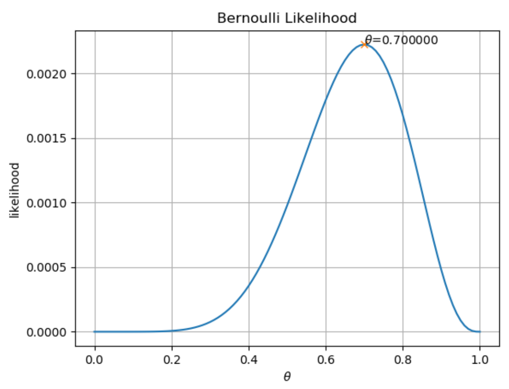

## 最大似然估计
MLE - Maximum Likelihood Estimation

这一节的详细说明见**这里**

### 概率和统计的区别
- **概率（Probability）**

    是已知模型和参数，用来预测结果数据。

    像前面的例子中，我们已知黑白球的比例（参数）和抽取方法（模型），来预测抽到的球的颜色（结果数据）。

- **统计（Statistics）**

    是已知数据，设定模型并==反推参数==。

    在反推参数的过程中，由于采样数据本身的限制原因，参数的值有多种可能性，我们==只能按照可能性最大的那种==来估计形成给定样本的==参数值==，所以被称为**最大似然估计**。

关于似然函数的记法有很多，比如$P(x|\theta), L(\theta|x), L(x;\theta), f(x;\theta)$等，要根据上下文来判断它到底代表什么，很糟糕。所以在这里我们统一定义：
- $P(x|\theta)$ 表示**概率**；
- $L(x;\theta)$ 表示**似然函数**，不使用$L(\theta|x)$的记法；
- $f(x;\theta)$ 表示**概率密度分布函数**。

> $p(a;b)$ 是以 $b$ 为参数，以 $a$ 为采样值的函数，常写成 $f(x_1,...,x_n;\theta)$，其中 ($x_1,...,x_n$) 是 $n$ 个采样值，$\theta$ 是参数，可以是一个标量（表示只有一个参数），也可以是一个向量（表示有多个参数）。

### 最大似然估计

问题1：一个袋子中有10个球，有黑白两种颜色，每次拿出一个记录颜色并放回，重复10次，查看记录得知取到白球7次，请问袋中白球的比例？

如果抽到7次白球，不能100%地认为白球占比就是0.7，也有可能是0.6、0.8等数值。

- 试验模型：一个袋子中有10个球，有黑白两种颜色，每次拿出一个记录颜色并放回，重复10次；
- 试验数据：取到白球7次；
- 反推参数：问袋中白球的比例。

由于问题比较简单，我们可以遍历所有白球占比的可能性，即$\theta=[0,0.1,0.2,...,1]$，然后根据公式1依次计算$P(x|\theta)$值：

$$
P(x|\theta) = C_n^x \theta^x (1-\theta)^{n-x} \tag{1}
$$

结果：

图1

可以看到白球占比为0.7的可能性最大，最大似然值为0.266828。但是我们不能说白球的占比一定会是0.7，这就是已知试验数据反推参数，也就是**最大似然估计**（MLE - Maximum Likelihood Estimation）。

请注意，我们并不关心 $L$ 值到底是多少，只取最大值即可，所以在图中的标记点显示的是横坐标

### 单参数似然函数

上面我们用了遍历的笨办法，那么严格的数学方法如何解决问题1呢？

每种分布都有自己的概率密度函数公式，假设为$f$，则取一次球的概率为:
$$P(x_1;\theta)=f(x_1;\theta)$$

取两次球的概率为：

$$P(x_1,x_2;\theta)=f(x_1;\theta) \times f(x_2;\theta)$$

我们令这种已知 $x$ 求 $\theta$ 的情况为似然函数 $L$，代表$L$ikelihood。

则一般性的似然函数公式为：

$$
L(X;\theta) = L(x_1,...,x_n;\theta) = \prod_{i=1}^n f(x_i;\theta) \tag{2}
$$

也就是多个样本的概率的乘积。根据上一节的公式6把$f(k;\theta)$代入公式3中，写出问题1的似然公式：

$$
L(X;\theta)= \theta^7 (1-\theta)^{10-7} \tag{3}
$$

从图2中可以看出，公式的函数值 $L$ 有一个最大值，设其对应的 $\theta$ 值为 $\theta_{max}$。如何得到这个值呢？我们只需要对 $L$ ==求导==，再令导数为 0 就可以了。

$$
dL/d\theta=7\theta^6 (1-\theta)^3 - 3\theta^7(1-\theta)^2=0
$$
$$
7\theta^6 (1-\theta)^3 = 3\theta^7(1-\theta)^2
$$
$$
\theta_{max}=0.7
$$

结果和遍历方法的结论一致。

### 复杂分布的似然函数

上面的例子中是伯努利分布，比较简单，我们来看看稍微复杂一些的指数分布的似然函数形态。

$$
f(x;\theta)=\begin{cases} \frac{1}{\theta}e^{-x/\theta} & x>0 \\ 0 & other  \end{cases} \tag{4}
$$

概率密度分布函数要复杂一些，似然函数如下：

$$
L(x_1,...,x_n;\theta) = \prod_{i=1}^n \frac{1}{\theta}e^{-x_i/\theta} = \frac{1}{\theta^n} e^{-1/\theta \sum_{i=1}^n x_i} \tag{5}
$$

对公式5求导的话有些复杂，由于$L>0$，我们给等式两边==取自然对数==：

$$
\ln L = -n \ln \theta - \frac{1}{\theta}\sum_{i=1}^n x_i \tag{6}
$$

对公式6求导，并令结果为0，以便得到最大值解：

$$
\frac{d \ln L}{d\theta} = -\frac{n}{\theta} + \frac{1}{\theta^2}\sum_{i=1}^n x_i = 0 \tag{7}
$$

$$
\theta_{max} = \frac{1}{n}\sum_{i=1}^n x_i = \bar{x} \tag{8}
$$

公式8告诉我们，对于指数分布的参数 $\theta$ 的最大似然值等于 $x$ 的均值。

总之，我们==求解最大似然估计的一般过程为==：
- 写出似然函数；
- 如果无法直接求导的话，对似然函数取对数；
- 求导数；
- 求解模型中参数的最优值。

## 损失函数
反正根据最大似然估计，我们可以得到：

- 数据的高斯分布假设导致了要使用SSE
- 数据的伯努利分布假设导致了要使用cross entropy
- 数据的Multinoulli分布假设导致了要使用cross entropy.