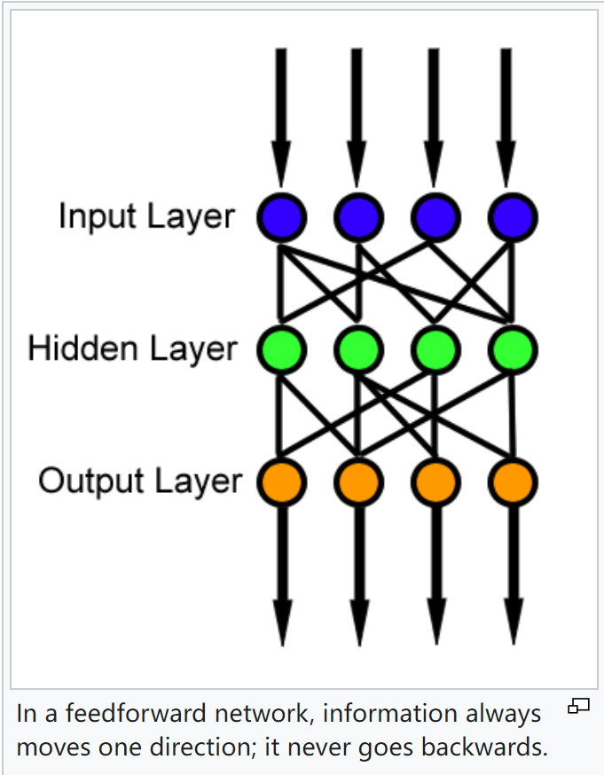
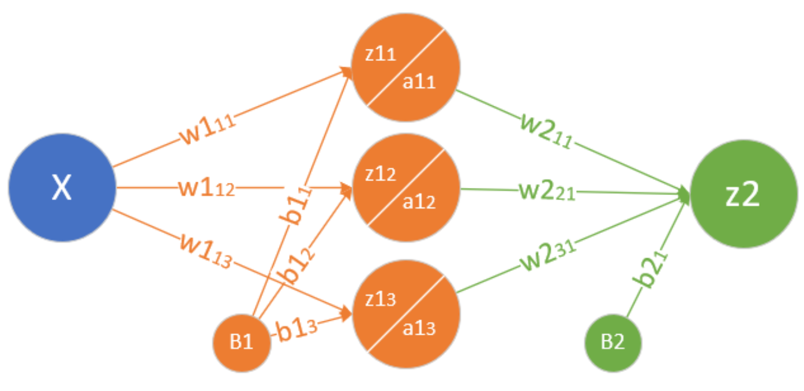
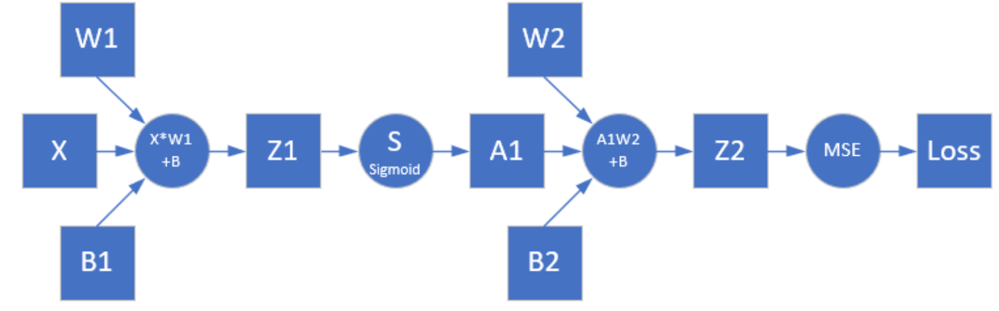
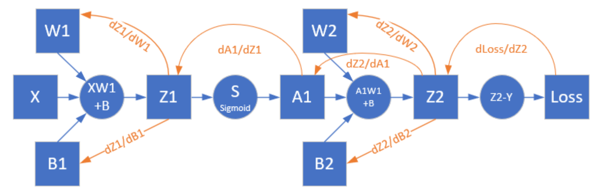

# Feedforward Neural Network (FNN)
> A **feedforward neural network (FNN)** is an artificial neural network wherein connections between the nodes do not form a cycle
 

信息总是单向传播的

## Single-layer Perceptron 
反正也只有一层，直接输入到这一层网络里，输入乘以权重之后相加

假如相加的结果高于某个值，那么就发送正信号

**perceptron** 指的就是一层只有一个这种单元的网络

反正就是只能进行线性计算

## Multi-layer Perceptron
一般来说会指代fully connected networks:
> each neuron in one layer is connected to all neurons in the next layer

**universal approximation theorem**:
> every continuous function that maps intervals of real numbers to some output interval of real numbers can be approximated arbitrarily closely by a ==multi-layer perceptron with just one hidden layer==. 

虽然说经常会看到使用sigmoid作为这种情况下的激活函数，但是一旦层数过深，就会出现梯度消失的问题

涉及的learning techniques:

- **Back-propagation**

    > To adjust weights properly, one applies a general method for non-linear optimization that is called **gradient descent**. For this, the network ==calculates the derivative of the error function with respect to the network weights==, and changes the weights such that the error decreases (thus going downhill on the surface of the error function).

    梯度是一个==矢量==，所以我们既需要大小（损失函数），又需要方向（梯度下降）

我们还是拿一个具体一点的例子来说明这玩意是咋工作的吧，更加具体的看**这里**

### 定义网络结构
我们这里定义一个两层的神经网络，输入层不算：

### 前向计算

可以比较直观的看到各个数据之间的关系

可以看到激活函数是sigmoid，损失函数则是使用均方差损失函数：

$$loss(w,b) = \frac{1}{2} (z2-y)^2\tag{4}$$

### 反向传播

这个图还是很直观的

来看看每一步的误差都是怎么传播的：
#### 损失函数对输出层的反向误差
- **Loss->Z2**

    根据公式4：

    $$
    \frac{\partial loss}{\partial z2} = z2 - y \rightarrow dZ2 \tag{5}
    $$

    答案看起来非常凑巧
- **W2的梯度**

    根据公式3和W2的矩阵形状，把标量对矩阵的求导分解到矩阵中的每一元素：

    $$
    \begin{aligned}
    \frac{\partial loss}{\partial W2} &= 
    \begin{pmatrix}
        \frac{\partial loss}{\partial z2}\frac{\partial z2}{\partial w2_{11} } \\\\
        \frac{\partial loss}{\partial z2}\frac{\partial z2}{\partial w2_{21} } \\\\
        \frac{\partial loss}{\partial z2}\frac{\partial z2}{\partial w2_{31} }
    \end{pmatrix}
    \begin{pmatrix}
        dZ2 \cdot a1_{1} \\\\
        dZ2 \cdot a1_{2} \\\\
        dZ2 \cdot a1_{3}
    \end{pmatrix} \\\\
    &=\begin{pmatrix}
        a1_{1} \\\\ a1_{2} \\\\ a1_{3}
    \end{pmatrix} \cdot dZ2
    =A1^{\top} \cdot dZ2 \rightarrow dW2
    \end{aligned} \tag{6}
    $$
- **B2的梯度**

    $$
    \frac{\partial loss}{\partial B2}=dZ2 \rightarrow dB2 \tag{7}
    $$

可以看到和之前的单个神经元的网络的结果没啥区别

#### 损失函数对隐藏层的反向误差
- **A1的梯度**

    根据公式3和A1矩阵的形状：

    $$
    \begin{aligned}
    \frac{\partial loss}{\partial A1}&=
    \begin{pmatrix}
        \frac{\partial loss}{\partial Z2}\frac{\partial Z2}{\partial a1_{11} }
        &
        \frac{\partial loss}{\partial Z2}\frac{\partial Z2}{\partial a1_{12} }
        &
        \frac{\partial loss}{\partial Z2}\frac{\partial Z2}{\partial a1_{13} }
    \end{pmatrix} \\\\
    &=
    \begin{pmatrix}
    dZ2 \cdot w2_{11} & dZ2 \cdot w2_{12} & dZ2 \cdot w2_{13}
    \end{pmatrix} \\\\
    &=dZ2 \cdot
    \begin{pmatrix}
        w2_{11} & w2_{21} & w2_{31}
    \end{pmatrix} \\\\
    &=dZ2 \cdot
    \begin{pmatrix}
        w2_{11} \\\\ w2_{21} \\\\ w2_{31}
    \end{pmatrix}^{\top}=dZ2 \cdot W2^{\top}
    \end{aligned} \tag{8}
    $$
- **A1->Z1**

    激活函数这里比较特别

    由于公式2在计算时，并没有改变矩阵的形状，相当于做了一个矩阵内逐元素的计算，所以它的导数也应该是逐元素的计算，不改变误差矩阵的形状。根据Sigmoid激活函数的导数公式，有：

    $$
    \frac{\partial A1}{\partial Z1}= Sigmoid'(A1) = A1 \odot (1-A1) \tag{9}
    $$

    所以最后到达Z1的误差矩阵是：

    $$
    \begin{aligned}
    \frac{\partial loss}{\partial Z1}&=\frac{\partial loss}{\partial A1}\frac{\partial A1}{\partial Z1} \\\\
    &=dZ2 \cdot W2^T \odot Sigmoid'(A1) \rightarrow dZ1
    \end{aligned} \tag{10}
    $$
- **W1和B1的梯度**

    和第5章中一样，我们直接列在下面：

    $$
    dW1=X^T \cdot dZ1 \tag{11}
    $$

    $$
    dB1=dZ1 \tag{12}
    $$

其实实际使用的时候，似乎是使用**自动微分**来计算复合函数的梯度的

## ?. Dynamic vs Static Computational Graphs – PyTorch and TensorFlow
[reference](https://www.geeksforgeeks.org/dynamic-vs-static-computational-graphs-pytorch-and-tensorflow/)

懒得写下来了，看链接

