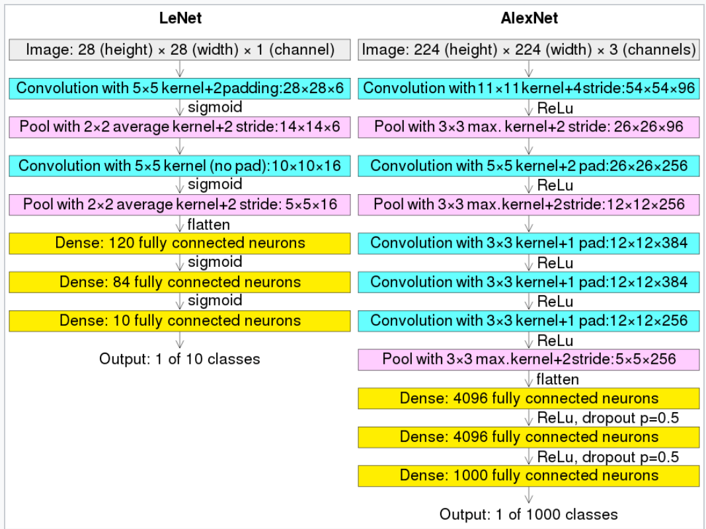
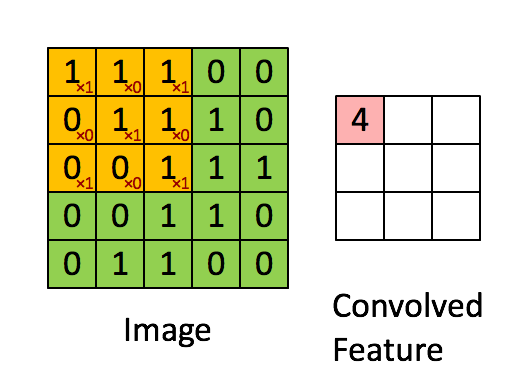
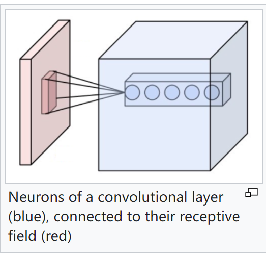
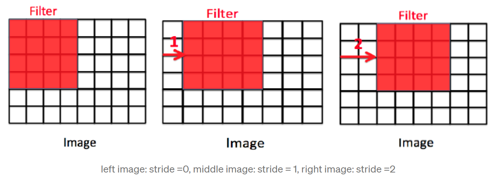
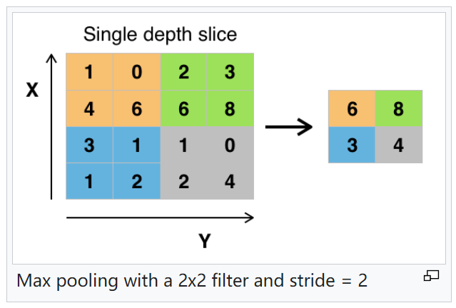
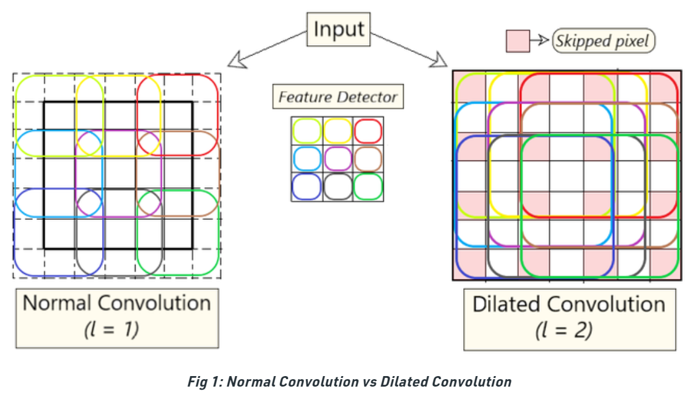

# Convolutional Neural Network (CNN)
CNN属于是上一章多层感知机（全连接前馈网络）的==regularized==的版本

全连接前馈网络的缺点之一在于，他们很容易==过拟合==数据，反正CNN就不会那么容易

CNN是模仿生物的视觉皮层构建的。每一个大脑皮层神经元只会对视野内==某一个区域内==(receptive field)的神经冲动做出响应，而所有大脑皮层神经元对应的区域之间有所重叠，于是能够覆盖整个视野

CNN相比于其他的图像分类算法来说，需要更少的预处理，甚至可以自动学习，不需要人过多干预

## Definition
> **Convolutional neural networks** are a specialized type of artificial neural networks that use a mathematical operation called [convolution](https://en.wikipedia.org/wiki/Convolution) in place of general matrix multiplication in at least one of their layers

## Architecture

### Convolutional Layers
由一堆的==feature map堆叠==而成

先来看看单个feature map是怎么生成的：

图中，绿色的是原始图像，而黄色的矩阵则是卷积核（用来学习图像的feature）。可以看到乘法的和就是feature map里的值

其实这个图像忽略了照片的深度（也就是RGB通道），假如是3通道的照片的话，那么filter（==多维语义下的卷积核==）自己的深度也会是3。当然，生成的feature map的深度就变成了1，只不过多个filter的结果stack一下就会拥有深度

In a CNN, the input is a tensor with a shape: `(number of inputs) × (input height) × (input width) × (input channels)`. After passing through a convolutional layer, the image becomes abstracted to a **feature map**, also called an activation map, with shape: `(number of inputs) × (feature map height) × (feature map width) × (feature map channels)`

每个卷积核其实就是个矩阵

#### Local Connectivity
局部不变性

就是receptive field带来的性质

需要注意的是，==receptive field会随着网络的加深而间接增大==（大概是因为像素量的减少导致的？）

#### Spatial Arrangement
三个超参控制着convolutional layer的输出的体积：
- **depth**

    > controls the number of neurons in a layer that connect to the same region of the input volume. These neurons learn to activate for ==different features== in the input

    For example, if the first convolutional layer takes the raw image as input, then different neurons along the depth dimension may ==activate in the presence of various oriented edges, or blobs of color==.

    也就是说不同深度的神经元对应着不同的feature
- **stride**
- **padding size**

output image's (feature map's) edge length will be:
$$
\frac{n+2p-f}{s}+1
$$
其中：
- padding $p$
- filter size $f\times f$
- input image size $n\times n$
- stride $s$

### Pooling Layers
> Pooling layers reduce the dimensions of data by ==combining the outputs of neuron clusters at one layer into a single neuron in the next layer==

可能有两种不同的池化：
- **local pooling**

    combines small clusters, tiling sizes such as 2 × 2 are commonly used
- **global pooling**

    acts on all the neurons of the feature map

池化的方法也有不同的：
- **max pooling**

    > uses the maximum value of each local cluster of neurons in the feature map

    这是最常用的
- **average pooling**

    takes the average value

其中一种常见的用法是，在两个相邻的convolutional layer之间插入一个pooling layer

### Fully Connected Layers
这部分和全连接一样

The flattened matrix goes through a fully connected layer to classify the images

### Weights
parameter sharing:
> sharing of weights by ==all neurons in a particular feature map==

体现统计平稳性

The vectors of weights and biases are called **filters** and represent particular features of the input (e.g., a particular shape). A distinguishing feature of CNNs is that many neurons can share the same filter. This reduces the memory footprint because a single bias and a single vector of weights are used across all receptive fields that share that filter, as opposed to each receptive field having its own bias and vector weighting

没懂

## Hyperparameters
### Kernel size
> the **kernel** is the number of pixels processed together

一般用维度表示，比如2x2

### Padding
> **padding** is the addition of (typically) 0-valued pixels on the borders of an image
>
> This is done so that the border pixels are ==not undervalued (lost)== from the output because they would ==ordinarily participate in only a single receptive field== instance
>
> Also, the image's size won't get too small

The padding applied is typically one less than the corresponding kernel dimension. e.g.:

a convolutional layer using 3x3 kernels would receive a ==2-pixel pad, that is 1 pixel on each side of the image==.

### Stride
> The **stride** is the number of pixels that the analysis window moves on each iteration

A stride of 2 means that each kernel is offset by 2 pixels from its predecessor

### Number of filters
Since ==feature map size decreases with depth==, layers near the input layer tend to have fewer filters while higher layers can have more

Preserving more information about the input would require ==keeping the total number of activations (number of feature maps times number of pixel positions) non-decreasing== from one layer to the next

注意filter和input的运算结果就是feature map

### Dilation
> **Dilation** involves ==ignoring== pixels within a kernel

就是挖空

dilation of 2 on a 3x3 kernel expands the kernel to 5x5:

留意每个框框里的红色色块

## Translation equivariance and aliasing
平移（旋转，缩放）不变性

大概就是假设CNN对于输入照片的位移并不会受影响

## Reference
["Convolutional neural network - Wikipedia," .](https://en.wikipedia.org/wiki/Convolutional_neural_network)

["Convolution, Padding, Stride, and Pooling in CNN | by Abhishek Kumar Pandey | Analytics Vidhya | Medium," .](https://medium.com/analytics-vidhya/convolution-padding-stride-and-pooling-in-cnn-13dc1f3ada26)