# Recurrent Neural Network (RNN)
循环神经网络
: where connections between nodes can create a ==cycle==, allowing output from some nodes to affect subsequent input to the same node. This allows it to exhibit ==temporal dynamic behavior==.
> 
注意不要和recursive neural network搞混

## Recurrent Neural Network vs. Feedforward Neural Network
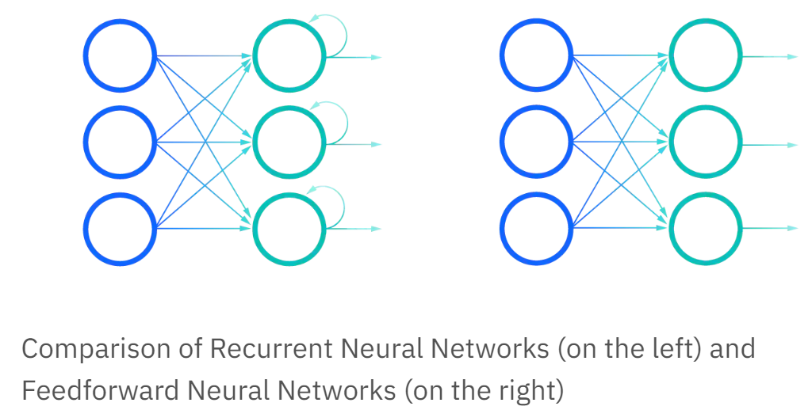

RNN是由前馈神经网络演化而来的，多加入的自循环特征，让他们能够==额外"记住"上一次训练的结果==（和之前假设输入和输出独立的神经网络都不同）。这让它非常适合处理时序数据（语音识别、自然语言处理。。。）

另一个明显的特征是，它每一层的==参数是共享的==:

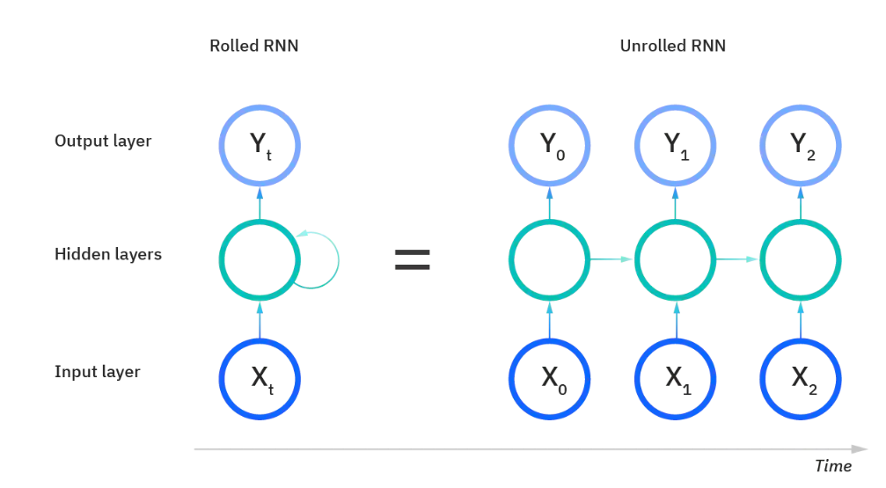

比如这里用展开的视角来看的话，每一层的参数都是一样的，每层可以分别识别一个单词，自带一种增强学习的能力

## Training
### Backpropagation through time (BPTT)
是前馈神经网络里面的backpropagation的泛化版本

假设我们现在的结构包含一个recurrent layer $f$和一个feedforward layer $g$，图中只展开了3次时间：

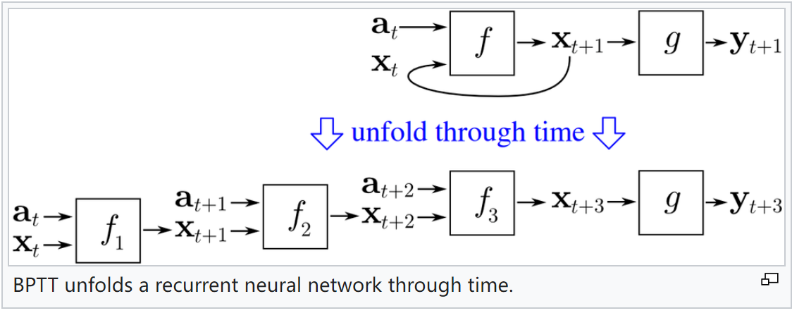

其中$a$为输入，$y$为输出，$x$为hidden state（初始状态一般初始化为全0）

> BPTT begins by ==unfolding== a recurrent neural network in time. The unfolded network contains $k$ inputs and outputs, but every copy of the network ==shares the same parameters==. Then the backpropagation algorithm is used to find the gradient of the cost with respect to all the network parameters.

损失被定义为所有时间节点的损失的平均值

因为展开后的每个节点的参数是共享的，所以权重的更新值是==逐步累加==起来的

- **优点**

    会比general purpose的优化算法（比如evolutionary optimization）在训练RNN的时候快很多
- **缺点**

    还是对付不了局部极小值

## Types of RNN
RNN的输入和输出都是没有长度限制的：
- **One-to-one**

    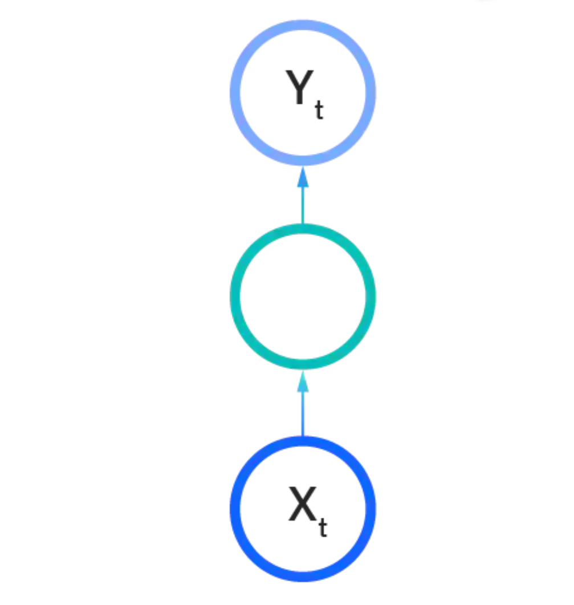
- **One-to-many**

    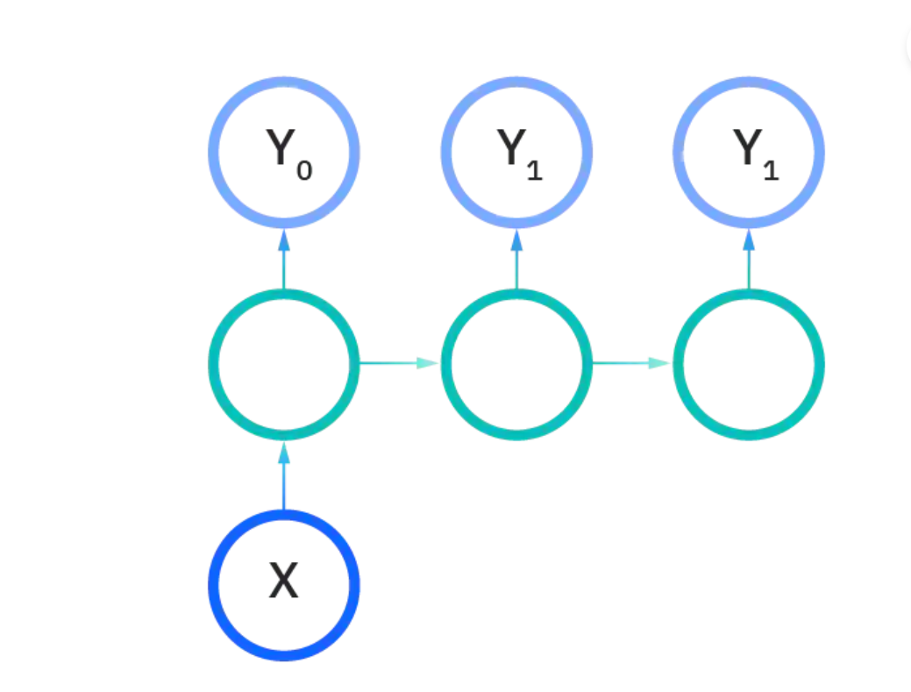
- **Many-to-one**

    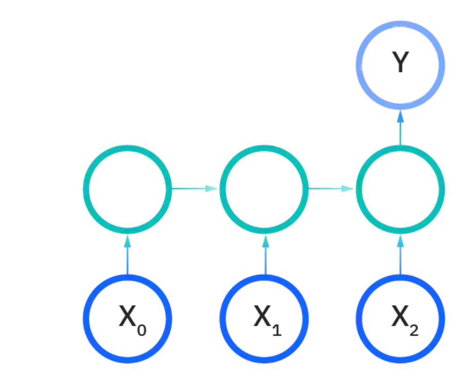
- **Many-to-many**

    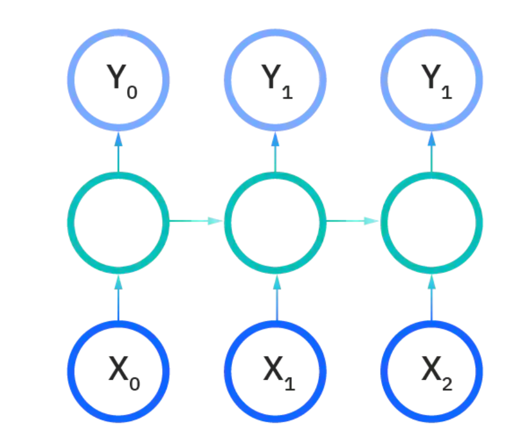

    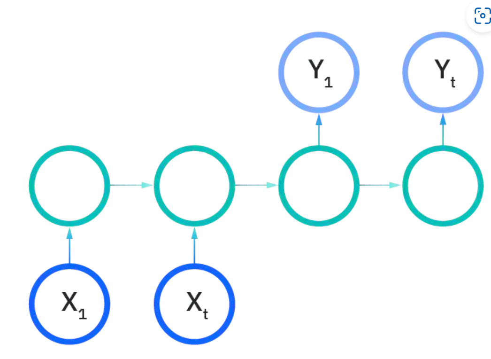

## Variant RNN Architectures
### Long short-term memory (LSTM)
#### The Problem of Long-Term Dependencies
传统RNN虽然理论上可以记录所有的历史信息，但是假如有效的context相隔太远的话，会因为梯度消失等问题，导致无法利用这些太远的信息：

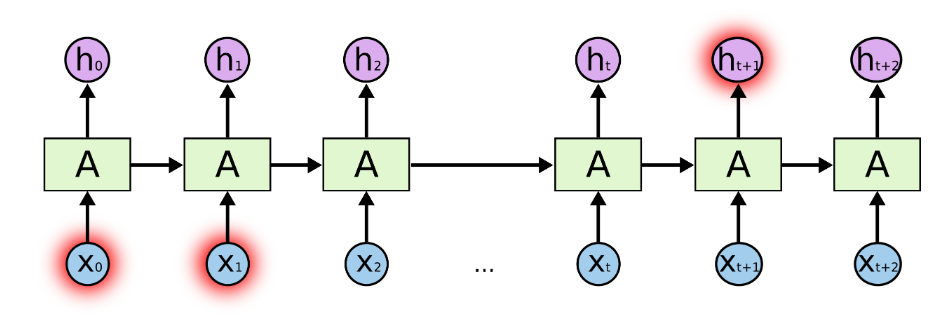

比如文章的开头说某个人物来自法国，然后一直到文章的末尾才需要网络来推断一下，他说啥语言。这时候普通RNN就没法做到利用文章开头的信息

LSTM就是来解决这种问题的

#### LSTM Networks
普通的RNN的重复结构比较简单，比方说只有一个tanh layer：

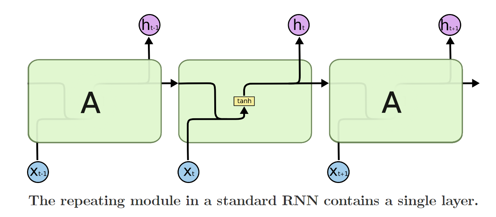

LSTM则是有四个层，以非常神奇的方式进行交互

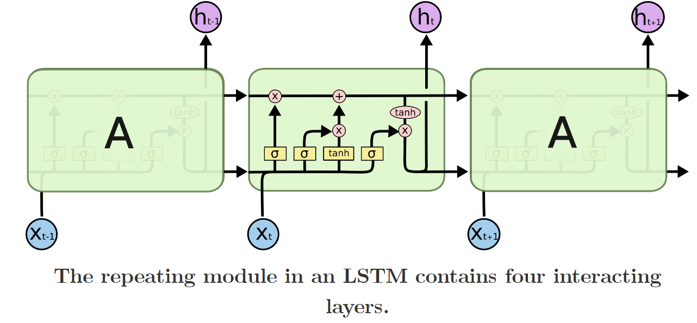

细节我们等会再说，先来熟悉一下符号：

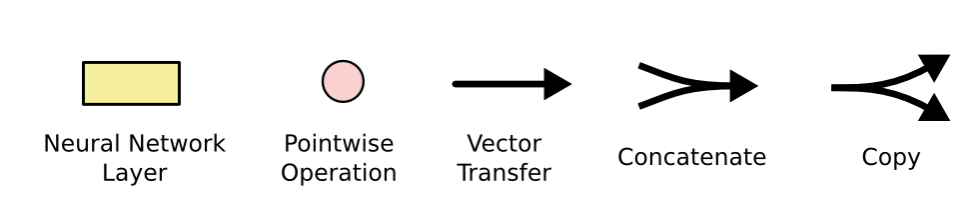

#### The Core Idea Behind LSTMs
The key to LSTMs is the **cell state**, the horizontal line running through the top of the diagram.

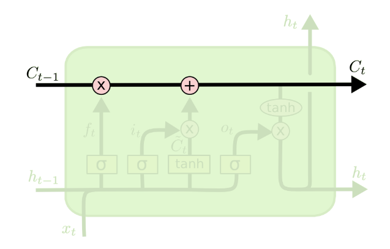

cell state有点像传送带，它会贯穿所有链，只会发生一些线性的运算。信息可以轻松无变化地在里面传送

只有**gate**结构可以修改core state：

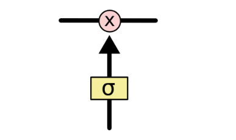

由sigmoid网络层和乘法组成，可以让信息有选择性地通过

其中sigmoid层会输出0~1范围内的值，用以描述"how much of each component should be let through"。0表示啥都不给过，1表示全都可以过

#### Step-by-Step LSTM Through 
##### Step 1
> is to decide what information we're going to ==throw away== from the cell state

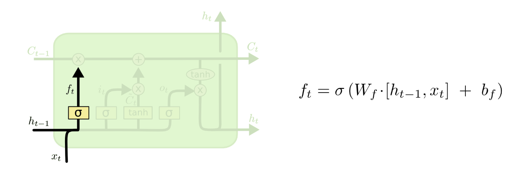

这个操作是由**forget gate layer**实现的:
> It looks at $h_{t−1}$ and $x_t$, and outputs a number between $0$ and $1$ for each number in the cell state $C_{t−1}$. A $1$ represents “completely keep this” while a $0$ represents “completely get rid of this.”

至于为什么你要遗忘信息：

e.g.
> the cell state might include the gender of the present subject, so that the correct pronouns can be used. When we see a new subject, we want to forget the gender of the old subject.

大概就是更新信息？

##### Step 2
> is to decide what ==new information== we’re going to store in the cell state

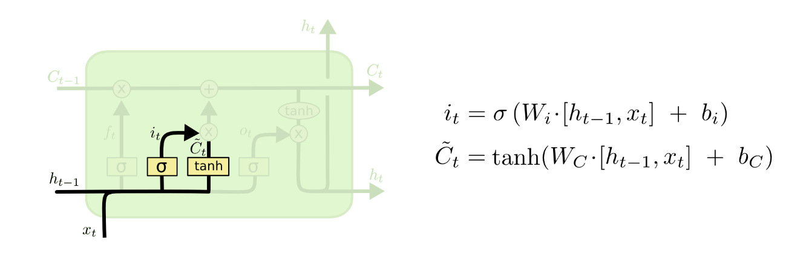

包含了两个部分：
- **input gate layer** ($\sigma$)

    decides which values we'll update
- **tanh layer**

    creates a vector of new candidate values, $\tilde{C_t}$, that could be added to the state

然后就可以结合两个层的结果来更新state了

e.g.
> In the example of our language model, we’d want to add the gender of the new subject to the cell state, to replace the old one we’re forgetting

##### Step 3
> It’s now time to ==update== the old cell state, $C_{t−1}$, into the new cell state $C_t$. The previous steps already decided what to do, we just need to actually do it.

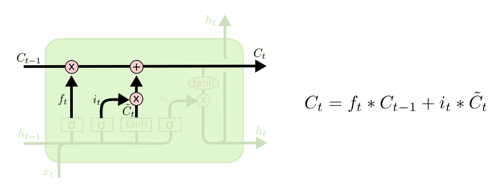

实际是把前两步的结果结合一下：
> We multiply the old state by $f_t$, forgetting the things we decided to forget earlier. Then we add $i_t∗\tilde{C}_t$. This is the new candidate values, scaled by how much we decided to update each state value

（感觉就是把图中的公式口述了一遍

##### Step 4
> Finally, we need to decide what we are going to ==output==. This output will be based on our cell state, but will be a filtered version

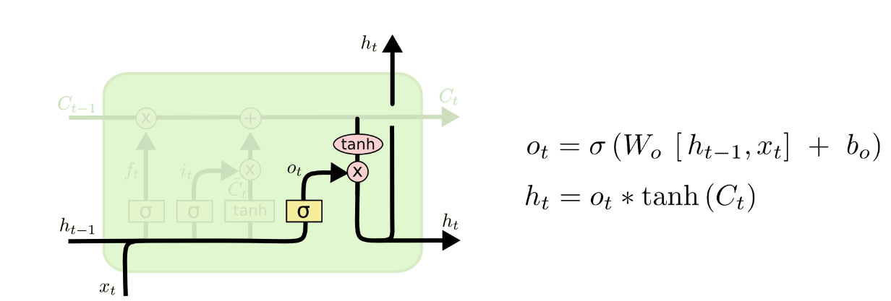

> First, we run a sigmoid layer which decides what parts of the cell state we’re going to output (似乎在图里面没有体现). Then, we put the cell state through **tanh** (to push the values to be between −1 and 1) and multiply it by the output of the sigmoid gate (**output gate**), so that we only output the parts we decided to.

至于为什么要对输出再做一遍筛选，主要是我们不一定需要所有的结果，而只需要一部分：
> For the language model example, since it just saw a subject, it might want to output information relevant to a verb, in case that’s what is coming next. For example, it might output whether the subject is singular or plural, so that we know what form a verb should be conjugated into if that’s what follows next.

### Gated recurrent unit (GRU)
> A slightly more dramatic ==variation on the LSTM== is the **Gated Recurrent Unit**, or **GRU**. It combines the forget and input gates into a single “**reset gate** ($r_t$).”, uses an **update gate** ($z_t$) （用来更新隐藏状态$\tilde{h}_t$）

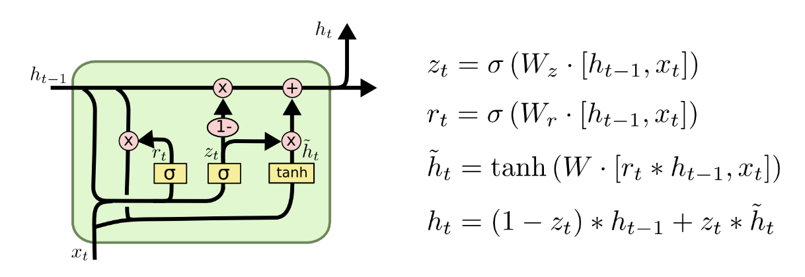

可以看到甚至连单独的output gate都没有，同时==并没有维护细胞状态==

## Reference
["What are Recurrent Neural Networks? | IBM," .](https://www.ibm.com/cloud/learn/recurrent-neural-networks)

["Recurrent neural network - Wikipedia," .](https://en.wikipedia.org/wiki/Recurrent_neural_network#Long_short-term_memory)

["Understanding LSTM Networks -- colah's blog," .](http://colah.github.io/posts/2015-08-Understanding-LSTMs/)