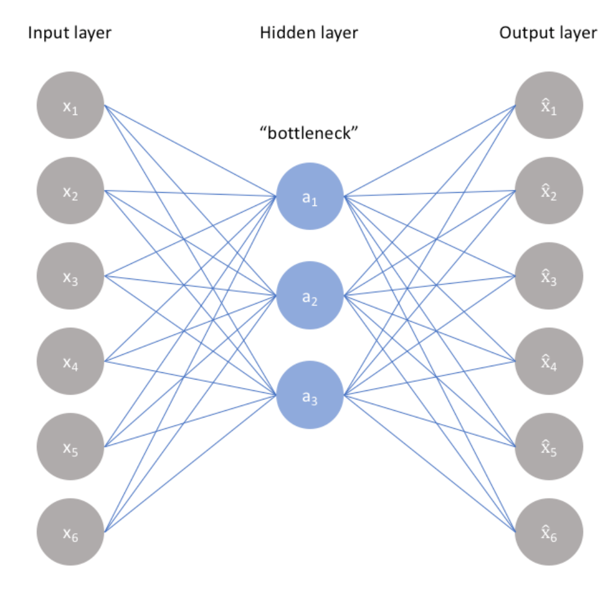
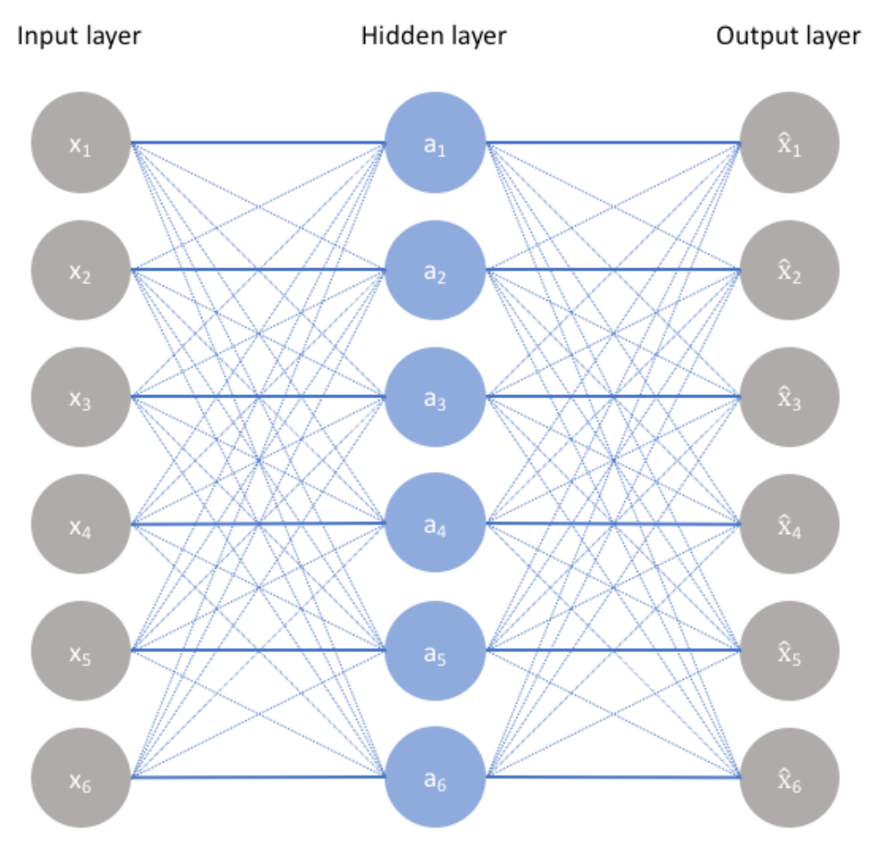
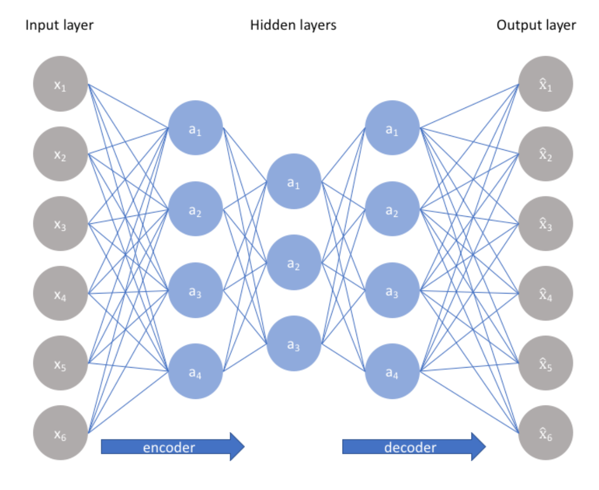
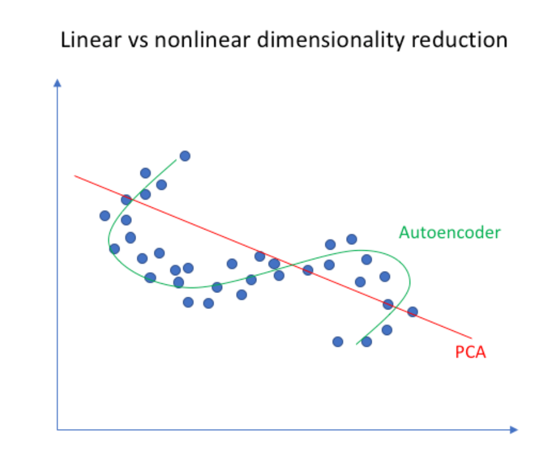
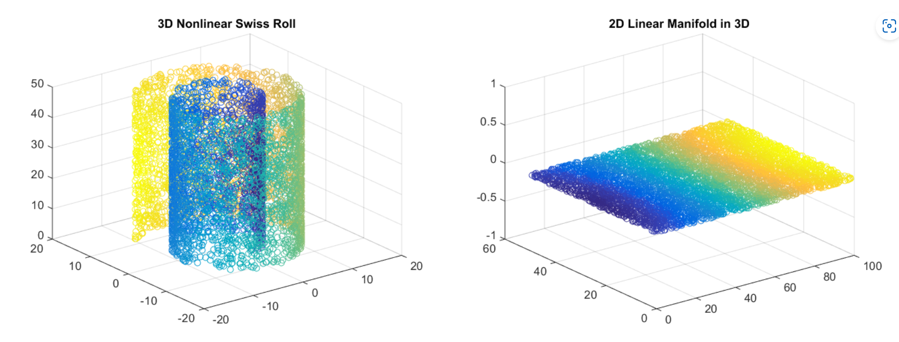
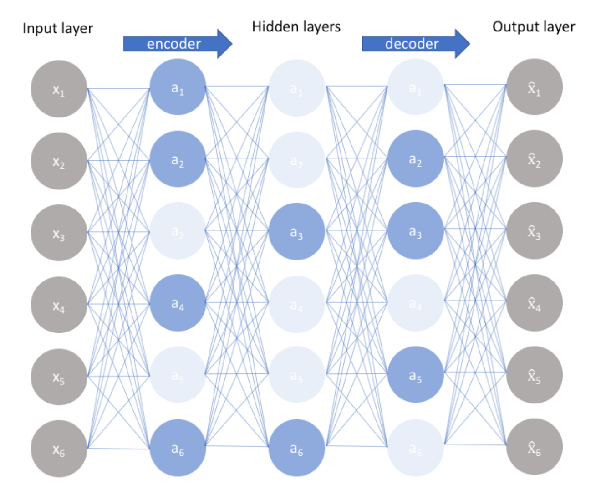
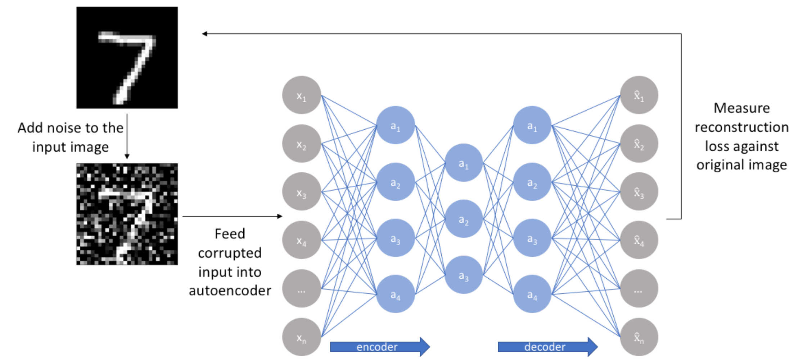

# Autoencoder

## Introduction
Autoencoder
: **Autoencoders**[^1] are an ==unsupervised learning== technique in which we leverage neural networks for the task of ==feature learning[^2]==

[^1]: ["Introduction to autoencoders.," .](https://www.jeremyjordan.me/autoencoders/)

[^2]: ["Feature learning - Wikipedia," .](https://en.wikipedia.org/wiki/Feature_learning)

它们长这样：

这个"bottleneck"的隐藏层是关键所在：
> we'll design a neural network architecture such that we impose a **bottleneck** in the network which forces a ==compressed== knowledge representation of the original input

至于Output Layer，则是试图基于这些被浓缩的数据，==重新构建==出Input Layer的数据，而我们的训练目标就是让输出层和输入层的对应数据误差较小：
$$
\min (\mathcal{L}(x, \tilde{x}))
$$

---

你可能会想，为什么bottleneck非要设置的节点数量更小呢？不妨设想一下假如隐藏层的节点个数和输入层一样多：

网络训练了一会之后就会发现，原来==单纯记住输入数据==就可以得到最小的误差，于是这个网络就单纯背住了答案，而不是学到了数据之间存在的联系和规律。

这显然与我们的目标相违背，我们希望的当然是发现数据之间存在的内在联系。bottleneck设置更少的节点数量就是让网络必须舍弃掉冗余的信息，留下输入数据的关键部分

!!! note
    In fact, if we were to construct a *linear* network (ie. without the use of nonlinear activation functions at each layer) we would observe a similar ==dimensionality reduction== as observed in [PCA](https://en.wikipedia.org/wiki/Principal_component_analysis).

---

一个理想的自编码器需要平衡以下因素：
- **Sensitive** to the inputs enough to accurately build a ==reconstruction==.
- **Insensitive** enough to the inputs that the model ==doesn't simply memorize or overfit== the training data.

听着就很抽象，实现的时候，实际上就是在对loss function提出要求：
- one term encourages our model to be sensitive to the inputs (ie. reconstruction loss $\mathcal{L}(x, \tilde{x})$)
- a second term discourages memorization/overfitting (ie. an added regularizer)

也就是说loss function长成这样：
$$
\mathcal{L}(x, \tilde{x})+regularizer
$$

一般来说，regularizer前面会添加一个==系数==，用来改变两项之间的权重关系

接下来会介绍一些常见的具体实现
## Undercomplete Autoencoder
欠完备的自编码器

这玩意最大的特点就是压根不存在regularizer这一项，对于overfitting的防备仅仅在于限制hidden layer的个数：

---

下面来插一嘴autoencoder和PCA之间的对比：

因为神经网络能够学习到非线性的关系，所以autoencoder可以看作是PCA的非线性的泛化版本，如同下图这样：

甚至可以学习高维空间的manifold（延伸阅读：a **manifold** is defined in simple terms as a continuous, non-intersecting surface），用来描述低维下的观察结果，并decode回到原本的输入维度空间：

## Sparse autoencoders
我们用一种新的方式来制造information bottleneck。不是单纯的减少节点数目，我们对于每一个输入，都只激活一部分的神经元：

!!! note
    不同的input会激活不同的神经元们

至于说每次激活不同的神经元到底有啥好处：
> we allow our network to sensitize individual hidden layer nodes toward specific attributes of the input data.

每个神经元对应特定的特征，这样在不影响网络提取特征的能力的前提下，做到了限制背答案

至于说具体实现的话，其实有两种，鉴于余志文只讲了其中一种那就只记录一种

L1 Regularization
: We can add a term to our loss function that ==penalizes== the absolute value of the vector of activations $a$ in layer $h$ for observation $i$, scaled by a tuning parameter $\lambda$:
$$\mathcal{L}(x, \hat{x})+\lambda \sum_i|a_i^{(h)}|$$

## Denoising autoencoders
另一种让模型更加泛化的方法是，让输入数据带一点噪声，然后将输出结果和不带噪声的数据作比较

这样一来，模型就没法抄作业了，因为输入数据和目标输出压根不一样
