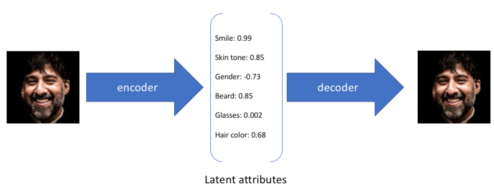
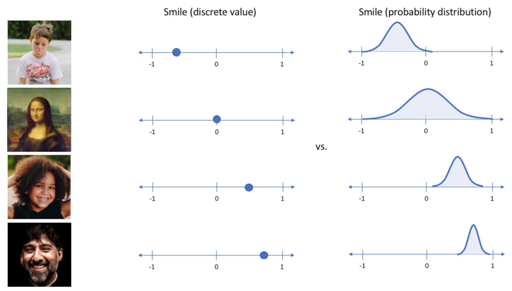
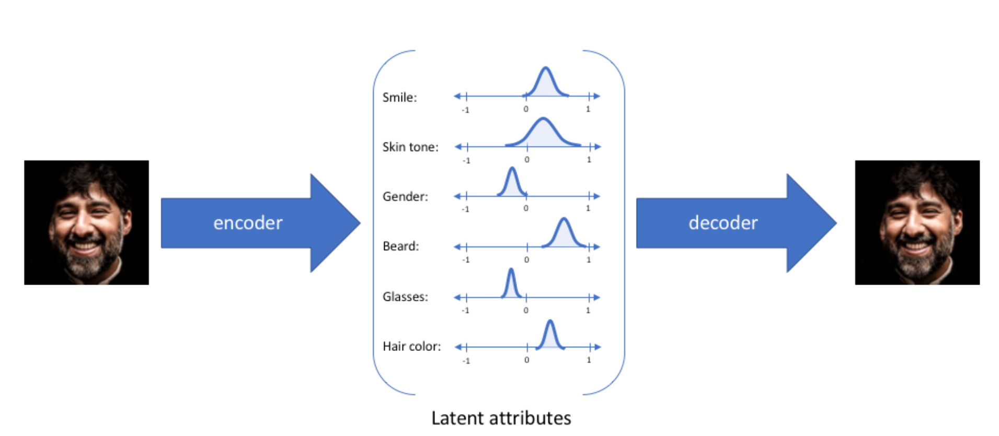
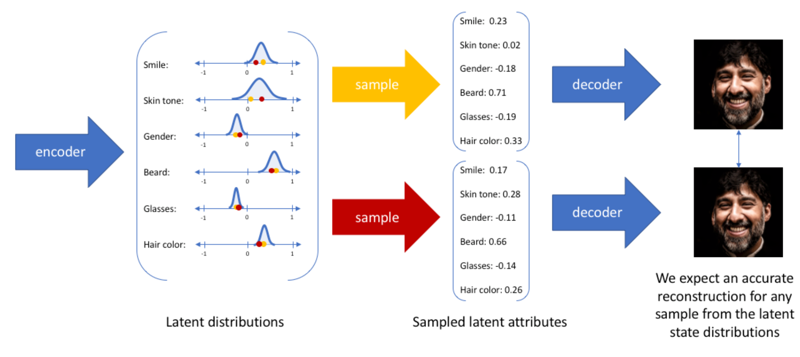
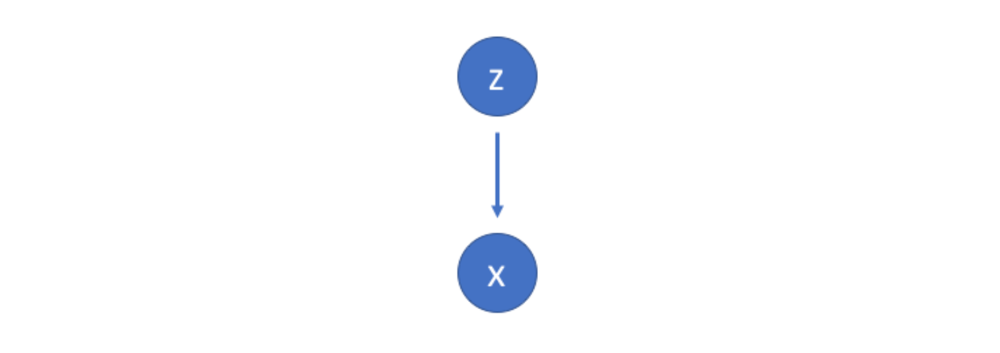
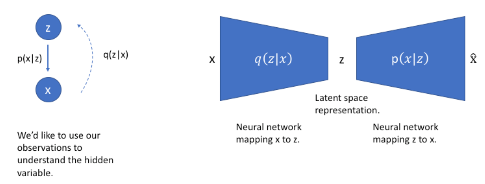
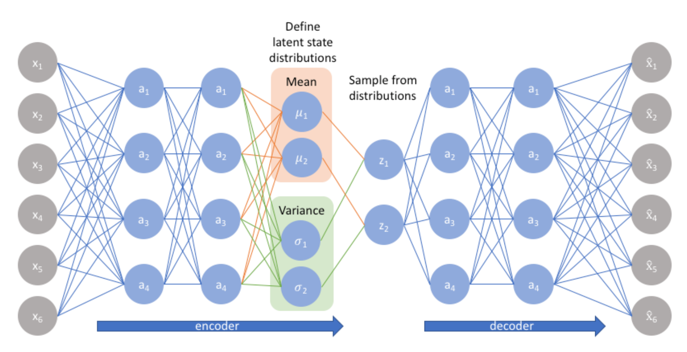
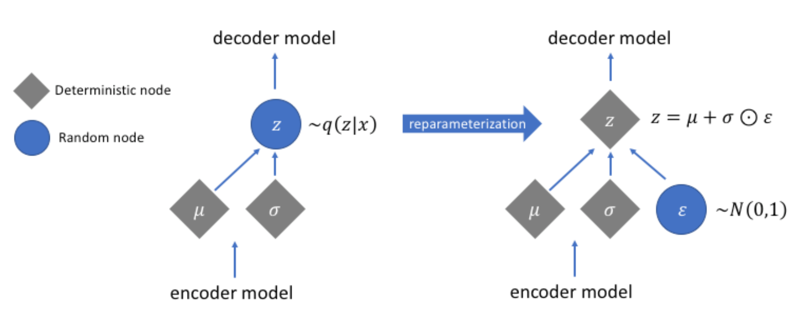
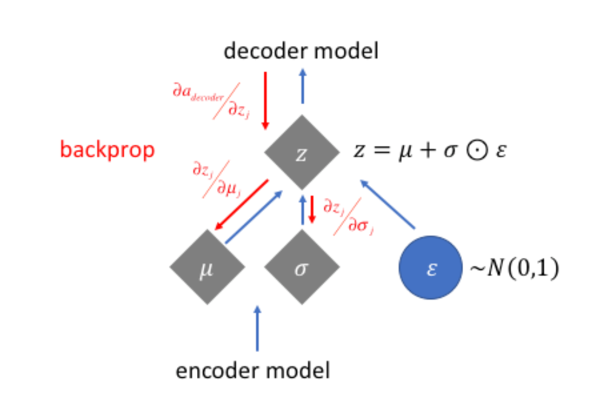
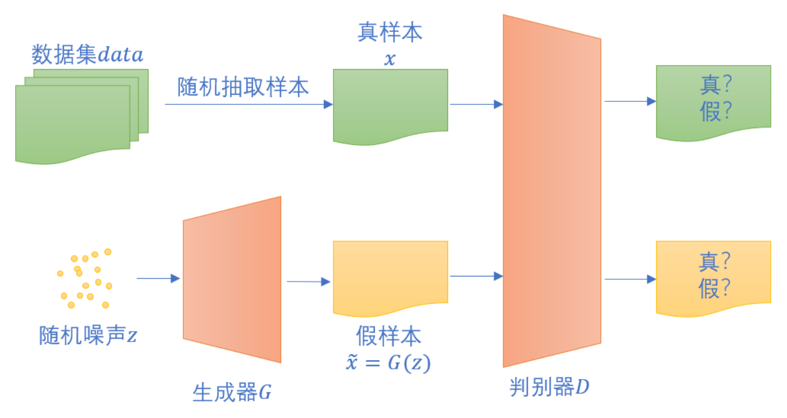

# Deep Generative Model
大概就是通过学习无标签数据，学到数据的==分布==，并基于此可以==生成==新的数据

## Variational Autoencoders[^1]

[^1]:["Variational autoencoders.," .](https://www.jeremyjordan.me/variational-autoencoders/)

### Intuition
> rather than building an encoder which outputs a ==single value== to describe each latent state attribute, we'll formulate our encoder to describe a ==probability distribution== for each latent attribute

single value的情况下，autoencoder会如此表述latent attribute:

然而，我们其实更加倾向于用a range of possible values来描述latent attribute，比如这个人到底是不是在笑的可能性：

于是乎，我们可以改成下图这个样子:

!!! note
    For variational autoencoders, the ==encoder== model is sometimes referred to as the **recognition model** whereas the ==decoder== model is sometimes referred to as the **generative model**.

---

> When decoding from the latent state, we'll ==randomly sample== from each latent state distribution to generate a vector as input for our decoder model

不管怎么取样，我们希望取样接近的两点之间的reconstruction结果相近

### Statistical Motivation

Suppose that there exists some hidden variable variable $z$ which generates an observation $x$:

We can only see $x$, but we would like to infer the characteristic of $z$. In order words, we'd like to compute $p(z|x)$

$$
p(z|x)=\frac{p(x|z)p(z)}{p(x)}
$$

Unfortunately, computing $p(x)$ is quite difficult:

$$
p(x)=\int p(x|z)p(z)dz
$$

虽然这个分布非常难以计算，但是我们可以用另一个分布来逼近这个分布

Let's approximate $p(z|x)$ by another distribution $q(z|x)$ which we'll define such that it has a tractable distribution. If we can define the parameters of $q(z|x)$ such that it is very similar to $p(z|x)$, we can use it to perform ==approximate inference== of the intractable distribution.

Recall that the KL divergence is a measure of difference between two probability distributions. Thus, if we wanted to ensure that $q(z|x)$ was similar to $p(z|x)$, we could ==minimize the KL divergence== between the two distributions.

$$
\min KL(q(z|x)||p(z|x))
$$

上式可以转而求解下式的最大值：

$$
E_{q(z|x)}\log p(x|z)-KL (q(z|x)||p(z))
$$

The first term represents ==the reconstruction likelihood== and the second term ensures that our learned distribution $q$ is similar to the true prior distribution $p$.

---

于是乎，我们用$q(z|x)$替代$p(z|x)$成为encoder，$p(x|z)$则是保持不变：

Our loss function for this network will consist of two terms, one which penalizes reconstruction error (which can be thought of ==maximizing the reconstruction likelihood== as discussed earlier) and a second term which encourages our learned distribution $q(z|x)$ to be similar to the true prior distribution $p(z)$, which we'll ==assume follows a unit Gaussian distribution==, for each dimension $j$ of the latent space.

$$
\mathcal{L}(x,\hat{x})+\sum_j KL(q_j(z|x)||p(z))
$$

### Implementation

记得之前说过，VAE的latent variable是以分布的形式表示的，而不是具体的值。为了简化描述，我们这里假设他服从正态分布，则我们中间输出的是 *two* vectors describing the ==mean and variance== of the latent state distributions

Our decoder model will then generate a latent vector by ==sampling== from these defined distributions and proceed to develop a reconstruction of the original input.

然而，sampling的过程有些细节需要注意。When training the model, we need to be able to *backpropagate*. However, we simply cannot do this for a random sampling process.

Fortunately, we can leverage a clever idea known as the "**reparameterization trick**" which suggests that we randomly sample $\varepsilon$ from a unit Gaussian, and then shift the randomly sampled $\varepsilon$ by the latent distribution's mean $\mu$ and scale it by the latent distribution's variance $\sigma$. (好像就是正则化一样？)

With this reparameterization, we can now optimize the *parameters* of the distribution while still maintaining the ability to randomly sample from that distribution.

!!! note
    In order to deal with the fact that the network may learn ==negative values== for $\sigma$, we'll typically have the network learn ==$\log \sigma$== and exponentiate this value to get the latent distribution's variance.

优点：
- 通过最大化变分下界来优化模型，有比较漂亮的数学原理；
- 通过重构可以实现无监督学习(没有标签!)；
- 利用再参数化技巧，实现了模型端到端（end-to-end）的训练；
- 通过推断出的隐变量，可以获得比较好的可解释性特征；

缺点：生成的图像比起GAN的来讲，有点模糊

## Generative adversarial network（延伸阅读：B15-生成对抗网络）

- **generative**

    指该网络中包含一个生成网络 (Generator)：
    - 输入为随机噪声
    - 输出为假样本

    假样本越逼真越好

- **adversarial**

    该网络中还包含一个判别网络 (Discriminator):
    - 输入为假样本和真样本
    - 输出为尽可能区分出真假样本

    生成网络和判别网络就这样相互对抗，直到generator生成的假样本能够骗过最严格的判别网络

---

discriminator面临的是一个==二分类==问题，可以回顾下前面第3.2章讲过的交叉熵损失函数，这里使用二分类问题的交叉熵函数：

$$
loss =-[y \log a + (1-y) \log (1-a)]
$$

对于真实样本$x$来说，它的标签是1 ($y=1$)，而discriminator的输出为$a=D(x)$，则对应的损失为：

$$
\begin{aligned}
loss_{real} &=-[y \log a + (1-y) \log (1-a)] \\
&=-[1 \log D(x) + (1-1) \log (1-D(x))] \\
&=-\log D(x)
\end{aligned}
$$

对于生成的假样本$G(z)$来说，假样本的标签是0，对应的损失为：

$$
\begin{aligned}
loss_{fake} &=-[y \log a + (1-y) \log (1-a)] \\
&=-[0 \log D(G(z)) + (1-0) \log (1-D(G(z)))] \\
&=-\log (1-D(G(z)))
\end{aligned}
$$

所以对于一对数据（一个真样本和一个假样本），总的损失为：

$$
loss = loss_{real} + loss_{fake} = -[\log D(x) + \log (1-D(G(z)))]
$$

对于判别器来说，它希望更准确的进行区分真假样本，所以$loss$应该越小越好，即，$\log D(x) + \log (1-D(G(z)))$越大越好。

对于生成器来说，它希望生成的样本不被正确的判别为假样本，所以$loss$应该越大越好，即，$\log D(x) + \log (1-D(G(z)))$越小越好。

这就是Goodfellow在论文中提到的生成器G和判别器D==对价值函数$V(D,G)$进行的二元极小极大化博弈==：

$$
\min_{G} \max_{D} V(D,G) = \mathbb{E}_{x \sim p_{data}{(x)} }[\log{D(x)}] + \mathbb{E}_{z \sim p_{z}{(z)} }[\log{(1 - D(G(z)))}]
$$

---

额外补充一点，在训练生成器G的时候，第一项和G无关，可以考虑只要==使得$\log (1-D(G(z)))$最小==即可。更进一步，Goodfellow提到还可以在真实训练用==最大化$\log D(G(z))$来代替==，其实也可以换个思路来看，生成器G的目标是让判别器D无法正确将假样本判别为假，即它的目标是让判别器D给每个假样本都判别为真。那么可以将所有假样本的标签置为1，这样一来，对应的损失即为：

$$
\begin{aligned}
loss &=-[y \log a + (1-y) \log (1-a)] \\
&=-[1 \log D(G(z)) + (1-1) \log (1-D(G(z)))] \\
&=-\log D(G(z)))
\end{aligned}
$$

最小化这个loss等同于最大化$\log D(G(z))$，和Goodfellow的表述一致。

所以在训练生成器时，可以将==假样本的标签置为1==来训练，这样和之前最小化损失函数的思路都是一致的，比较容易实现。

