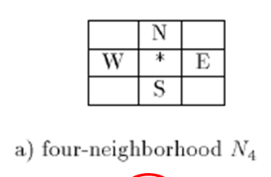
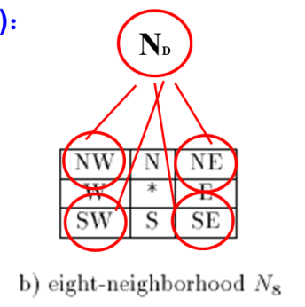
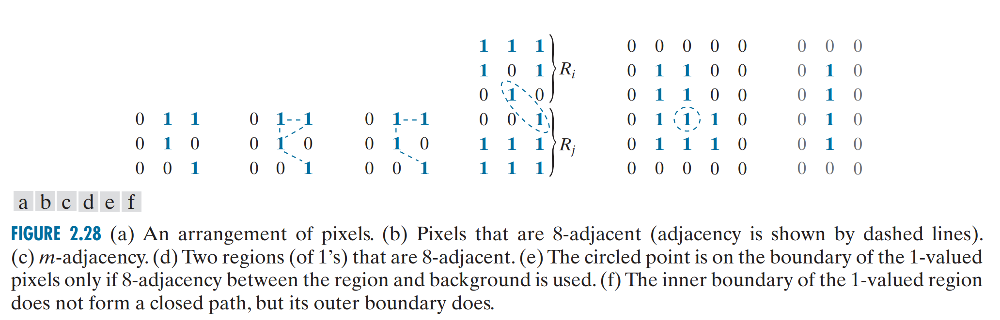
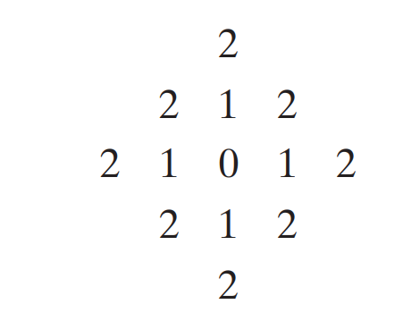
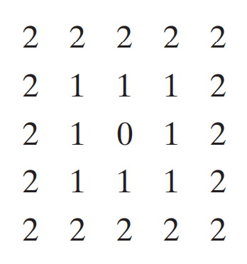

## 2.5 Some Basic Relationships Between Pixels

### 2.5.1 Neighbors of a Pixel

4-neighbors $N_4(p)$
: 

8-neighbors $N_8(n)$
: 

### 2.5.2 Adjacency, Connectivity, Regions, and Boundaries

4-adjacency
: Two pixels $p$ and $q$ with values are *4-adjacent* if $q$ is in the set $N_4(n)$

8-adjacency
: 同理

m-adjacency
: 太复杂，见P81末尾

连通性，略：

### 2.5.3 Distance Measures 

**Euclidean distance**
$$
D_e(p,q)=[(x-u)^2+(y-v)^2]^{\frac{1}{2} }
$$

**$D_4$ distance (city-block distance)**
$$
D_4(p,q)=|x-u|+|y-v|
$$

**$D_8$ distance (chessboard distance)**
$$
D_8(p,q)=\max(|x-u|,|y-v|)
$$

