# Intensity Transformation and Spacial Filtering

spatial domain
: The term spatial domain refers to the image plane itself, and image processing methods in this category are based on ==direct manipulation of pixels== in an image.

和之相对的就是transform domain (利用傅里叶变换)，将会在Ch4 & Ch6描述

spatial processing的两个主要的类别是：
- **intensity transformation**
- **spatial filtering**

## 3.1 Background

### 3.1.1 The Basics of Intensity Transformations and Spatial Filtering

The *spatial domain* processes we discuss in this chapter are based on the expression:

$$
g(x,y)=T[f(x,y)]
$$

其中：
- $f(x,y)$

    input image
- $g(x,y)$

    output image
- $T$

    operator on $f$ defined over a ==neighborhood== of point $(x,y)$

    比如在一定范围内取强度的平均值

比如neighborhood是$3\times 3$的话就是这样：

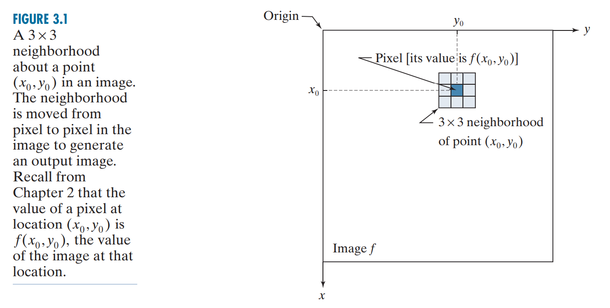

neighborhood会一点点移动，来生成最终的图像

---

作为特殊情况，当neighborhood是$1\times 1$的时候，就只有自己，上面的式子变成了 **intensity** (also called a **gray-level**, or **mapping**) **transformation function**:

$$
s=T(r)
$$
for simplicity in notation, we use $s$ and $r$ to denote, respectively, the intensity of $g$ and $f$ at any point $(x, y)$

point processing
: Approaches whose results depend only on the intensity at a point

---

举两个$T(r)$的例子：

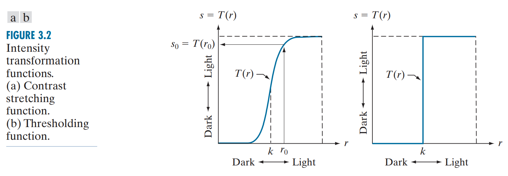

- **contrast stretching**

    似曾相识，这不就是PS里拉对比度的曲线吗？？？
- **thresholding function**

    直接把照片变为binary

### 3.1.2 About the Examples in This Chapter

Enhancement
: **Enhancement** is the process of manipulating an image so that the result is more suitable than the original for a ==specific== application

虽然intensity transformation和spatial filtering的应用场面非常广泛，但是本章举的例子主要围绕于Enhancement，因为大家对这些比较感兴趣

## 3.2 Some Basic Intensity Transformation Functions

一些常见的强度转换函数：

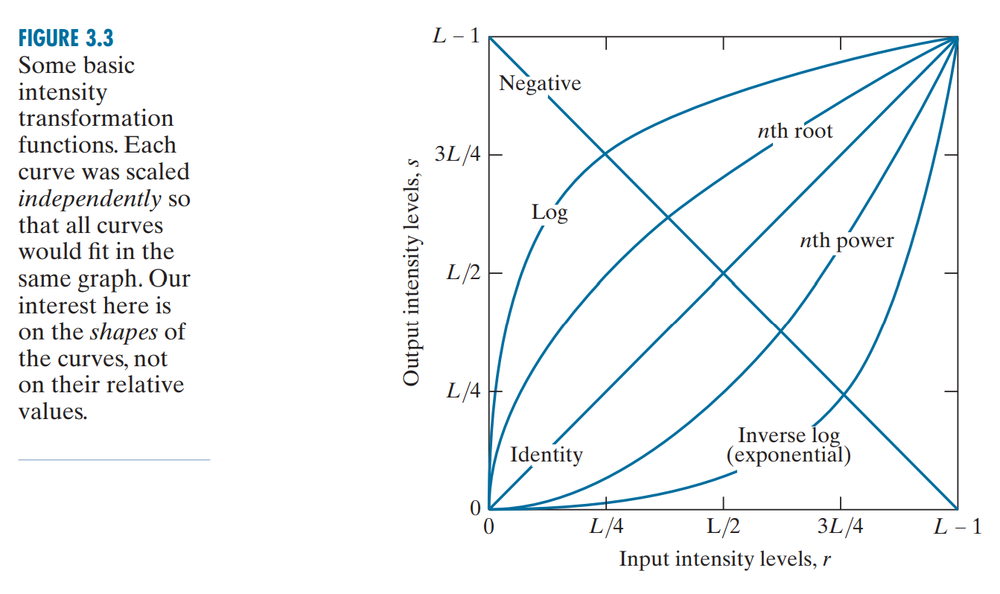

### 3.2.1 Image Negatives

图像见上图，对应的公式是：

$$
s=L-1-r
$$

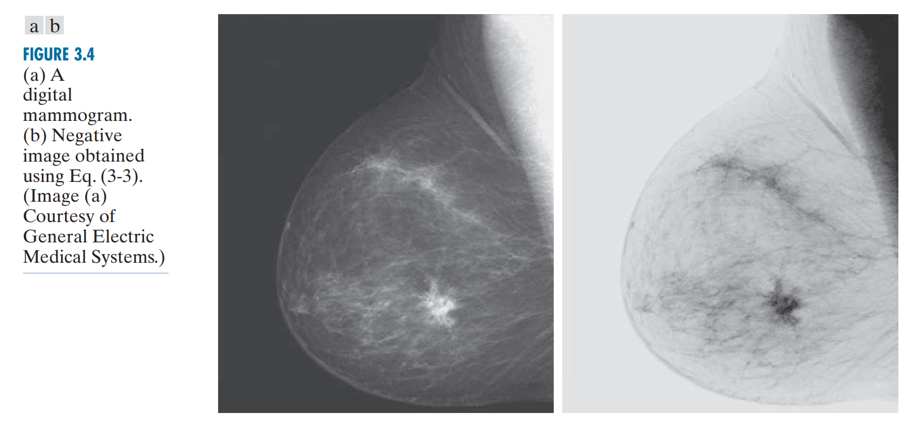

### 3.2.2 Log Transformations

general form 如下：

$$
s=c\log{(1+r)}
$$

$c$ 是个常数

从图像也可以看出来，提高了低光对应的范围，相对的也让高光的范围更窄

e.g.

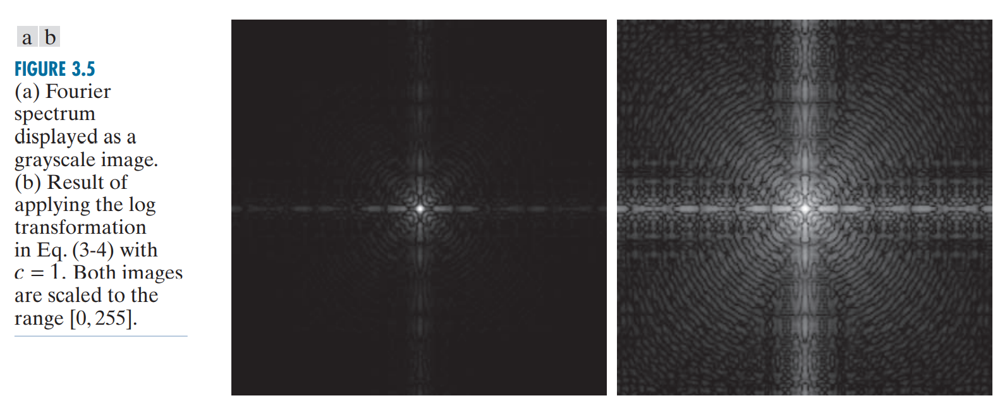

### 3.2.3 Power-Law (Gamma) Transformations

$$
s=cr^{\gamma}
$$

$\gamma$取不同的值的时候对应的图像：

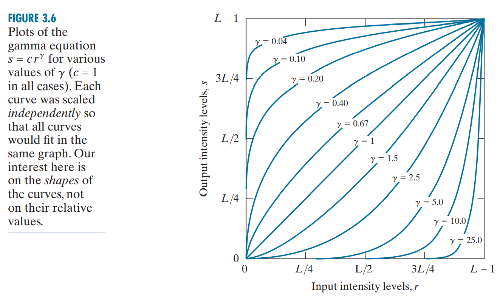

总之最终效果是符合平时处理照片的时候拉曲线的直觉的

---

因为很多的图像设备都遵循power law，所以很多时候处理出来的图像是不准的

gamma correction (gamma encoding)
: The process used to correct these power-law response phenomena

e.g.

CRT (阴极射线管)设备有一个幂值为1.8~2.5左右的intensity-to-voltage response

假如说CRT的$\gamma=2.5$，我们就可以先对照片进行一次gamma correction:

$$
s=r^{1/2.5}=r^{0.4}
$$

这样就可以抵消掉失真

### 3.2.4 Piecewise Linear Transformation Functions

#### 3.2.4.1 Contrast Stretching

就是微不足道的增强对比度的一个曲线

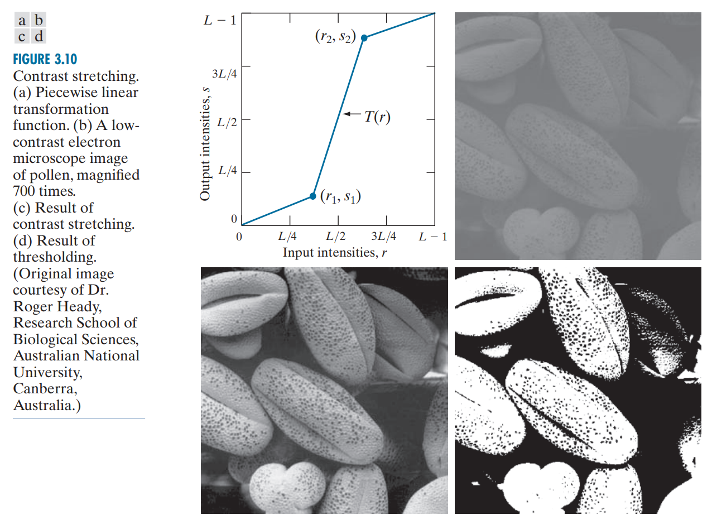

#### 3.2.4.2 Intensity-Level Slicing

灰度切割

一些比较极端的曲线：

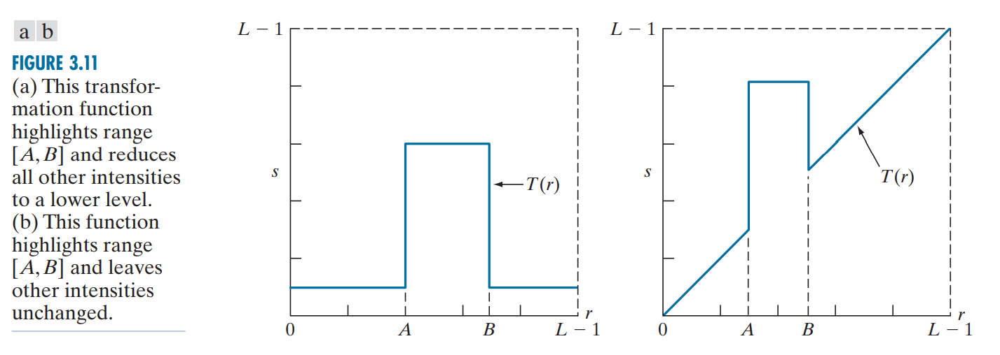

#### 3.2.4.3 Bit-Plane Slicing

像素的值是由bit构成的，比如8-bit

我们可以把图片看成几个bit-plane复合而成的图像：

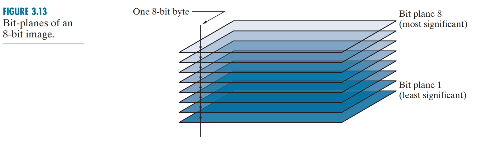

e.g.

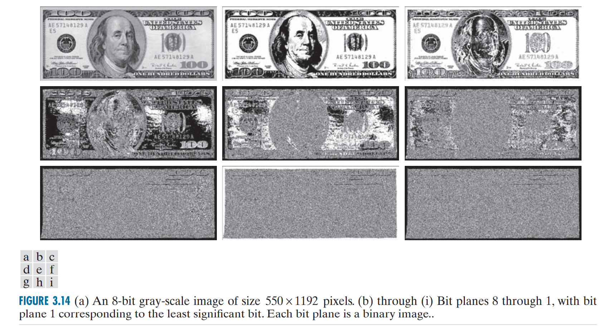

可以看到前两张保留了大部分信息，而后面几张保留了细节

那这玩意有啥用呢？
> Decomposing an image into its bit planes is useful for analyzing the relative importance of each bit in the image, a process that aids in determining the adequacy of the number of bits used to quantize the image

Ch8的图像压缩也会用到

## 3.3 Histogram Processing

老朋友直方图

Let $r_k$, for $k=0,1,2,...,L-1$ denote the ==intensities== of an $L$-level digital image, $f(x,y)$

unnormalized histogram
: for $f$:$$h(r_k)=n_k$$where $n_k$ is the number of pixels in $f$ with intensity $r_k$

normalized histogram
: $$p(r_k)=\frac{h(r_k)}{MN}=\frac{n_k}{MN}$$$MN$即是照片的长宽之积，也就是总像素量

可以看到normalized就是和总像素做了个比值。一般来说我们都会使用normalized

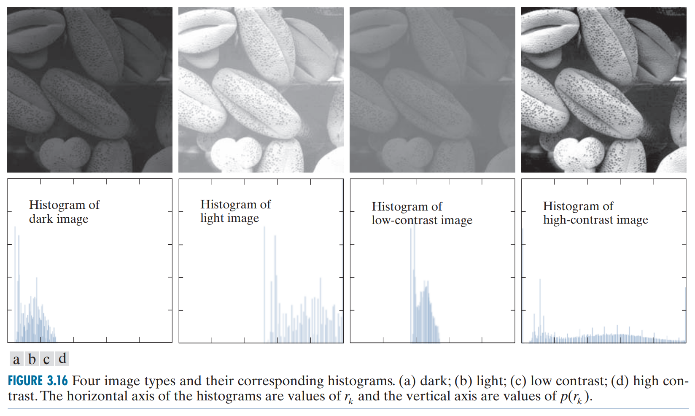

丢失了空间信息

你懂的

### 3.3.1 Histogram Equalization

均衡化

我们要研究的对象：

$$
s=T(r)\qquad 0\le r\le L-1
$$
且满足以下条件：
- $T(r)$ is a strictly monotonic increasing function in the interval $0\le r\le L-1$
- $0\le T(r)\le L-1$ for $0\le r\le L-1$

来复习一下数学上strict monotonic的概念：

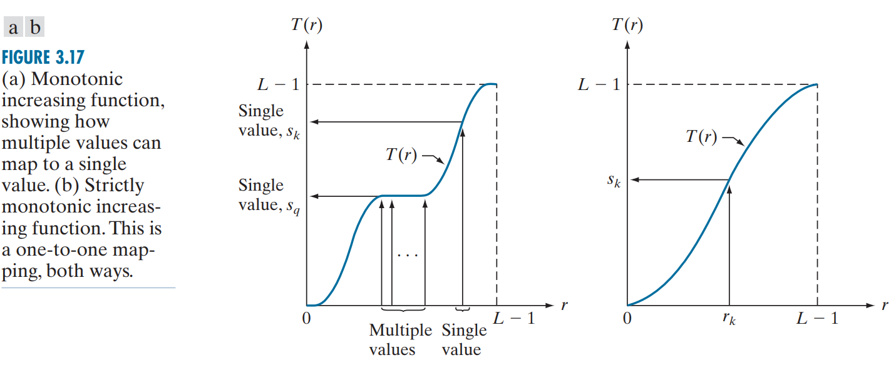

可以证明的是，我们需要的==直方图均衡函数，就是**CDF (Cumulative Distribution Function)**==

---

这里是证明为什么是CDF，可以略过

the **PDF (Probability Distribution Function)** of the transformed (mapped) variable $s$ can be obtained as:
$$
p_s(s)=p_r(r)|\frac{dr}{ds}|
$$

transformation function如下:
$$
s=T(r)=(L-1)\int_0^r P_r(w)dw
$$

$w$是dummy variable（不知道是什么意思）。右边的积分部分是变量$r$的**CDF**，当$r=L-1$的时候积分结果就是1

总之一通操作之后可以得到：

$$
\begin{aligned}
p_s(s)&=p_r(r)|\frac{dr}{ds}|\\
&=p_r(r)|\frac{1}{(L-1)p_r(r)}|\\
&=\frac{1}{L-1}\qquad 0\le s\le L-1
\end{aligned}
$$

证明了结果$s$的PDF永远是个==uniformed== probability density function

