
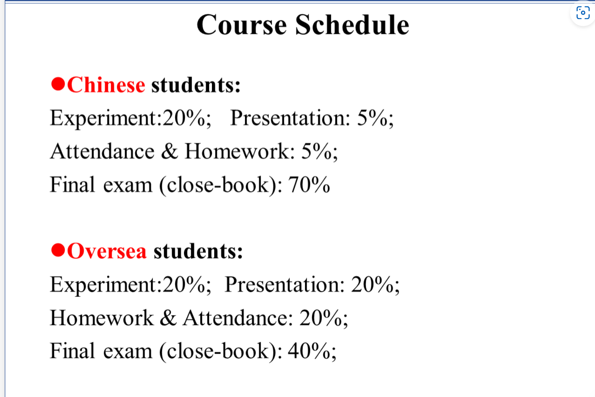

# Introduction
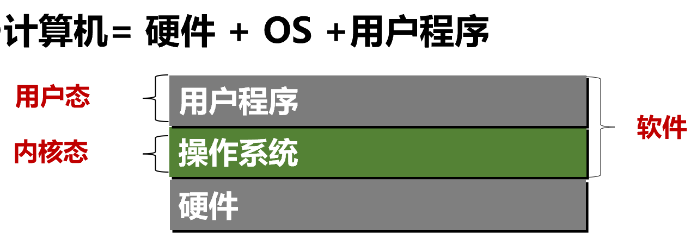

大部分OS都有两种操作模式：
- **kernel mode**

    OS就会运行在**kernel mode** (也叫**supervisor mode**)

    拥有硬件的所有控制权并且能执行所有可执行的指令

- **user mode**

    不能搞涉及操作或者IO的

OS的特性除此之外还有huge, complex and long-lived

## 1.1 What is an OS?

书上的意思是很难给一个定义，但是有两个 function 肯定是 OS 提供的：
- providing programmers an ==abstract== set of resources
- ==manage== hardware resources

### 1.1.1 The OS as an Extended Machine
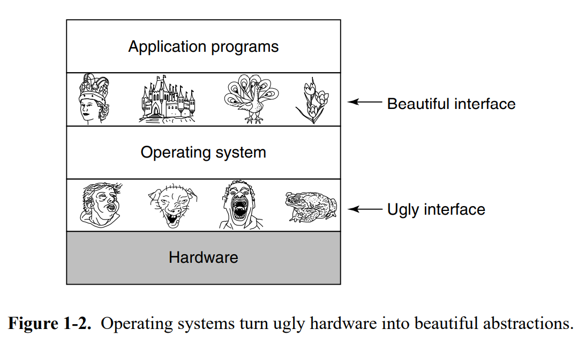

### 1.1.2 The OS as a Resource Manager
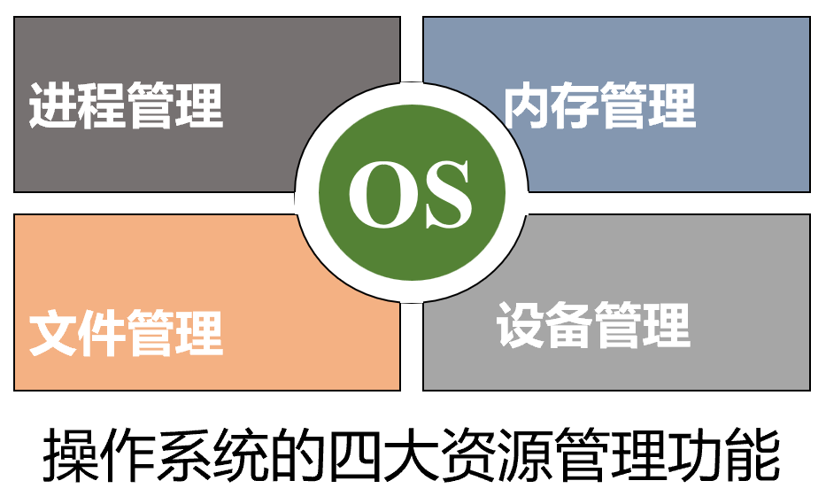

一般就分配这几种资源

multiplexing包括了两种：
- **Time multiplexing**

    时间复用，分配CPU啥的，下一个谁来使用，使用多久？
- **Space multiplexing**

    分配内存和硬盘，问题集中在公平性，保护等等

## 1.2 History of OS
### 1.2.1 The First Generation: Vacuum Tubes
- use machine language or worse
- ==No OS==
- Numerical calculations
### 1.2.2 The Second Generation: Transistors and Batch Systems
- FORTRAN or assembler language
- FMS and IBSYS OS
- Scientific calculations

### 1.2.3 The Third Generation: ICs and Multiprogramming
- ==C==, Pascal, Prolog
- OS/360, UNIX, Dos
- scientific calculations & some applications
### 1.2.4 The Fourth Generation: Personal Computers
- C++, java, ...
- ==Windows, Linux, Mac==, ...
- scientific calculations & wide applications
### 1.2.5 The Fifth Generation: Mobile Computers

## 1.3 Computer Hardware Review
**Cache hit**: 需要的数据已经在cache里找到了，不需要进一步去磁盘那里找

启动计算机步骤：

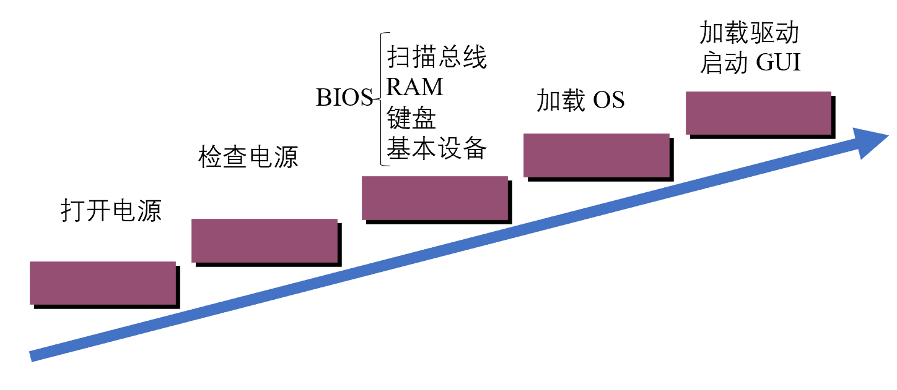

### 1.3.4 I/O Devices
- **Device driver**

    > a software that talks to a controller, giving it commands and accepting responses

Three ways to put a driver into kernel:
- Relink the kernel and reboot the system; (UNIX)
- Make entry file and reboot and load it;  (WINDOWS)
- Accept and install it without rebooting the system.  (USB)

Three ways to do input/output
- **Busy waiting**

    User program $\rightarrow$ system call $\rightarrow$ driver $\rightarrow$

    The driver starts the I/O and sits in a tight loop to see if it is done.

    I/O done $\rightarrow$ driver return $\rightarrow$ return to caller.

- **Interrupt**

  User program $\rightarrow$ system call $\rightarrow$ driver$\rightarrow$

  The driver starts the I/O and ask it to given an interrupt when it is finished.
  
    $\rightarrow$ return $\rightarrow$ block the caller $\rightarrow$ run another program.
  
- **DMA**

  Allows certain hardware subsystems to access main memory independently of the CPU.

## 1.5 OS Concepts
### 1.5.1 Processes
- A program in execution
- A container that holds all the information needed to run a program

**process table**: 
- store information about processes
- process control block (PCB)
  - UID
  - PID
  - GID

**process tree**:

The communication to cooperate and synchronize processes is called **inter-process communication (IPC)**

**core image**:
> the ==address space== a (suspended) process consists of

!!! note
    来区分一下 process 和 program:
    - Processes are dynamic, while programs are static. A process has a certain life cycle, and a program is a collection of instructions;
    - A program can correspond to multiple processes, but a process can only correspond to one program;
    - In addition to the program code, a process also contains the resources needed to run the program

### 1.5.2 Address Spaces
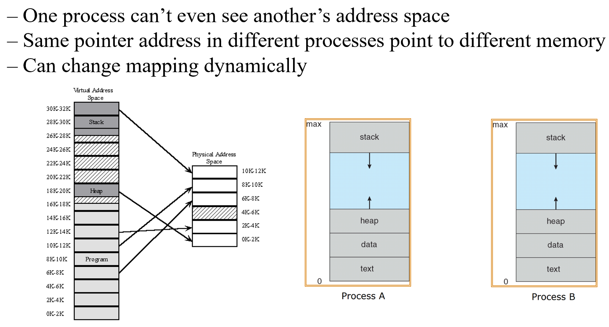

这个空间是可以包含虚拟内存的，所以64bit处理器不一定就有$2^{64}$的内存可用

### 1.5.3 Files
file system相关的概念：
- **directory**: 

    used to group files together
- **path name**:

    specify the location of a file
- **root directory**: 
- **working directory**

    Linux下的`pwd`指令指的是**p**rint **w**orking **d**irectory

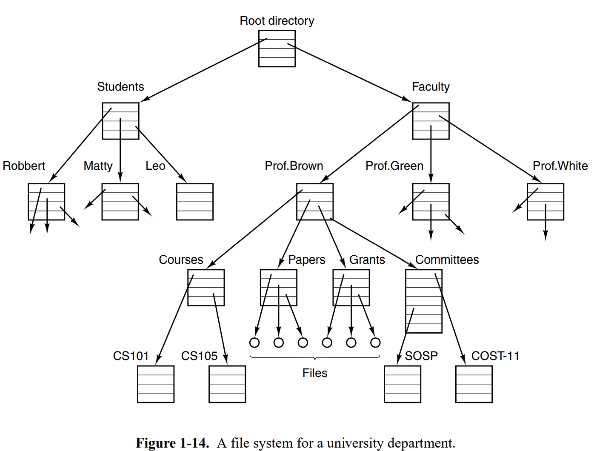

- **file descriptor**: 

    > Before a file can be read or written, it must be opened, at which time the ==permissions== are checked. If the access is permitted, the system returns a ==small integer== called a **file descriptor** to use in subsequent operations. If the access is prohibited, an error code is returned

- **mounted file system**: 

    就像上次用docker的时候用把windows里面的目录挂载到linux里一样

### 1.5.5 Protection
保护好文件，比如只允许authorized users访问重要文件

e.g.

UNIX里，给每个文件提供一个9-bit binary protection code

这个protection code分成三个不同的3-bit fields：
- owner
- other members of the owner's group

    (users are divided into groups by the system administrator)
- everyone else

每个field里面的三个bit分别是：
- read access
- write access
- execute access

这三个bit我们统称为 **rwx bits**

比如一个protection code长成 *rwxr-x--x*，代表着：
- owner啥都能干
- other group members 只能read, execute
- everyone else只能execute

没错减号代表的就是缺少对应的权限

### 1.5.6 The Shell
> A shell is a user interface for access to an OS's services

比如sh, bash

很多电脑现在都是用GUI作为用户界面，比如Linux下的KDE, Gnome

## 1.6 System Calls
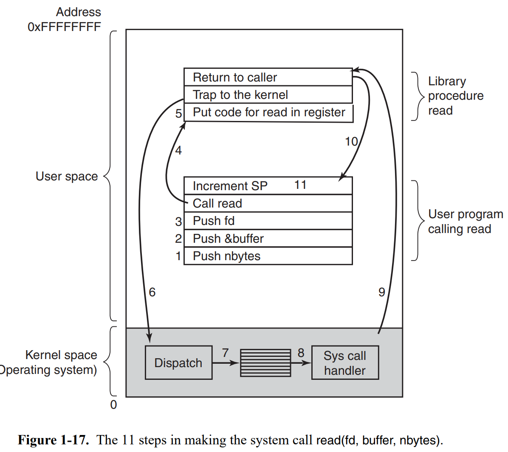

书本的P83上有整个过程11个步骤的详细解释

### 1.6.1 System Calls for Process Management
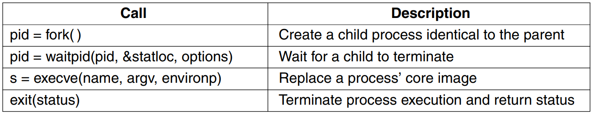

### 1.6.2 System Calls for File Management
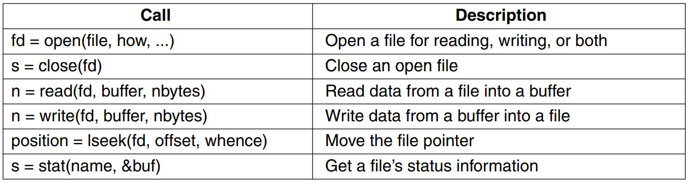

### 1.6.3 System Calls for Directory Management
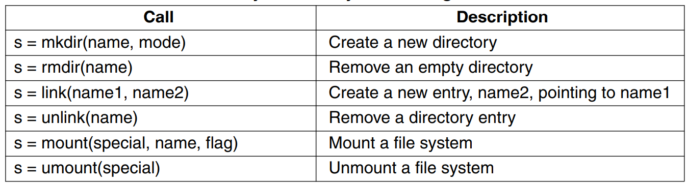

### 1.6.4 System Calls for Miscellaneous Tasks
“各种各样的”

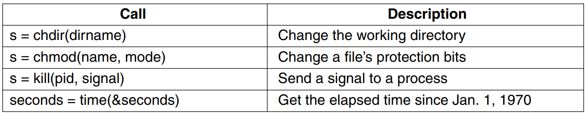

### 1.6.5 The Windows Win32 API
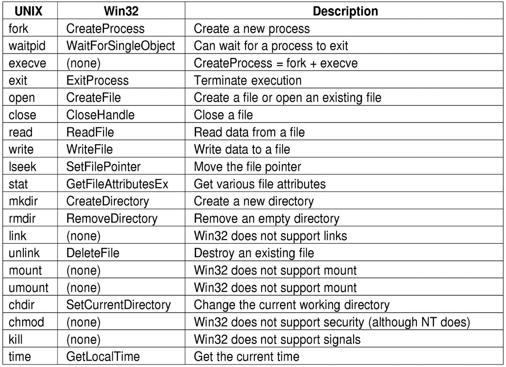

**Win32 API**:
> programmers are expected to use to get OS services

## 1.7 OS Structure
我们将要介绍6种不同的系统结构

### 1.7.1 Monolithic Systems
> All operating system operations are put into a ==single file==. The operating system is a collection of procedures, each of which can call any of the others. (e.g., Linux, windows)

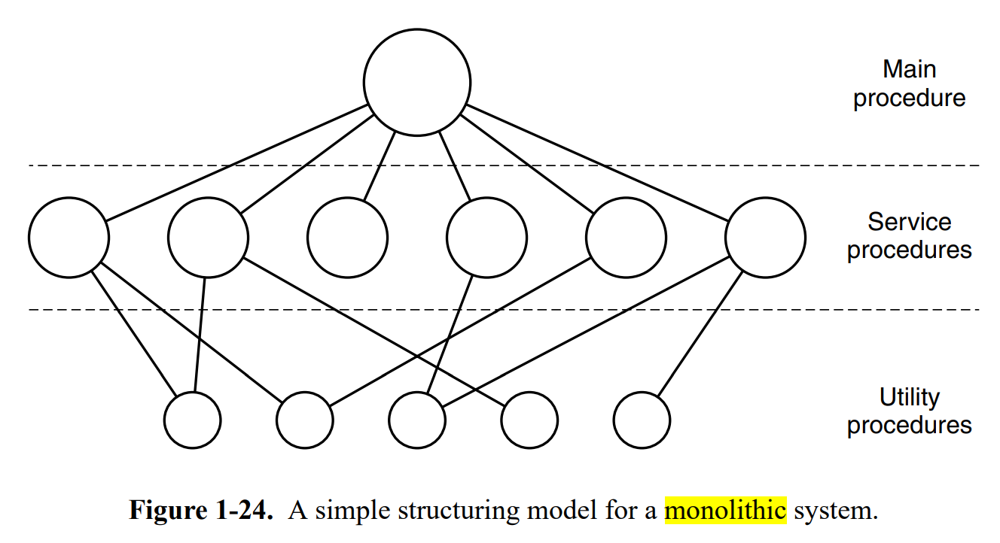

### 1.7.2 Layered Systems
> The operating system is organized as a hierarchy of layers of processes

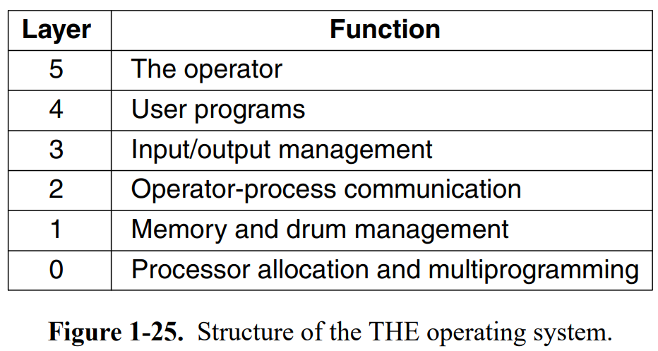

### 1.7.3 Microkernels
> Split the OS into modules, only one runs in kernel mode and the rest run in user mode;  (a lot communication)

Put as little as possible into kernel model to improve the reliability of the system.

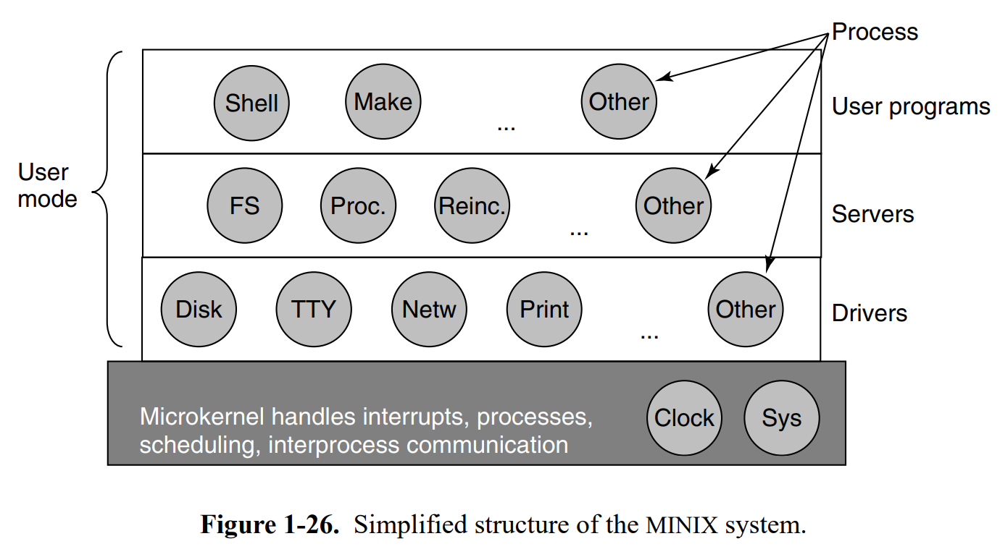

### 1.7.4 Client-Server Model
> A slight variation of the microkernel idea is to distinguish two classes of processes, the **servers**, each of which provides some service, and the **clients**, which use these services

Communication between servers and clients is done by message passing.  It is an abstraction that can be used for a single machine or a network of machines

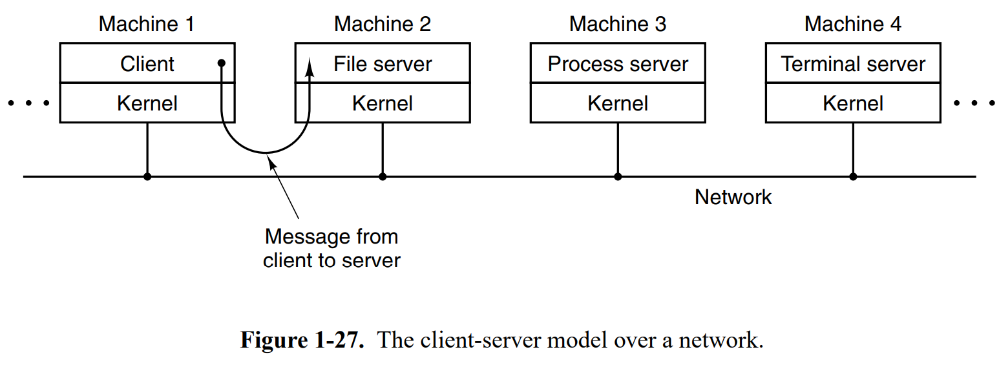

### 1.7.5 Virtual Machines
> The operating system is a timesharing system that provides multiprogramming

VM monitors  are exact copies of the bare hardware, e.g., VM/370, JVM (Java Virtual Machine)

## 1.? 题目

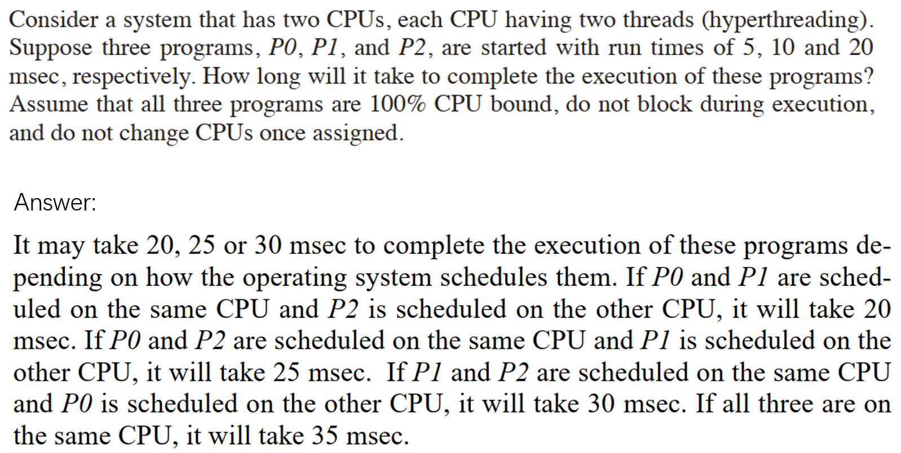

。。。什么破题

---

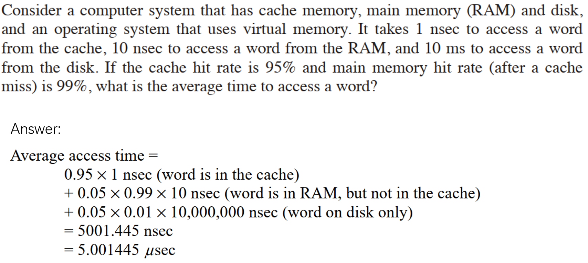

!!! warning 
    $1{\text{ ms} }=10^{6}\text{ ns}$（毫 milli ($m$)、微 micro ($\mu$)、纳 nano ($n$)）

---

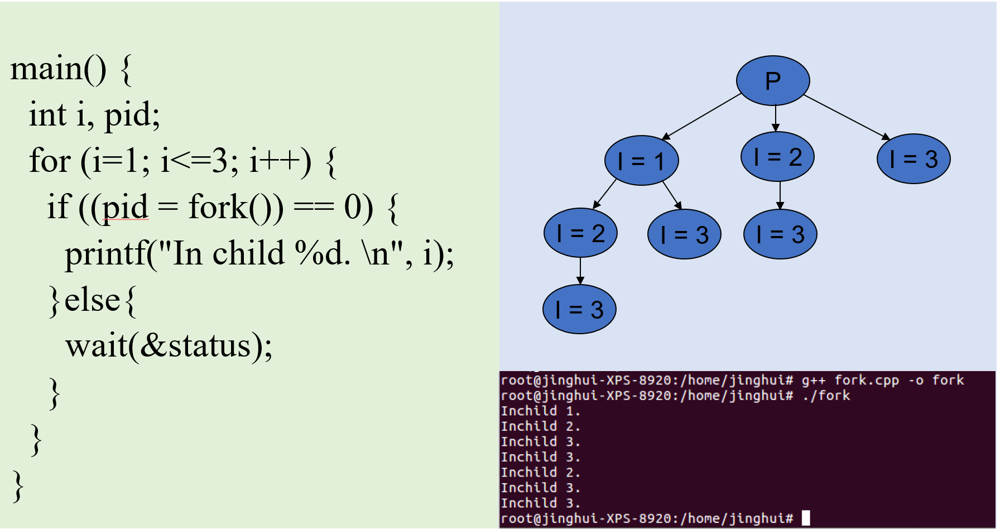

一个很无语的题目

`fork()`在被调用的时候，就会产生一个完全一样的新进程，而且==变量的值是继承的==，甚至出现==两个fork函数在等待返回值==。父进程`fork()`会返回子进程的pid，而新创造出来的子进程的`fork()`则会==返回0==

也就是说，这里父进程`fork()`后，会进入`else`而等待子进程的结束；而新创建的子进程被创建后直接就输出当前的循环计数器的值`i`

---

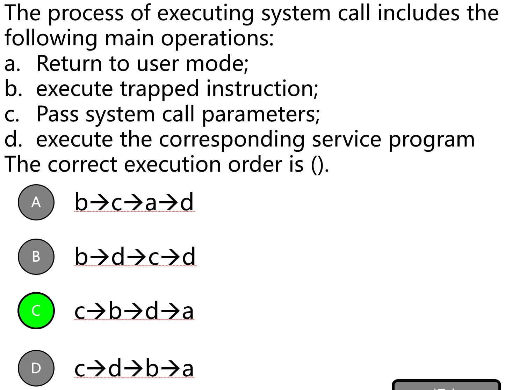
