# Unix, Linux, and Android

## 10.2 Overview of Linux

### 10.2.2 Interfaces to Linux

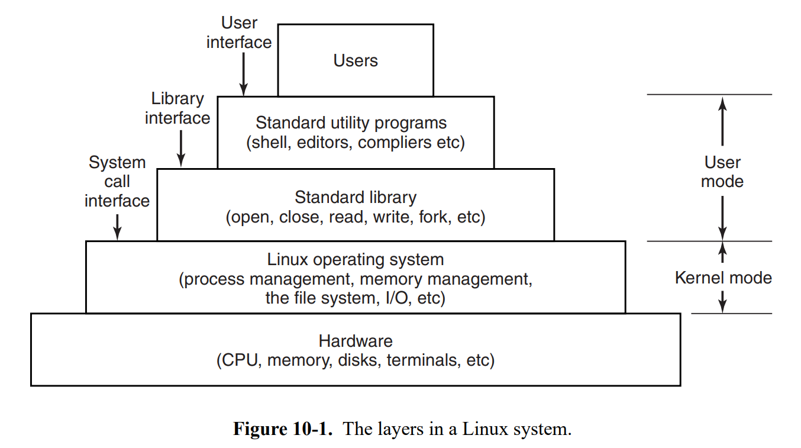

The OS controls hardware and provides system calls for user programs；Linux also provides many utility programs required by POSIX.

### 10.2.4 Linux Utility Programs

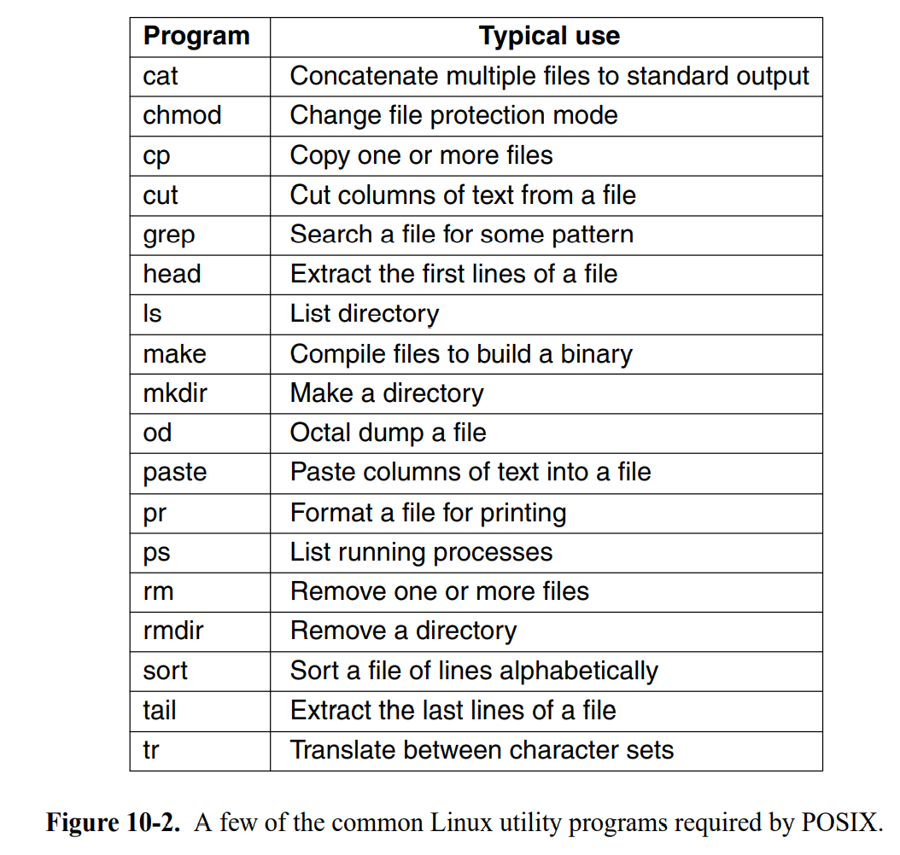

### 10.2.5 Kernel Structure

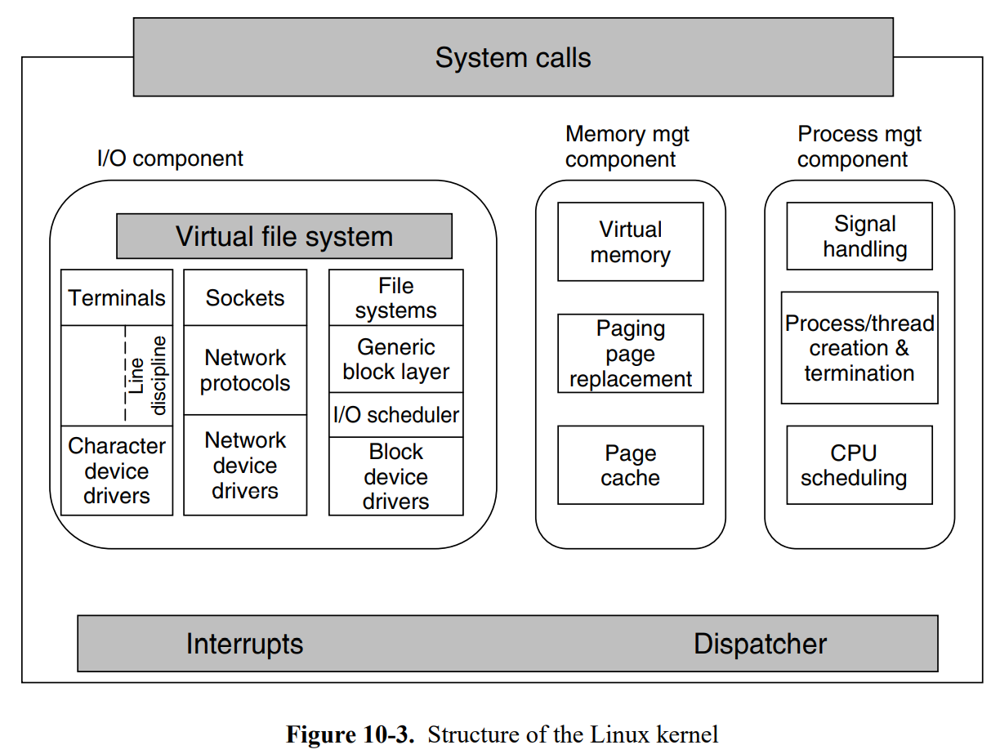

The kernel sits directly on the hardware and consists of :
- I/O devices Component
- Memory Management Component
- Processes Management Component

## 10.3 Processes in Linux

### 10.3.1 Fundamental Concepts

daemon
: a kind of special processes running in the background

!!! note
    PID 是非零的，想想 `fork` 的返回值就知道了

process group
: consists of its parent, further ancestors, siblings, children, and further descendants

signal
: information, arguments, etc. that a process sends to another process

### 10.3.2 Process-Management System Calls in Linux

回想一下 [Ch2 2.16](ch2-processes-and-threads.md#216-implementation-of-processes) 学的process table 和 pcb 的概念

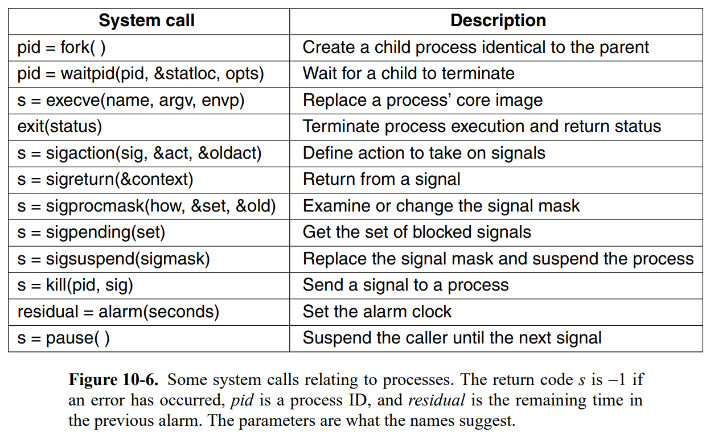

比如实现一个最简单的 SHELL：

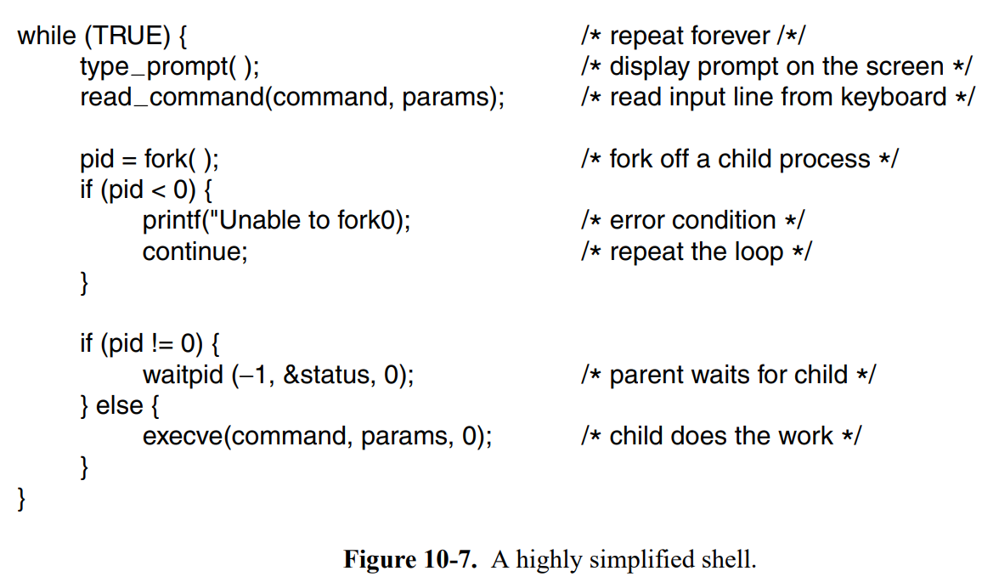

### 10.3.3 Implementation of Processes and Threads in Linux

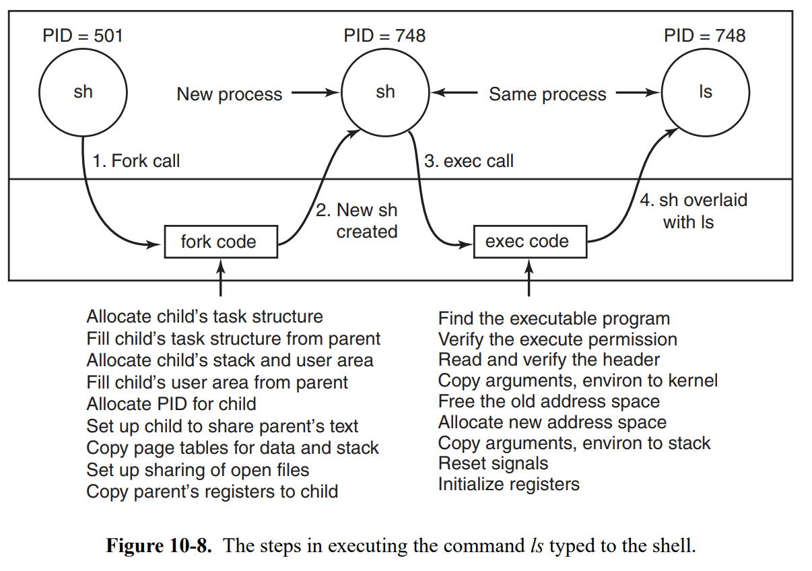

怎么感觉非常简单的事情被他搞得这么复杂

### 10.3.4 Scheduling in Linux

!!! note
    Linux threads are kernel threads, so scheduling is based on threads, not processes

runqueue
: a key data structure used by the scheduler to track all runnable tasks in the system and select the next one to run

接下来介绍一种比较常用的 Linux scheduler：**O(1) scheduler**

有这么个名字的原因也非常显而易见：
> it was able to perform task-management operations in constant time, independent of the total number of tasks in the system

在 O(1) scheduler 里，runqueue 被划分成了两个列表：
- active
- expired

至于具体怎么操作：
> select a task from the active queue with the highest priority. If the task’s time quantum expires, it is moved to the expired list.
>
> Higher priority task has larger time quantum

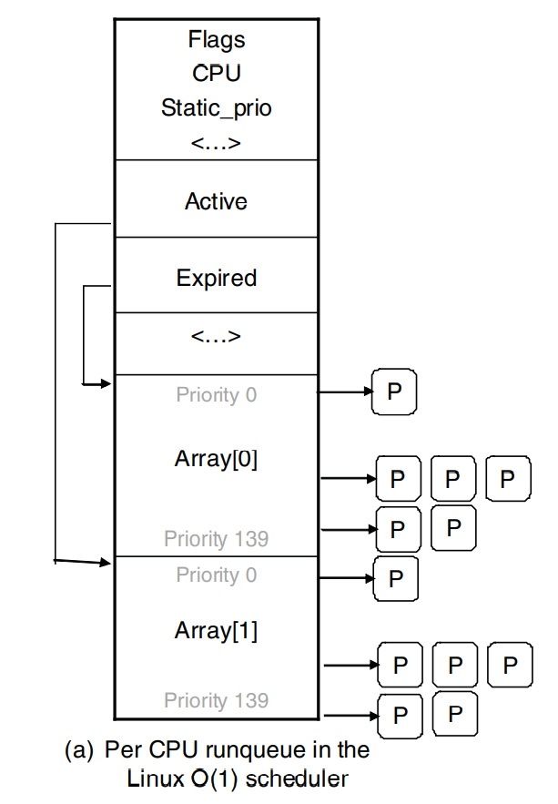

这图就很迷

## 10.4 Memory Management in Linux

Memory management in Linux is based on ==paging==

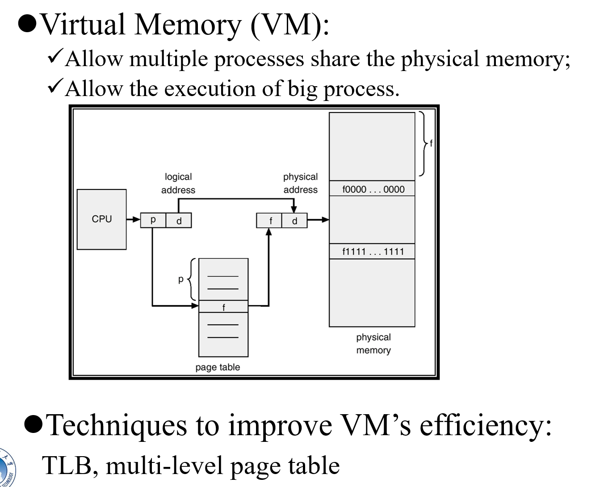

ppt 这里就是回顾了 [Ch3 3.3](ch3-memory-management.md#33-virtual-memory) 的内容。反正也不知道这些结论哪来的

### 10.4.1 Fundamental Concepts

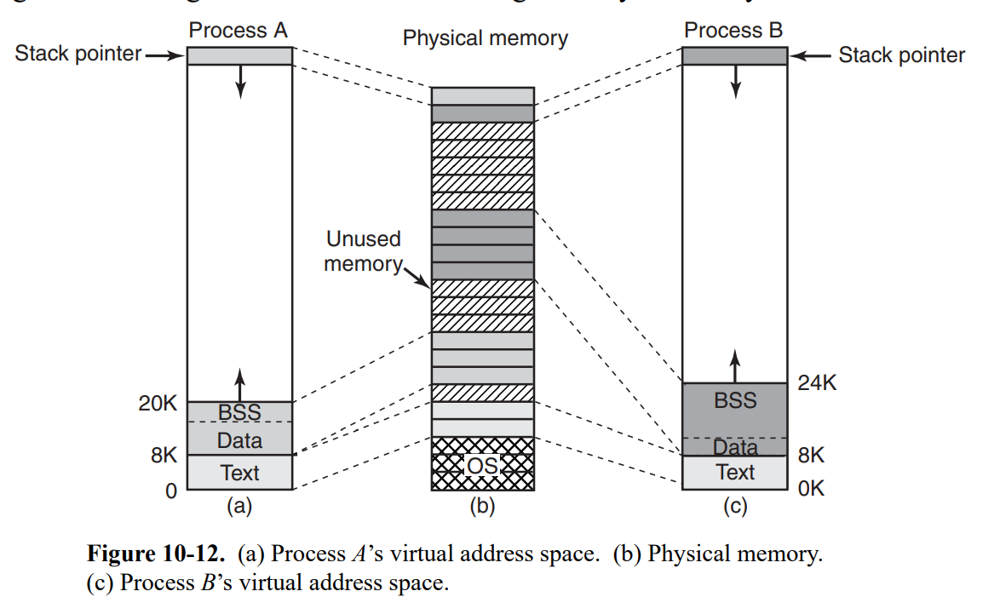

可以看到A, B两个 process 使用了同样的 text segment，而 data 和 stack 都不一样

---

除开动态分配更多内存，Linux 里的 process 可以通过 **memory-mapped files** 的机制，访问文件的数据：
> This feature makes it possible to ==map a file onto a portion of a process’ address space== so that the file can be read and written as if it were a byte array in memory. 
> 
> Mapping a file in makes random access to it much easier

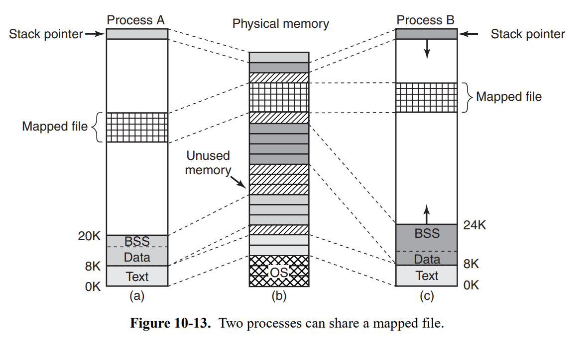

感觉就是把文件直接读进内存来减少 I/O

### 10.4.2 Memory Management System Calls in Linux

如何使用 memory-mapped file：
```cpp{.line-numbers}
void * mmap( void *start, size_t length, int prot , int flags,int fd, off_t offset);
```
其中：
- `start`: mapped to the starting address of the process space，usually is `null` 
- `length`：the number of bytes mapped to the calling process address space 
- `prot` : Access mode， PROT_READ , PROT_WRITE, PROT_EXEC, PROT_NONE
- `flags`：MAP_SHARED , MAP_PRIVATE , MAP_FIXED。
- `offset`: usually is 0，start from the beginning
- `fd`: get by open()

The return value of the function is the address of the file mapped to the process space. The starting address is the effective address of the value

e.g.

```cpp{.line-numbers}
#include <sys/mman.h> 
fd = open (name, flag, mode);
if (fd<0) {
    printf("error!\n");
}        
ptr = mmap(NULL, len , PROT_READ|PROT_WRITE|PROT_EXEC, MAP_SHARED , fd , 0);
```

### 10.4.3 Implementation of Memory Management in Linux

#### 10.4.3.1 Physical Memory Management

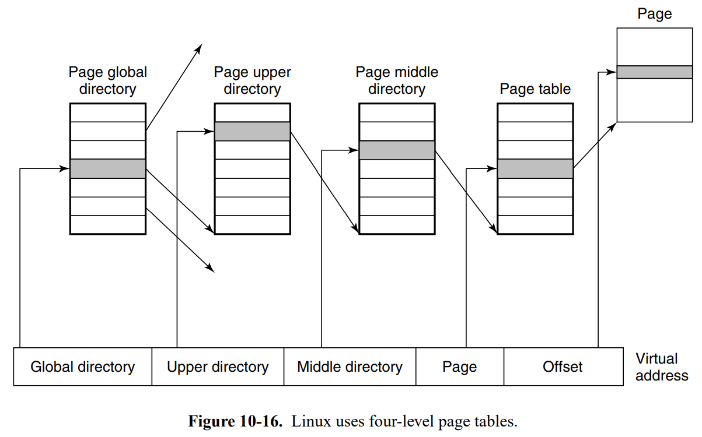

虚拟地址被分成了 5 个 field，三个 directory field 指代 directory 里面的哪一项，而 directory 的每一项则指代哪个下一级的 table (每级应该是不止一个 table)

#### 10.4.3.2 Memory-Allocation Mechanisms

Linux 支持多种不同的内存分配机制
> The main mechanism for allocating new page frames of physical memory is the **page allocator**, which operates using the well-known **buddy algorithm**

buddy algorithm 的操作如下：

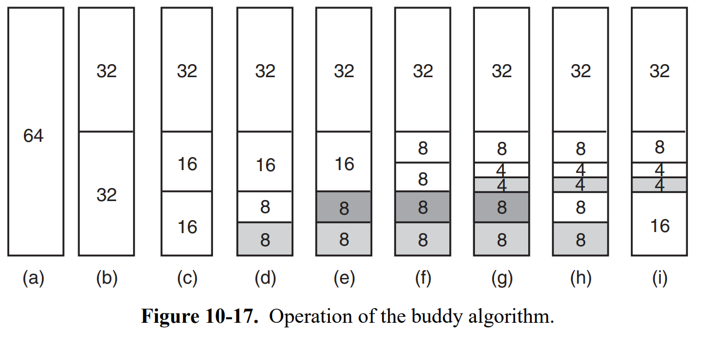

> 64 pages in the simple example of Fig. 10-17(a). When a request for memory comes in, it is first ==rounded up to a power of 2==, say eight pages. The full memory chunk is then ==divided in half==, as shown in (b). Since each of these pieces is still too large, the lower piece is divided in half again (c) and again (d). 
>
> Now suppose that a second request comes in for eight pages. This can be satisfied directly now (e). At this point a third request comes in for four pages. The smallest available chunk is split (f) and half of it is claimed (g). Next, the second of the 8-page chunks is released (h). Finally, the other eight-page chunk is released. Since the two adjacent just-freed eight-page chunks came from the same 16-page chunk, ==they are merged== to get the 16-page chunk back (i)

### 10.4.4 Paging in Linux

> Paging is implemented partly by the kernel and partly by a new process called the **page daemon**
>
> The *page daemon* checks the page usage periodically (100ms) ; it will ==free up more pages== if the number of free pages is not enough；

#### 10.4.4.1 The Page Replacement Algorithm

为了能够保证总有一部分 page 是空闲的，Linux 使用 **PFRA (Page Frame Reclaiming Algorithm)**

Linux 区分四种不同的 page：

- unreclaimable：e.g., locked pages, kernel mode stack; 
- swappable：must be written back before being reclaimed；
- syncable：must be written back if it is dirty；
- discardable：can be reclaimed immediately.

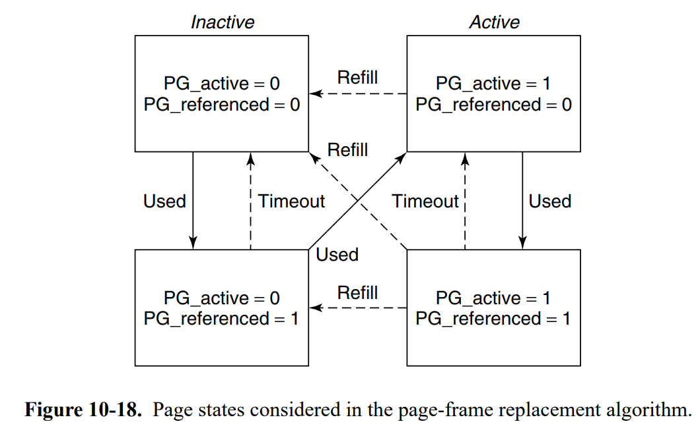

用一种增强的 LRU 算法, 每个 page 都维护两个 flag: active/inactive, and referenced or not.

> In the first scan, the reference bits of pages are cleared. If during the second scan, the page is referenced it is moved to a state that is less likely to be reclaimed. Otherwise, the page is moved to a state that is more likely to be reclaimed.

## 10.5 Input/Output in Linux

### 10.5.1 Fundamental Concepts

甚至连 I/O 设备都被假装成了一种特殊的文件来对待：

> Linux integrates devices into the file system as what are called **special files**

special files 被分成了两类：
- **block special file**

    e.g.

    magnetic disks, etc
- **character special files**

    e.g.

    keyboards, printers, mice, etc

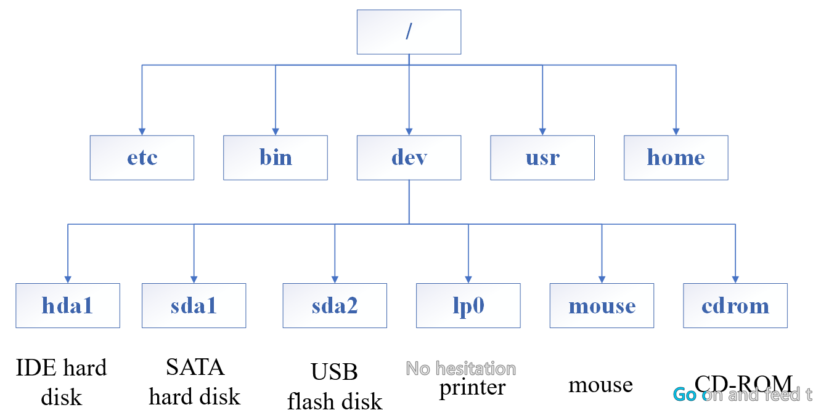

### 10.5.3 Input/Output System Calls in Linux

> Each I/O device in a Linux system generally has a special file associated with it. Most I/O can be done by just using the proper file, eliminating the need for special system calls
>
> Some special files require special POSIX calls

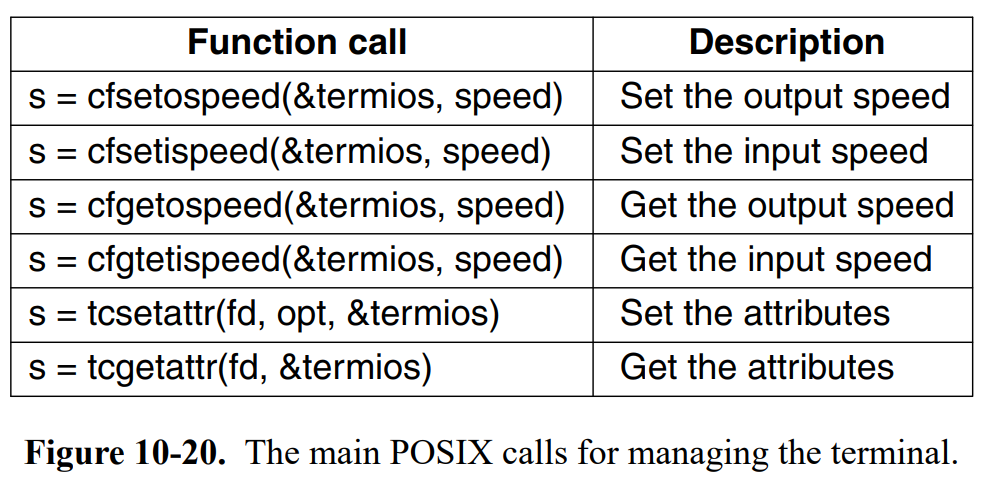

### 10.5.4 Implementation of Input/Output in Linux

Each special file is associated with a ==device driver== that handles the corresponding device

When the user accesses a special file, the file system determines the major and minor device numbers belonging to it:
- **Major device number**

    identify the types of devices
- **Minor device number**

    identify devices of the same type

The system indexes into the hash table of character devices to select the proper structure, then calls the corresponding function to have the work performed

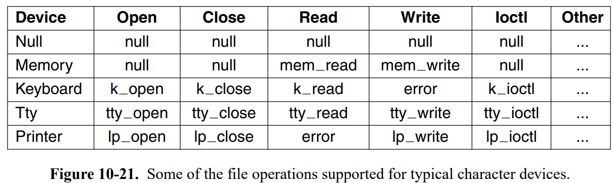

## 10.6 The Linux File System

### 10.6.1 Fundamental Concepts

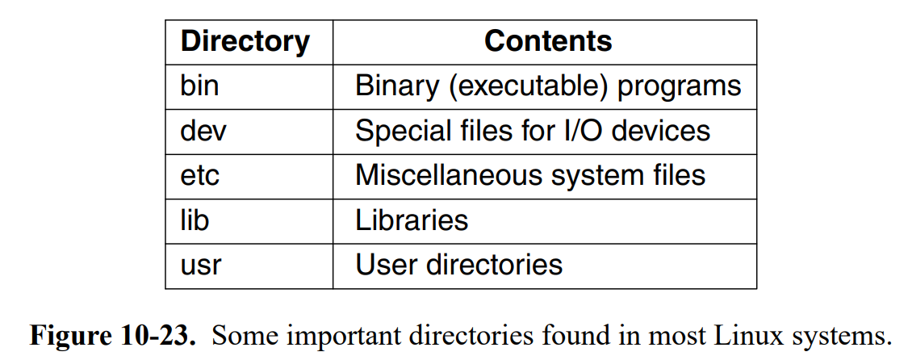

### 10.6.2 File-System Calls in Linux

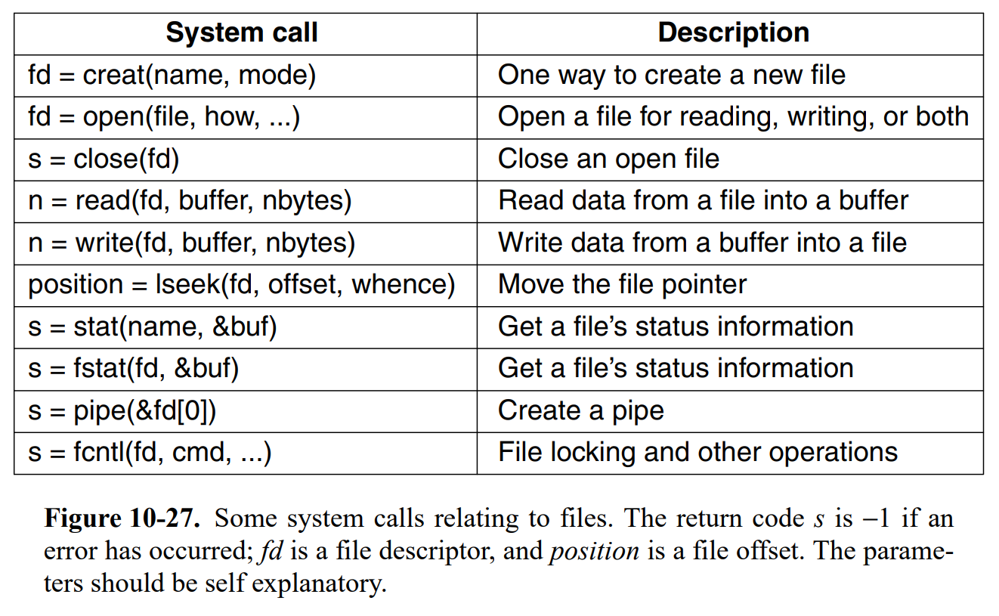

ppt 还特地提了一嘴 `stat`：

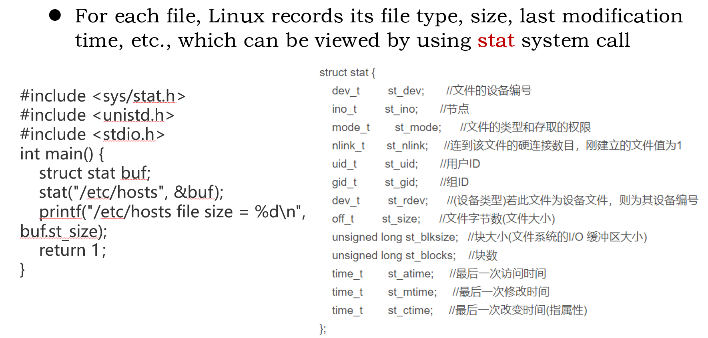

---

和 directory 相关的函数：

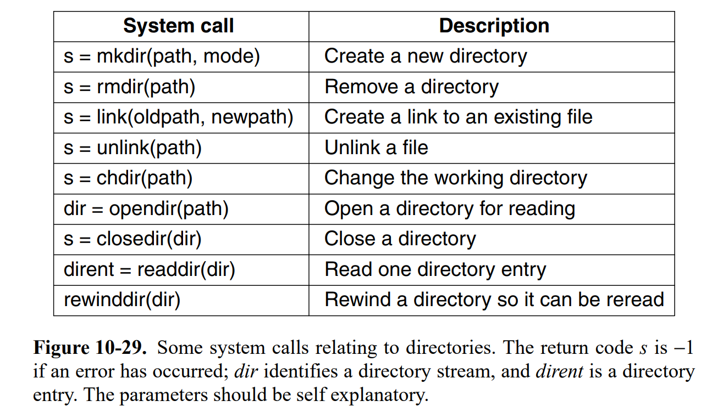

e.g.

```cpp{.line-numbers}
#include <sys/types.h>
#include <dirent.h>
#include <unistd.h>
Int main() {    
    DIR * dir;    
    struct dirent * ptr;    
    int i;
    dir = opendir("/etc/rc.d");    
    while ((ptr = readdir(dir)) != NULL) {
        printf("d_name : %s\n", ptr->d_name);    
    }
    closedir(dir);
    return 1；
}
```

### 10.6.3 Implementation of the Linux File System

#### 10.6.3.2 The Linux Ext2 File System

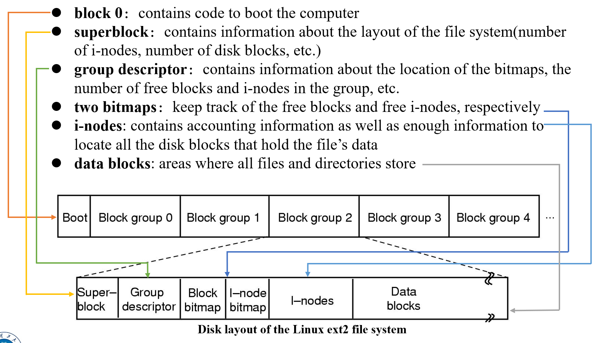

---

directory 允许名字最大为 255 characters，存储结构如下图：

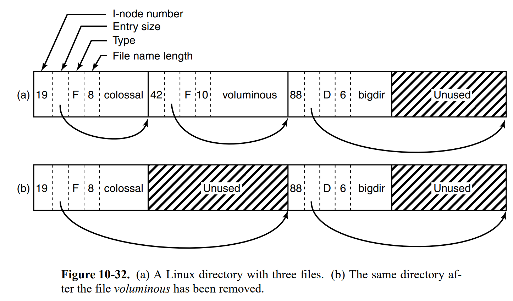

> Each directory consists of some ==integral number of disk blocks== so that directories can be written atomically to the disk (不是占用整数个 block 也会填充成整数个). 
> 
> Within a directory, entries for files and directories are in unsorted order, with each entry directly following the one before it. 
>
> Entries may not span disk blocks, so often there are some number of unused bytes at the end of each disk block

---

关于 i-node：
> The i-node is put in the i-node table, a kernel data structure that holds all the i-nodes for currently open files and directories

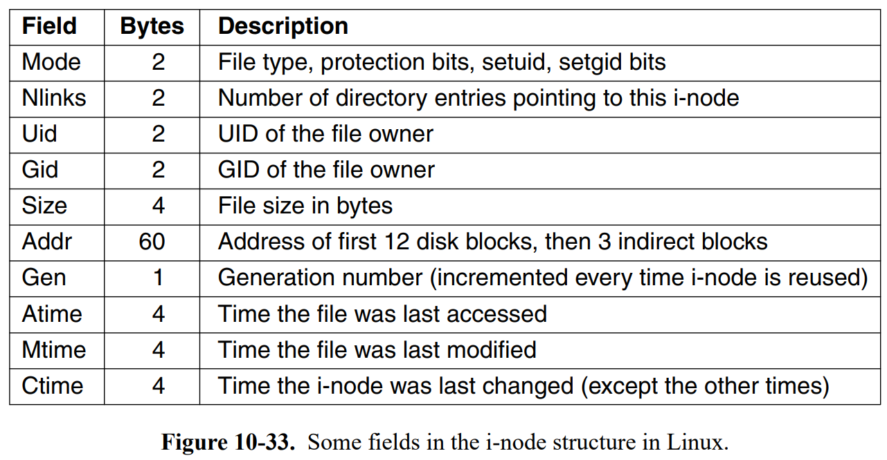

---

现在出现了个小问题：假如同一个进程的两个命令：$p1$ 和 $p2$，需要先后写一些内容到某个文件里。理想情况下，我们会希望 $p1$ 写完后，$p2$ 会从 $p1$ 的结尾开始写起。但怎么告诉 $p2$ 这个位置在哪呢？

这需要介绍一种新的 table：**open-file-description table**，存储 file position 和 read/write bit 之类的信息，table 位于 file descriptor table 和 i-node table 之间：

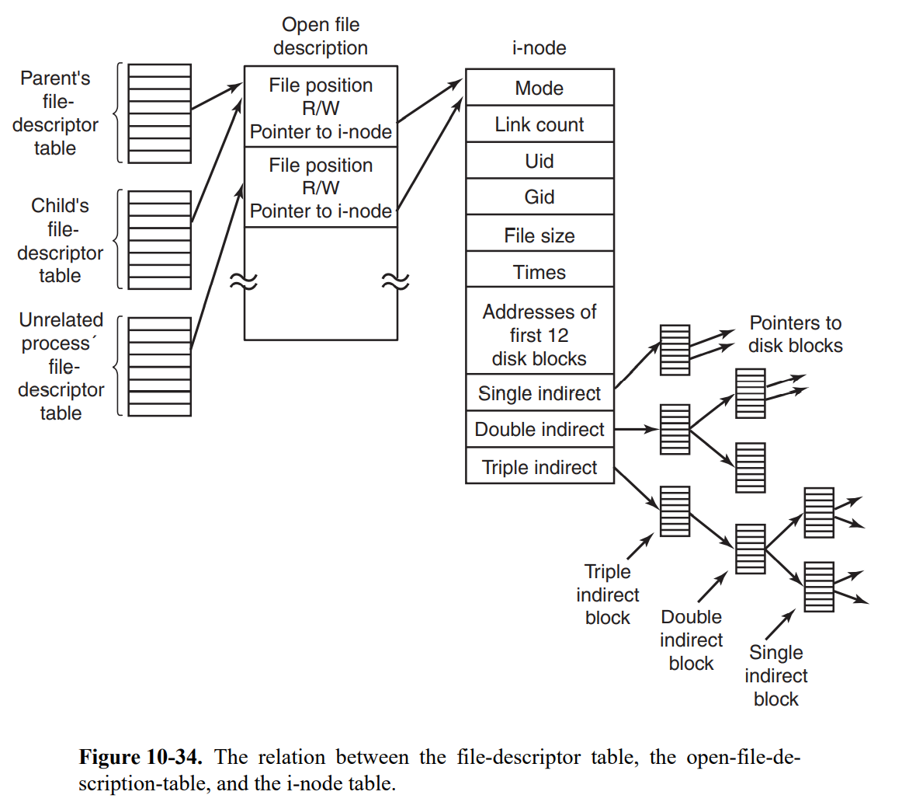

上图中还有个知识点，就是 i-node 里会存储文件的前 12 个 disk block 的内容

假如上述不够用，就会使用 **single indirect block**，假设 block 大小 1 KB，disk address 大小 4 bytes，那么一个 single indirect block 就可以存储 256 个 disk addresses，也就是说，可以多指向大小为 268 个 block (也就是 268 KB) 的文件

假如上述不够用，就会用 **double indirect block**，那么上限就会增加 $12+2^{16}$ 个 block

假如上述还不够用，就会用 **triple indirect block**，这个 field 的上限 $2^{24}$ 个 block (16 GB)

总共来说，假如这些所有的 field 全都用上，就是：
$$
12+2^{8}+2^{16}+2^{24}=16843020\text{ KB}
$$

## 10.7 Security in Linux

### 10.7.1 Fundamental Concepts

UID (User ID)
: The user community for a Linux system consists of some number of registered users, each of whom has a unique *UID*, which is an integer between 0 and 65535 ($2^{16}$)

GID (Group ID)
: Users can be organized into groups, which are also numbered with 16-bit integers called *GIDs*

> The basic security mechanism in Linux is simple. Each process carries the UID and GID of its owner

file protection 则是由 9 个 bit 控制，三组分别对应不同的用户类型：
- Owner
- Group member
- Outsider

每组人各自有 $r$, $w$, $x$ 三个 bit

e.g.

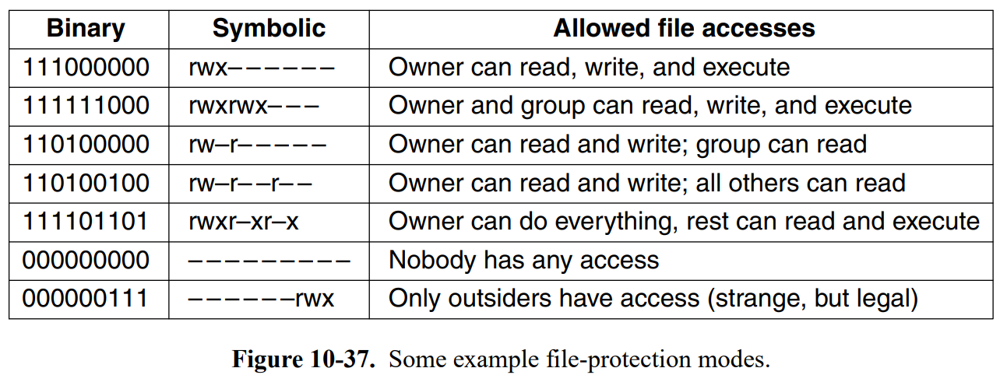

### 10.7.2 Security System Calls in Linux

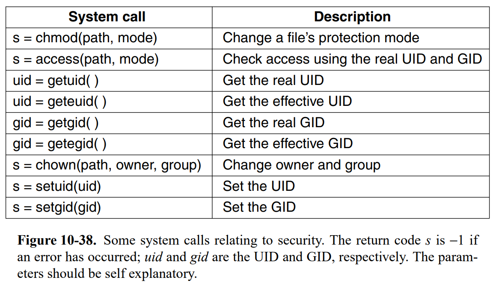

最后三个只有 superuser 有权限

!!! note
    虽然 ppt 上没讲，但由于实际遇到过，所以就说一下 `chmod`

    e.g.

    ```cpp{.line-numbers}
    s = chmod("/usr/ast/newgame", 0755);
    ```

    这样会把那 9 个 bit 设置成`rwxr-xr-x`。`755` 是一个八进制的数 (0表示它是八进制)，每一位对应二进制里的三位，所以就是对应二进制里的 `111101101`

    之前在 [Ch1 1.5.5](ch1-introduction.md#155-protection) 里提过

## 习题

Please write down the years when UNIX and Linux were born

A: 1969 & 1991

---

Please explain the meaning of Process Table and PCB

A:

Process table: A table maintained by the operating system to implement the process model. (One entry per process, which is called the process control block)

见 [Ch2 2.16](ch2-processes-and-threads.md#216-implementation-of-processes)

---

What is thread? What are the difference between thread and process?

A:

- Threads are parts of processes;
- Threads are the smallest units that CPU schedules;
- A process contains one thread or multiple threads;
- Threads in the process share resources and data
- The cost of thread creation/switching is lower

也是 Ch2 的内容

---

Please explain how TLB and multi-level page table improve the performance of virtual memory？ 

A:

没有标准答案，我就说自己理解了，参考 [Ch3 3.3](ch3-memory-management.md#33-virtual-memory)

TLB: mapping virtual addresses to physical addresses without going through the page table

multi-level page table: 可以用来管理更大的内存

---

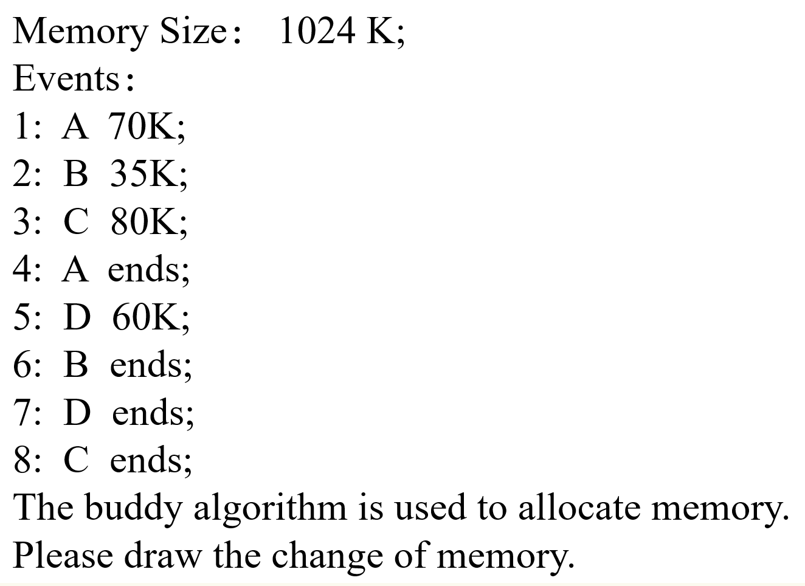

A:

没啥难度

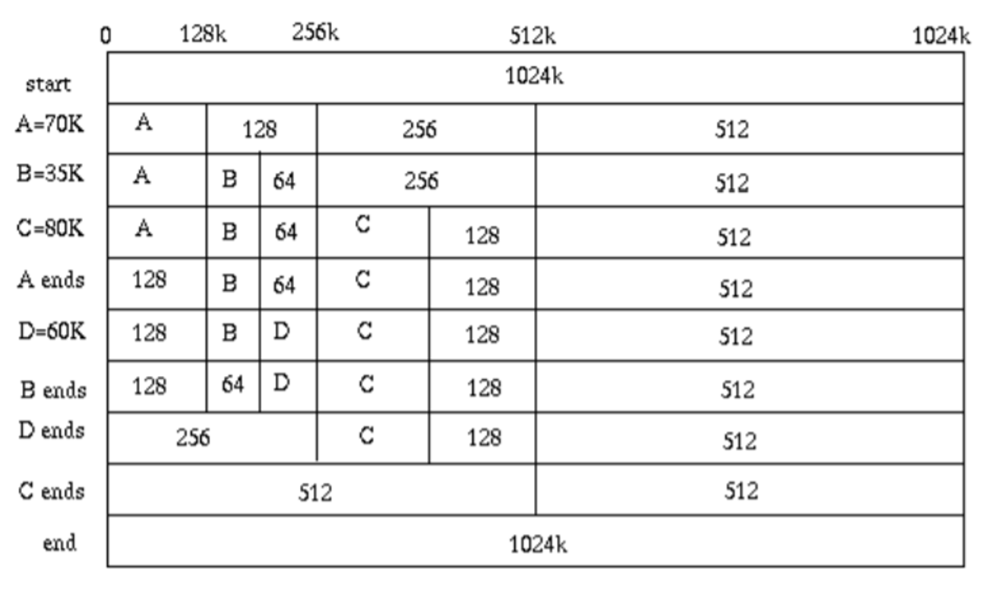

---

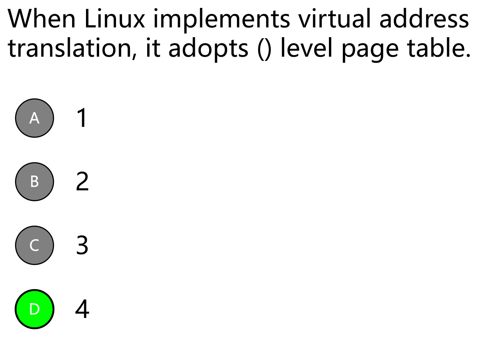

虽然课上未发布，但我不理解

!!! warning
    查资料的时候发现，假如使用 4-level page table 的话，virtual address 就会有 5 个 field，因为最后一个 field 是 page offset

---

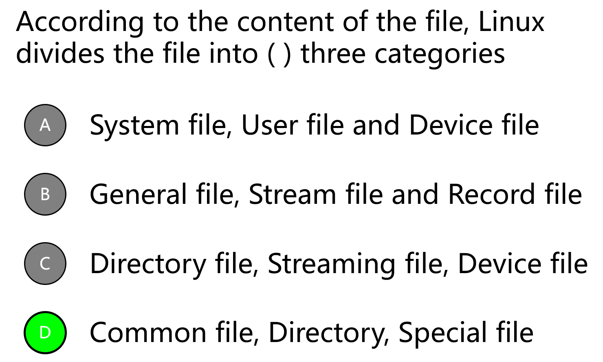

---

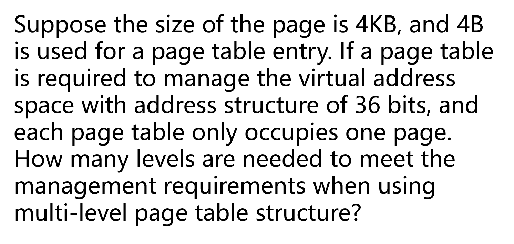

A:

如前面提到的一样，不要忘了考虑每个 page 内部的 offset！虽然看似有 $2^{36}$ 个地址需要我们管理，但是由于每个 page 包含 $4\text{ KB}=2^{12}$ 个地址（byte addressable 的前提下），所以实际上我们只需要能覆盖 $2^{36}\div 2^{12}=2^{24}$ 个 page 就可以！

由于我们只有一个 page 的大小来装我们的 page table，所以能装下的 entry 数量为：
$$
4\text{ KB}\div 4\text{ B}=1\text{ K}=2^{10}
$$

所以为了能够让这么多的 entry 就能够覆盖掉所有的 page，我们需要的 $n$-level page table 需要满足：

$$
(2^{10})^{n}\ge 2^{24}
$$

所以 $n=3$，三层 page table

!!! note
    offset 并不存在于 page table 的 entry 里！page table 的 entry 只需要指出目标地址处于哪个 page。这里就是需要覆盖 24 个 bit 的地址对应的 $2^{24}$ 个 page！
