# Deadlocks

## 6.1 Resources

resource
: A resource is anything that can be acquired, used, and released over the course of time.  

### 6.1.1 Preemptable and Nonpreemptable Resources

preemptable resource
: is one that can be taken away from the ==process== owning it with ==no ill effects==.

e.g.

内存。把进程从内存里swap到硬盘并不会导致什么严重损失

nonpreemptable resource
: is one that cannot be taken away from its current owner ==without potentially causing failure==.

e.g.

一个进程正在刻录光盘，结果现在把刻录的权限交给了另一个进程，那这个光盘就废了

---

Potential deadlocks that ==involve preemptable resources== can usually be resolved by ==reallocating resources from one process to another==.

稍微谦让一下资源，双方都开心

而对于nonpreemptable resource来说情况就需要我们来讨论了

The abstract sequence of events required to use a resource is given below:
- Request the resource.
- Use the resource.
- Release the resource

If the resource is not available when it is requested, the requesting process is ==forced to wait==. In some operating systems, the process is automatically ==blocked== when a resource request fails, and awakened when it becomes available. In other systems, the request fails with an ==error code==, and it is up to the calling process to wait a little while and try again

### 6.1.2 Resource Acquisition

For some kinds of resources, such as records in a database system, it is up to the ==user processes== rather than the system to manage resource usage themselves

One way of allowing this is to associate a ==semaphore== with each resource (initialized to 1)

上文提到的三个对资源的操作可以具象化为：
- *down* on the semaphore
- use the resource
- *up* on the semaphore

转换为代码的话就是这样子：

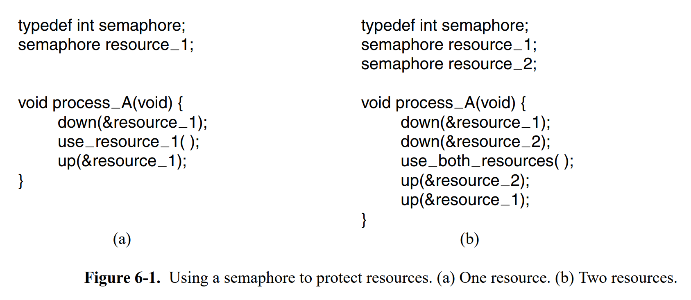

---

上面提到的是只有一个process的奇特情况。实际上，我们肯定会涉及到多个process抢多个resource

现在我们考虑有两个进程$A, B$，和两个resources的情况

细微的顺序不同会导致可能出现死锁：

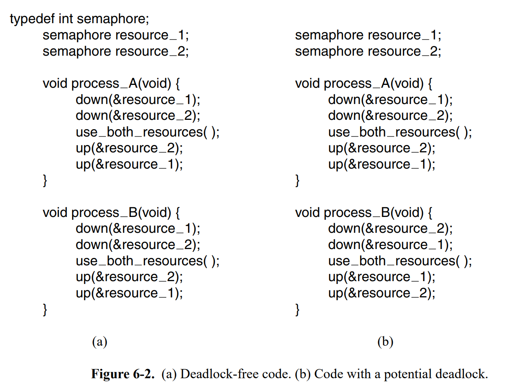

不难想象，假如A获得了resource_1而B获得了resource_2，那么就死锁了

## 6.2 Introduction to Deadlocks

deadlock
: A set of processes is deadlocked if each process in the set is waiting for an event that only another process in the set can cause.

resource deadlock
: the event that each process is waiting for is the release of some resource currently possessed by another member of the set

### 6.2.1 Conditions for Resource Deadlocks

four conditions must hold for there to be a (resource) deadlock:
- **Mutual exclusion**

    Each resource is either currently assigned to exactly one process or is available.
- **Hold-and-wait**

    Processes currently holding resources that were granted earlier can request new resources
- **No-preemption**

    Resources previously granted cannot be forcibly taken away from a process. They must be explicitly released by the process holding them
- **Circular wait**

    There must be a circular list of two or more processes, each of which is waiting for a resource held by the next member of the chain

### 6.2.2 Deadlock Modeling

可以用directed graph来刻画，有两种节点：
- **process**

    circle

    
- **resource**

    square

    

一图流解释箭头含义：

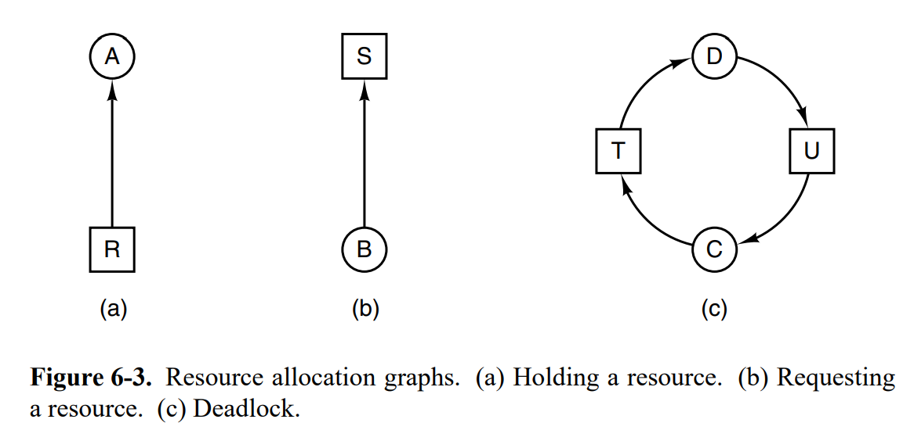

---

关于图中是否有死锁：

- **no cycles**

    no deadlock.
- **contains a cycle**

    - if only one instance per resource type
    
        deadlock.
    - if several instances per resource type
    
        possibility of deadlock.

## 6.3 The Ostrich Algorithm

stick your head in the sand and ==pretend there is no problem==.

Reasonable if 
- deadlocks occur very rarely 
- cost of prevention is high

## 6.4 Deadlock Detection and Recovery

### 6.4.1 Deadlock Detection with One Resource of Each Type

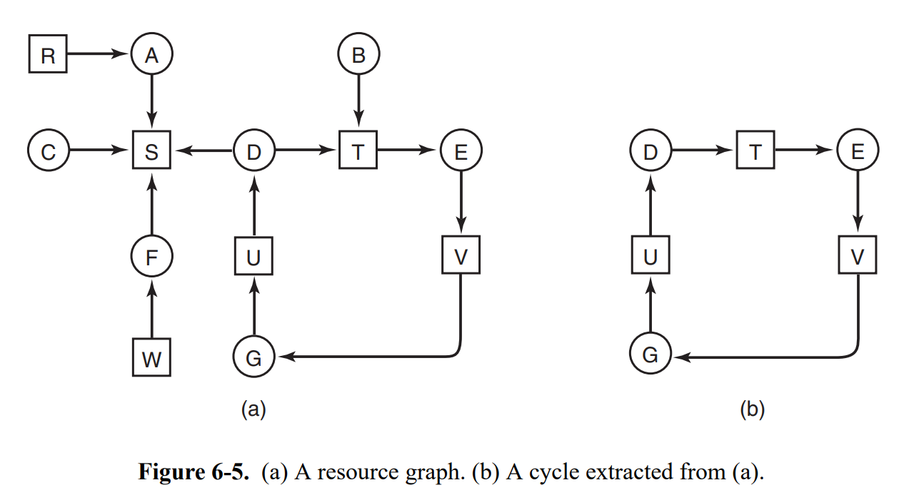

对于上图这种简单的图，我们可以一眼看出来存在右边那样的cycle，于是有deadlock

至于有没有严谨的算法来检测呢？见书P477，考试不考

### 6.4.2 Deadlock Detection with Multiple Resources of Each Type

We'll now present a matrix-based algorithm for detecting deadlock among $n$ processes, $P_1$ through $P_n$

existing resource vector
: $E$ is the **existing resource vector**, with $E_i$ resources of class $i$ ($1\le i\le m$) 

available resource vector
: $A$ is the **available resource vector**, with $A_i$ giving the number of instances of resource $i$ that are currently available (i.e., unassigned)

current allocation matrix
: $C$ is the **current allocation matrix**. The $i$th row of $C$ tells how many instances of each resource class $P_i$ currently holds; Thus, $C_{ij}$ is the number of instances of resource $j$ that are held by process $i$

request matrix
: $R$ is the **request matrix**. Similar to  *current allocation matrix*, $R_{ij}$ is the number of instances of resource $j$ that process $P_i$ wants

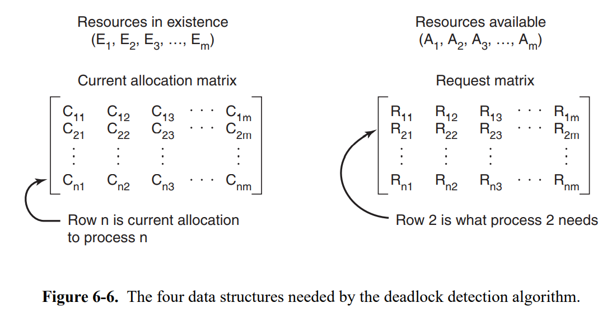

对于上述的四个概念，存在一个重要的等式。鉴于resource要么是allocated要么是available的状态：

$$
\sum_{i=1}^{n}C_{ij}+A_j=E_j
$$

---

接下来讲deadlock detection algorithm：

- Look for an unmarked process, $P_i$, for which the $i$th row of $R$ is less than or equal to $A$
- If such a process is found, add the $i$th row of $C$ to $A$, mark the process, and go back to step 1
- If no such process exists, the algorithm terminates

When the algorithm finishes, ==all the unmarked processes, if any, are deadlocked==

!!! note
    关于第二步为什么要增加$A$，是因为初始状态下，是假定各个process可能已经占有了一些资源了。在他们都不直接放弃自己的资源的前提下，看available resource能不能满足任何一个process的需求

附上书上的解释:

> What the algorithm is doing in step 1 is looking for a process that can be run to completion. Such a process is characterized as having resource demands that can be met by the currently available resources. The selected process is then run until it finishes, at which time it returns the resources it is holding to the pool of available resources. It is then marked as completed. If all the processes are ultimately able to run to completion, none of them are deadlocked. 

好像想法还挺简单的

书本P480 Figure 6-7有一个例题具体演示这个算法是怎么操作的，复习时可以看看

### 6.4.3 Recovery from Deadlock

这里介绍三种方式：

#### Recovery through Preemption

take a resource from some other processes

depends on the nature of the resource

#### Recovery through Rollback

回滚到间歇记录的复活点

#### Recovery through Killing Processes

找一个可以从头开始运行的process嘎了

## 6.5 Deadlock Avoidance

### 6.5.1 Resource Trajectories
[trəˈdʒektəri] 轨迹

The main algorithms for deadlock avoidance are based on the concept of **safe states**

我们先用图像来直观地理解一下safety：

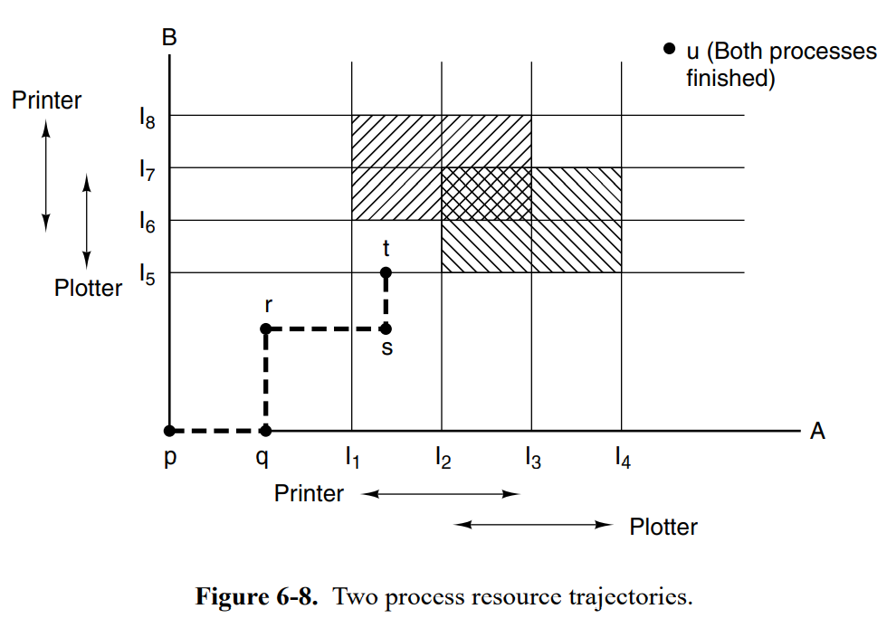

A, B两个进程需要printer和plotter的时间段如图中所示

> With a single processor, all paths must be horizontal or vertical, ==never diagonal==. Furthermore, motion is always to the north or east, never to the south or west (because processes cannot run backward in time, of course)

图中$I_1$, $I_4$, $I_5$, $I_8$围成的矩形，一旦进去了就必定会寄：

> If the system ever enters the box bounded by $I_1$ and $I_2$ on the sides and $I_5$ and $I_6$ top and bottom, it will ==eventually deadlock== when it gets to the intersection of $I_2$ and $I_6$.

### 6.5.2 Safe and Unsafe States

safe state
: A state is said to be **safe** if there is some ==scheduling order== in which every process can run to completion even if all of them suddenly request their maximum number of resources immediately

说起来太抽象了，我们来看看实际例子：

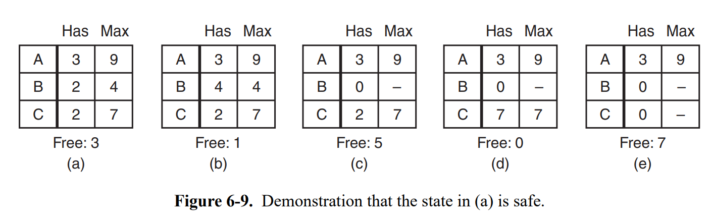

图 (a) 的状态时safe的，因为$B\rightarrow C\rightarrow A$的执行顺序可以满足所有的process对于resource的最大需求

让我们再来看看unsafe state:

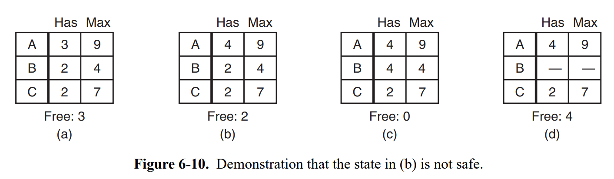

(a) 就是上次的safe state，我们对(a)进行一点改动，就变成了(b)，而很不巧的是，(b)是unsafe state，因为process没法全部都执行完 (到(d)就尬住了)

---

!!! note
    unsafe state和deadlock state并不是一样的。unsafe state可以再苟一小会，甚至假如有进程放弃资源的话，可能回到safe state

### 6.5.3 The Banker's Algorithm for a Single Resource

上一小节的算法其实就是banker's algorithm

### 6.5.4 The Banker's Algorithm for Multiple Resources

情况如下图：

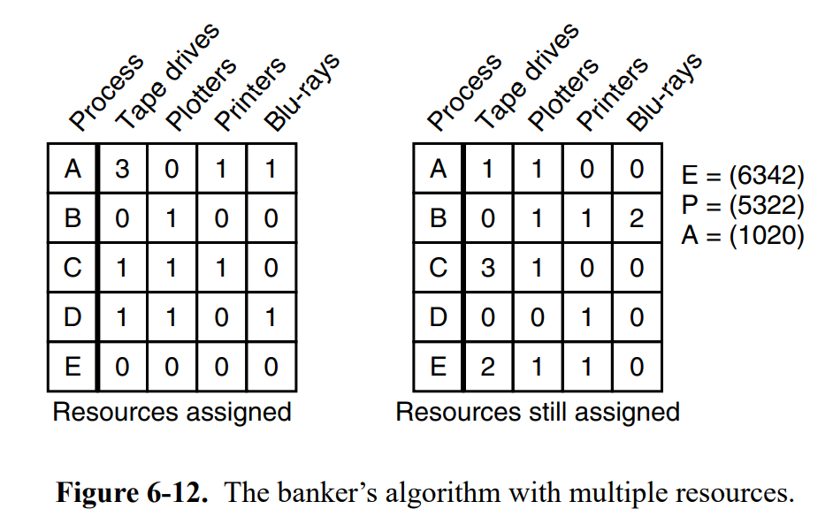

右边的表格指的是各个process还需要的资源；而最右边的三个向量分别表示 **Existing resource**, **Possessed resource**, **Available resource**

看看这个算法具体的步骤：
- Look for a ==row==, $R$, whose unmet resource needs are ==all== smaller than or equal to $A$. If no such row exists, the system will eventually deadlock since no process can run to completion (assuming processes keep all resources until they exit).
- Assume the process of the chosen row requests all the resources it needs (which is guaranteed to be possible) and finishes. Mark that process as terminated and add all of its resources to the $A$ vector.
- Repeat steps 1 and 2 until either all processes are marked terminated (in which case the initial state was safe) or no process is left whose resource needs can be met (in which case the system was not safe).

只不过这次线程的所有最大需求都必须满足了

虽然说听起来挺美好的，但是实际上没什么系统真的使用，因为压根不知道最大需求量

## 6.6 Deadlock Prevention

之前的学习可以看出来，deadlock avoidance其实是完全实现不了了（压根不知道未来发生什么）。那么我们可以退而求其次：只要deadlock发生的条件之一一定满足不了，那么就成了，这叫做**deadlock prevention**

[6.2.1](#621-conditions-for-resource-deadlocks) 的时候介绍过deadlock发生所需要满足的4个条件。所以，接下来我们就来看看，怎么样能够让这四个条件中的一个不满足

### 6.6.1 Attacking the Mutual-Exclusion Condition

> no resource were ever assigned exclusively to a single process

换句话说，所有的resource都是至少有两个人共享的

这种方法一般来说都是不可能的，因为例如printer这种资源是不可能共享的

### 6.6.2 Attacking the Hold-and-Wait Condition

> require all processes to request all their resources before starting execution

比如在dining philosopher问题中，哲学家必须同时得到两个fork才会开始吃饭，否则不吃

这种方法的问题出在，很难一开始就知道进程需要多少的资源

### 6.6.3 Attacking the No-Preemption Condition

假如有进程的资源需求无法被满足的话，那就把所有进程所拥有的该资源都抢回上帝手上，再分配给该进程

问题也很明显，就是这种资源必须是可以被中断后重新继续的。比如打印机就不能做到

### 6.6.4 Attacking the Circular Wait Condition

这个的破坏方式有两种

第一种，规定一个进程只能够在同一时刻里，占有一种资源

这个的问题非常明显，比如有进程需要从tape复制文件到打印机，那就完全无法工作

---

另一种方法是：
> provide a ==global numbering== of all the resources

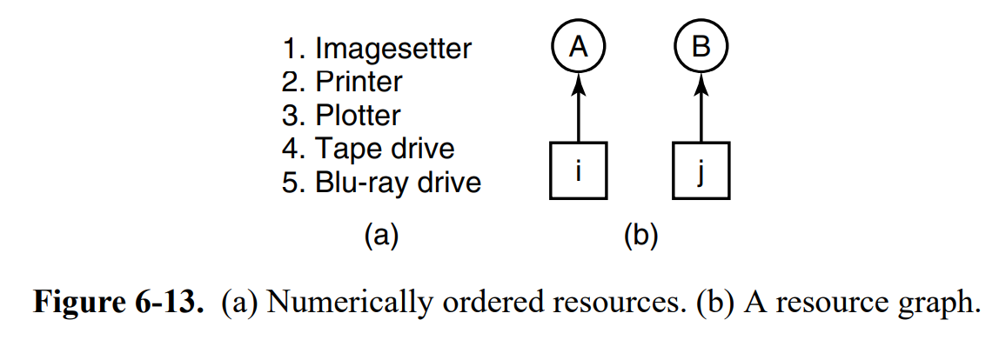

更加具体的规则如下：
> processes can request resources whenever they want to, but all requests must be made in numerical order

比如上图中，process可以先要printer再要tape drive，但是不能先要plotter再要printer

只要满足total order就行，听起来似乎有点不可思议一样，书上P490图的下面给了简单证明

---

总结一下四种破坏的方法：

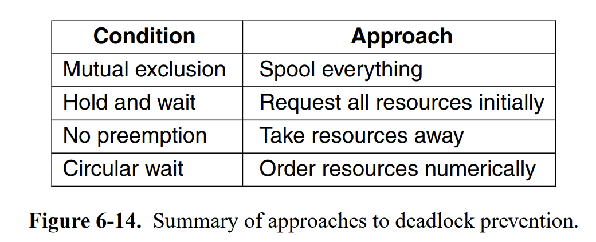

## 6.7 Other Issues

### 6.7.1 Two-Phase Locking

现实场景中，经常会有多个process，每个都试图同时修改多个record的情景。应对的方法则是**tow-phase locking**

- **first phase**

    the process tries to lock ==all== the records it needs, one at a time

    - **succeed**

        begins the second phase
    - **fail**

        some record is needed is already locked, the process just ==releases all its locks== and ==starts the first phase all over==
- **second phase**

    performs its updates and releases the locks

有点类似于一次性请求完所有的资源

听起来似乎挺美好，但是因为从头来的开销实在是太大了，所以实际上也并没有真的使用

### 6.7.2 Communication Deadlocks

也叫做**no-resource deadlocks** (和之前学过的resource deadlock相比最明显的特点就是完全没有资源在争夺)

e.g.

在通信系统当中：
> process
$A$ sends a request message to process $B$, and then blocks until $B$ sends back a reply message. Suppose that the ==request message gets lost==. $A$ is blocked waiting for the reply. $B$ is blocked waiting for a request asking it to do something

非常简单的解决方法就是，设置一个timeout

### 6.7.4 Starvation
> This policy, although seemingly reasonable, may lead to some processes ==never getting service== even though they are not deadlocked.

比如每次都选择最小的文件来执行，那么大的文件就很可能等了半天都没法执行

---

deadlock和starvation的区别是：deadlock是starvation，但starvation有可能会结束，而deadlock不会

## 6.? 习题

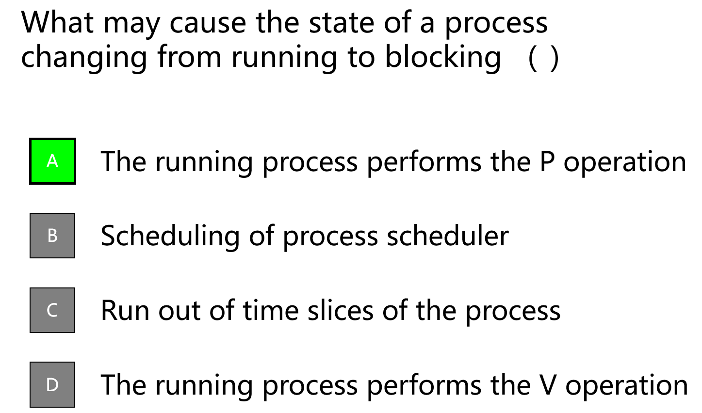

回去看看定义就知道了，down 不成功就会被 block

---

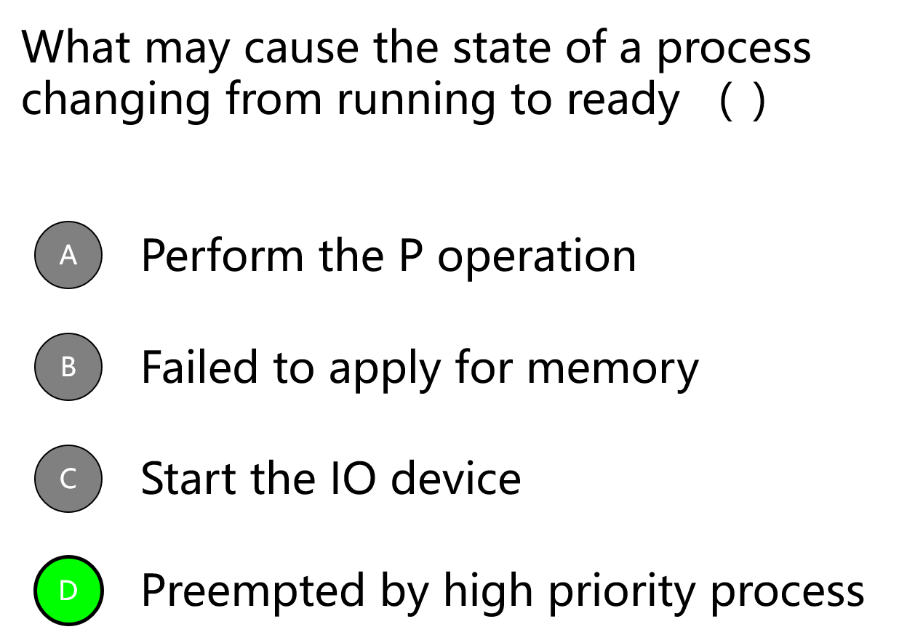

CPU 被抢了就会

---

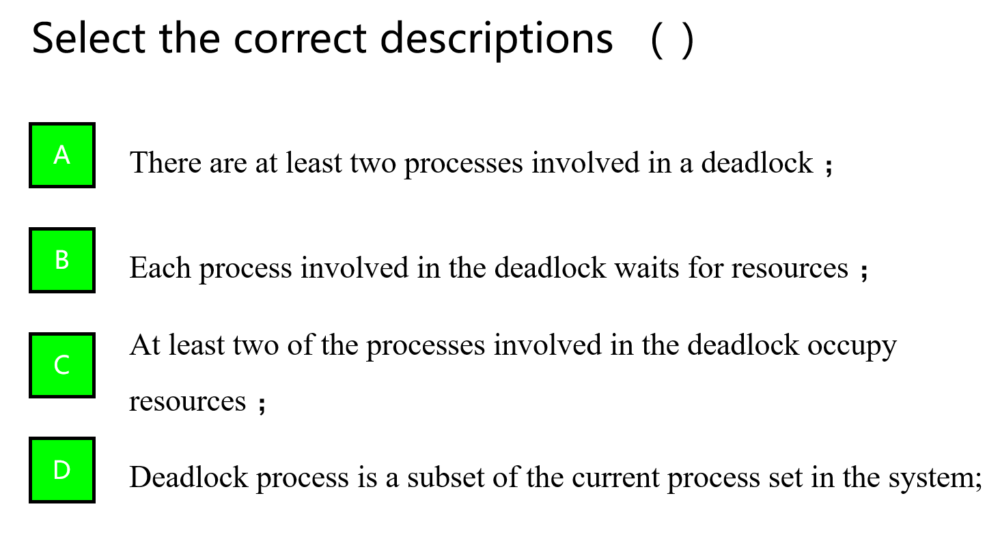

---

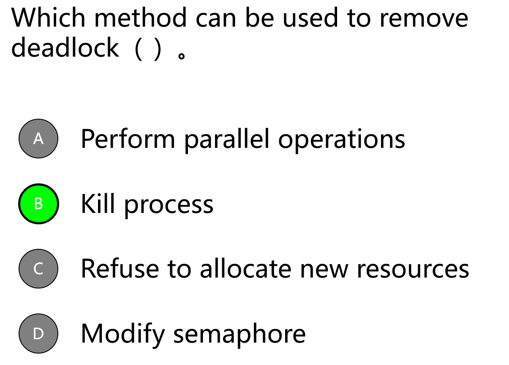

强行关掉可还行

---

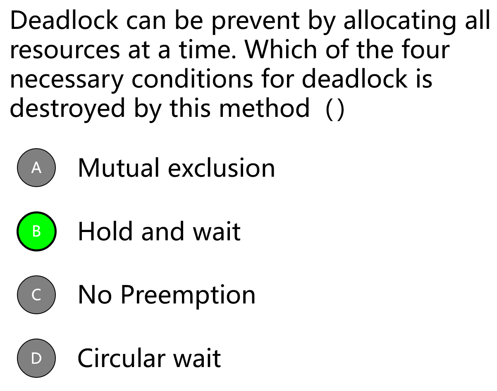

一次性全部分配了，就不存在等待资源了

---

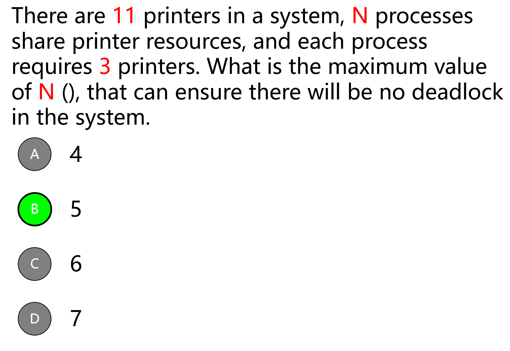

关于银行家算法的问题，其实只要记住一个最基本的公式就行：
$$
R\ge N\times (M - 1)+1
$$

其中$R$是可用的资源，$N$是进程个数，$M$是每个进程最多需要的该资源的个数

这个代表的意思是：最极端的情况下，每个process都拥有了$M-1$个资源后，都还想要那最后一个，这时候你还有那最后一个的可用资源给他们

---

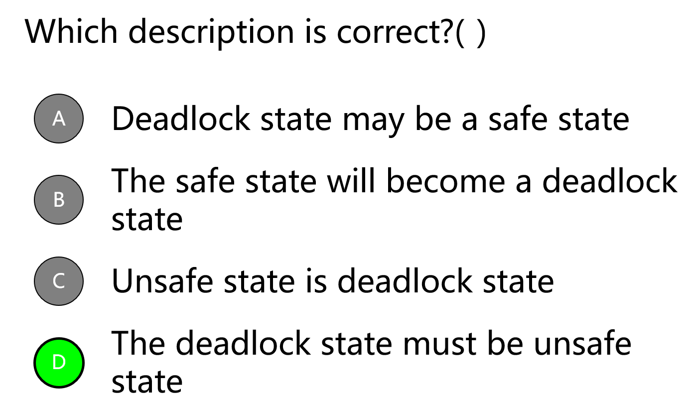

---

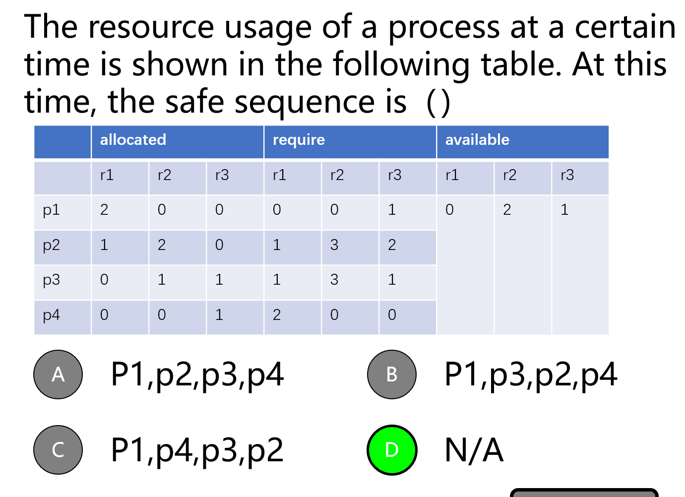

已经结束力，压根没法跳出 unsafe

---

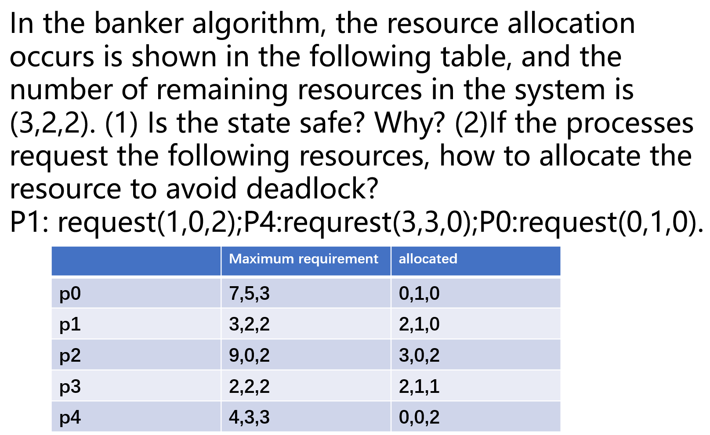

- (1)

    
- (2)

    

    第二问题目的意思是，假如这三种分别的情况下，某个进程请求了这些资源后，能否证明满足了请求之后，还是不是safe state (这描述的也太模糊了。。。)

    P4被拒绝的理由倒是非常简单：因为现有的资源甚至就没法满足(3, 3, 0)的请求，甚至省去了请求成功后找路的步骤

---

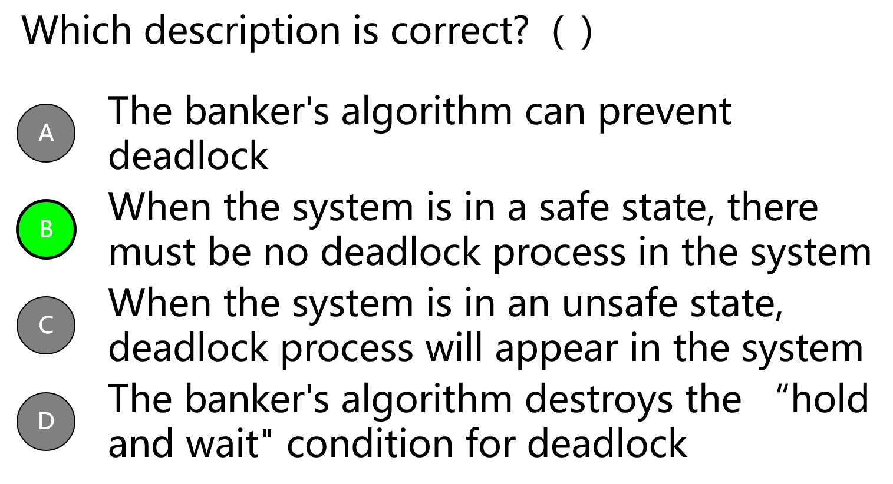

---

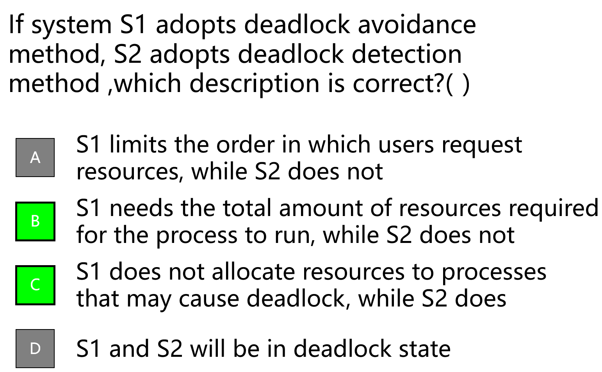

A当中S1的做法是deadlock prevention的做法 (破坏circular wait)

deadlock detection则是在[6.4](#64-deadlock-detection-and-recovery)中有所描述

---

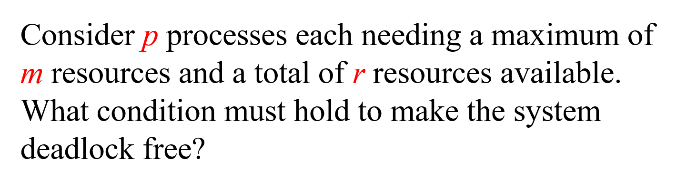

就是前面提到过的
$$
r\ge p\times(m-1) + 1
$$

---

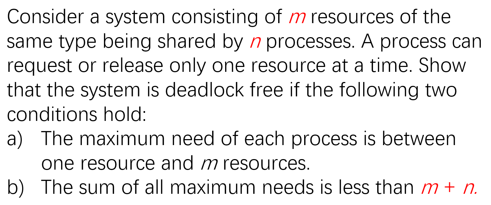

仔细想想，这个条件的意思其实就是，当他把所有$m$的资源都分出去之后，至少有一个process已经达到了maximum need (因为最大需求之和顶多等于$m+n-1$，假如 $n$ 个 process 都恰好差一个满足需求的话，那就正好分配了 $(m+n-1)-n=m-1$ 的资源，意思就是最坏的情况下，除了一个进程外，每个进程都刚好差一个就能满足最大需求)

---

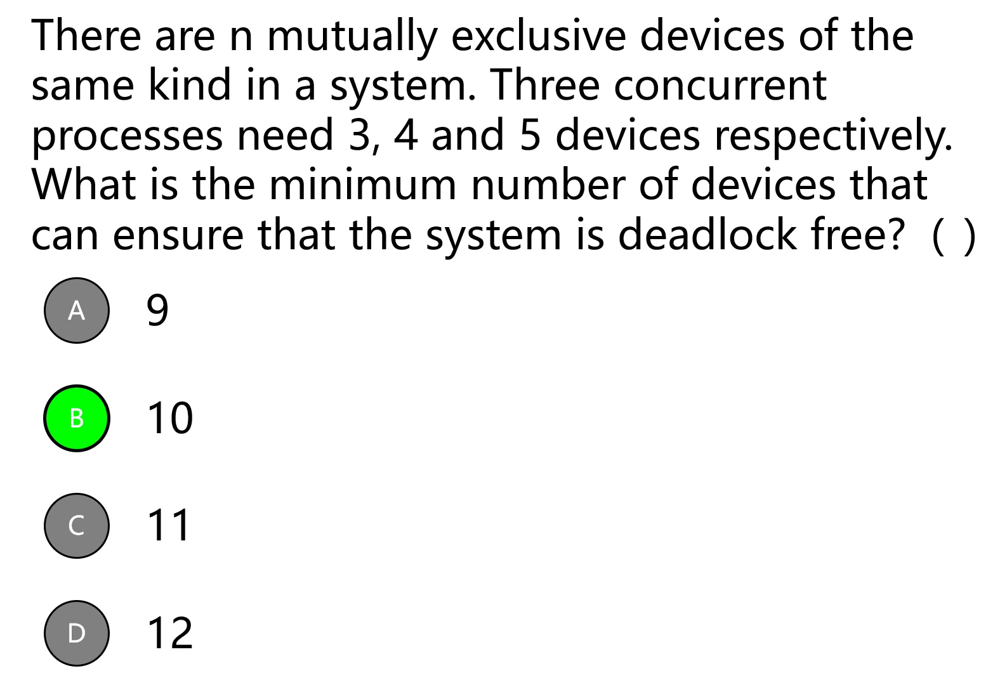

