# Security

!!! warning
    本章内容大多来自第三版的教材，非第四版

## 9.1 The Security Environment

### 9.1.1 Threats

大多情况下会把 security of an information system 分解成三个部分：
- confidentiality

    : is concerned with having secret data remain secret

    > More specifically, if the owner of some data has decided that these data are to be made available only to certain people and no others, the system should guarantee that release of the data to unauthorized people never occurs

- integrity

    : means that unauthorized users should not be able to modify any data without the owner’s permission

- availability

    : means that nobody can disturb the system to make it unusable

    常用手段：Denial of service (就是大名鼎鼎的[DoS](https://en.wikipedia.org/wiki/Denial-of-service_attack))

总结一下就是：

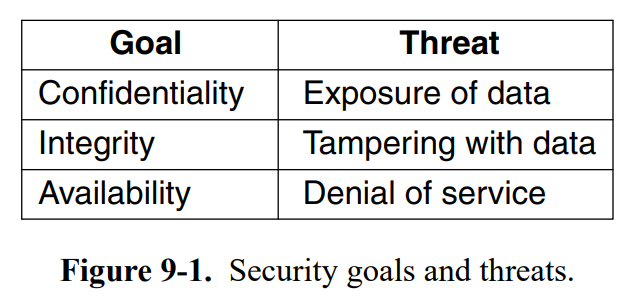

### 9.1.2 Attackers

在安全这一话题中：

intruder (attacker)
: people who are nosing around places where they have no business being

- Casual prying by nontechnical users.

    非技术用户的随意窥探（？感觉翻译很怪
- Snooping by insiders.

    内部人士窥探
- Determined attempts to make money.
- Military espionage

    军事间谍

## 9.2 Basics of Cryptography

[krɪpˈtɒɡrəfi]

> The purpose of *cryptography* is to take a message or file, called the **plaintext**, and encrypt it into the **ciphertext** ['saɪfəˌtekst] in such a way that only authorized people know how to convert it back to the plaintext

如下定义符号：
- $P$: plaintext file
- $K_E$: encryption key
- $C$: ciphertext
- $E$: encryption algorithm (i.e., function)

则 encryption 的定义如下：
$$
C=E(P,K_E)
$$

假如额外定义符号：
- $D$: decryption algorithm
- $K_D$: decryption key

则 decryption 的定义如下：
$$
P=D(C,K_D)
$$

也就是如下关系：

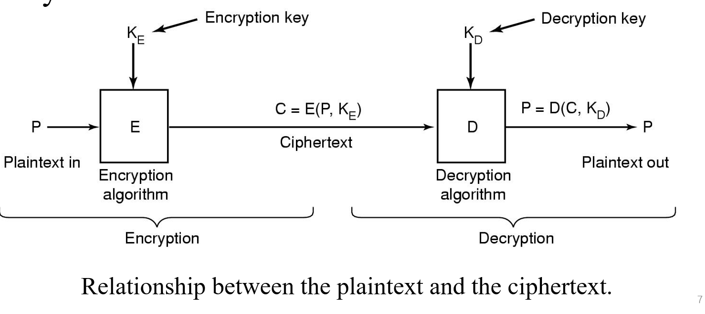

还有个奇怪的定理：

Kerckhoffs's principle
: a cryptosystem should be secure, even if everything about the system, except the key, is public knowledge

有点开源项目 keypass 的感觉

### 9.2.1 Secret-Key Cryptography

先来介绍一种非常简单的算法：**monoalphabetic substitution**

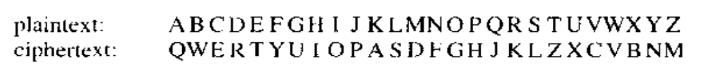

就是把一个字母映射成另一个字母

---

许多的 cryptographic system，类似上述的 monoalphabetic substitution，都有一个共同的特性而属于同一类：

secret-key cryptography (symmetric-key cryptography)
: given the encryption key it is easy to find the decryption key, and vice versa

尽管前面提到的字母替换是种非常简单的算法，但是大部分其他的 secret-key cryptography 在 key 长度足够的情况下，都是很安全的

### 9.2.2 Public-Key Cryptography

前面提到的 secret-key 固然看起来很美好，但是有个大问题：发送和接受双方必须拥有同样的 secret key，甚至还需要线下交流来确定 key

为了解决这个问题，就发明了 **public-key cryptography**

> This system has the property that ==distinct keys== are used for encryption and decryption and that given a well-chosen encryption key, it is virtually impossible to discover the corresponding decryption key
>
> Under these circumstances, the encryption key can be made public and only the private decryption key kept secret

为了方便说明 public-key cryptography 为什么能做到保密性，我们考虑下面这俩问题：

- Question 1: How much is $314159265358979\times 314159265358979$ ?
- Question 2: What is the square root of $3912571506419387090594828508241$ ?

显然，第一个还有可能算出来，第二个想要算出来的话，基本就不太可能了

一个叫做 **RSA**[^1] 的公共密钥系统正是利用了上面的这个事实：

[^1]:[RSA (cryptosystem) - Wikipedia..](https://en.wikipedia.org/wiki/RSA_(cryptosystem))

> multiplying big numbers is much easier for a computer to do than factoring big numbers, especially when all arithmetic is done using modulo arithmetic and all the numbers involved have hundreds of digits

要说这个方法有啥问题，就是运算起来==比对称加密慢了几百倍==

---

下面将讲述 RSA 具体是怎么运算的（书上都没有讲这个干什么啊？？？

RSA 包括了四个步骤：
- key generation
- key distribution
- encryption
- decryption

A basic principle behind RSA is the observation that it is practical to find three very large positive integers $e$, $d$, and $n$, such that with [modular exponentiation](https://en.wikipedia.org/wiki/Modular_exponentiation) for all integers $m$ ($0\le m <n$):

$$
(m^e)^d \equiv m\quad (\text{mod}\ n)
$$

and that knowing $e$ and $n$, or even $m$, it can be extremely difficult to find $d$


!!! note
    ==$n$ 和 $e$ 将作为 public key, 而 $d$ 是 private key，$m$ 表示 message==

    $\equiv$ 的含义是 "modular congruence"，说人话就是不管是 $(m^e)^d$ 还是 $m$，他俩对 $n$ 取模的结果都是一样的

#### 9.2.2.1 Key generation

- Choose two large ==prime numbers== $p$ and $q$

    当然，这俩质数必须保密
- Compute $n=pq$

    $n$ 将作为模数，且==双方都知道该值==
- Compute $\phi(n)=(p-1)(q-1)$
- $e$ 是怎么得到的就不说了，反正和 private key exponent $d$ 一起满足下列式子：

    $$
    e\times d\equiv 1\text{ mod }\phi(n)
    $$

    说人话，想要得到 $d$ 的话就要满足：
    $$
    (e\times d) \text{ mod }\phi (n)=1
    $$


#### 9.2.2.2 Key distribution

略

#### 9.2.2.3 Encryption

假如我们现在需要加密一下 integer $m$，就需要利用已知的 public key $e$，来计算 ciphertext $c$：

$$
c\equiv m^e\quad (\text{mod}\ n)
$$

说人话就是计算：

$$
c=m^e\text{ mod } n
$$

#### 9.2.2.4 Decryption

可以借助 private key $d$，来将密文 $c$ 给恢复成 $m$：

$$
c^d\equiv (m^e)^d\equiv m\quad(\text{mod }n)
$$

说人话就是计算：

$$
m=c^d\text{ mod }n
$$

### 9.2.3 One-Way Functions

function $f$, which has the property that given $f$ and its parameter $x$, computing $y=f(x)$ is easy to do, but given only $f(x)$, finding $x$ is computationally infeasible

正向计算容易，反向难

### 9.2.4 Digital Signatures

常用的 hash function 包括 **MD5 (Message Digest)** 和 **SHA (Secure Hash Algorithm)**

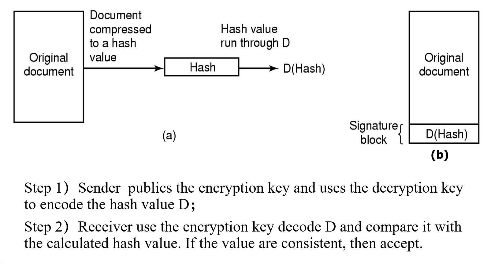

!!! note
    书上这里其实说的不是很明白。这东西最大的特点其实是==用你的 private key 去加密文本==，然后别人假如能够用 public key 来解开的话，就证明了一定是你本人（因为只有你拥有这个 private key

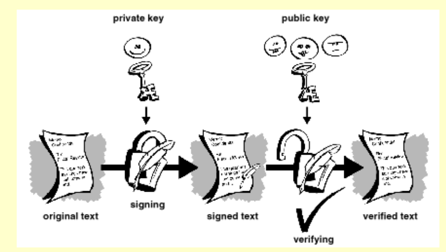

!!! warning
    从这里可以看出，digital signature 必须依赖于公钥加密，而不能使用对称加密！

## 9.3 User Authentication

好的，我们已经有了一点密码学的知识背景了，让我们现在看看 OS 实际会遇到的安全问题

user authentication
: When a user logs into a computer, the OS normally wishes to determine who the user is

验证最基本的要求是：
- Unique authentication
- Be accomplished before users get access to the system

大部分验证用户的手段，都是基于以下三种 general principles 之上的：
- Something the user knows
- Something the user has
- Something the user is

分别对应了接下来讲的三种验证方法

### 9.3.1 Authentication Using Passwords

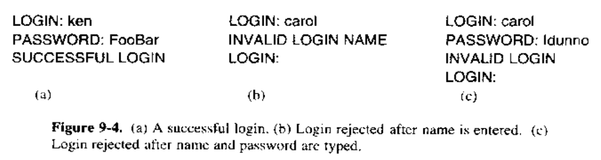

上图 (b) 其实是种错误的做法，因为降低了 cracker 入侵系统的难度

#### 9.3.1.1 UNIX Password Security

显然不能明文存储这种东西

UNIX 里会存储一个文件，包含用户名字，以及 encrypted password

然而这也存在问题。假如这个文件可以被访问的话，那么 cracker 可以准备好一个 password 和对应的 encrypted password 的字典，然后把密码文件里的 encrypted password 拿来比较字典，最终就能撞出密码

为了解决撞库的问题，UNIX 利用了一些随机数：

salt
: associate an $n$-bit random number, called the *salt*, with each password

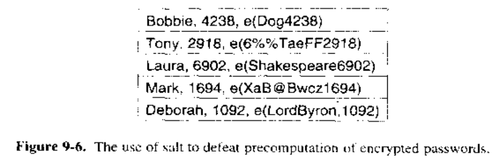

大概是上图这个意思：先将 password 和 salt 拼接在一起，然后才丢给 encrypt function $e$

### 9.3.2 Authentication Using a Physical Object

字面意思

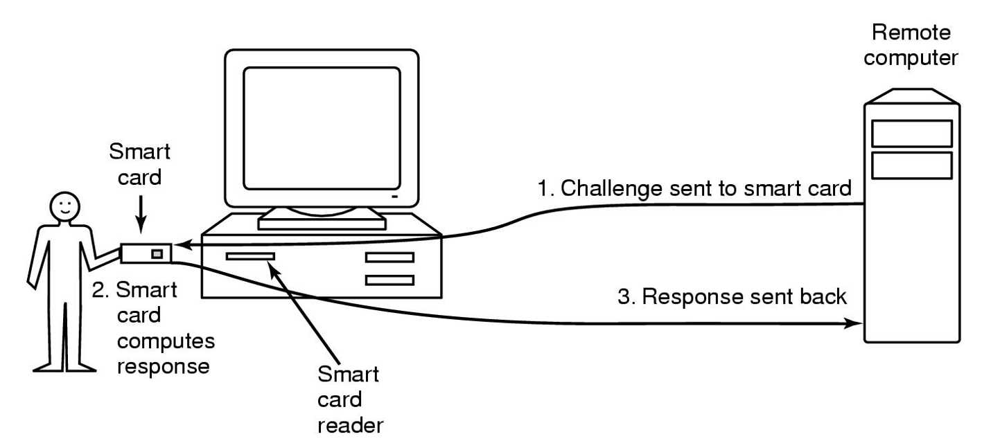

### 9.3.3 Authentication Using Biometrics

> measures physical characteristics of the user that are hard to forge

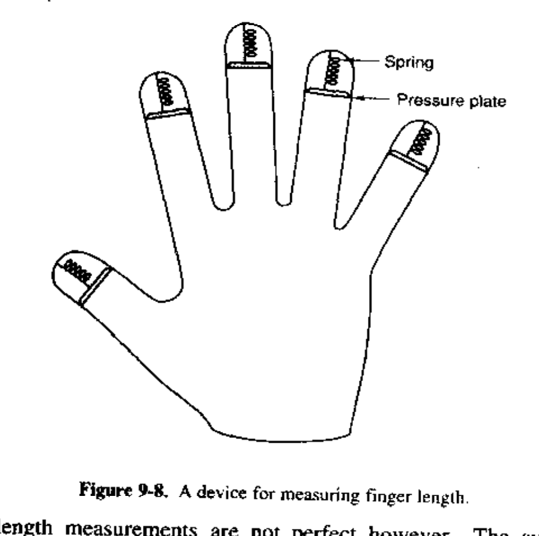

上图不是手，是个手形状的空心容器，测量手指长度

## 9.4 Attacks From Inside the System

以下的攻击方法，都是建立在攻击者已经登陆了系统的前提之下，所以叫做 "inside"

### 9.4.1 Trojan Horses

你懂的，反正就是藏在一些程序里，就可以为所欲为了

!!! warning
    这玩意不会自我复制

- Composition:

    Control terminal program, Trojan horse program and Trojan horse configuration program

- Features:

    - Invisibility: the primary feature; no icon, not appear in the software manager, etc.
    - Autorunning
    - Fraudulence: deceptive names, commonly used icons
    - Automatic recovery
    - Open specific ports automatically


### 9.4.2 Login Spoofing

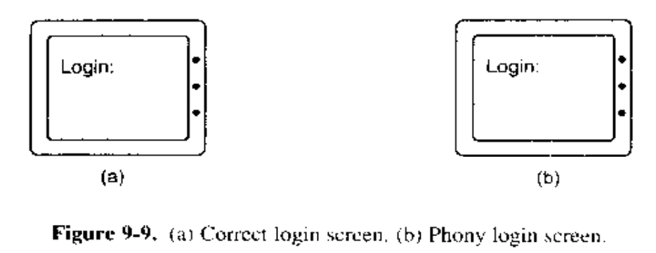

就是整一个非常逼真的假登录窗口，用以采集用户输入的用户名和密码

### 9.4.3 Logic Bombs

程序员可能故意藏了点“小惊喜”在程序里

e.g.

> a device which does nothing as long as the programmer feeds it its daily password while goes off after the programmer gets suddenly fired and not feeds it the next day

有种恶作剧的感觉

### 9.4.4 Trap Doors

人话：程序员写了点可以通过特殊方式跳过检查的代码

e.g., 输入 admin 而不输入密码就可以直接登录系统

### 9.4.5 Buffer Overflow

由于很多程序都是用 C 写的，而 C 压根就没有数组的越界检查，所以就可以设法越界

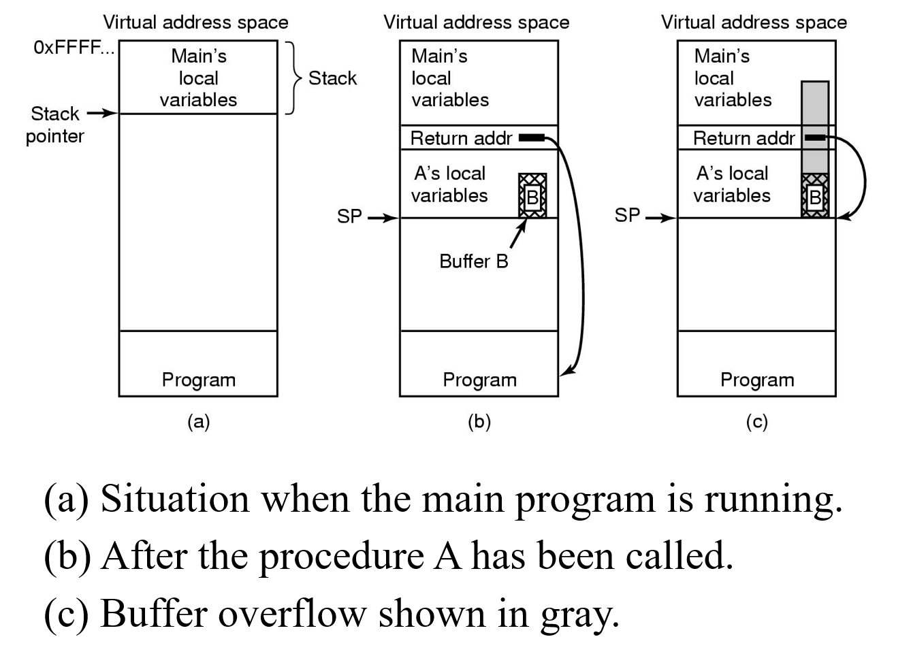

可以看到 buffer 溢出之后，甚至可以影响到其它的内存空间（这是什么憨批设计

## 9.5 Attacks From Outside the System

前面提到的都是来自 inside 的攻击，然而由于电脑可以联网之类的，所以来自外界的攻击也会有

malicious codes
: Software or codes aimed at destroying hardware or software, stealing user information or disturbing users without authorization

*malicious code* 的定义包含但不限于以下玩意 (还包含 [trojan horses](#941-trojan-horses) 啥的)

virus
: is a program that can reproduce itself by ==attaching== its code to another program, analogous to how biological viruses reproduce

worm
: A kind of malwares that exploit system vulnerabilities for self-reproduction. ==Without attaching== to other programs, it can be executed independently. 

关于这些概念到底是啥关系（来自 ChatGPT）：


|  | Virus | Worm | Trojan Horse |
| --- | --- | --- | --- |
| Propagation | Attaches to a program and requires user interaction to spread | Self-replicates and spreads through networks or the internet without user interaction | Disguises itself as a legitimate program to trick users into installing it, often through social engineering tactics |
| Payload | May cause damage, steal data, or perform other malicious actions | Similar to viruses, but often have more specific goals (e.g. creating a botnet) | Allows an attacker to gain unauthorized access to a system, often providing a backdoor for further attacks |
| Detection | May be detected and removed by antivirus software | May be detected and removed by antivirus software, but can be more difficult to detect due to their ability to spread rapidly | Often require human intervention or specialized security tools to detect and remove |
| Examples | Melissa, Sasser, ILOVEYOU | Nimda, Code Red, Conficker | Back Orifice, Poison Ivy, Netbus |


### 9.5.1 Virus Damage Scenarios

显然病毒就是搞破坏用的，病毒的特点如下：

- Fast to spread
- Difficult to detect
- Difficult to delete

### 9.5.2 How Viruses Work

dropper
: virus is written in assembly language, and then carefully inserts it into a program, using *dropper*

> Once installed on the victim's machine, the virus lies dormant until the infected program is executed

payload
: Once started, virus usually begins by infecting other programs on the machine and then executing its *payload*

#### 9.5.2.2 Executable Program Viruses

影响可执行文件的病毒

一个循环找到可执行文件并进行感染的逻辑如下所示：

```cpp{.line-numbers}
#include <sys/types.h>
#include <sys/stat.h>
#include <dirent.h>
#include <fcntl.h>
#include <unistd.h>
struct stat sbuf;

search(char *dir_name)
{
    DIR *dirp;
    struct dirent *dp;

    dirp = opendir(dir_name);
    if (dirp == NULL) return;
    while (TRUE) {
        dp = readdir(dirp);
        if (dp == NULL) {
            chdir("..");
            break;
        }
        if (dp->d_name[0] == '.') continue;
        Istat(dp->d_name, &sbuf);
        if (S_lSLNK(sbuf.st_mode)) continue; /* skip symbolic links */
        if (chdir(dp->d_name) == 0) {
            search(".");
        } else {
            if (access(dp->d_name,X_OK) == 0) /* if executable, infect it */
                infect(dp->d_name);
        }
    }
    closedir(dirp);
}
```

---

下面介绍一种具体一点的病毒

parasitic viruses
: viruses attach themselves to teh program and do their dirty work, but allow the program to function normally afterward

寄生病毒

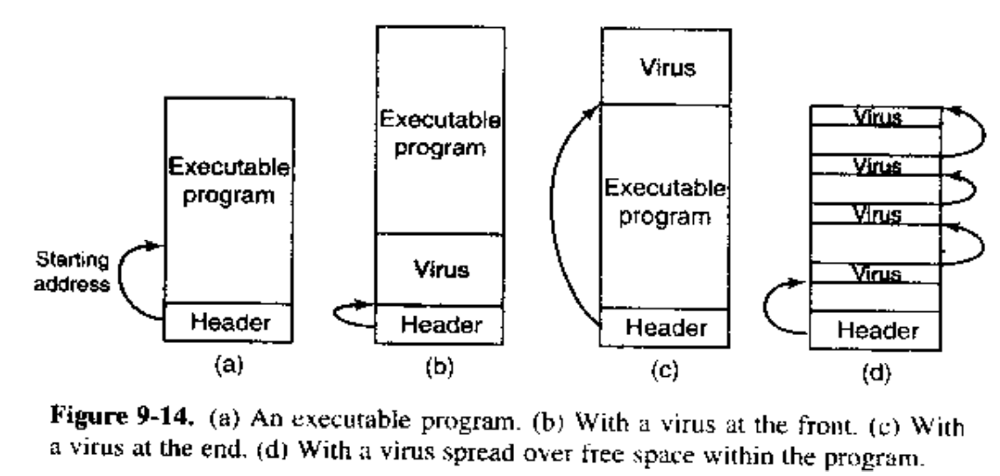

### 9.5.3 How Viruses Spread

- Put viruses in places which have frequent copy operation
- After duplication

    - Infect the programs on the hard disk 
    - May spread on the LAN
- Play as the attachment of E-mails

### 9.5.4 Antivirus and Anti-Antivirus Techniques

每个小标题都代表一种做法

#### 9.5.4.1 Virus Scanners

其中一种检测病毒的手段是记录每个文件的长度。假如文件长度变化了，那存在可能性被感染了 (图 (b))

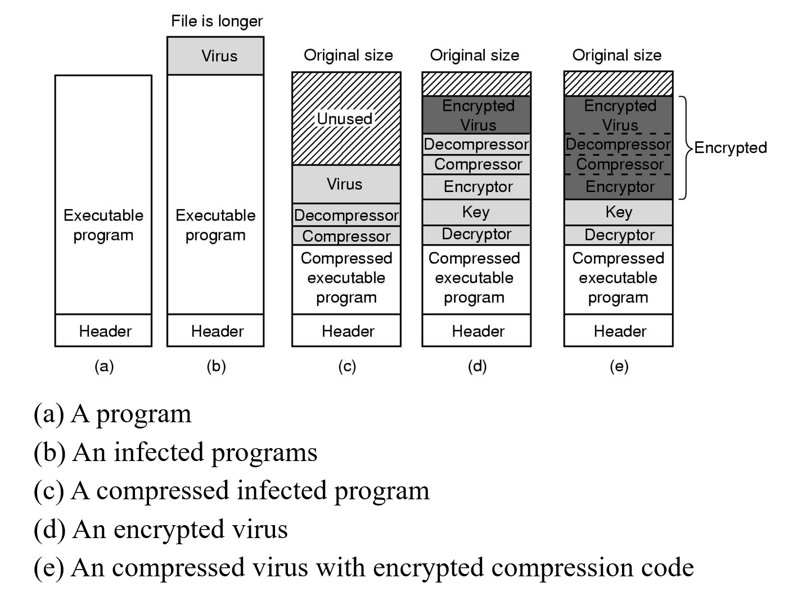

聪明的病毒会先压缩源程序 (图 (c))，而聪明的杀毒软件会检查文件是否存在和数据库里相似的信息；更聪明的病毒会进一步加密自己 (图 (d))，而更聪明的杀软会利用 decomposer, compressor, encryptor 的特征来识别病毒；更更聪明的病毒会将这仨也一并加密了 (图 (e))

#### 9.5.4.2 Integrity Checkers

#### 9.5.4.3 Behavioral Checkers

#### 9.5.4.4 Virus Avoidance

- An operating system that offers a high degree of security 
- Install only the software from a reliable manufacturer
- Buy a good antivirus software package.
- Do not click on attachments to e-mails
- Make frequent backups of key files

#### 9.5.4.5 Recovery from a Virus Attack

Shut down the computer, restart it on the safe disk and run the antivirus software

### 9.5.5 The Internet Worm

Worms can cause network congestion (网络拥堵)

A worm consist of two programs:
- The bootstrap
- The worm proper

A worm hides its existence firstly,  and then it attempts to spread its bootstrap to other machines connected to the host computer.

### 9.5.? Mobile Phone Malicious Codes

如何预防手机病毒：

- Check calling information and do not answer calls from abnormal numbers
- Download files from the Internet carefully
- Reject abnormal messages, especially messages with links
- Turn off wireless and Bluetooth when unnecessary
- Pay attention to safety information and take precautions
- Improve security awareness, use protective tools and download files carefully)
- Network traffic detection
- Update software and install patch
- Back up important files

## 9.7 Trusted Systems

### 9.7.5 Covert Channels

/ˈkəʊvɜːt/ 秘密通道

事实上，即便通过数学证明了不会出现信息泄露问题，也可能会发生泄露

下面介绍一些，可以实现两个进程之间秘密通信的方法

---

假如现在存在三个进程，而其中 server 想向 collaborator 传递一些悄悄话

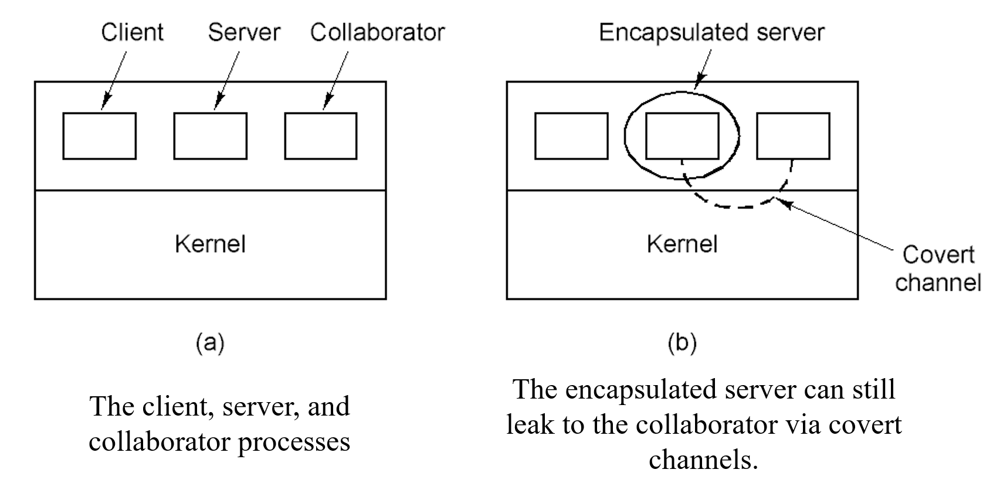

由于 server 被包裹了起来，没法光明正大地发信息，所以只能如下发送：
> To send a `1` bit, it computes as hard as it can for a fixed interval of time.
> 
> To send a `0` bit, it goes to sleep for the same length of time

而 collaborator 需要做的，就是不断监视 server 的==响应时间==的变化情况。因为发送 `1` 的时候，server 很忙，响应时间就会比较长；而发送 `0` 的时候，响应时间就会比较短

---

下面介绍的是利用 file locking 实现秘密通信

server 和 collaborator 各自控制一个文件，$F1$ 和 $F2$，以实现时间较为精准的信息同步，并通过共享的文件 $S$ 的 lock/unlock 的状态，代表 1/0

> After the server locks or unlocks $S$, it flips the lock status of $F1$ to indicate that a bit has been sent
>
> As soon as the collaborator has read out the bit, it flips $F2$'s lock status to tell the server it is ready for another bit

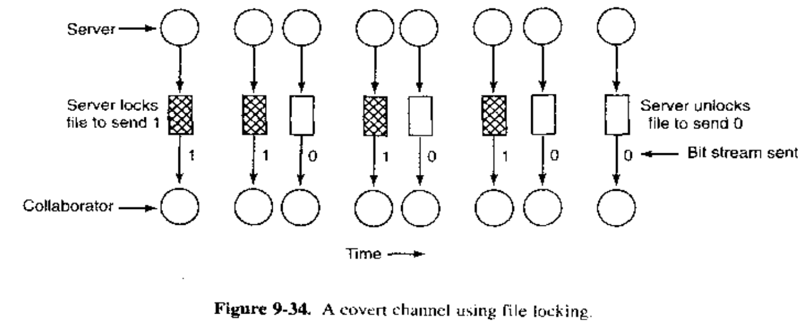

甚至想要提高带宽的话，还可以让共享文件 $S$ 的数量多几个，这样就能一次传好几个 bit

---

甚至可以藏在照片里

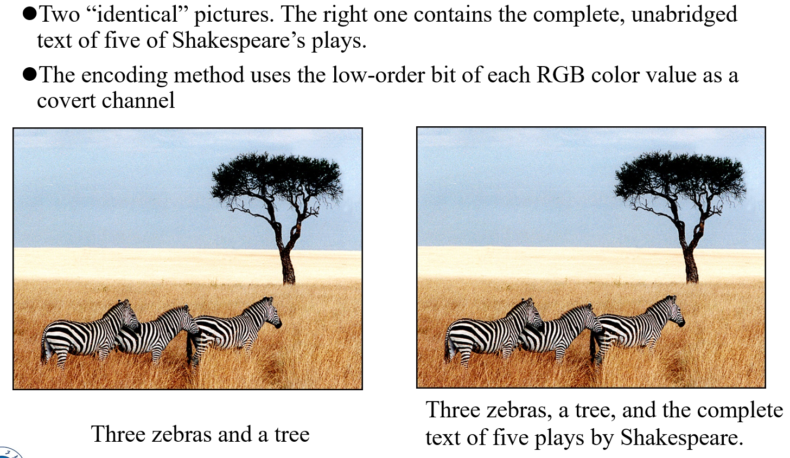

每个像素点的 RGB 三个值，都可以各存一个 bit，也就是每像素藏 3-bit

## 习题

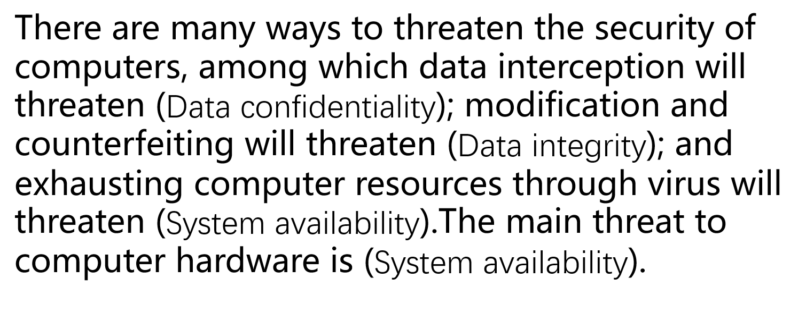

逆天背书题

!!! note
    interception: 拦截；侦听

---

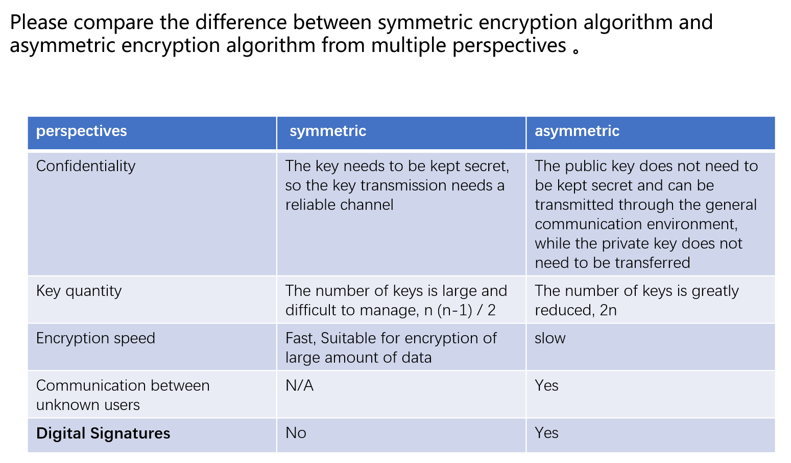

也很逆天

---

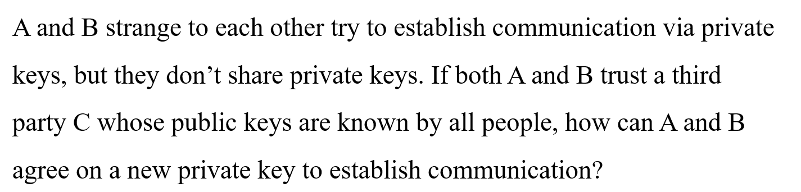

A:

给的答案如下：

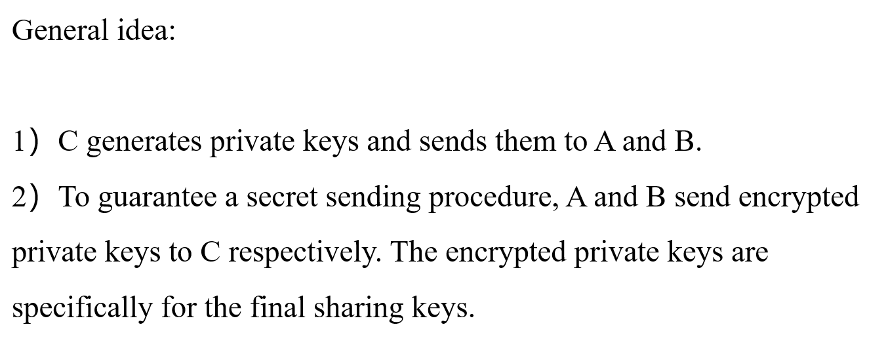

但这题目说的就不明不白的，感觉意思应该是两个人最开始各自拥有对称加密的密钥（但是不同）（其实也可以是非对称加密，只不过根据题意感觉更有可能是对称），而想最终用 新生成的对称加密的密钥 来通信？这个最终用来通信的密钥是由 C 来负责生成并分发的。然而为了让这个最终的密钥安全地被送到 A, B 的手上，A, B 可以先用非对称加密将自己的密钥作为内容传送给 C，即先使用 C 的公钥加密各自的密钥发给 C（没错，C 拥有该公钥对应的私钥）。然后 C 再利用收到的各自的密钥，来分别加密最终的密钥，然后分别传给 A, B

---

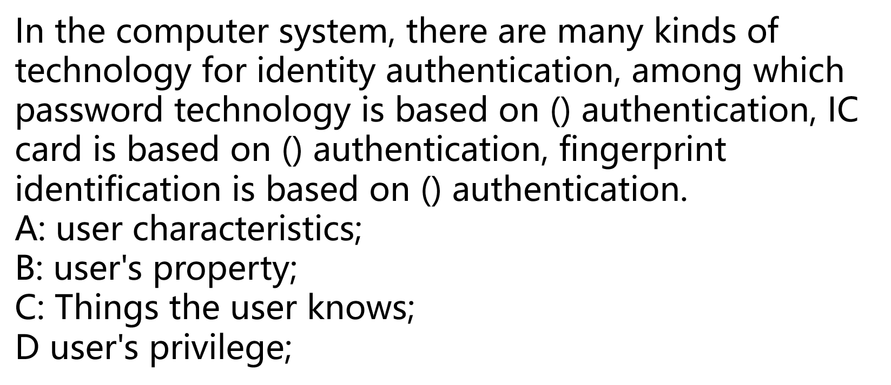

A:

C, B, A

你管 IC card 叫做 user's property???

---

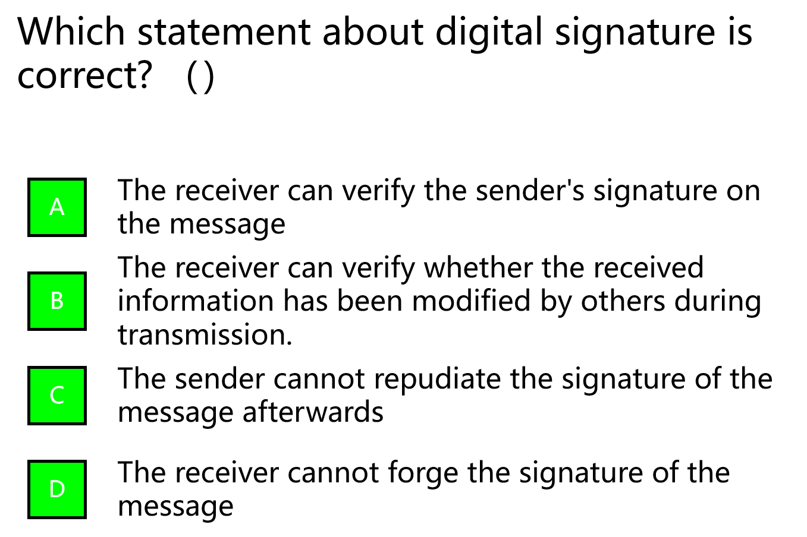

发送方和接收方都不能改

---

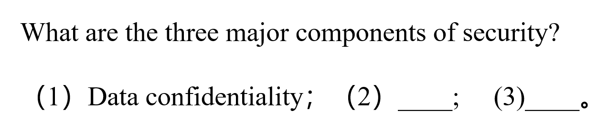

A:

(2) Data integrity; (3) System availability

---

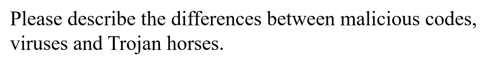

没有标准答案，我就写下自己的理解了

malicious codes 包含了后面两种。而后俩的区别是：

> A virus is a program that spreads by ==attaching== itself to other software, while a trojan spreads by ==pretending== to be useful software or content

---

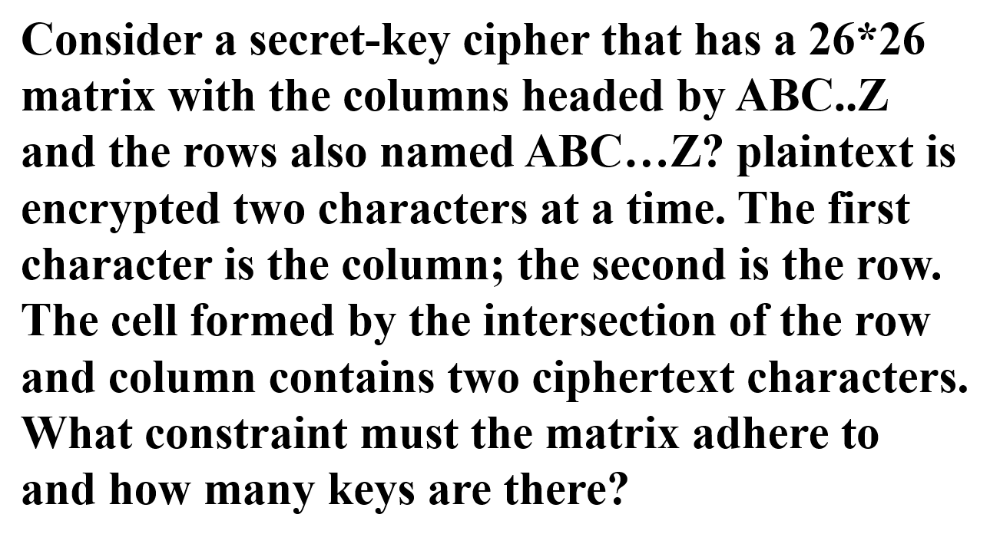

A:

(1) constraint: There are no two identical ciphertext characters in the secret-key matrix

就是所有的单元格都不相同

(2)

本质上来说，这就是把一对字母映射成了另一对字母，所有的组合都要映射，而且还要求映射的结果不能重复，结果就是，所有的映射都会是一一映射

所以，表格上的所有单元格的集合绝对只存在一种情况，只是排列顺序可以不同而已

所以，结果是单元格总数的全排列：
$$
(26\times 26)!
$$
