## Difficulties in SE
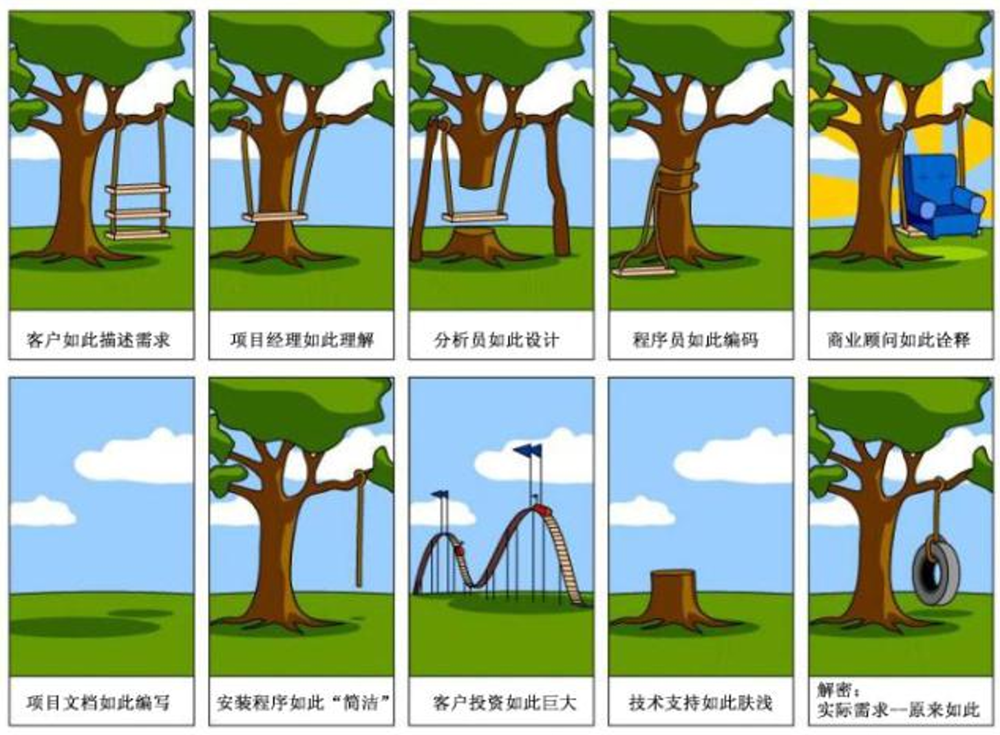

## Relationship between computer science and SE

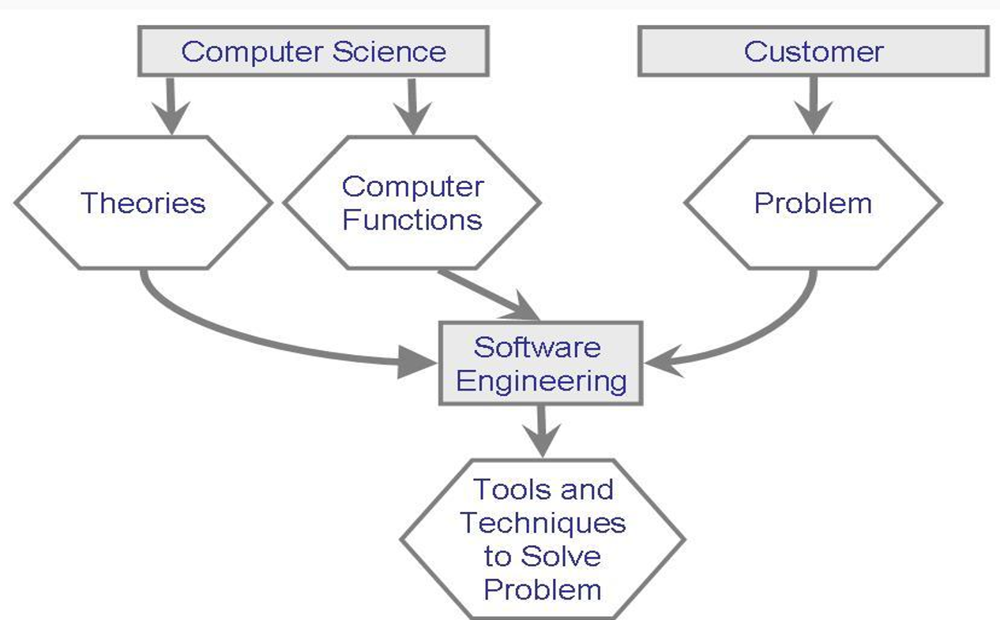

## 三个要素
- **Method**

    > refers to a formal procedure; a formal “recipe” for accomplishing a goal that is typically independent of the tools used
- **Tool**

    > an instrument or automated system for accomplishing something in a better way
- **Procedure**

    > a ==combination== of tools and techniques to produce a product

## Content of SE
### Procedure of SE
- Analysis (requirement specification)
- Design
- Implementation
- Testing

### Methods
- UML  and other models
- Design Pattern
- Formal method
- Agile Development

### Environment and Tools 
Ruby + Rails

### Other Topics
- Declarative Programming: Prolog
- Distributed Architecture: CORBA

## Solving Problems
一般会需要:
### Analysis
> ==decompose== a large problem into smaller, understandable pieces

把问题进行一些抽象

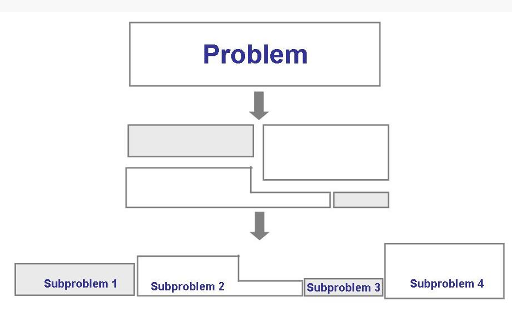

可以一层层地抽象，形成一个层次结构：

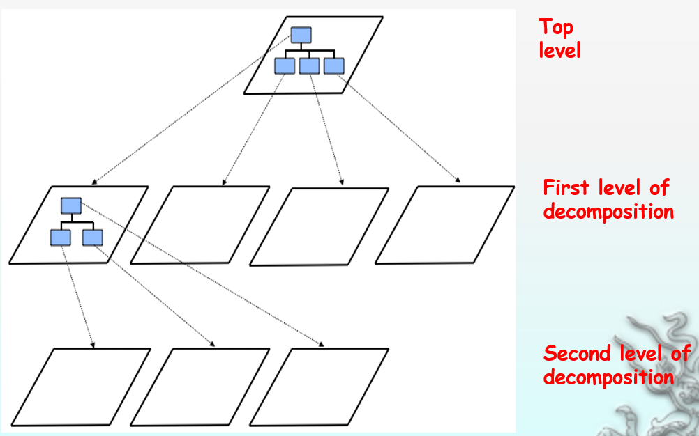

### Synthesis
> build (compose) a software from smaller building blocks

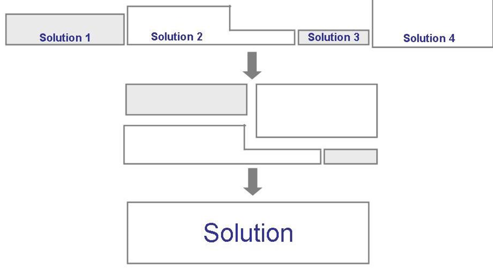

## Software Life Cycle
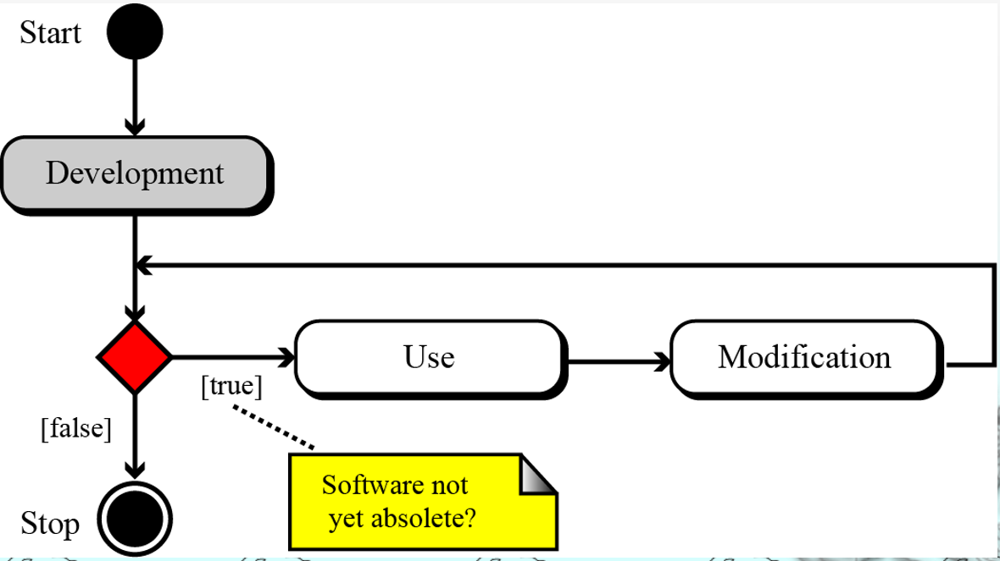

对于其中的**development process**[^1]来说，包含了四个阶段：

[^1]:["Software development process - Wikipedia," .](https://en.wikipedia.org/wiki/Software_development_process)

- analysis (requirement specification)
- design
- implementation
- testing

前面提到过这四个玩意

对于development process来说，有很多种model：

### 几种模型

#### Waterfall Model

同时也是 **Software Life Cycle**！

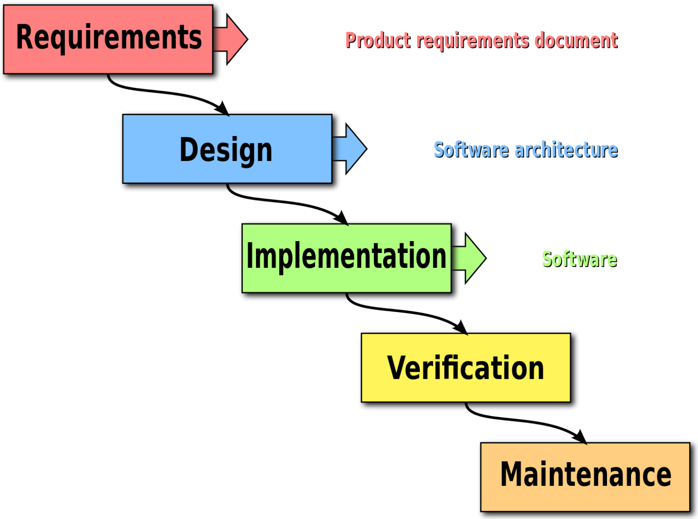

> the development process flows in only one direction. This means that a phase cannot be started until the previous phase is completed.

---

我们还可以在这个基础上增加一点帮助的手段

prototype
: A prototype is a partially developed product

好处是：
- developers assess alternative design strategies (design prototype)
- users understand what the system will be like (user interface prototype)

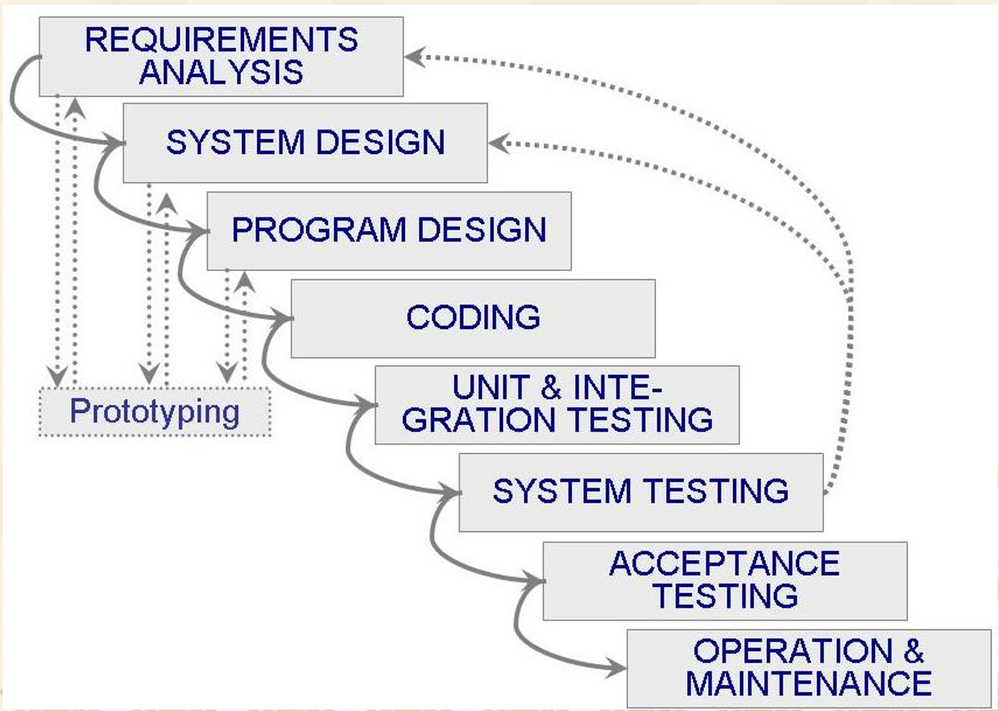

在verification and validation里有用

--- 

waterfall的一个变种是 **V-Model**[^2]

[^2]:["V-Model (software development) - Wikipedia," .](https://en.wikipedia.org/wiki/V-Model_(software_development))

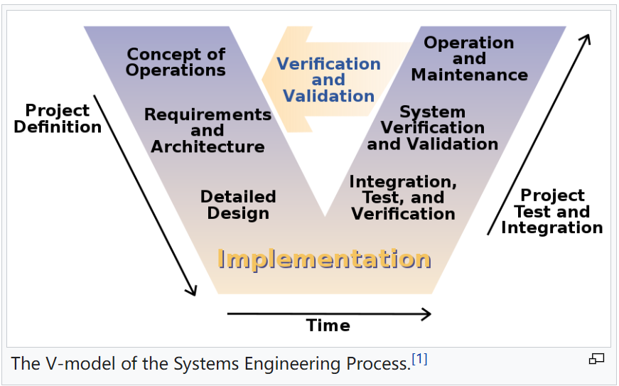

似乎左右是有对应关系的？？没理解

#### Iterative and Incremental Model
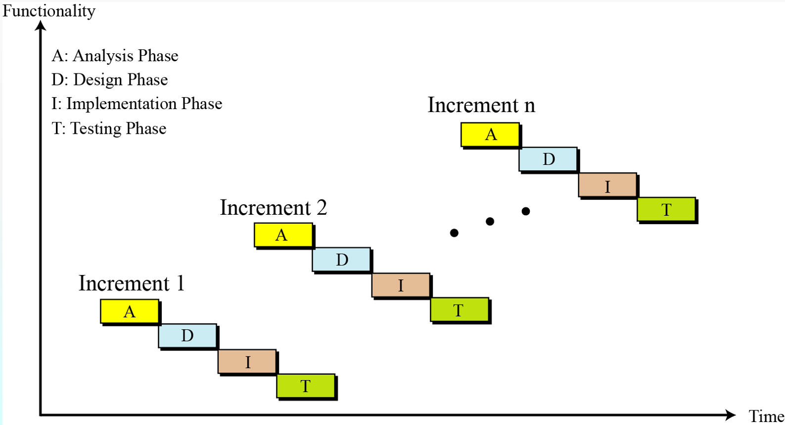

> The basic idea behind this method is to develop a system through repeated cycles (iterative) and in smaller portions at a time (incremental), allowing software developers to take advantage of what was learned during development of ==earlier parts or versions== of the system

相比于waterfall这种最后才得到成品的，increment可以先用着半成品

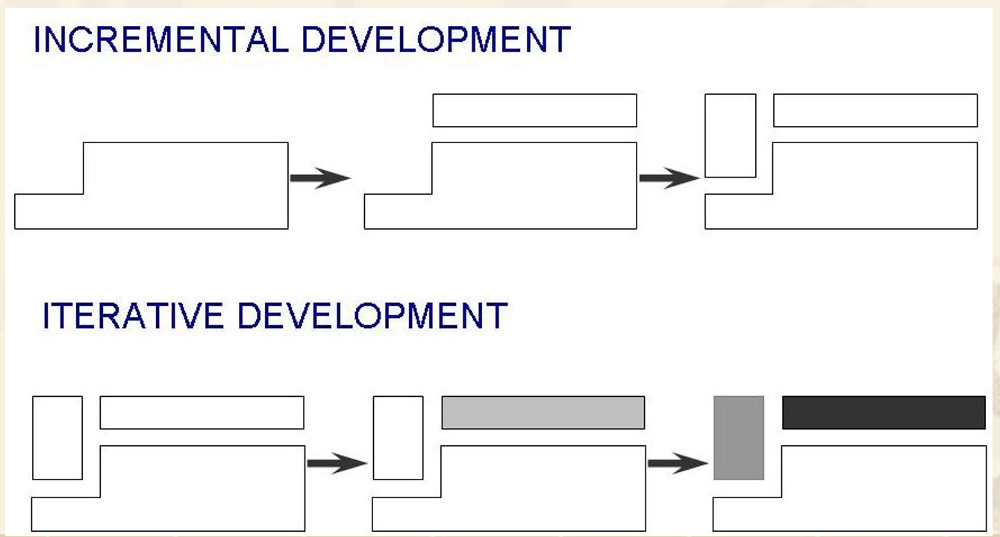

可以看到这两种的特点是：
- 增量开发：

    先定义一个小的功能子系统，再在每个新的发布中增加新功能
- 迭代开发：

    一开始就提交完整的系统，再在每一个新的发布中改变每个子系统的功能

#### Spiral Model[^3]

[^3]:["Spiral model - Wikipedia," .](https://en.wikipedia.org/wiki/Spiral_model)

spiral model
: is a ==risk-driven== software development process model. Based on the unique risk patterns of a given project, the spiral model guides a team to adopt elements of one or more process models, such as incremental, waterfall, or evolutionary prototyping.

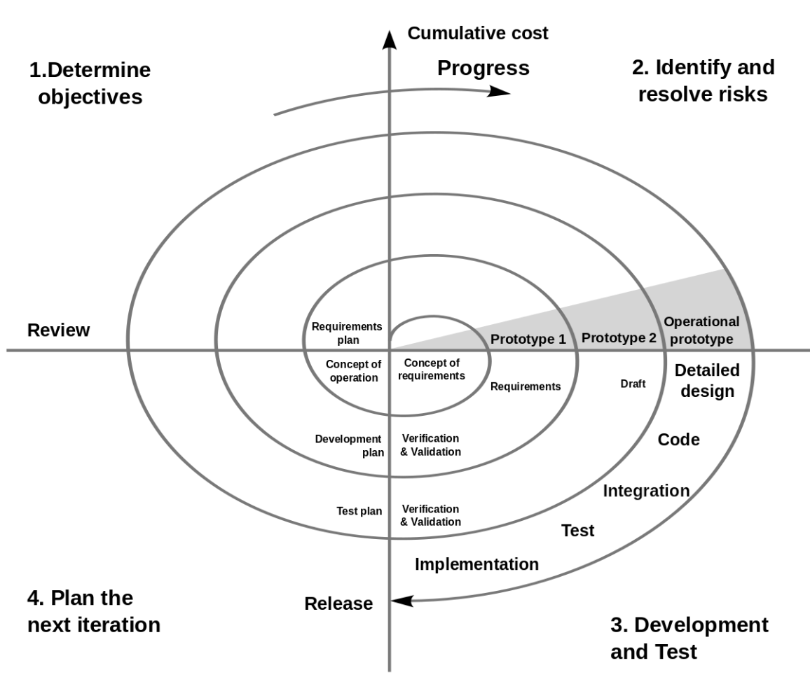

每圈经历相同的四个阶段，螺旋上升：
- Objective setting
- Risk assessment
- Development and validation
- Planning

### Component-based software engineering[^4]

[^4]:["Component-based software engineering - Wikipedia," .](https://en.wikipedia.org/wiki/Component-based_software_engineering)

Component-based software engineering (CBSE)
: also called component-based development (CBD), is a branch of software engineering that emphasizes the separation of concerns with respect to the wide-ranging functionality available throughout a given software system.

课件2里还有Operational Specification Model和Transformational Model，懒得写

### Analysis Phase
> Analysis phase results in a specification document that shows ==what== the software will do without specifying ==how== it will be done

根据不同的两种实现方式，我们也需要对应不同的两种analysis

#### Procedure-oriented Analysis
当你准备使用procedural language来实现你的项目的时候，我们就使用这种分析

这种分析需要用到几种modeling tools:
- **Data flow diagrams**

    > show the movement of data in the system

    下面这个应该是酒店订房间的例子：

    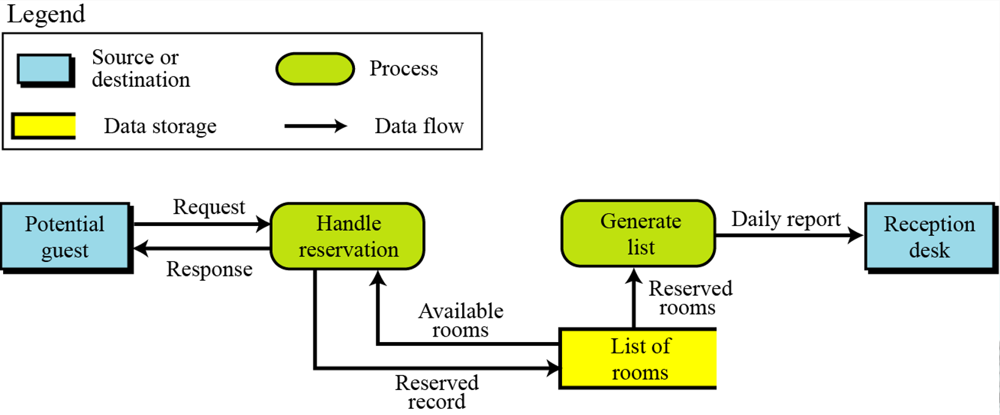

- **ER diagrams**
- **State diagrams**

    > normally used when the state of the entities in the system will change in response to events

    我们以一个只能搭载一名乘客的奇葩电梯做例子
    
    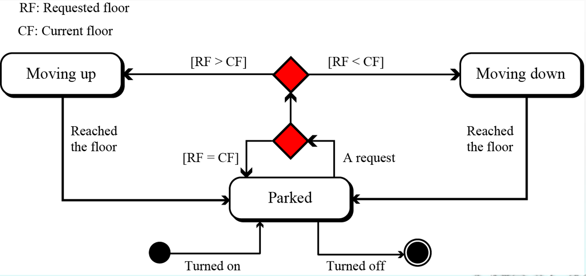
    
#### Object-oriented Analysis
同样也有几种不同的工具：

!!! warning
    这俩图很可能是重点

- **Use case diagrams**

    > A use-case diagram gives the user’s view of a system: it shows how users communicate with the system. A use-case diagram uses four components: system, use cases, actors and relationships. A system, shown by a **rectangle**, performs a function.
    
    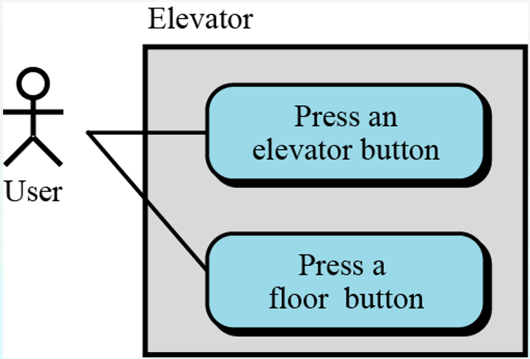
- **Class diagrams**

    想清楚哪些entity会涉及到：

    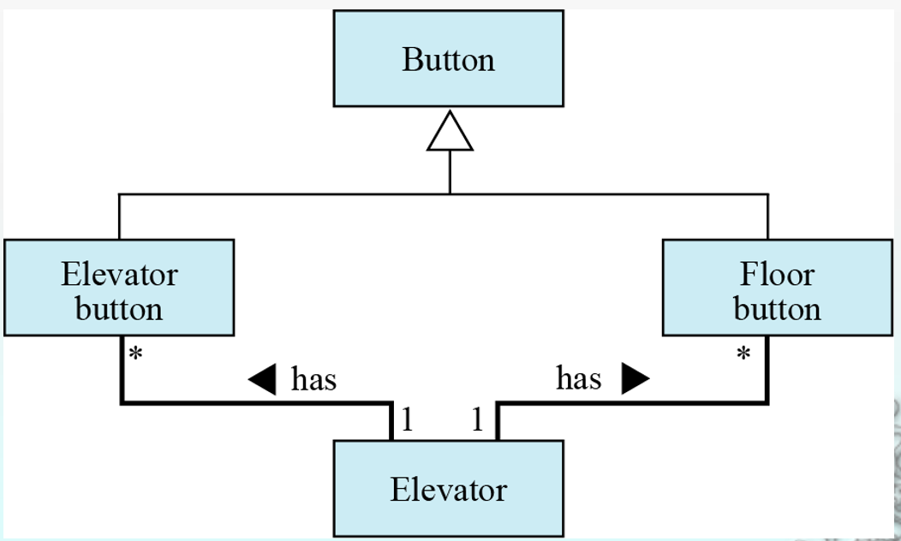

### Design Phase
> The design phase defines how the system will accomplish what was defined in the analysis phase. In the design phase, ==all components== of the system are defined.

#### Procedure-oriented Design
##### Structure charts
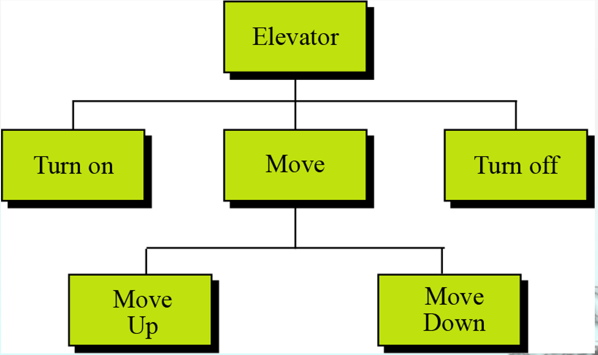

可以看到被分成了很多的模块

##### Modularity
模块化设计有两个主要要考虑的问题：
- **coupling**

    > a measure of how tightly two modules are bound to each other. 
    
    Coupling between modules in a software must be ==minimized==
    
    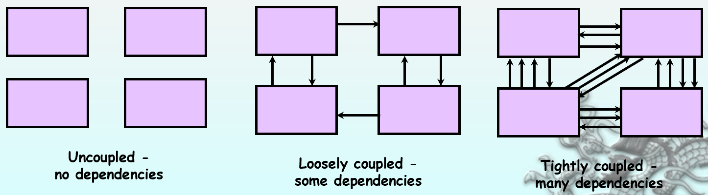
- **cohesion**

    大概就是一个模块里面的methods和data之间的联系紧密程度

    Cohesion within modules in a software system be ==maximized==.

#### Object-oriented Design
你懂的

### Implementation Phase
#### Choice of Language
#### Software Quality
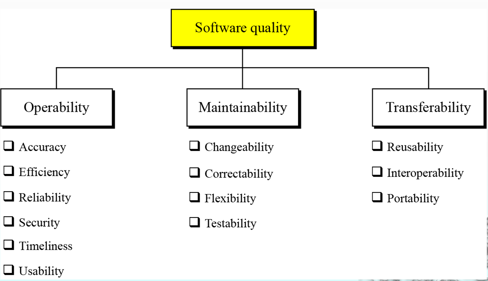
    
### Testing Phase
两种不同的测试：
- **glass-box (white box)**
- **black-box**

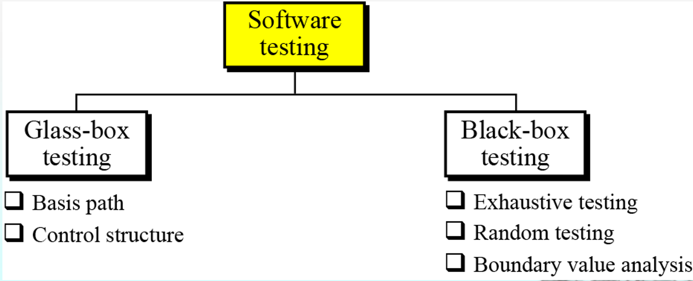

#### Glass-box Testing
使用者知道这个程序的所有内部结构以及他们都是各自用来干啥的，目的是测试各个组件是否都如预期地工作

白盒测试的其中一种方法是**Basis path testing**:
> Basis path testing is a method in which ==each statement== in the software is executed at least once

说白了每句话都要测试到

#### Black-box Testing
同样有好几类：
##### Exhausive Testing
> The best black-box test method is to test the software for ==all possible values in the input domain==

酒吧.mp4

##### Random Testing
> In random testing, a ==subset== of values in the input domain is selected for testing. It is very important that the subset be chosen in such a way that the values are ==distributed over the domain input==.

##### Boundary-value Testing

### Documentation
需要三种不同的文档：
#### User Documentation
#### System Documentation
> System documentation defines the software itself. It should be written so that the software can be ==maintained and modified== by people other than the original developers. System documentation should exist for all four phases of system development.

#### Technical Documentation
> Technical documentation describes the ==installation and the servicing== of the software system. Installation documentation defines how the software should be installed on each computer, for example, servers and clients. Service documentation defines how the system should be maintained and updated if necessary.

