# Formal Specification

formal methods
: refer to any activities that rely on mathematical representations of software including formal system specification, specification analysis and proof, transformational development, and program verification

formal software specification
: is a specification expressed in a language whose vocabulary, syntax and semantics are formally defined

因为人们发现用数学方法表示可以提升软件的品质，就流传下来了

## 10.1 Formal specification in the software process

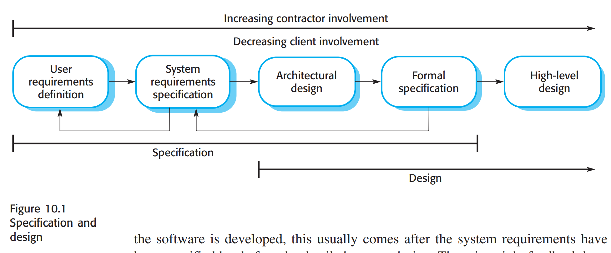

从左到右，要求从原本的面向用户，逐渐变成非常具体的面向工程师的描述

可以看到，specification和design在上图中并非是完全独立的，甚至可以不一定按照上述顺序执行

比如说，可以让specification和design完全并行：

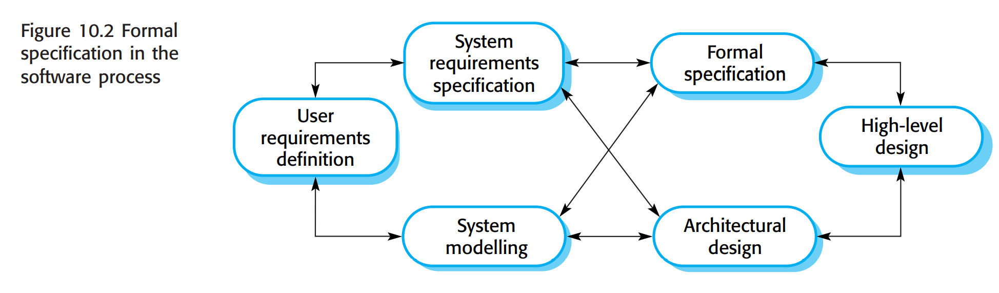

---

来看看formal specification对development cost的影响

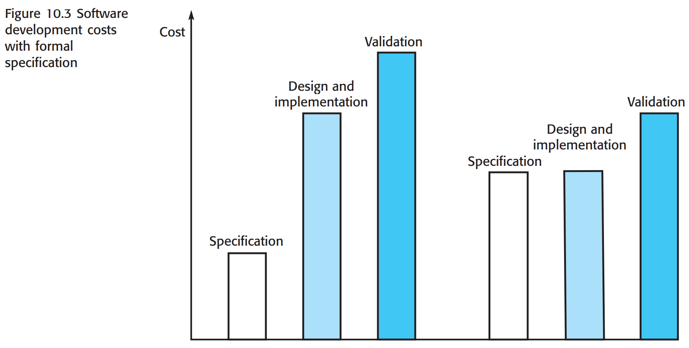

左边是使用前，右边是使用后。可以看到成本消耗==前移==了，原本validation和design的成本下降，而specification的成本增加

---

Two fundamental approaches to formal specification have been used to write detailed specifications:
- **algebraic approach**

    where the system is described in terms of operations and their relationships
- **model-based approach**

    where a model of the system is built using mathematical constructs such as sets and sequences, and the system operations are defined by how they modify the system state 

这俩针对sequential和concurrent systems诞生出了不同的具体方法：

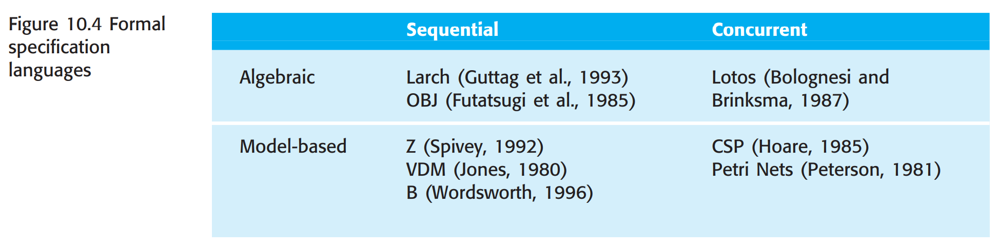

## 10.2 Sub-system interface specification (algebraic approach)

> Large systems are usually decomposed into ==sub-systems== that are developed ==independently==.

因为subsystem之间要相互调用，定义好之间的接口就显得格外重要

Sub-system interfaces are often defined as a set of objects or components:

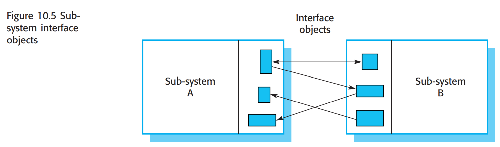

而algebraic approach非常适合用来声明这些接口，表现得非常类似于object class

---

The body of the specification has four components:
- **introduction** 

    declares the `sort` (the type name) of the entity being specified

    it may also include an `imports` declarations, where the names of specification defining other sorts are declared

- **description**

    where the operations are described informally
- **signature**

    defines the syntax of the interface to the object class or abstract data type
- **axioms**

    defines the semantics of the operations by defining a set of ==axioms== that characterise the behaviour of the abstract data type

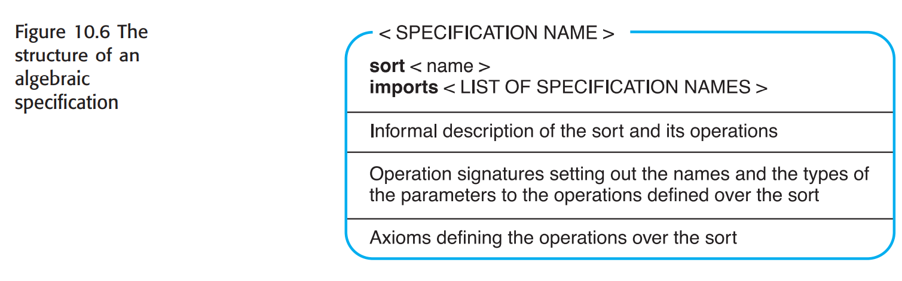

e.g.

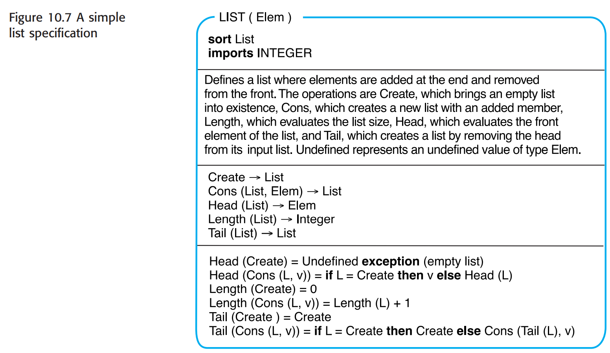

可以看到有些操作是递归的

e.g.

有时候，我们可以定义一些额外的操作，使得specification的过程简化

这些作为基础的operation就被称作primitive operation

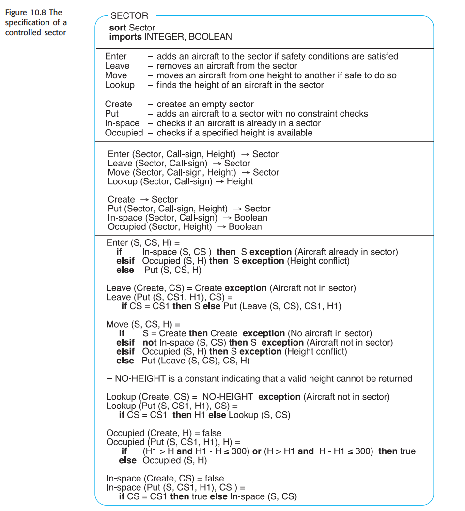

图中create开始的几个操作就是primitive operation

## 10.3 Behavioral specification (model-based approach)

[10.2](#102-sub-system-interface-specification-algebraic-approach)介绍了algebraic approach，这一节介绍model-based approach

model-based specification
: is an approach to formal specification where the system specification is expressed as a ==system state model==

> You can specify the system operations by ==defining how they affect the state of the system model==. The combination of these specifications defines the ==overall behaviour== of the system

---

有许多实现这个方法的成熟的标记体系，本节介绍的是 **Z** (pronounced Zed, not Zee)

Z
: In **Z**, systems are modelled using ==sets== and relations between sets. However, *Z* has augmented these mathematical concepts with constructs that specifically support software specification

> Specifications are presented as **informal text** supplemented with **formal descriptions**:

schemas
: The *formal description* is included as small, easy-to-read chunks called **schemas**. *Schemas* are used to introduce ==state variables== and to define ==constraints and operations== on the state

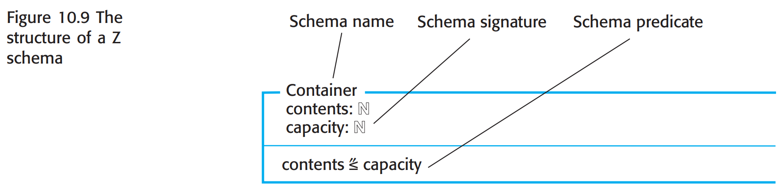

正常来说，会有一堆informal text围绕着上图这样的formal description (schema)

---

e.g.

我们用之前的例子insulin pump (胰岛素泵)来说明

The Z state schema that models the insulin pump state:

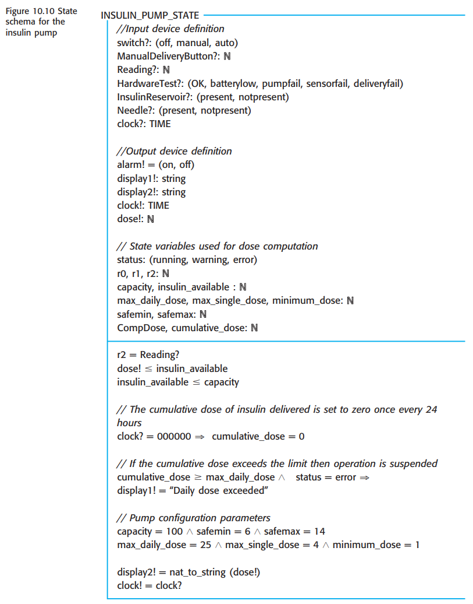

内容具体是啥完全不重要。我们来看看上半部分的命名规则：
- **System inputs**

    所有input variable名字后面跟上了一个`?`
- **System outputs**

    所有output variable名字后面跟上了一个`!`
- **State variables**

    used for dose computation

    没啥特别的符号规则

    $\mathbb{N}$ 代表的是 non-negative number

The RUN schema models the normal operating condition of the pump:

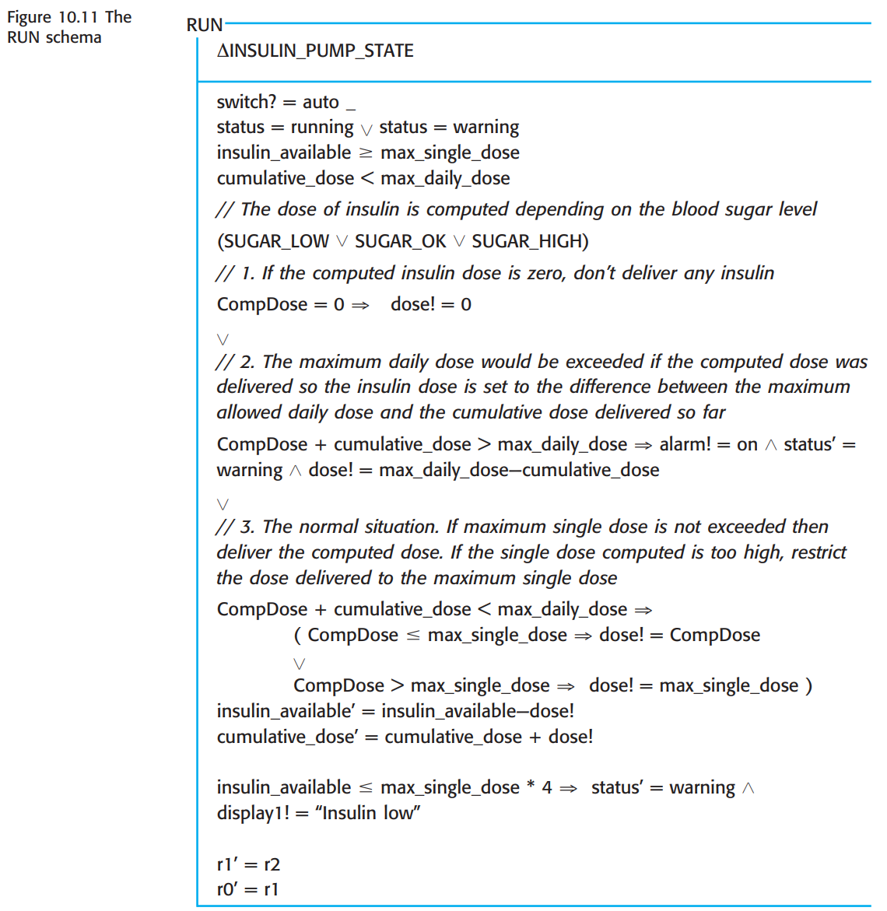

可以看到上一个INSULIN_PUMP_STATE的名字直接出现在了declaration的部分，意思类似于include

名字前面还有一个$\Delta$:
> The delta means that the state variables defined in INSULIN_PUMP_STATE are in scope as are a set of other variables that represent ==state values before and after== some operation
> 
> Therefore, `insulin_available` represents the amount of insulin available before some operation, and `insulin_available´` represents the amount of insulin available after some operation (==用`´`表示操作后的state==)

其实上图中还用到了SUGAR_LOW, SUGAR_OK, SUGAR_HIGH这些其它schema

大发慈悲再把SUGAR_OK的图也贴上：

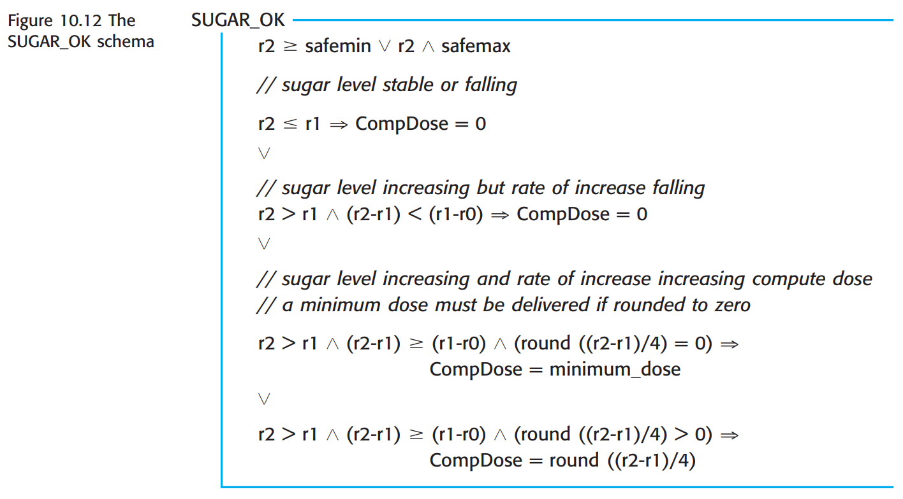

