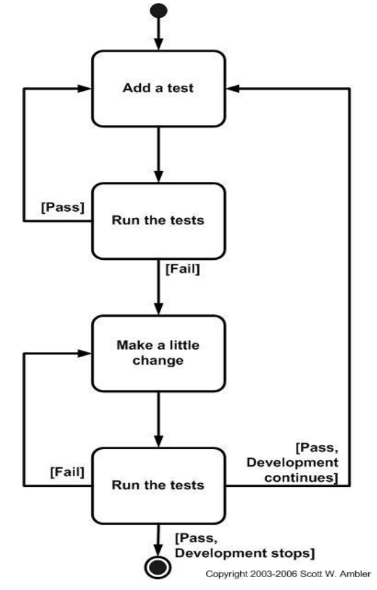
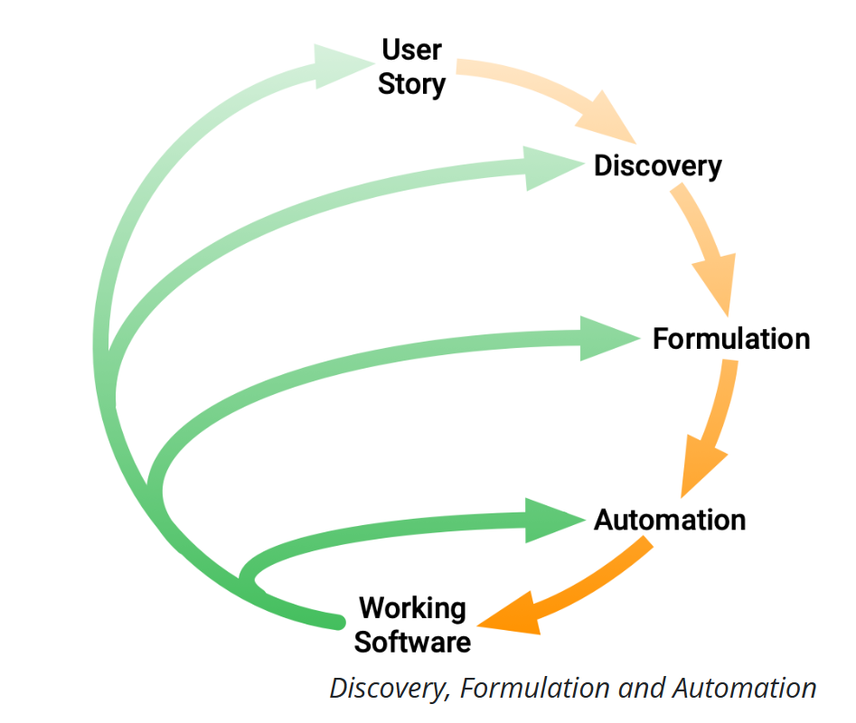

# Testing on Rails[^1]

[^1]:[RSpec Tutorial..](https://www.tutorialspoint.com/rspec/index.htm)

实际上是讲RSpec[^2]的使用

[^2]:[RSpec: Behaviour Driven Development for Ruby..](https://rspec.info/)

> RSpec: Behaviour Driven Development[^3] for Ruby

其实看了wiki的解释，也看不懂behaviour driven development是个什么东西。tutorialspoint的解释是：

> RSpec does not put emphasis on, how the application ==works== but instead on how it ==behaves==, in other words, what the application actually does

[^3]:[Behavior-driven development - Wikipedia..](https://en.wikipedia.org/wiki/Behavior-driven_development)

behaviour-driven development是从test-driven development之中诞生的，而test-driven development的流程图如下：



## 1. Basic Syntax

用一个例子来说明

`hello_world_spec.rb`:

```ruby{.line-numbers}
class HelloWorld
   def say_hello 
      "Hello World!"
   end
end

describe HelloWorld do 
   context "When testing the HelloWorld class" do 
      it "should say 'Hello World' when we call the say_hello method" do 
         hw = HelloWorld.new 
         message = hw.say_hello 
         expect(message).to eq "Hello World!"
      end
   end
end
```

假如运行：

```shell
rspec spec hello_world_spec.rb
```

RSpec就会进行测试

!!! note
    spec 在这里就是 specification 的缩写，类似于测试文件

不难看出ruby文件里是在测试HelloWorld类。除此之外的代码出现了一些新的关键字：

### 1.1 `describe`

> It is used to define an "Example Group"

也就是里面包含了一系列“测试”。基本的结构需要吃一个需要测试的类的名字，或是一个string，自己形成一个block

```ruby{.line-numbers}
describe testedClassName do
    ...
end
```

### 1.2 `context`

类似于`describe`，但并非一个强制需要的关键词，只不过用了它可以给里面包含的example提供更多的备注（那我为什么不直接用注释？？）

### 1.3 `it`

> It is used to define an "Example"

`describe` 包含的子项目就是这些 test case

虽然说`it`和`describe`类似，也可以接受类名或者string作为参数，一般情况下，我们都会给他一个string作为参数

string argument 里经常包含 "should" 这样的词，因为一般会被用来描述==我们所期待的行为==

```ruby{.line-numbers}
it "The say_hello method should return 'Hello World'" do
    ...
end
```

### 1.4 `expect`

用来定义一个你所期待的结果，属于verification step

在例子中，这句话被包括在了`it`块里：

```ruby{.line-numbers}
expect(message).to eql "Hello World!"
```

其中还包含了两个别的关键词

- `to`

    还存在它的反面：`not_to`

    其实就是个Ruby的方法
- `eql`

    属于 Matcher 类型的关键词

## 2. Capybara[^4]

[^4]:[File: README — Documentation for teamcapybara/capybara (master)..](https://rubydoc.info/github/teamcapybara/capybara#using-capybara-with-rspec)

一个acceptance test framework，能够模仿人操作的行为

写出来大概是这个画风：

```ruby{.line-numbers}
describe "the signin process", type: :feature do
  before :each do
    User.create(email: 'user@example.com', password: 'password')
  end

  it "signs me in" do
    visit '/sessions/new'
    within("#session") do
      fill_in 'Email', with: 'user@example.com'
      fill_in 'Password', with: 'password'
    end
    click_button 'Sign in'
    expect(page).to have_content 'Success'
  end
end
```

## 3. Cucumber[^5]

[^5]:[Introduction - Cucumber Documentation..](https://cucumber.io/docs/guides/overview/)

> Cucumber is a tool that supports Behaviour-Driven Development(BDD)

### 3.1 Three practices

BDD的流程就是个三步的循环流程：

- **Discovery: What it *could* do**

    First, take a ==small upcoming change== to the system – a **User Story** – and talk about concrete examples of the new functionality to explore, discover and agree on the details of what’s expected to be done.
- **Formulation: What it *should* do**

    Next, document those examples in a way that can be automated, and check for agreement.
- **Automation: What it *actually* does**

    Finally, implement the behaviour described by each documented example, starting with an automated test to guide the development of the code.



### 3.2 Gherkin[^6]

[^6]:[Gherkin Reference - Cucumber Documentation..](https://cucumber.io/docs/gherkin/reference/)

> **Gherkin** is a set of grammar rules that makes plain text structured enough for Cucumber to understand

存储于`.feature`文件里

e.g.

```gherkin{.line-numbers}
Feature: Guess the word

  # The first example has two steps
  Scenario: Maker starts a game
    When the Maker starts a game
    Then the Maker waits for a Breaker to join

  # The second example has three steps
  Scenario: Breaker joins a game
    Given the Maker has started a game with the word "silky"
    When the Breaker joins the Maker's game
    Then the Breaker must guess a word with 5 characters
```

!!! warning
    有些关键词后面存在冒号，但有些没有

随便来介绍下这些关键词：
- `Feature`

    > to group related scenarios

    也就是对应了 user story 这个概念
- `Scenario`

    > This is a concrete scenario that illustrates a business rule. It consists of a list of steps.

- `Steps`

    Each step starts with `Given`, `When`, `Then`, `And`, or `But`：
    - `Given`

        > represent state of world before event

        也就是precondition
    - `When`

        > represent event

        比如用户按了按钮，这就是个事件
    - `Then`

        > represent expected postconditions
    - `And`, `But`

        显然就是用来组合之前的几种语句


### 3.3 Step Definitions

> **Step definitions** connect Gherkin *steps* to *programming code*, which carries out the action that should be performed by the *step*

```
┌────────────┐                 ┌──────────────┐                 ┌───────────┐
│   Steps    │                 │     Step     │                 │           │
│ in Gherkin ├──matched with──>│ Definitions  ├───manipulates──>│  System   │
│            │                 │              │                 │           │
└────────────┘                 └──────────────┘                 └───────────┘
```

其实可以用很多别的语言来写，鉴于我们用Rails，那就是用Ruby来写

然后ppt就来了个 "write steps for the feature"，看起来像是用RSpec写得，也不知道这俩工具是怎么协同的

`features/step_definitions/authentication_steps.rb`:

```ruby{.line-numbers}
Given /^a user visits the signin page$/ do
    visit signin_path
end

When /^he submits invalid signin information$/ do
    click button "sign in"
end

Then /^he should see an error message$/ do
    expect(page).to have selector('div.alert.alert-error'
end
```
