# Modeling Using the Unified Modeling Language (UML)

## Dynamic Modeling
**behavioral** view
### Use Case Diagrams
> A **use case diagram** is a graphical depiction of a user's (**actor**) possible interactions with a system (**use cases**)

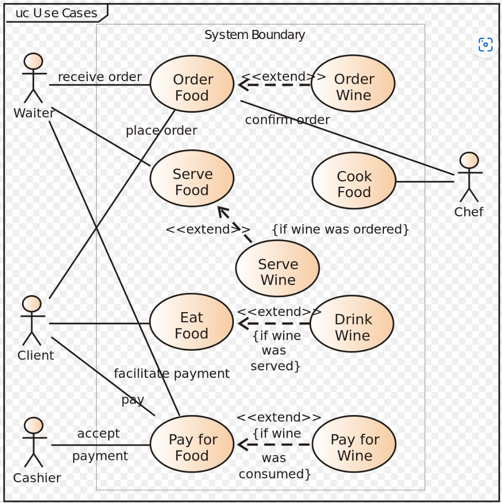

- **use case**

    一般以圆形或者是椭圆形呈现
- **actor**

    用火柴人表示，可以参与一个或多个use cases
    
    不同actor还可以合并在一起抽象成一个

### State Diagrams
只有当类非常动态的时候，才需要考虑用state diagram来帮助我们理解

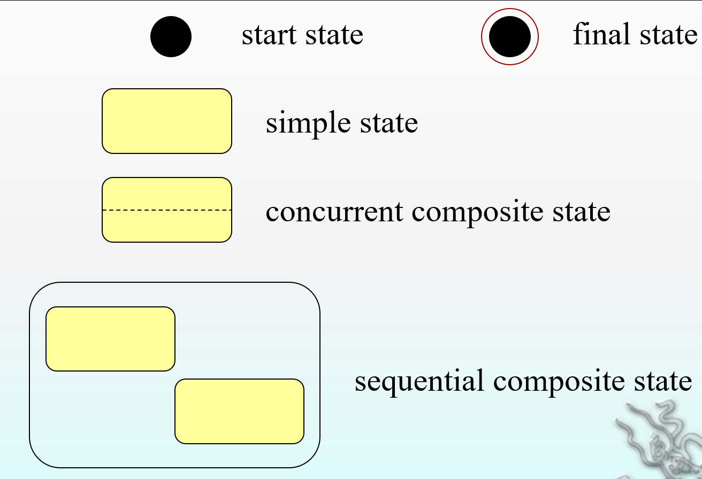

### Interaction Diagrams
总共有四种不同的分类，这里只介绍两种
#### Sequence Diagram
> A **sequence diagram** shows process interactions arranged in ==time sequence==. It depicts the processes involved and the sequence of ==messages== exchanged between the processes needed to carry out the functionality.

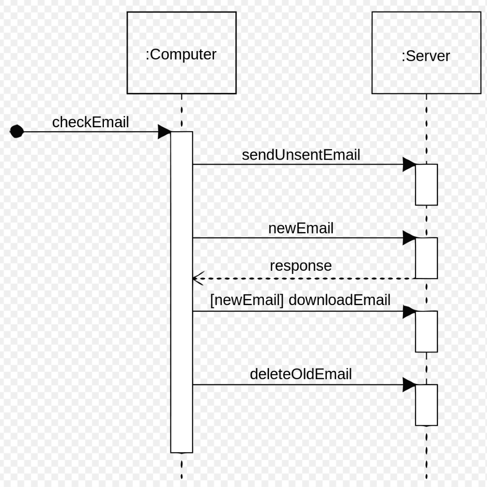

图中：
- **object lifeline**

    就是竖着的虚线
- **messages**

    显然是横着的线
    
    线上的那些方括号，代表**condition**，什么时候message会被传递
    
    假如有的线上面啥都没有，代表他是上一个message的**返回值**
    
    假如线上有一个`*`，代表着这是一个**循环**
    
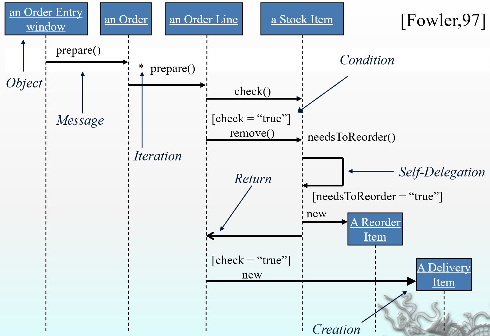

下图中没有冒号的不是object:

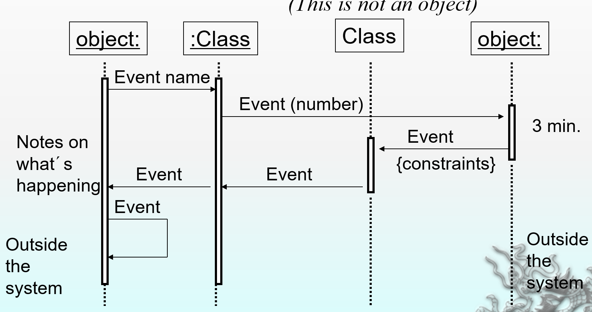

#### Collaboration Diagram
从wiki的描述可以知道，UML 1.x中叫做collaboration diagram，而UML 2.0中变成了简化版本的**communication diagram**

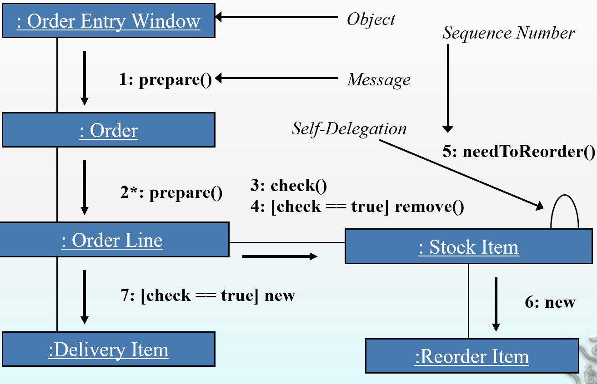

关于Object identifiers的命名格式：
> Object identifiers are of the form `objectName : className`, and either the `objectName` or the `className` ==can be omitted==, and the placement of the colon indicates either an `objectName:` , or a `:className`. 

和sequence diagram呈现的信息非常像。不同在于他是自由排版的，为了记录时间信息，就会在message前面加上==chronological number==。所以：
> Communication diagrams show which elements each one ==interacts with== better, but sequence diagrams show the order in which the interactions ==take place== more clearly

### Activity Diagram
> An activity diagram is essentially a ==flowchart==, showing the ==flow of control from activity to activity==

Whereas interaction diagrams emphasize the flow of control ==from object to object==, activity diagrams emphasize the flow of control ==from activity to activity==.

An activity is an ongoing non-atomic execution within a state machine

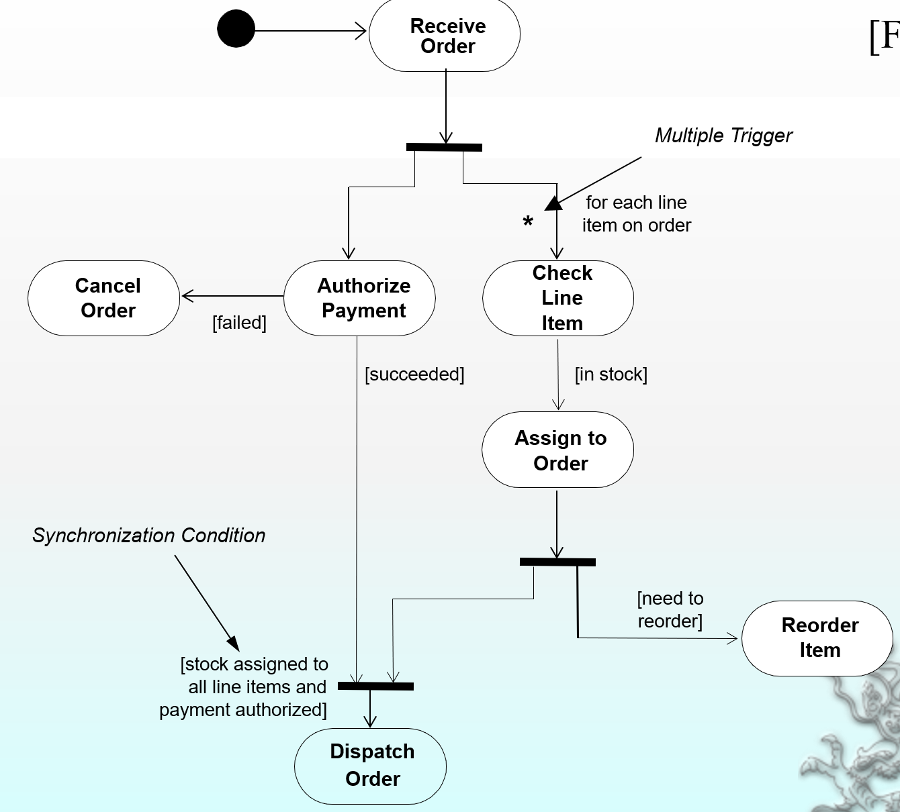

图中的标记：
- ellipses represent actions;
- diamonds represent decisions;
- bars represent the start (split) or end (join) of concurrent activities;
- a black circle represents the start (initial node) of the workflow;
- an encircled black circle represents the end (final node).

## Static Modeling
**structural** view
### Class Diagrams
有几种比较特殊的class:
- `<<interface>>`
- `<<enumeration>>`
- `<<exception>>`

#### Compartments
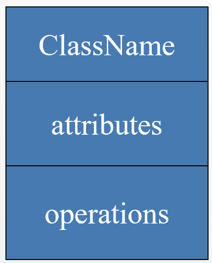

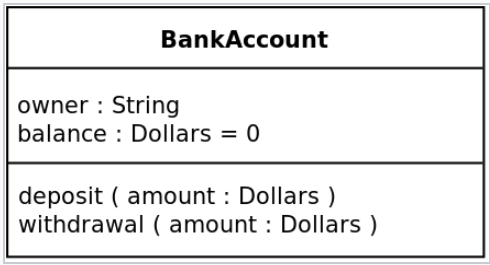

- **name of the class**

    It is printed in ==bold and centered==, and the first letter is ==capitalized==.
- **attributes**

    They are ==left-aligned== and the first letter is ==lowercase==.
- **operations**

    They are also ==left-aligned== and the first letter is ==lowercase==.

    可以声明参数类型，返回值啥的

除此之外，我们甚至可以在第四行把这个class的responsibility给写出来：

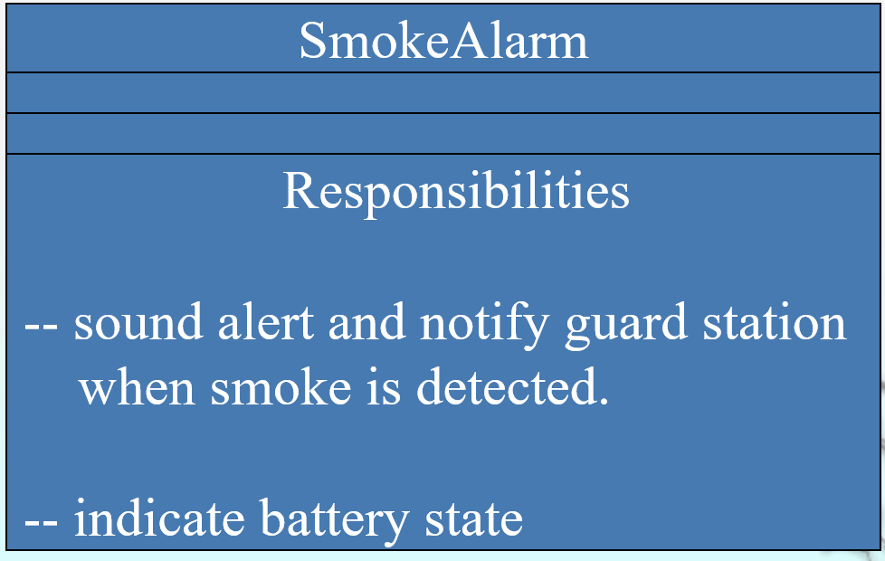
    
> 事实上并==不需要==在每张图上都把attribute和operation都写出来
    
#### Visibility
在attribute或者method前面加上这些记号：
- `+` Public
- `-` Private
- `#` Protected
- `~` Package
- `/` Derived

#### Relationships
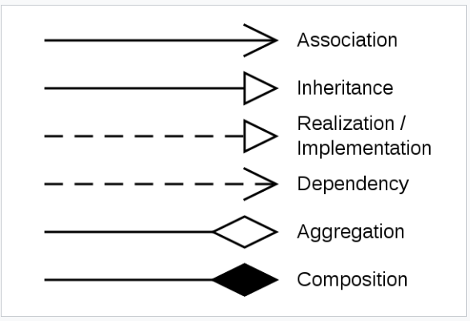

##### Dependency

e.g.

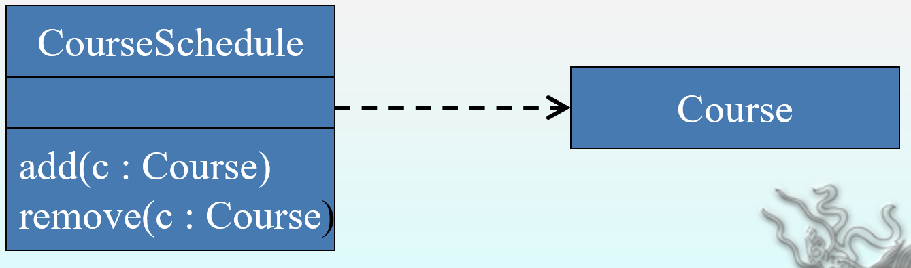

可以看到add和remove的参数都有Course类，所以CourseSchedule类是依赖于Course的
##### Generalization/Inheritance

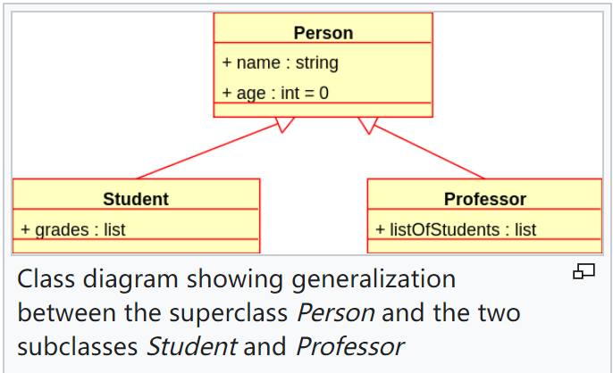

需要注意的是，UML里是==允许多继承==的

##### Realization/Implementation
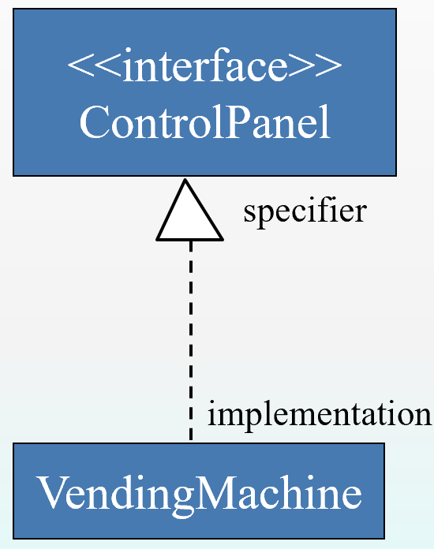

提供一个该类的抽象服务接口

虚线和空心箭头来表示

##### Associations
two classes in a model need to communicate with each other

用一根实线来代表：

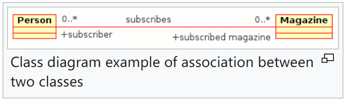

- **multiplicity**

    `0..*` 的位置也很关键：
    - 在Person一侧的那个，表示“==a== Magazine has ==0 or more== Person”
    - 在Magazine一侧的时候，表示“==a== Person has ==0 or more== Magazine”
    
    其它还有：

    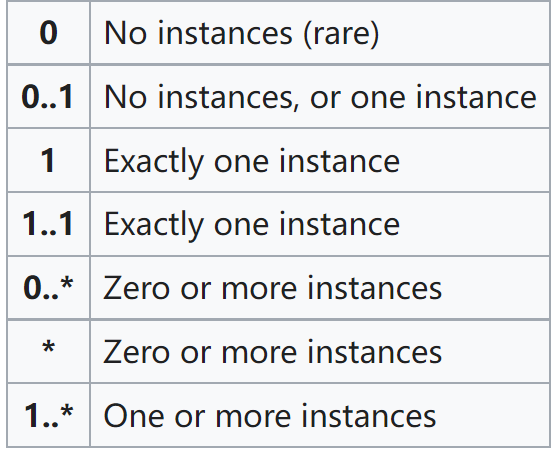
- **role names**

    `subscriber`和`subscribed magazine` 都是
- **name**

    `subscribes`

下面是一些特殊情况

- **dual associations**

    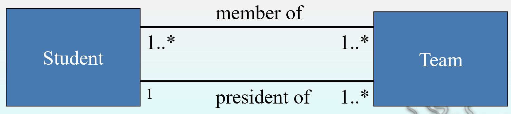
- **navigability**

    
    
    多了个箭头，代表着DNS并不知道Router的存在
- **association classes** (link classes)

    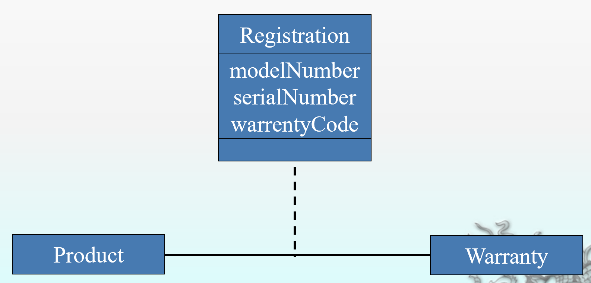
- **self association**

    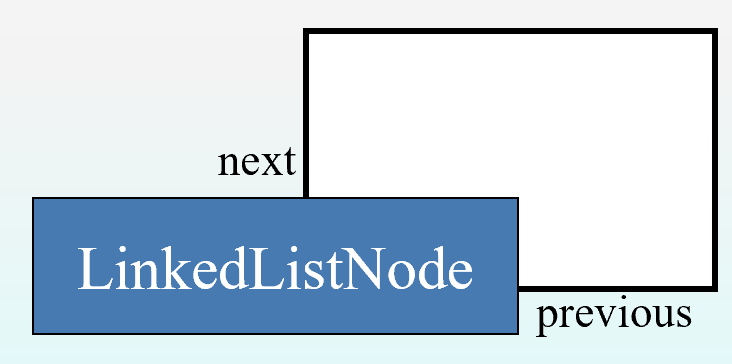

还有两种更特殊的变种：
##### Aggregation
> Aggregation is a variant of the =="has a"== association relationship

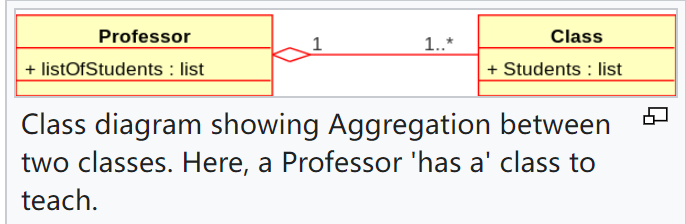

感觉就是满足==包含关系==的association（不一定就是1对多，可能是0对多啥的）

用空心的菱形来表示

##### Composition
也是一对多的关系，但是区别在于，两个class的life cycle是生命周期上紧密联系的，不可分开生存：

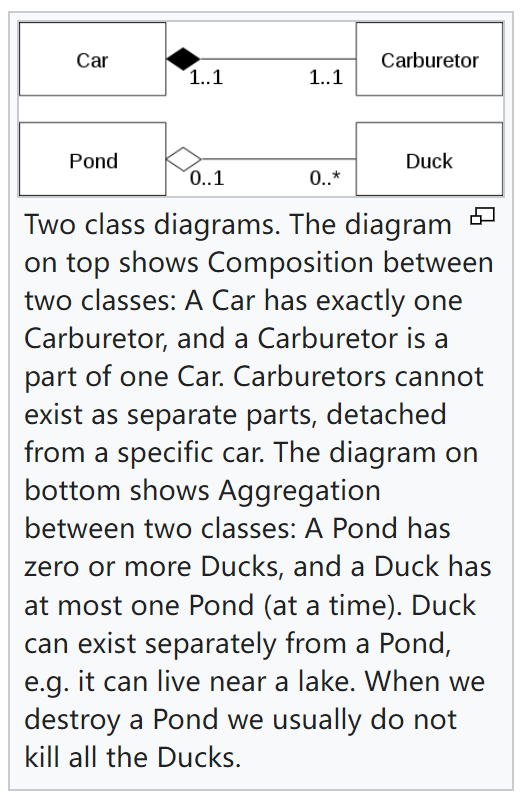

### Package Diagram
> Packages are an organization of the defined classes into groups

A package can contain classes and other packages and diagrams

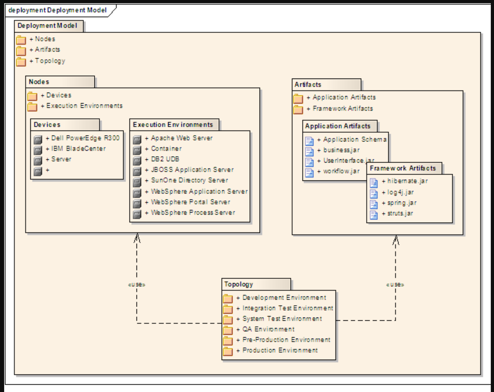

和class diagram用相同的association

### Component Diagram
> a **component diagram** depicts how components are wired together to form larger components or software systems

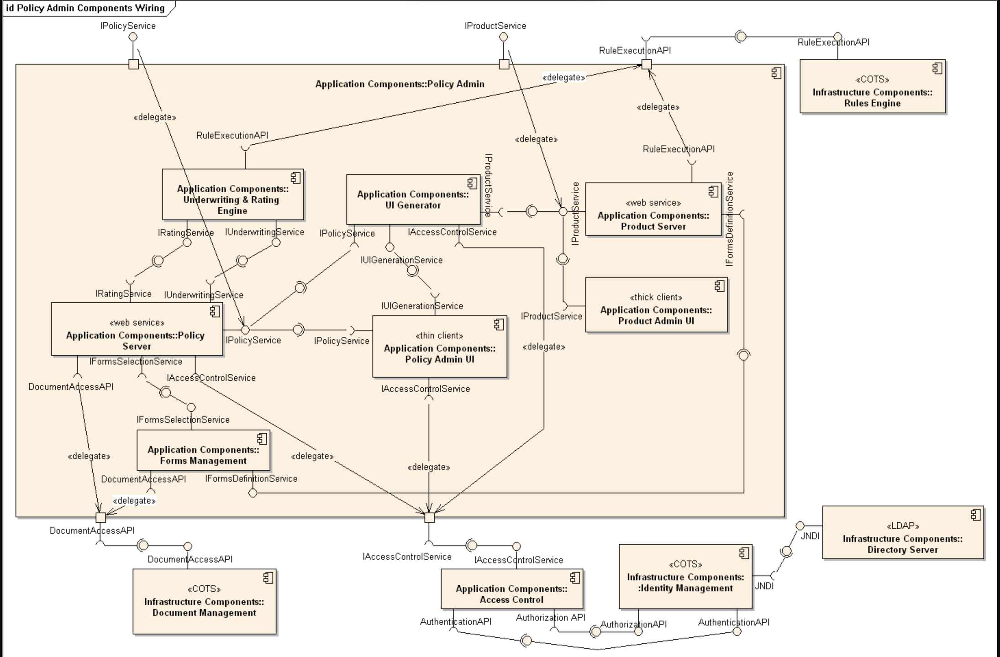

### Deployment Diagram
> A deployment diagram in the Unified Modeling Language models the **physical deployment** of artifacts on nodes.
>
> The nodes appear as boxes, and the artifacts allocated to each node appear as rectangles within the boxes

e.g.

To describe a web site, for example, a deployment diagram would show what hardware components ("nodes") exist (e.g., a web server, an application server, and a database server), what software components ("artifacts") run on each node (e.g., web application, database), and how the different pieces are connected (e.g. JDBC, REST, RMI).

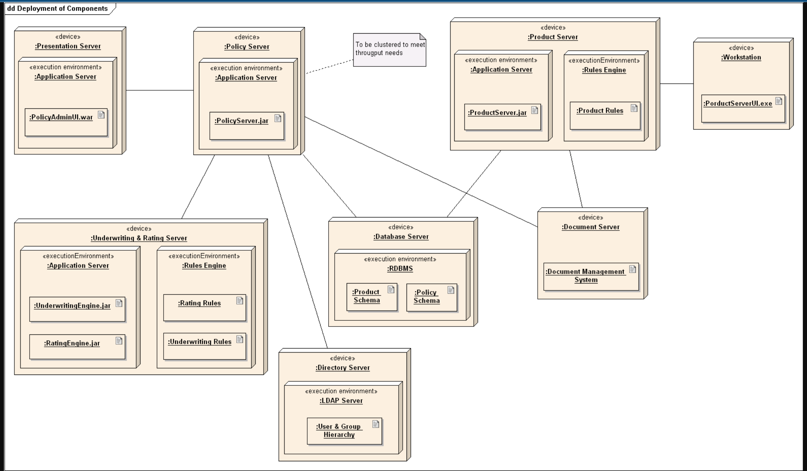

## Reference
["Unified Modeling Language - Wikipedia," .](https://en.wikipedia.org/wiki/Unified_Modeling_Language#Structure_diagrams)
