# Petri Net[^1]

有个可互动的神奇网站 ["Home | Petri Nets | Statebox," .](http://petrinet.org/)

## Petri net basics

[^1]:["Petri net - Wikipedia," .](https://en.wikipedia.org/wiki/Petri_net)

Petri net
: also known as a **place/transition (PT) net**, is one of several mathematical modeling languages for the description of ==distributed systems==.

获取需求阶段可以使用的工具

这玩意的图像表达方式是**directed bipartite graph**[^2]，包含以下元素：

[^2]:["Bipartite graph - Wikipedia," .](https://en.wikipedia.org/wiki/Bipartite_graph)

- **places**

    depicted as ==white circles==

    tokens
    : A place can contain any number of ==tokens==, depicted as ==black circles==

    marking 
    : Any distribution of tokens over the places will represent a configuration of the net called a marking

- **transitions**

    depicted as ==rectangles==

- **arc**

    Arcs run from a place to a transition or vice versa, ==never between places or between transitions==

---

> a transition of a Petri net may **fire** if it is enabled, i.e. there are sufficient tokens in all of its input places; when the transition fires, it ==consumes== the required input tokens, and ==creates== tokens in its output places

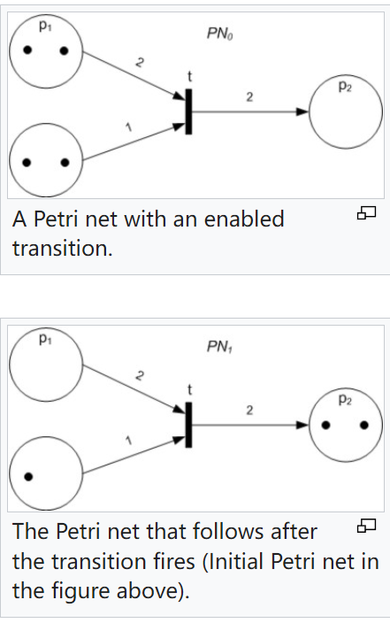

fire前后对比

A *firing* is **atomic**, i.e. a single non-interruptible step.

the execution of Petri nets is **nondeterministic**: when multiple transitions are enabled at the same time, they will fire in any order.

Since firing is nondeterministic, and multiple tokens may be present anywhere in the net (even in the same place), Petri nets are well suited for modeling the **concurrent** behavior of distributed systems.

### Conflict

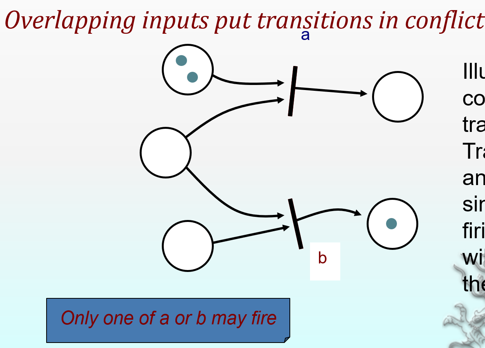

现在有个诡异的题目：

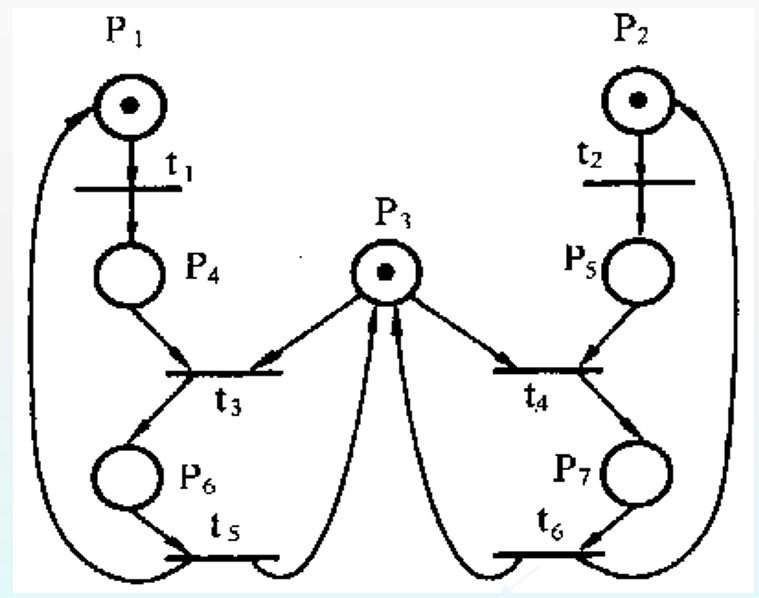

显然左右两个循环是conflict的，咋办呢？

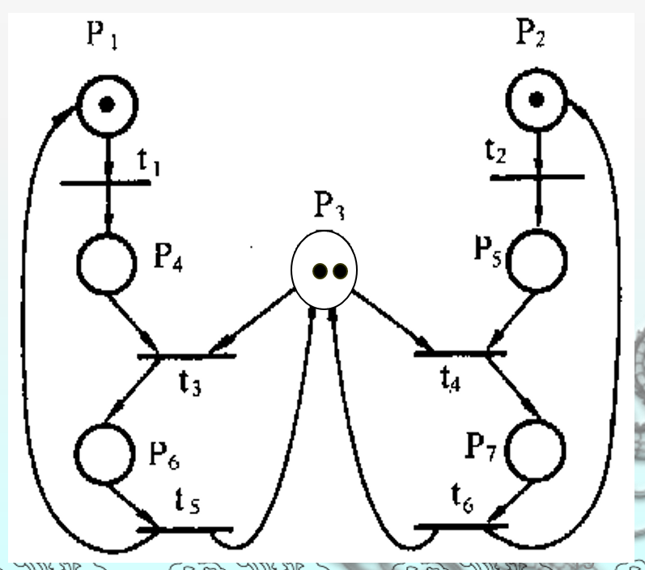

直接在中间多加一个token

然而这样子可能会有t3触发两次的奇葩情况，可以进一步改进：

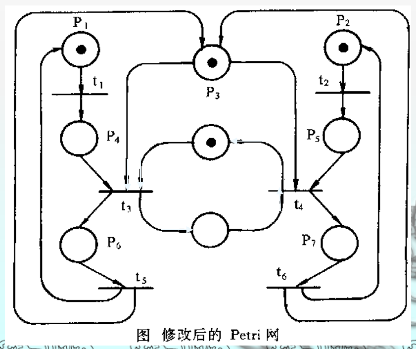

### Mutual Exclusion

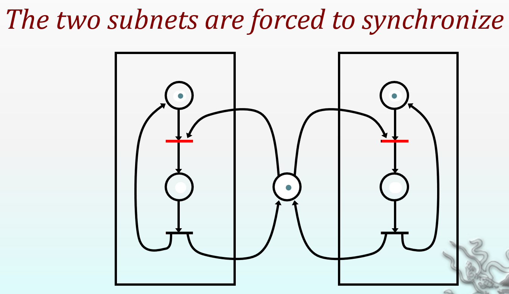

### Producer - Consumer

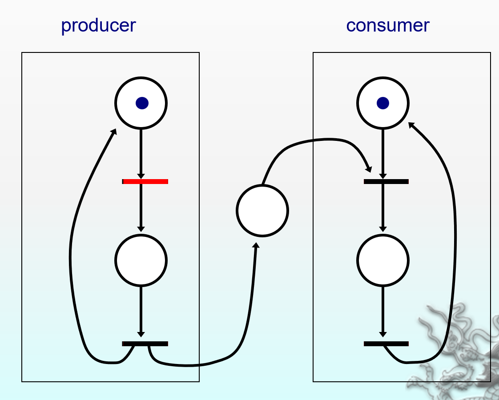

producer是1分2，而consumer是2合1

## Liveness
有两种等级：
- **deadlocked**

    it can never fire
- **live**

    it can never deadlock

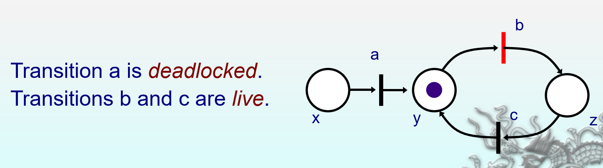

## Traffic Lights
为了避免在十字路口的两个红绿灯，同时处于绿灯的状态下，我们可以这样设置：

[http://petrinet.org/#TrafficLights](http://petrinet.org/#TrafficLights)

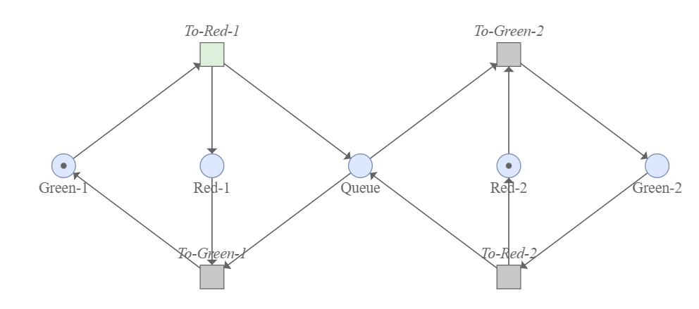

反正是用queue节点巧妙避免了

## Formal Definition

A *Petri net* $C=(P,T,I,O)$ consists of:
- a finite set $P$ of **places**
- a finite set $T$ of **transitions**
- an **input function** $I: T\rightarrow \text{Nat}^p$ (maps to bags of places)
- an **output function** $O: T\rightarrow \text{Nat}^p$

A *marking* of $C$ is a mapping $m: P\rightarrow \text{Nat}^p$ 

e.g.

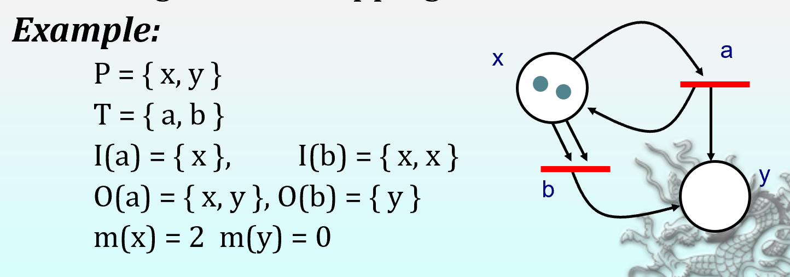

## Implementing Petri Nets

两种：

- **Centralized**

    A single “net manager” monitors the current state of the net, and fires enabled transitions

    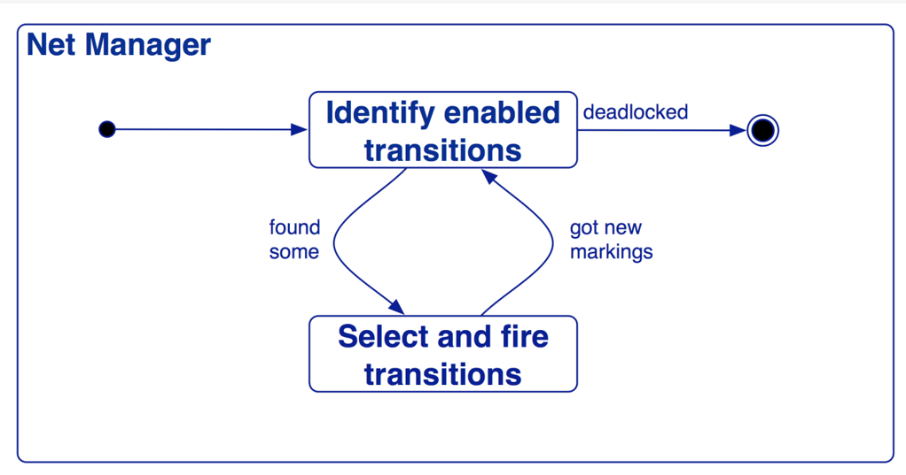

- **Decentralized**

    Transitions are processes, places are shared resources, and transitions compete to obtain tokens

    没人做监管者，比较乱的样子

