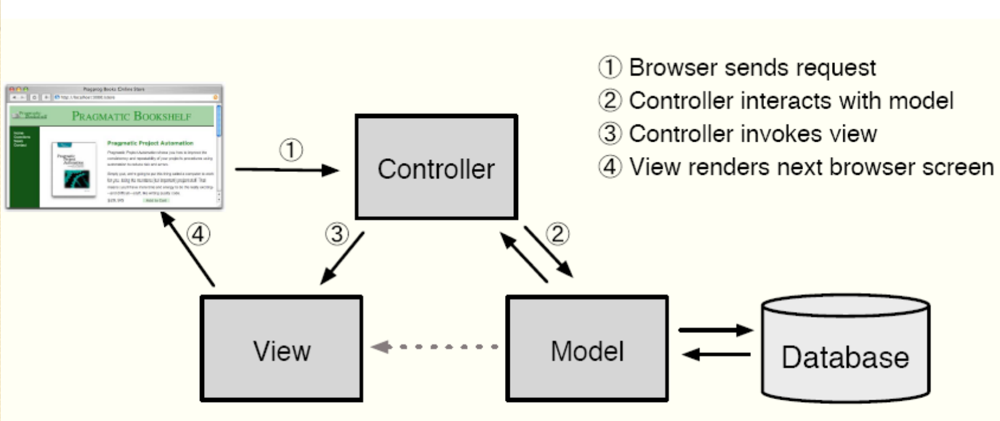

# Ruby on Rails[^1]

## 3. Creating a New Rails Project

### 3.2 Creating the Blog Application

```shell
$ rails new blog
```

自动创建的项目文件夹里面包含如下文件：

<table>
<thead>
<tr>
<th>File/Folder</th>
<th>Purpose</th>
</tr>
</thead>
<tbody>
<tr>
<td>app/</td>
<td>Contains the controllers, models, views, helpers, mailers, channels, jobs, and assets for your application. You'll focus on this folder for the remainder of this guide.</td>
</tr>
<tr>
<td>bin/</td>
<td>Contains the <code>rails</code> script that starts your app and can contain other scripts you use to set up, update, deploy, or run your application.</td>
</tr>
<tr>
<td>config/</td>
<td>Contains configuration for your application's routes, database, and more. This is covered in more detail in <a href="configuring.html">Configuring Rails Applications</a>. 包含routes.rb来设定route；database.yml来设定怎么连接数据库</td>
</tr>
<tr>
<td>config.ru</td>
<td>Rack configuration for Rack-based servers used to start the application. For more information about Rack, see the <a href="https://rack.github.io/">Rack website</a>.</td>
</tr>
<tr>
<td>db/</td>
<td>Contains your current database schema, as well as the database migrations.</td>
</tr>
<tr>
<td>Gemfile<br>Gemfile.lock</td>
<td>These files allow you to specify what gem dependencies are needed for your Rails application. These files are used by the Bundler gem. For more information about Bundler, see the <a href="https://bundler.io">Bundler website</a>.</td>
</tr>
<tr>
<td>lib/</td>
<td>Extended modules for your application.</td>
</tr>
<tr>
<td>log/</td>
<td>Application log files.</td>
</tr>
<tr>
<td>public/</td>
<td>Contains static files and compiled assets. When your app is running, this directory will be exposed as-is.</td>
</tr>
<tr>
<td>Rakefile</td>
<td>This file locates and loads tasks that can be run from the command line. The task definitions are defined throughout the components of Rails. Rather than changing <code>Rakefile</code>, you should add your own tasks by adding files to the <code>lib/tasks</code> directory of your application.</td>
</tr>
<tr>
<td>README.md</td>
<td>This is a brief instruction manual for your application. You should edit this file to tell others what your application does, how to set it up, and so on.</td>
</tr>
<tr>
<td>storage/</td>
<td>Active Storage files for Disk Service. This is covered in <a href="active_storage_overview.html">Active Storage Overview</a>.</td>
</tr>
<tr>
<td>test/</td>
<td>Unit tests, fixtures, and other test apparatus. These are covered in <a href="testing.html">Testing Rails Applications</a>.</td>
</tr>
<tr>
<td>tmp/</td>
<td>Temporary files (like cache and pid files).</td>
</tr>
<tr>
<td>vendor/</td>
<td>A place for all third-party code. In a typical Rails application this includes vendored gems.</td>
</tr>
<tr>
<td>.gitattributes</td>
<td>This file defines metadata for specific paths in a git repository. This metadata can be used by git and other tools to enhance their behavior. See the <a href="https://git-scm.com/docs/gitattributes">gitattributes documentation</a> for more information.</td>
</tr>
<tr>
<td>.gitignore</td>
<td>This file tells git which files (or patterns) it should ignore. See <a href="https://help.github.com/articles/ignoring-files">GitHub - Ignoring files</a> for more information about ignoring files.</td>
</tr>
<tr>
<td>.ruby-version</td>
<td>This file contains the default Ruby version.</td>
</tr>
</tbody>
</table>

看看就得了

## 4. Hello, Rails!

### 4.1 Starting up the Web Server

```shell
$ ruby bin/rails server
```

!!! note
    默认的端口是3000，假如占用了的话要添加`-p 8089`之类的参数修改

!!! note
    其实所有指令都是可以用`rails`直接代替掉`ruby bin/rails`的，只不过一个是调用了全局的rails，一个是调用了项目自己的rails，似乎是后者更合理？

### 4.2 Say "Hello", Rails

为了至少实现hello world，我们至少需要包含以下的东西：

- **route**

    > maps a request to a *controller* action

    routes are rules written in a Ruby **DSL (Domain-Specific Language)**[^2]

[^2]:[Domain-specific language - Wikipedia..](https://en.wikipedia.org/wiki/Domain-specific_language)
- **controller**

    > A **controller** with an *action* performs the necessary work to handle the request, and prepares any data for the view

    controllers are Ruby ==classes==, and their public methods are *actions*

- **view**

    > display data in the desired format

    views are templates, usually written in a mixture of HTML and Ruby

---

先来添加一个route，在`config/routes.rb`的头部添加代码：
```ruby{.line-numbers,highlight=[2]}
Rails.application.routes.draw do
  get "/articles", to: "articles#index"

end
```

这句话的意思是，所有的`GET /articles`请求都会被映射到`ArticlesController`里面`index`这个action

---

那controller在哪呢？我们可用controller generator的语法 (怎么这都有偷懒的语法啊？？？)：

```bash
$ bin/rails generate controller Articles index --skip-routes
```

!!! note
    有 `--skip-routes` 的选项是因为，我们已经有一个合适route存在了

其实生成了很多文件，我们其中最关心的是controller file，在`app/controllers/articles_controller.rb`：

```ruby{.line-numbers}
class ArticlesController < ApplicationController
  def index
  end
end
```

可以看到，文件里包含了一个叫 `index` 的action，然而这个函数里面是空的

> When an action does not explicitly render a view (or otherwise trigger an HTTP response), Rails will ==automatically render a view== that matches the name of the controller and action

根据controller和action的名字，会自动对应到`app/views`底下的`app/views/articles/index.html.erb`这个view

---

修改上面这个view文件，就可以改变前端了，比如说改成：

```html{.line-numbers}
<h1>Hello, Rails!</h1>
```

### 4.3 Setting the Application Home Page

到目前为止，其实修改前端的东西，是不会显示在屏幕上的

我们需要在`config/routes.rb`里添加点东西：
```ruby{.line-numbers,highlight=[2]}
Rails.application.routes.draw do
  root "articles#index"

  get "/articles", to: "articles#index"
end
```

这句话的意思是：
> add a route that maps the *root path* of our application to the appropriate controller and action

听起来有点像是挂载到了根节点上去

## 5. Autoloading

你可能发现了，虽然说`ArticlesController`继承自`ApplicationController`，但是代码里并没有类似：

```ruby{.line-numbers}
require "application_controller" # DON'T DO THIS.
```
这样的导入的代码

> Application classes and modules are ==available everywhere==, you do not need and **should not** load anything under `app` with `require`. 

这就是autoloading

只有两种情况下需要显式地调用`require`:
- To load files under the `lib` directory.
- To load gem dependencies that have `require: false` in the `Gemfile`.

## 6. MVC and You

Model-View-Controller (MVC)[^3]
: Model–view–controller (MVC) is a software architectural pattern commonly used for developing user interfaces that divide the related program logic into three interconnected elements.



鉴于我们之前的工作已经有controller、view了，现在就差一个model了

---

其实是可以通过scaffold来生成MVC这些核心资源的:
```bash
$ rails generate scaffold Post name:string title:string content:text
```

### 6.1 Generating a Model

model
: A **model** is a Ruby class that is used to represent data

Active Record
: models can interact with the application's database through a feature of Rails called **Active Record**

model也是有generator的 (之前是controller有generator):
```bash
$ bin/rails generate model Article title:string body:text
```

!!! note
    model的名字都是==单数==。想象一下你想要写的语句，是`Article.new()`而不是`Articles.new()`

同样会产生很多文件，而我们最关心的是：
- migration file

    `db/migrate/<timestamp>_create_articles.rb`
- model file

    `app/models/article.rb`

### 6.2 Database Migrations

Migration
: **Migrations** are used to ==alter the structure== of an application's database

migration file的内容如下：

```ruby{.line-numbers}
class CreateArticles < ActiveRecord::Migration[7.0]
  def change
    create_table :articles do |t|
      t.string :title
      t.text :body

      t.timestamps
    end
  end
end
```

!!! note
    `:` 开头的东西是symbol，Ruby的特殊类型，别忘了


调用`create_table`用来描述`articles`这个table应该怎么构建

> By default, the `create_table` method ==adds an `id` column== as an auto-incrementing primary key

`create_table`这个block里面，定义了两个column: `title`和`body`。因为我们之前的generator的指令里有提到这俩

最后一行调用了`t.timestamps`。这个方法会创建两个column: `created_at`和`updated_at`

---

跑一下migration：
```bash
$ bin/rails db:migrate
```

这样一来就会创建出table，输出如下：
```
==  CreateArticles: migrating ===================================
-- create_table(:articles)
   -> 0.0018s
==  CreateArticles: migrated (0.0018s) ==========================
```

---

另，假如想要创建一个空的数据库的话：

```bash
$ rake db:create
```

### 6.3 Using a Model to Interact with the Database

为了互动式地使用model，我们可以用Ruby一个叫做**console**地功能。

*console* 是一个类似`irb`的交互环境，但是它会自动加载Rails和我们的应用代码

如下启动 *console*:

```bash
$ bin/rails console
```

这样一来就会看到如下界面：

```
Loading development environment (Rails 7.0.0)
irb(main):001:0>
```

我们可以在这里新建一个`Article`对象：

```ruby{.line-numbers}
irb> article = Article.new(title: "Hello Rails", body: "I am on Rails!")
```

!!! note
    虽然我们在和数据库打交道，但是操作的却是对象。这归功于 Active Record Pattern 的设计模式：每个table row/colum看作是object，那么table就是collection of objects

需要注意的是，此时我们只是初始化了这个对象，==我们还没有把它加到数据库里！==。为了存入数据库，可以调用`save`函数：

```ruby{.line-numbers}
irb> article.save
```

此时再来看看`article`对象的话：

```bash
irb> article
=> #<Article id: 1, title: "Hello Rails", body: "I am on Rails!", created_at: "2020-01-18 23:47:30", updated_at: "2020-01-18 23:47:30">
```

可以看到Rails自动生成了`id`, `created_at`和`updated_at`三个column

---

假如我们想要fetch个article的话，可以用`find`方法（参数为`id`）：
```bash
irb> Article.find(1)
=> #<Article id: 1, title: "Hello Rails", body: "I am on Rails!", created_at: "2020-01-18 23:47:30", updated_at: "2020-01-18 23:47:30">
```

---

假如要返回全部的article的话，就需要`all`方法：

```bash
irb> Article.all
=> #<ActiveRecord::Relation [#<Article id: 1, title: "Hello Rails", body: "I am on Rails!", created_at: "2020-01-18 23:47:30", updated_at: "2020-01-18 23:47:30">]>
```

这个方法会返回`ActiveRecord::Relation`对象，可以想象成一个超级强大的array

### 6.4 Showing a List of Articles

MVC都介绍完了，我们现在来把所有串起来

回到controller的文件`app/controllers/articles_controller.rb`，修改`index`操作，以让它从数据库里fetch所有的article:

```ruby{.line-numbers}
class ArticlesController < ApplicationController
  def index
    @articles = Article.all
  end
end
```

==controller对象的数据成员可以被view访问到== (说好的默认private呢)，也就是说，我们可以在`app/views/articles/index.html.erb`里直接引用`@articles`数据成员：
```html{.line-numbers}
<h1>Articles</h1>

<ul>
  <% @articles.each do |article| %>
    <li>
      <%= article.title %>
    </li>
  <% end %>
</ul>
```

可以看到，上面的语法是HTML和*ERB*的混合

ERB
: a ==templating system== that evaluates Ruby code embedded in a document

甚至可以说和vue的做法有点像

代码里展示了两种ERB里的tag:
- `<% %>`

    "evaluate the enclosed Ruby code"
- `<%= %>`

    "evaluate the enclosed Ruby code, and ==output the value it returns=="

虽然说可以写任何Ruby表达式，但还是尽量简洁为好

---

让我们来理一下，当我们访问localhost的端口的时候，都发生了什么事情：

- The browser makes a request: `GET http://localhost:3000`
- Our Rails application receives this request
- The Rails router maps the root route to the `index` action of `ArticlesController`
- The `index` action uses the `Article` model to fetch all articles in the database
- Rails automatically renders the `app/views/articles/index.html.erb` view
- The ERB code in the view is evaluated to output HTML
- The server sends a response containing the HTML back to the browser

## 7. CRUDit Where CRUDit Is Due

CRUD
: Create, Read, Update, Delete

最无聊的增删改查


[^3]:[Model–view–controller - Wikipedia..](https://en.wikipedia.org/wiki/Model%E2%80%93view%E2%80%93controller)

[^1]:["Getting Started with Rails — Ruby on Rails Guides," .](https://guides.rubyonrails.org/getting_started.html)