# Requirements Engineering

!!! note
    从这章开始，可以在"*Software Engineering, 9th Edition*" 这本书中找到对应内容

需要明确区分开两种不同等级的requirements，不然很混乱：
- **user requirements**

    > high-level abstract requirements

- **system requirements**

    > detailed description of what the system should do

e.g.

mental health care patient management system (MHC-PMS)

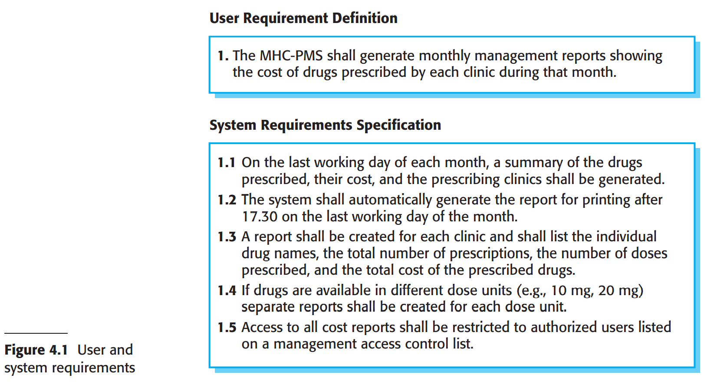

不同level的描述适合给不同的人看，上图中一个user requirement就展开成了几个system requirements

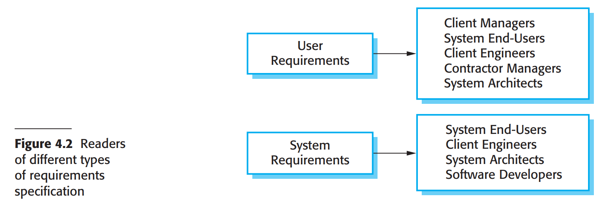

## 1. Functional and non-functional requirements

Software system requirements are often classified as **functional requirements** or **nonfunctional requirements**:

- Functional requirements

    : These are statements of ==services== the system should provide, how the system should react to particular inputs, and how the system should behave in particular situations. 
    
    In some cases, the *functional requirements* may also explicitly state what the system should not do.

- Non-functional requirements

    : These are ==constraints== on the services or functions offered by the system. They include timing constraints, constraints on the development process, and constraints imposed by standards. 
    
    *Non-functional requirements* often apply to the system ==as a whole==, rather than individual system features or services.

现实当中的需求可能并没法这么简单地划分开来，一个需求也可能产生其他的需求

### 1.1 Functional requirements

插入一个奇怪的另外的概念：

Domain requirements
: Domain requirements are derived from the application domain of the system rather than from the specific needs of system users. They may be new functional requirements in their own right, constrain existing functional requirements, or set out how particular computations must be carried out.

---

回到正题

> The *functional requirements* for a system describe ==what the system should do==

还是拿之前的mental health care patient management system (MHC-PMS)做例子，看看这玩意的functional requirements有啥：
- A user shall be able to search the appointments lists for all clinics.
- The system shall generate each day, for each clinic, a list of patients who are expected to attend appointments that day.
- Each staff member using the system shall be uniquely identified by his or her eight-digit employee number.

---

In principle, the functional requirements specification of a system should be both **complete** and **consistent**:
- completeness

    : all services required by the user should be defined.
- consistency

    : requirements should not have contradictory definitions

### 1.2 Non-functional requirements

> requirements that are ==not directly concerned with the specific services== delivered by the system to its users

e.g.

> They may relate to emergent system properties such as reliability, response time, and store occupancy

---

non-functional requirements经常会比functional requirements更加重要：

>  System users can usually find ways to work around a system function that doesn’t really meet their needs. However, failing to meet a non-functional requirement can mean that the whole system is ==unusable==

e.g.

> if an aircraft system does not meet its reliability requirements, it will not be certified as safe for operation

---

随便看一眼types of non-functional requirement:

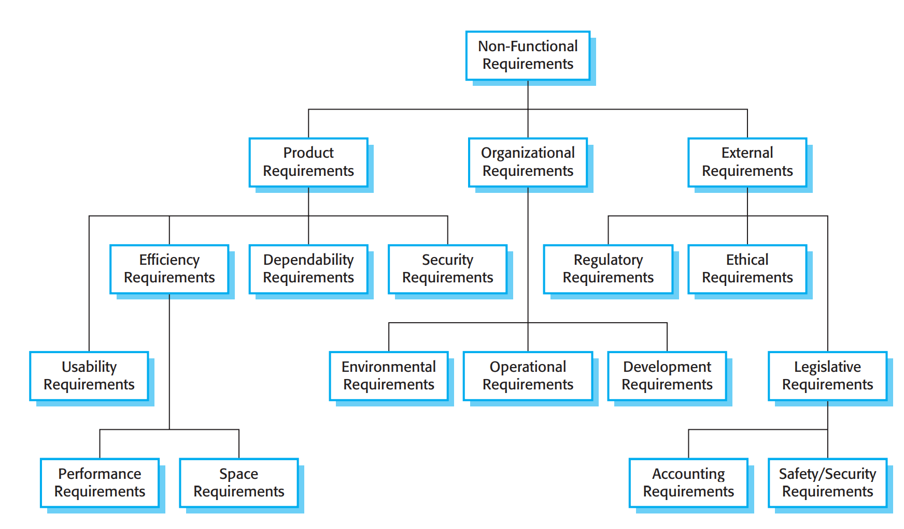

---

> Whenever possible, you should write non-functional requirements ==quantitatively== so that they can be objectively tested

e.g.

原本需求是这么描述的：

> The system should be easy to use by medical staff and should be organized in such a way that user errors are minimized.

把这句话加上量化的限制之后，我们才方便测试：

> Medical staff shall be able to use all the system functions after *four* hours of training. After this training, the average number of errors made by experienced users shall not exceed *two* per hour of system use.

书上还给了个翻译成量化需求的表格：

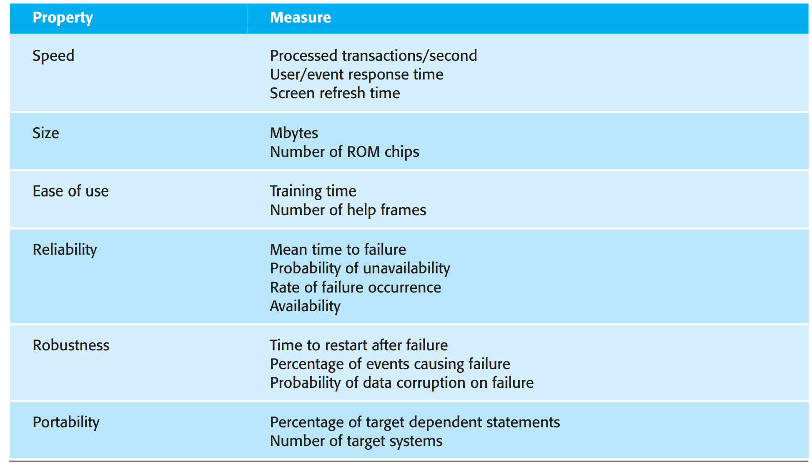

## 2. The software requirements document

software requirements document
: (sometimes called the **software requirements specification** or **SRS**) is an official statement of what the system developers should implement.

用户需求文档可能会有以下用户：

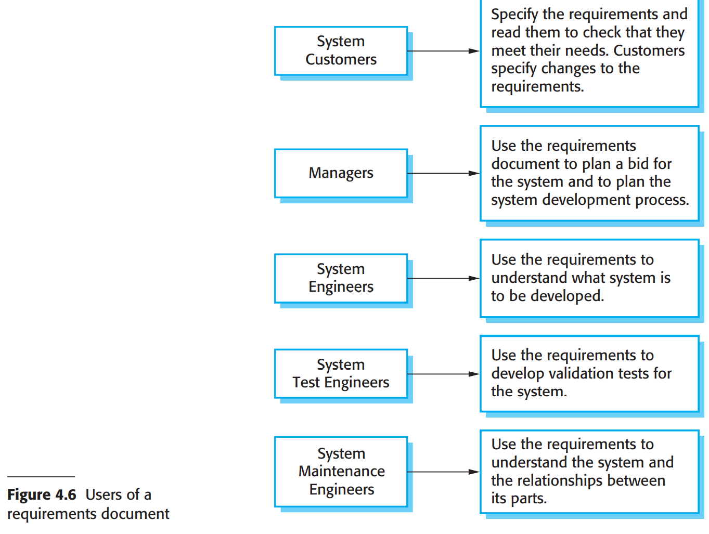

至于说这玩意里面到底是个什么结构，IEEE给出了一个标准：

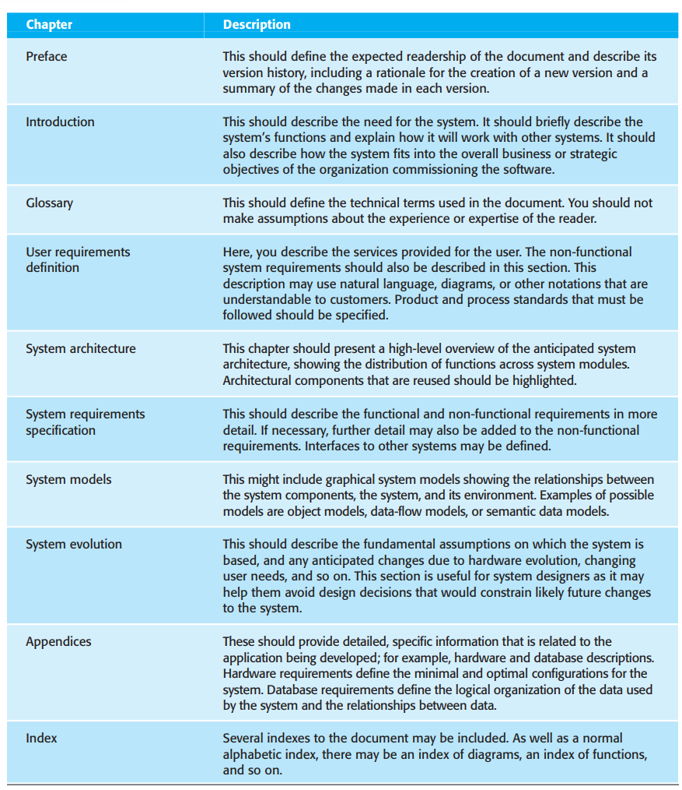

## 3. Requirements specification

> **Requirements specification** is the process of writing down the user and system requirements in a requirements document

我们当然希望这些需求都是 clear, unambiguous, easy to understand, complete, and consistent，然而甲方和你的理解显然很可能不一样

我们希望找到个适合的语言，来让双方都能理解，以下是可能用的语言：

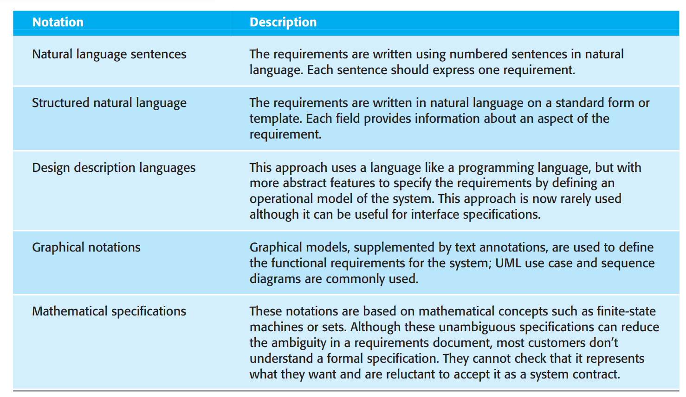

### 3.1 Natural language specification

自软件工程诞生的那一天起，就一直在用

- **Advantages**

    expressive, intuitive, and universal
- **Disadvantages**

    potentially vague, ambiguous, and its meaning depends on the background of the reader

虽然有很多提议来取代这玩意，但是没有一个能完美取代。

为了减少使用自然语言带来的误解，最好遵循这些guidelines: 
- Invent a standard format
- Use language consistently
- Use text highlighting to pick out key parts of the requirement
- Avoid, as far as possible, the use of computer jargon

### 3.2 Structured specification

> **Structured natural language** is a way of writing system requirements where the freedom of the requirements writer is limited and all requirements are written in a standard way

**Advantages**:
- Maintains most of the expressiveness and understandability of natural language
- Ensures some degree of uniformity is imposed on the specification

structured specification of a requirement的例子如下，描述胰岛素泵的工作：

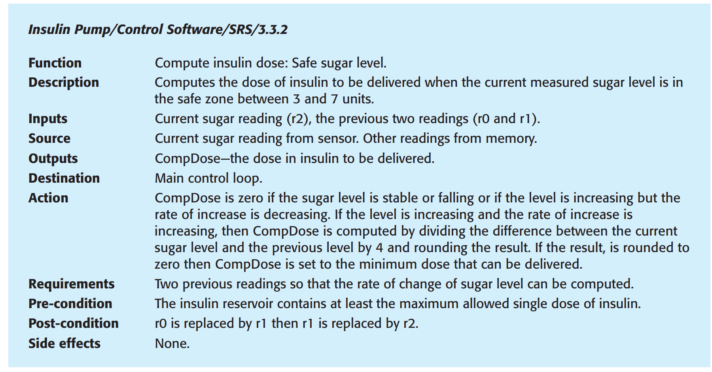

太多字了，大概知道这个结构就行

虽然说上图中已经比自然语言结构化很多了，但是有时候要描述复杂计算的时候，就显得还是有点乏力。这时候可以利用表格来辅助我们：

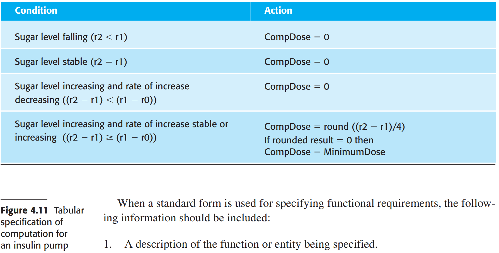

!!! note
    接下来的内容来自于 "*software engineering theory and practice*" 这本书，所以编号也会改变

## 4.5 Modeling Notations

需求建模会用到许许多多不同的图

### 4.5.1 Entity-Relationship Diagrams

数据库的时候讲过

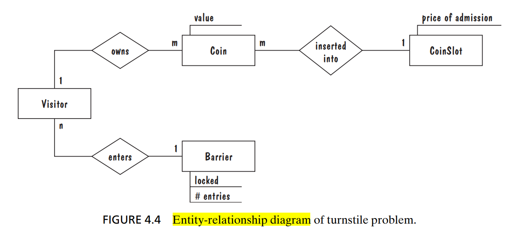

包含了三种不同的元素：
- entity

    : a rectangle, represents a collection of real-world objects that have common properties and behaviors

    方形
- relationship

    : an edge between two entities, with diamond in the middle of the edge specifying the type of relationship

    边
- attribute

    : an annotation on an entity that describes data or properties associated with the entity

### 4.5.2 Event Traces

ER 图描绘的是 structural 的静态行为，为了描述 behavioral requirements，我们可以用：

event trace
: is a graphical description of a sequence of events that are exchanged between real-world entities

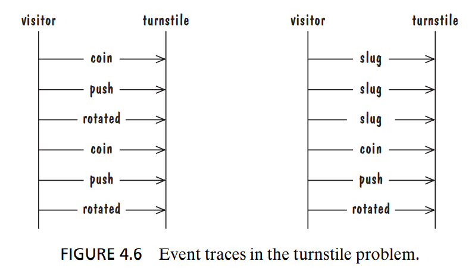

垂直线是 timeline，水平线是 event or interaction

左图是 typical behavior，右图是 exceptional behavior (有人试图输入一些不合法的东西的时候的表现)

### 4.5.2.1 Message Sequence Chart

Message sequence chart
: is an enhanced event-trace notation, with facilities for creating and destroying entities, specifying actions and timers, and composing traces

event trace 的增强版本

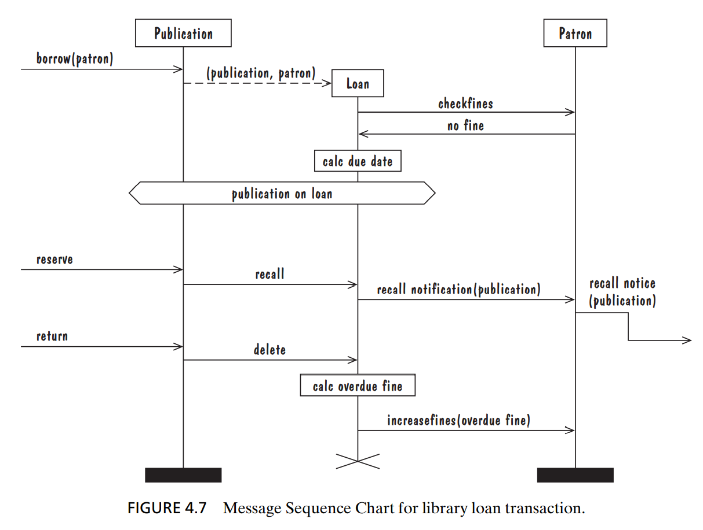

- Vertical line

    : represents a participating entity
- Message

    : depicted as an arrow from the sending entity to the receiving entity
- Actions

    : are specified as labeled rectangles positioned on an entity's execution line
- Conditions

    : are important states in an entity's evolution, represented as labeled hexagon

### 4.5.5 Petri Nets

详见 [Ch4](ch4-petri-net.md)

### 4.5.8 Functions and Relations

Formal methods / approach
: mathematically based specification and design techniques

> Formal methods model requirements or software behavior as a collection of mathematical functions or relations
> - Functions specify the state of the system's execution, and output
> - A relation is used whenever an input value maps more than one output value

e.g.

representing turnstile problem using two functions

- One function to keep track of the state
- One function to specify the turnstile output

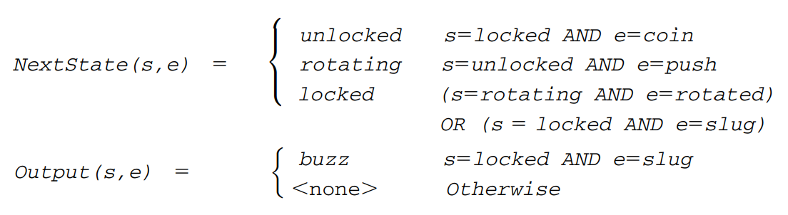

#### 4.5.8.1 Decision Tables

decision table
: It is a tabular representation of a functional specification that maps events and conditions to appropriate responses or actions

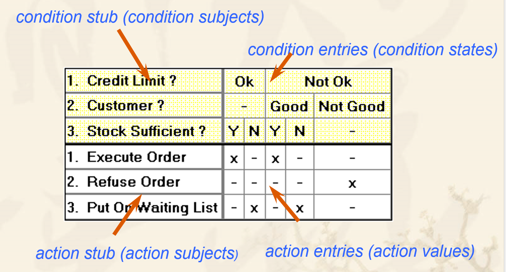

说白了就是啥条件下应该干什么，有 $n$ 个条件的话就有 $2^n$ 种不同的情况。结果相同的情况可以合并到一个列里

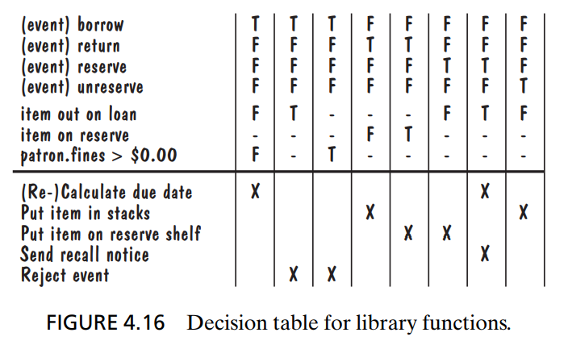

#### 4.5.8.2 Parnas Table

和 decision table 类似，但是这里用的都是数学表达式

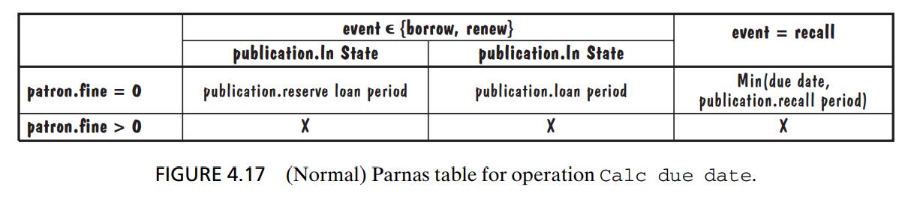

### 4.5.9 Logic

相比于前面的方法，这个纯用表达式

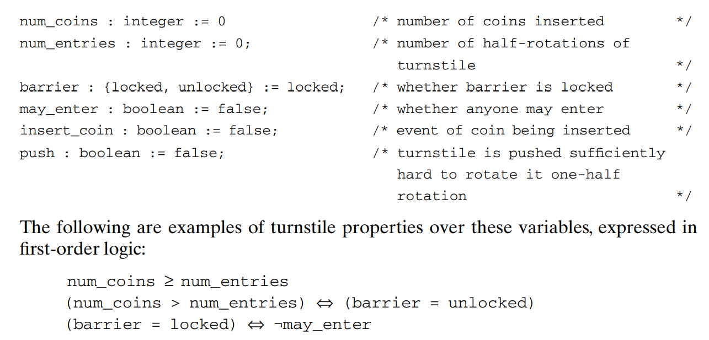
