!!! note
    对应于书本Ch6

根据introduction里面的步骤，design是requirement之后的步骤，也就是第二步

这一步的最终输出是**software architecture model**

---

可以使用block diagram来展示：

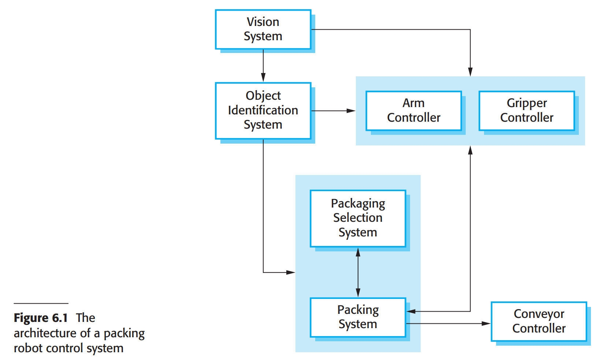

## 6.3 Architectural Patterns

> You can think of an architectural pattern as a stylized, abstract description of ==good practice==, which has been tried and tested in different systems and environments

下面介绍一些经典的pattern

### 6.3.1 Layered

体现了separation and independence的思想

Layered Architecture
: Organizes the system into ==layers== with related functionality associated with each layer. A layer ==provides services== to the layer above it so the lowest-level layers represent core services that are likely to be used throughout the system

计网提过的OSI model就是

e.g.

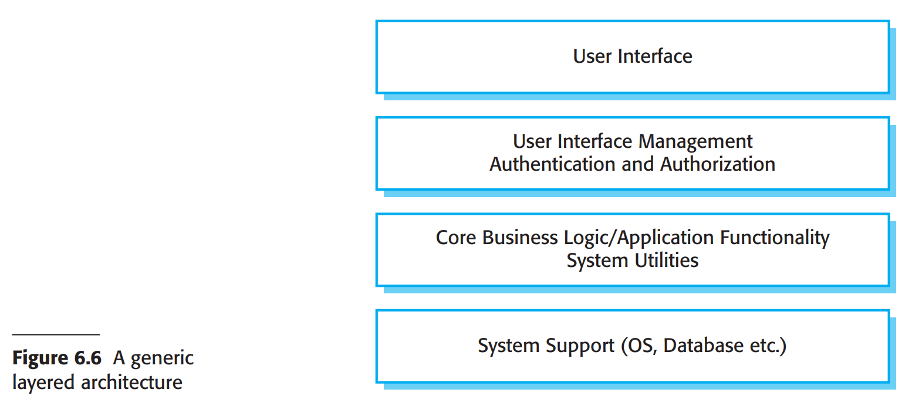

- **Advantages**

    - High levels of abstraction
    
    - Relatively easy to add and modify a layer

- **Disadvantages**

    - Not always easy to structure system layers
    
    - System performance may suffer from the extra coordination among layers 

使用场景：
- when building new facilities on top of existing systems
- when the development is spread across several teams with each team responsibility for a layer of functionality
- when there is a requirement for multi-level security.

### 6.3.2 Repository

Repository Architecture
: All data in a system is managed in a ==central repository== that is accessible to all system components. Components do not interact directly, ==only through the repository==.

e.g.

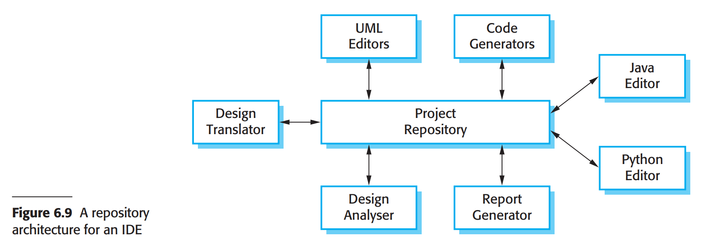

- **Advantages**

    - Data representation is made available to various programmers (vendors) so they can build tools to access the repository
- **Disadvantages**

    - the data format must be acceptable to all components

使用场景：
- You should use this pattern when you have a system in which large volumes of information are generated that has to be stored for a long time. 
- You may also use it in data-driven systems where the inclusion of data in the repository triggers an action or tool.

### 6.3.3 Client-Server

repository pattern描述的是static structure。接下来讲一个run-time organization

Client-Server Architecture
: the functionality of the system is organized into ==services==, with each service delivered from a separate ==server==. ==Clients== are users of these services and access servers to make use of them

e.g.

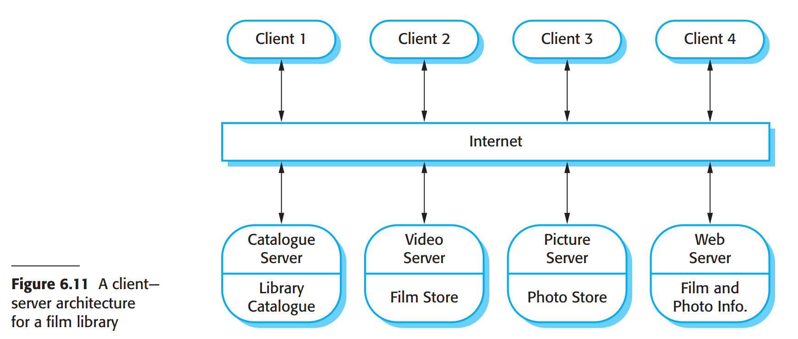

### 6.3.4 Pipe and Filter

也是一种run-time organization

Pipe and Filter Architecture
: The processing of the data in a system is organized so that each processing component (==filter==) is discrete and carries out one type of data transformation. The data flows (as in a ==pipe==) from one component to another for processing.

说人话比较像Bash的pipeline语法

- **Advantages**

    - The designer can understand the entire system's effect ==on input and output== as the composition of the filters
    - The filters can be ==reused== easily on other systems
    - System evolution is simple
    - Allow ==concurrent== execution of filters
- **Disadvantages**

    - Not good for handling interactive application

e.g.

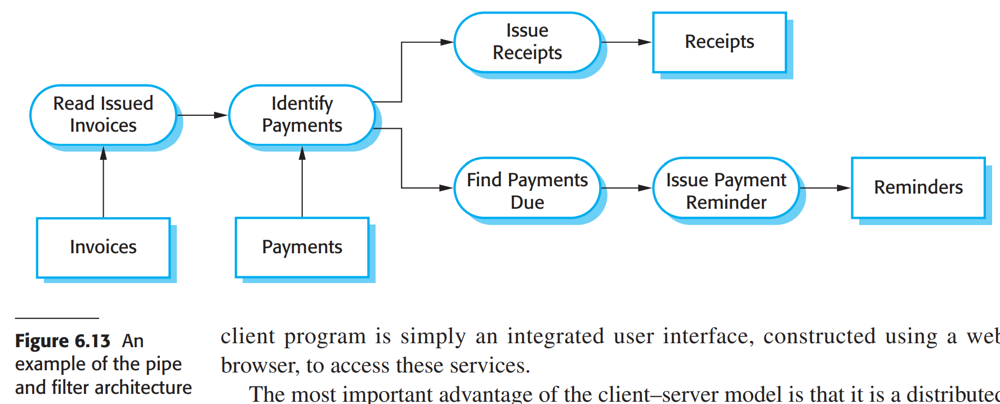

### 18.3.5 Peer-to-Peer

没错，这个方法出现在Ch18

P2P (Peer-to-Peer) Architecture
: Each component acts as its own process and acts as ==both a client and a server== to other peer components. Any component can initiate a request to any other peer component.

e.g.

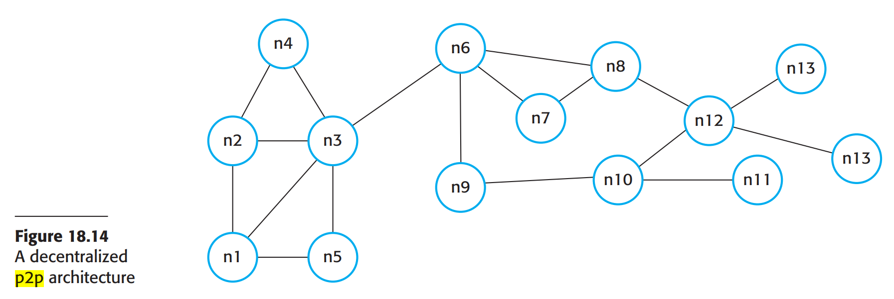

- **Advantages**

    - Scale up well
    - Increased system capabilities
    - Highly tolerant of failures

### 6.3.? Publish-Subscribe

书上没有

Components interact by ==broadcasting== and ==reacting== to events
- Component expresses interest in an event by ==subscribing== to it
- When another component announces (publishes) that event has ==taken place==, subscribing components are ==notified==

有点RSS的意思

## 6.? Control

在书上只出现在了P181顶上的拓展阅读里

There are specific architectural patterns that reflect commonly used ways of organizing control in a system:
### 6.?.1 Centralized Control

> One sub-system is designated as the system controller and has responsibility for managing the execution of other sub-systems

e.g.
- **call-return model**

    top-down subroutine model

    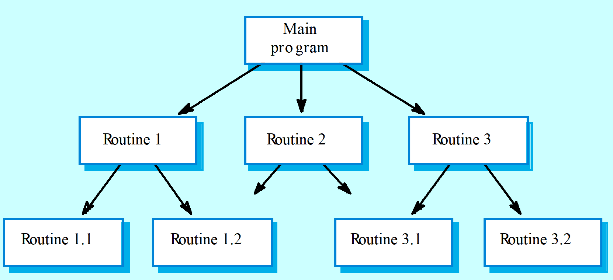
- **manager model**

    one system component is designated as a system manager and controls the starting, stopping and coordination of other system processes

### 6.?.2 Event-Based Control

> the system reacts to external events. 

e.g.
- **Broadcast model**

    Sub-system register an interest in specific events, and all events could be broadcast to all sub-systems

- **Interrupt-driven model**

    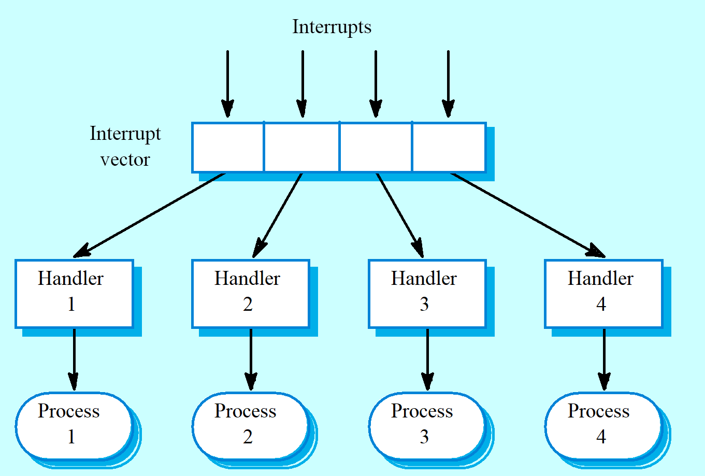

## ?. Design Principles

书上完全没有

### ?.1 Modularity

Modularity
: is the principle of keeping separate the various unrelated aspects of a system, so that each aspect can be studied in isolation

**Advantages**:
- each module will be easy to understand and develop
- easier to locate faults (because there are fewer suspect modules per fault) 
- Easier to change the system (because a change to one module affects relatively few other modules

我们用两个指标来衡量separation of concerns:

### ?.2 Coupling

Coupling
: is the measure of the degree of ==interdependence== between the modules

一个优秀的设计应该这个指标较低

### ?.3 Cohesion

Cohesion
: is a measure of the degree to which the elements of the module are ==functionally related==

一个优秀的设计应该较高

### ?.4 Fan-in and Fan-out

Fan-in
: the number of units that use a particular software unit

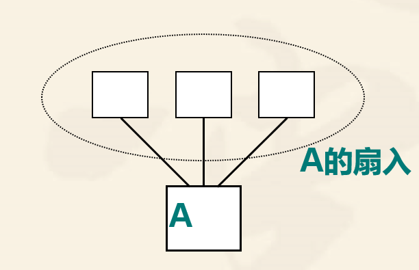

fan-in 大的较好

---

Fan-out
: refers to the number of units used by particular software unit

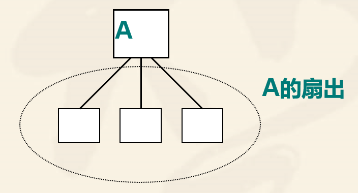

一般在3到9之间

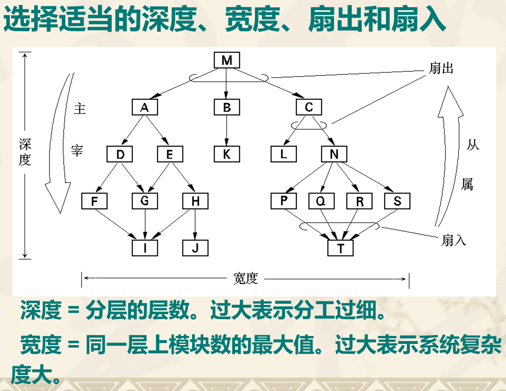

### ?.5 Sandwiching

用来拆分循环或者长链

拆分过程如下

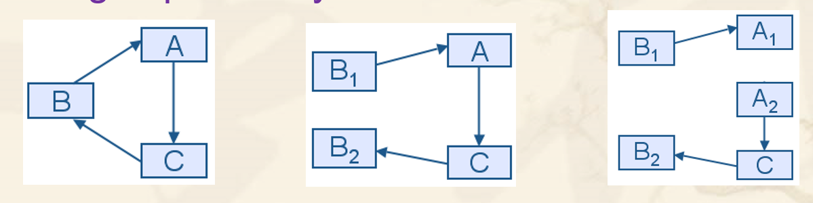

