# Design Patterns

这部分的内容在''Design Patterns: Elements of Reusable Object-Oriented Software''[^1]这本书里

[^1]:[Design Patterns - Wikipedia..](https://en.wikipedia.org/wiki/Design_Patterns#cite_note-1)

根据wiki的介绍，这本书被分为了两个大的板块：
> with the first two chapters (第一板块) exploring the capabilities and pitfalls of object-oriented programming, and the remaining chapters describing 23 classic software design patterns.

而所有的design pattern又划分成了三个大类：
- **Creational patterns**
- **Structural patterns**
- **Behavioral patterns**

如下所示：

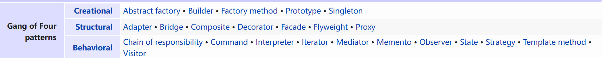

PS: "Gang of Four" (GoF) 因为被用来代表这本书的4个作者，而正好这本书的名字很长，所以大家习惯简称这本书为 "GoF book"[^2]

[^2]:[Gang Of Four..](http://wiki.c2.com/?GangOfFour)

根据ppt，Design Pattern有以下好处：

- Design patterns enable large-scale reuse of software architectures and also help document systems

- Patterns explicitly capture expert knowledge and design tradeoffs and make it more widely available

- Patterns help improve developer communication

- Pattern names form a common vocabulary

## 1. Introduction

大部分时候，我们想要一个可复用且面向对象的程序，然而这是很困难的。事实证明自己想是非常难的，而已经有许多的成功经验可供参考

> The purpose of this book is to record experience in designing object-oriented software as **design patterns**

### 1.1 What is a Design Pattern?

In general, a pattern has four essential elements:
- pattern name

    : The **pattern name** is a handle we can use to describe a design problem, its solutions, and consequences in a word or two.

    说白了就是定义一个术语，方便后续更高层次的设计

- problem

    : The **problem** describes *when to apply* the pattern. It explains *the problem* and its *context*

- solution

    : The **solution** describes the elements that make up the design, their relationships, responsibilities, and collaborations

    UML-like structure, abstract code

- consequences

    : The consequences are the ==results and trade-offs== of applying the pattern

在本书中，design pattern被定义为：

design pattern
: descriptions of communicating objects and classes that are customized to solve a general design problem in a particular context

## 3. Creational Patterns

### 3.1 Abstract Factory

P107

> Provide an interface for creating families of related or dependent objects ==without specifying their concrete classes==

我感觉大概意思就是，调用父类的方法，就可以通过多态调用子类的方法

书上给了个不是那么直观的图：

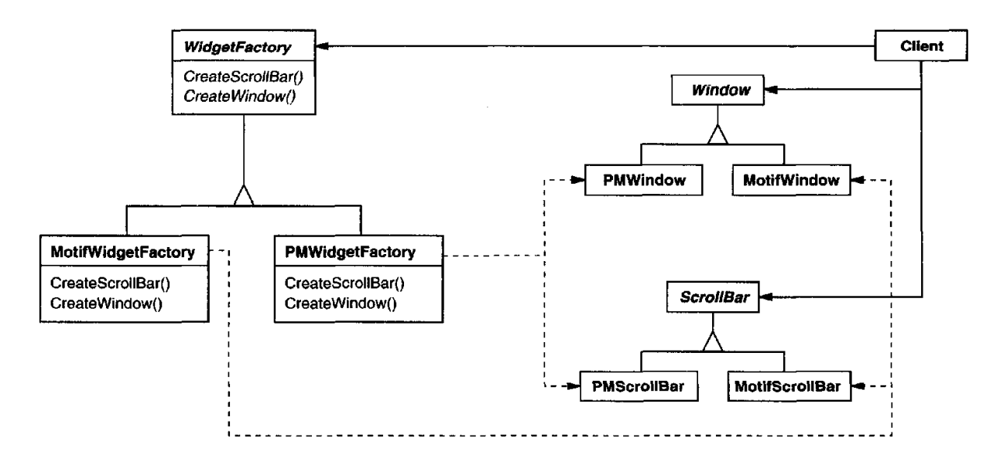

创建widget的factory提供了两种不同的窗体风格，用户在创建widget的时候只需调用父类的函数，就能得到同一个风格的窗体

抽象了一层隐藏了实现

### 3.2 Builder

> Separate the ==construction== of a complex object from its ==representation== so that the same construction process can create different representations

书上举的例子是关于 RTF (Rich Text Format) 的渲染器的。由于类似 Markdown 这样的东西最终的渲染效果其实完全是可以改的，所以为了能够支持对于同一段文字的不同最终渲染效果，就需要将 parser (reader) 和 text converter (渲染器) 给完全分开。

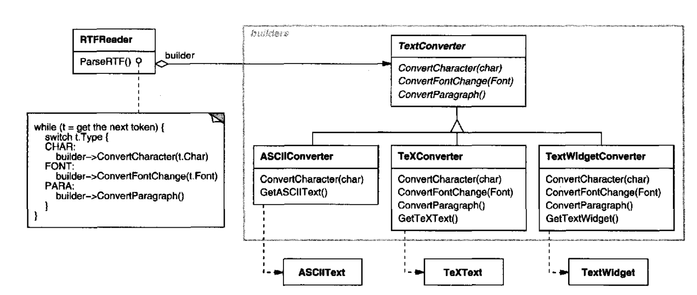

这里RTFReader parse了token之后，就会交给各种不同的textConverter来实现最终渲染

---

在正式一点的描述中，上面例子中的converter被叫做 **builder**, 然后reader叫做 **director**:

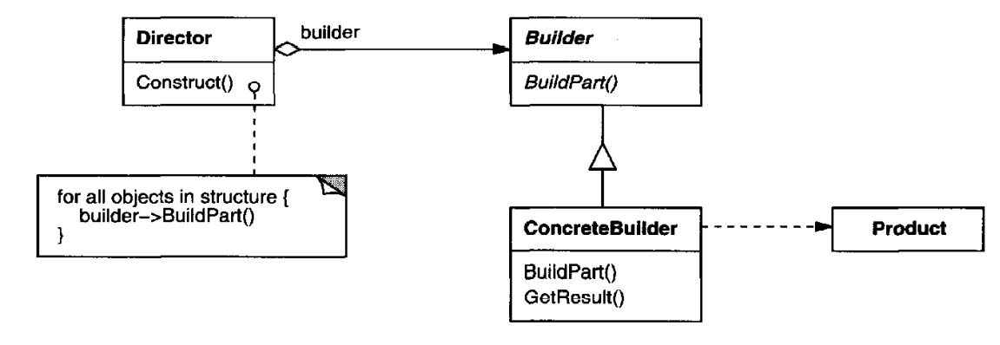

然后当有client想通过这种模式获得输出时，interaction diagram就如下：

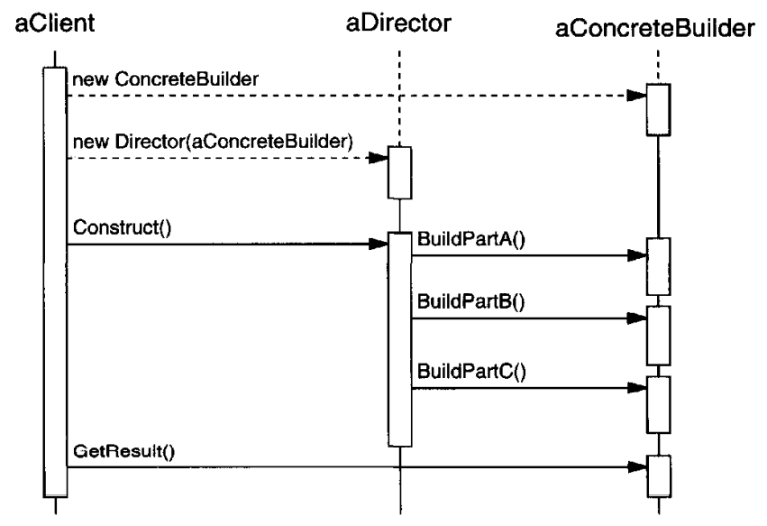

### 3.3 Factory Method

> Define an interface for creating an object, but let subclasses decide which class to instantiate. Factory Method lets a class defer instantiation to subclasses

书上也说了，其实就是virtual constructor

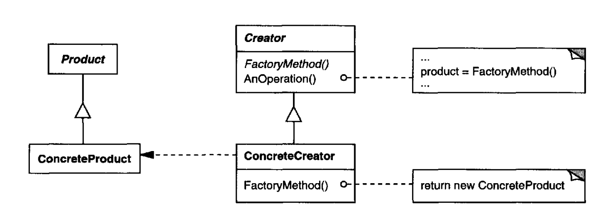

很难讲和abstract factory有啥区别，感觉abstract多了一个生产一类产品的能力？？？课件上就是混着讲了一样

优点：
- Separates responsibility of complex creation into cohesive helper classes
- Hides complex creation logic, such as initialization from a file
- Handles memory management strategies, such or recycling or caching

### 3.4 Prototype

P137

> Specify the kinds of objects to create using a prototypical instance, and create new objects by copying this prototype

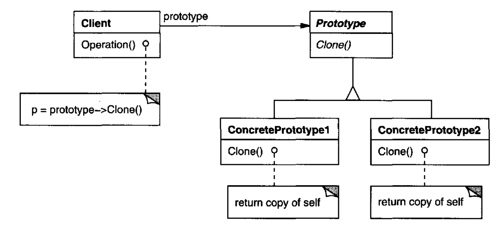

使得类的==实例==能够生成自身的==拷贝==

如果创建一个对象的实例非常复杂且耗时时，就可以使用这种模式，而不重新创建一个新的实例，你可以拷贝一个对象并直接修改它。

### 3.5 Singleton

P147

> Ensure a class only has ==one instance==, and provide a global point of access to it

看着还挺莫名其妙的，设计的动机是，有些东西确实只能存在一个，比如一个系统只应该有一个file system，也只应该有一个window manager

为了保证只有一个instance，应该让class自己管理自己有几个instance，保证只有一个，且提供一个接口给外界访问。假如直接使用一个邪恶的全局变量来管理的话，就并不能限制object的数量

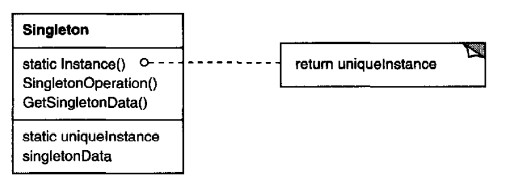

## 4. Structural Patterns

> Rather than composing interfaces or implementations, structural object patterns describe ways to ==compose objects== to ==realize new functionality== 

### 4.1 Adapter

> Convert the interface of a class into another interface clients expect. Adapter lets classes work together that couldn't otherwise because of incompatible interfaces

类似相机的转接环

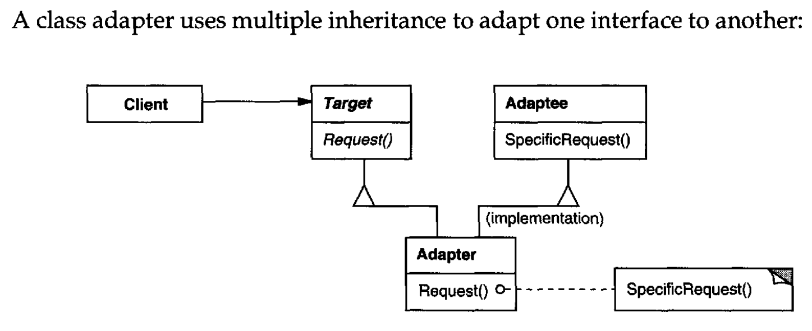

好处：
- Reduces coupling to implementation specific details
- Polymorphism and Indirection reveals essential behavior provided
- Including name of design pattern in new class (e.g., TaxMasterAdapter) in class diagrams and code communicates to other developers in terms of known design patterns

### 4.2 Bridge

> Decouple an abstraction from its implementation so that the two can vary independently

abstraction是一棵树，implementation是另一棵树，两者由bridge连接起来

ppt上的例子甚至都直观一点：

不使用bridge:

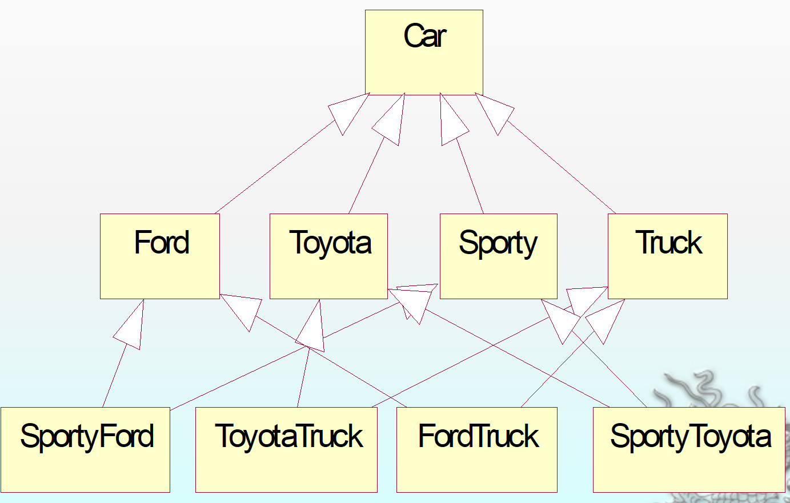

使用bridge:

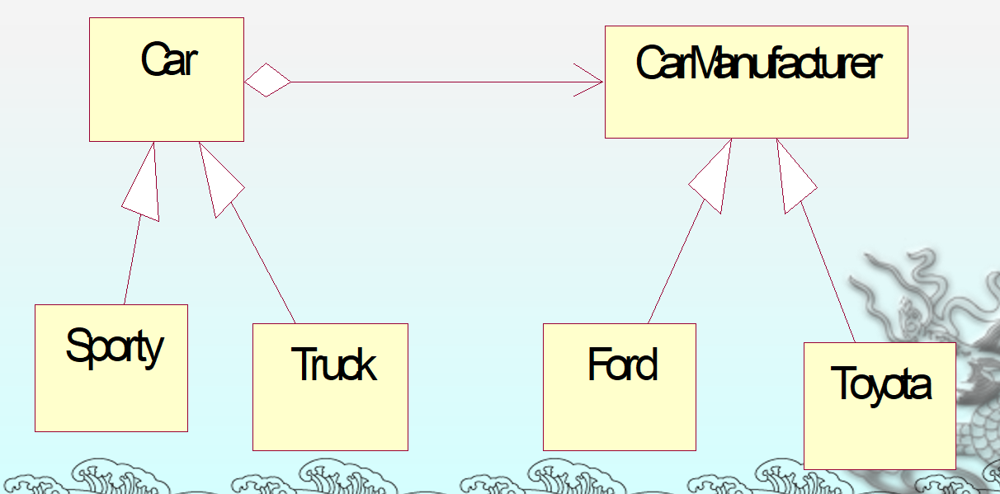

抽象点来说就是这样的结构：

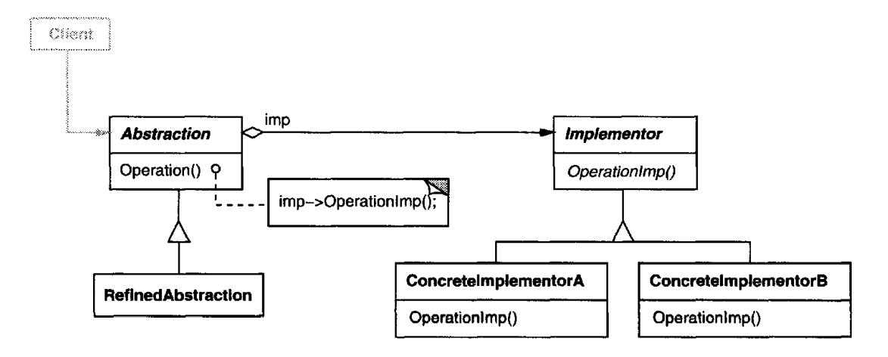

### 4.3 Composite

> Compose objects into tree structures to represent part-whole hierarchies. Composite lets clients treat individual objects and compositions of objects uniformly

大概就是，组件 和 组件的集合 拥有同样的提供给client的接口，这样的话client就不需要区分拿到的是个组件还是组件的集合，调用函数更方便无脑

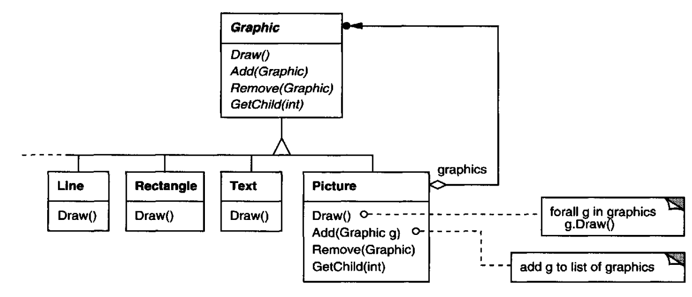

比如上图中，Graphic这个抽象类就同时表示了组件 (Line, Rectangle, Text) 和组件集合 (Picture)。由于Picture是集合，所以会多出来三个操作子组件的方法

### 4.4 Decorator

> Attach additional responsibilities to an object dynamically, Decorators provide a flexible alternative to subclassing for extending functionality

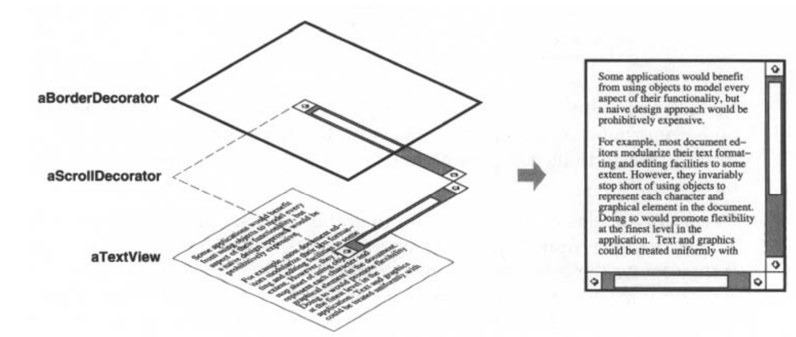

感觉和html的结构似乎有点像

反正结构如下：

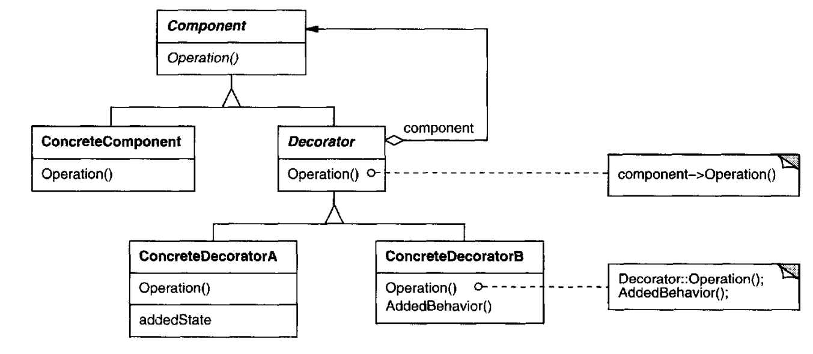

### 4.5 Facade

[fəˈsɑːd] 外表

> Provide a unified interface to a set of interfaces in a subsystem. Facade defines a higher-level interface that makes the subsystem easier to use

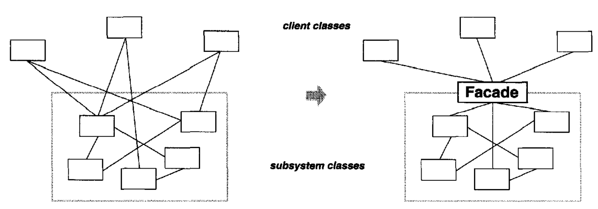

图还是挺直观的

### 4.5 Flyweight

略

### 4.7 Proxy

> Provide a ==surrogate or placeholder== for another object to control access to it

比如在lazy loading里面，图片是按需加载的，这时候为了不影响排版，我们可以让未加载的图片被一个同样大小的placeholder暂时替代

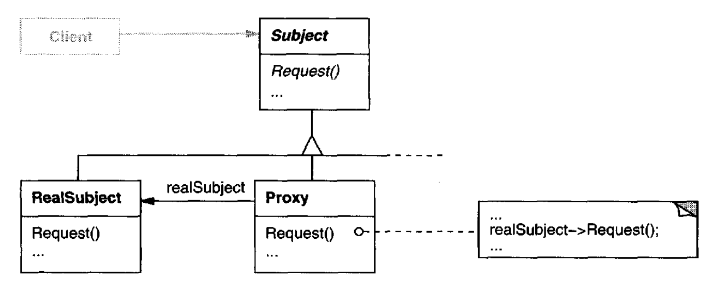

## 5. Behavioral Patterns

### 5.1 Chain of Responsibility

略

### 5.2 Command

> Encapsulate a request as an object, thereby letting you ==parameterize== clients with different requests, queue or log requests, and support ==undoable== operations

这个真的挺迷惑的

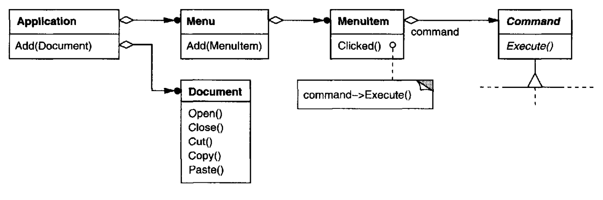

比如这里，我们希望每个MenuItem都能够执行不同的command。MenuItem在被点击的时候只会直接调用execute函数，但是实际上它==并不知道command的哪个subclass会被调用==。这些==subclass则是知道自己应该在哪个MenuItem被点击时响应==

感觉和Qt的signal slot机制似乎有点像，不同item有不同的callback function

搞了半天似乎就是多态一样

### 5.3 Interpreter

略

### 5.4 Iterator

> Provide a way to access the elements of an aggregate object sequentially without exposing its underlying representation

之前C++见过的array的iterator，用来遍历，非常好懂

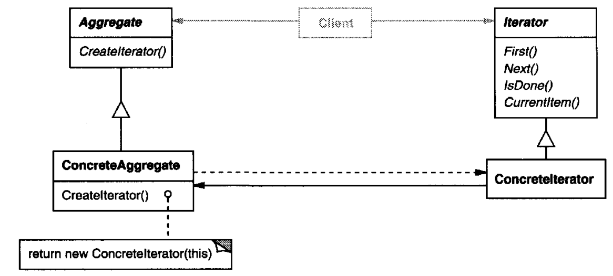

### 5.5 Mediator

略

### 5.6 Memento

略

### 5.7 Observer

> Define a one-to-many dependency between objects so that when one object changes state, all its dependents are notified and updated automatically

比如同一个数据，可以画出不同的图表。只要改了数据，所有的图表都会更新

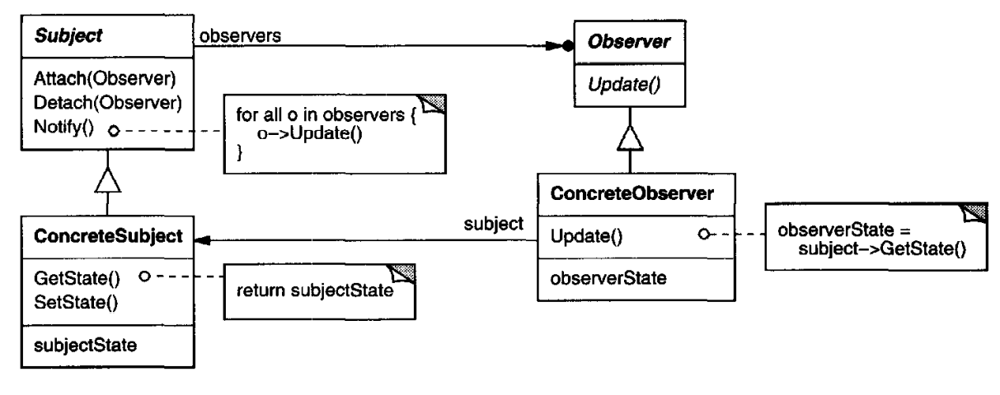

subject是被观察的东西

### 5.8 State

> Allow an object to alter its behavior when its internal state changes. The object wil appear to change its class

比如对于TCP Connection来说，双方可以处在established, listening, closed三个不同的状态下，在处理连接请求的时候，不同状态会做出不同的反应

我们就可以利用一个TCPState的抽象类，来代表网络的连接状态，并且其子类实现不同状态下的不同反应

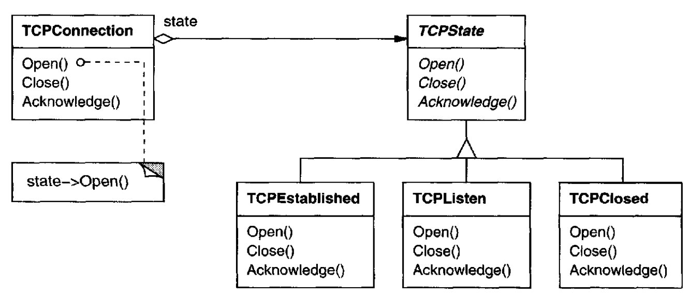

### 5.9 Strategy

> Define a family of algorithms, encapsulate each one, and make them interchangeable. Strategy lets the algorithm vary independently from clients that use it.

比如对于源码的分词，不同的算法有着不同的行为，而假如把这些算法的代码直接写进程序本体的话，并不灵活。所以就单独封装一下这些算法

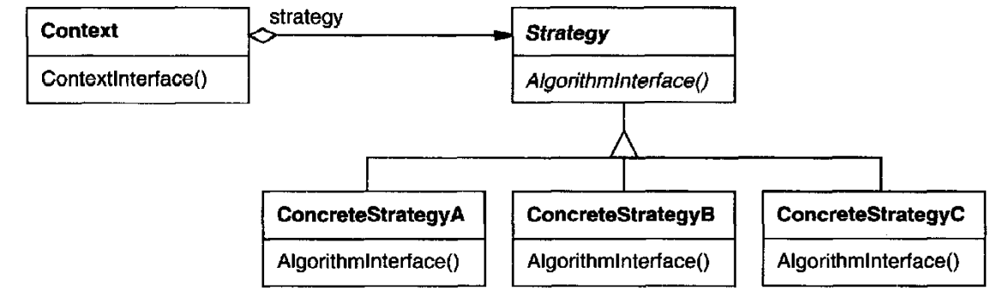

搞了半天不就是encapsulation？

### 5.10 Template Method

略

### 5.11 Visitor

略
