# Software Testing

!!! warning
    内容有部分来自于 "Software Engineering: theory and practice" 这本书

The testing process has two distinct goals:
- To demonstrate to the developer and the customer that the software meets its requirements
- To discover situations in which the behavior of the software is incorrect, undesirable, or does not conform to its specification.

传统的软件测试过程：

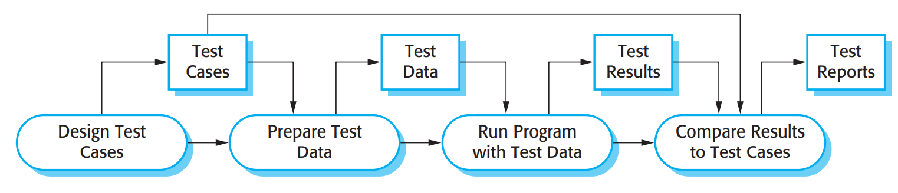

在另一本书中，测试过程是下图这样：

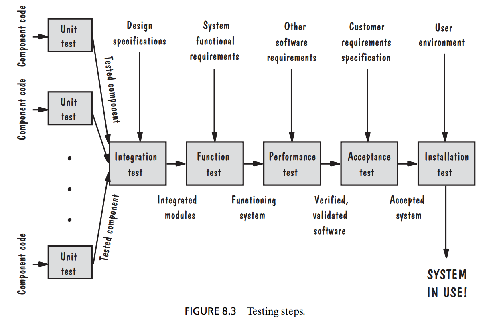

如果软件是给==一个客户==开发的，需要进行一系列验收测试 (acceptance test) 来保证满足客户所有的需求。验收测试主要由==用户==而不是开发者来进行的。

假如是给==多个用户==开发的话：

Alpha测试
: 是在一个受控的环境下，由用户在开发者的指导下进行测试，由开发者负责记录错误和使用中出现的问题。

Beta测试
: 由最终用户在自己的场所进行，开发发者通常不在场，也不能控制应用的环境。由用户记录错误和使用中出现的问题，并定期地交给开发者来解决。

## 1. System testing

### 1.1 Integration testing

由于system integration的过程就是要把不同的component给结合到一起，我们就需要确定，到底不同component结合到一起的时候，会不会出现奇怪的问题。这就是integration testing需要关心的问题了

#### 1.1.1 Incremental testing

integration testing的过程中，会遇到的比较困难的问题是，到底==怎么确定bug出现在了哪个位置==

为了解决定位困难的问题：

incremental approach
: Initially, you should integrate a ==minimal system configuration== and test this system. You then add components to this minimal configuration and test after each added increment

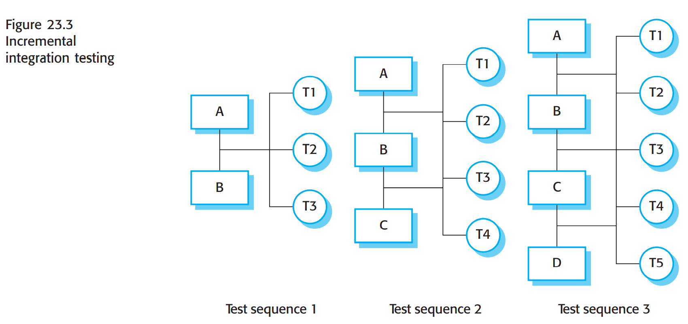

那啥叫minimal system呢？一般的做法是：
> a good rule of thumb is to integrate the components that implement the ==most frequently used functionality== first

除此之外，还有两种更加具体的做法：

##### 1.1.1.1 Bottom-Up Integration

比如有这么一个组件结构：

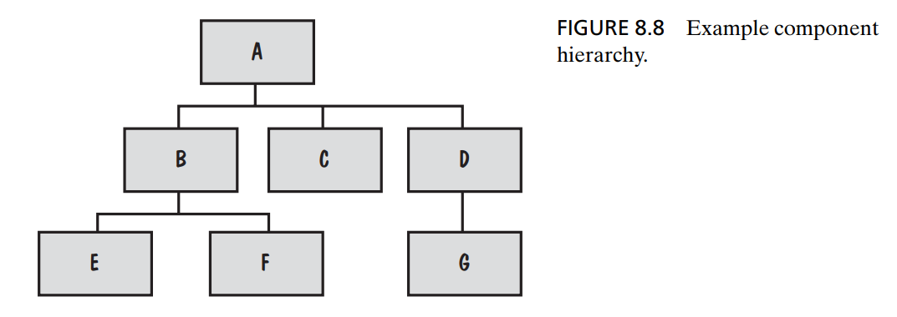

那么bottom-up的顺序就是：

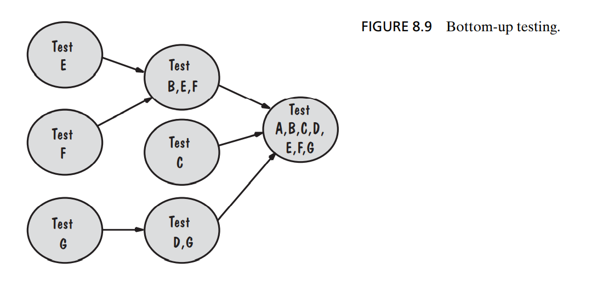

##### 1.1.1.2 Top-Down Integration

> The top level, usually one controlling component, is tested by itself.Then, all components called by the tested component(s) are combined and tested as a larger unit

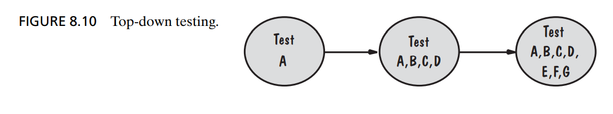

还有种改进的做法，就是在正式merge之前，先将下一级的所有component独自测试一遍：

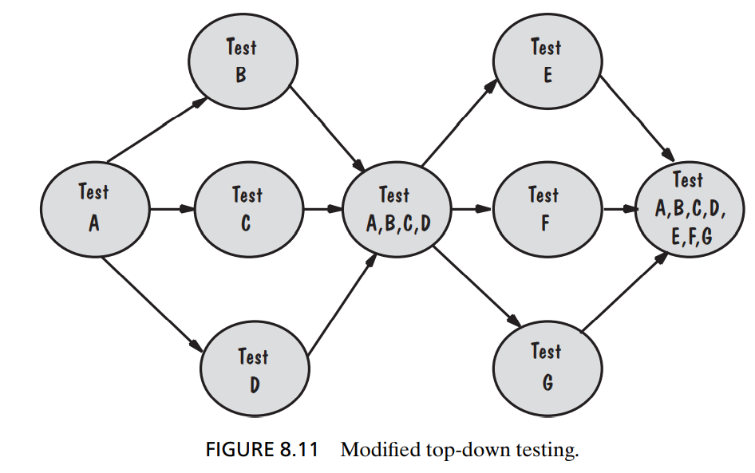

#### 1.1.2 Big-Bang Integration

这就是个看起来不咋合理的方法了。。。不建议真的使用

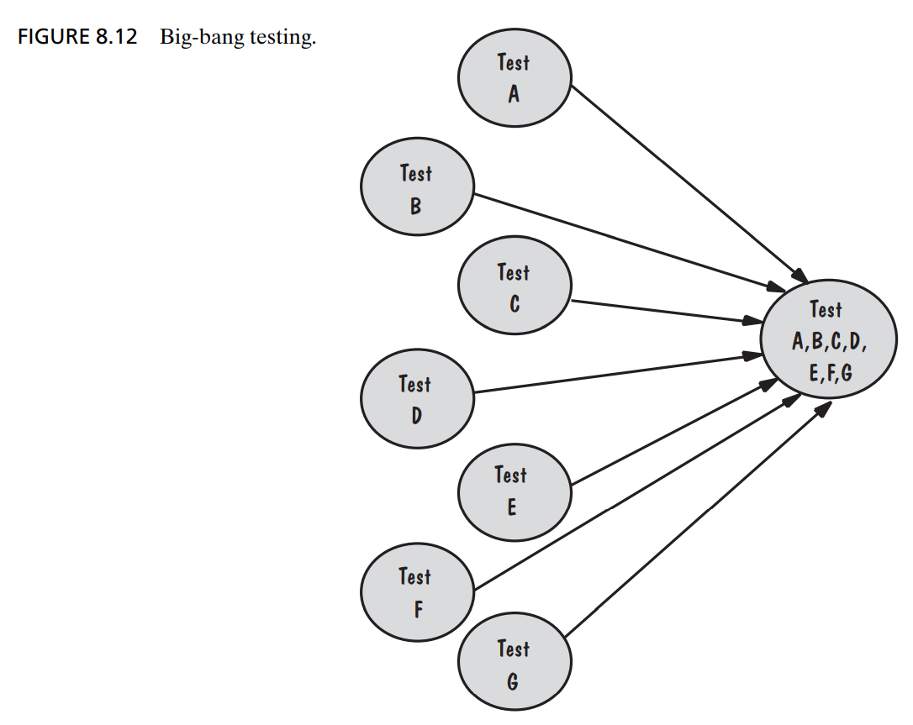

每个测完之后就直接组合到一起，可想而知有多混乱

### 1.2 Release testing

Release testing
: is the process of testing a release of the system that will be distributed to customers

通过对release进行测试，开发者就会更加确信他们写的东西是可以满足需求的

> *Release testing* is usually a ==black-box testing== process where the tests are derived from the system specification

也叫做**functional testing**，因为我们不知道程序的实现细节，只关心它的功能是否是正常的

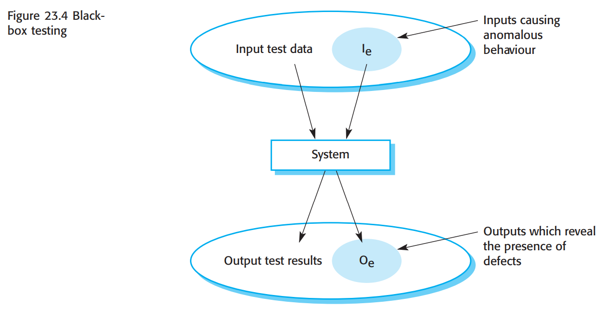

我们当然是需要点一些炒饭，看看酒吧炸不炸 (defect test)

---

也有像Whittaker这样的人，把自己的测试经验总结成了指导的规则：
- Choose inputs that force the system to generate all error messages
- Design inputs that cause input buffers to overflow
- Repeat the same input or series of inputs numerous times
- Force invalid outputs to be generated
- Force computation results to be too large or too small

---

最好的方法其实是scenario-based testing。找一些真实的场景，然后基于场景来设计测试用例

书上举的例子是图书系统的测试：
- Test the login mechanism using correct and incorrect logins to check that valid users are accepted and invalid users are rejected
- Test the search facility using queries against known sources to check that the search mechanism is actually finding documents
- Test the system presentation facility to check that information about documents is displayed properly
- Test the mechanism to request permission for downloading
- Test the e-mail response indicating that the downloaded document is available

### 1.3 Performance testing

也叫**stress testing**，就是搞一些超出设计负载的情景

这种测试有两个功能：

- It tests the failure behavior of the system
- It stresses the system and may cause defects to come to light that would not normally be discovered

## 2. Component testing

Component testing
: (sometimes called **unit testing**) is the process of testing individual components in the system

？这难道不应该是发生在integration testing之前的事情吗

可能在这一阶段被测试的component：
- Individual functions or methods within an object
- Object classes that have several attributes and methods
- Composite components made up of several different objects or functions

### 2.1 Interface testing

由于component内部可能是包含了多个object来实现的，而我们关心的就是，这个component定义的interface到底工作正不正常

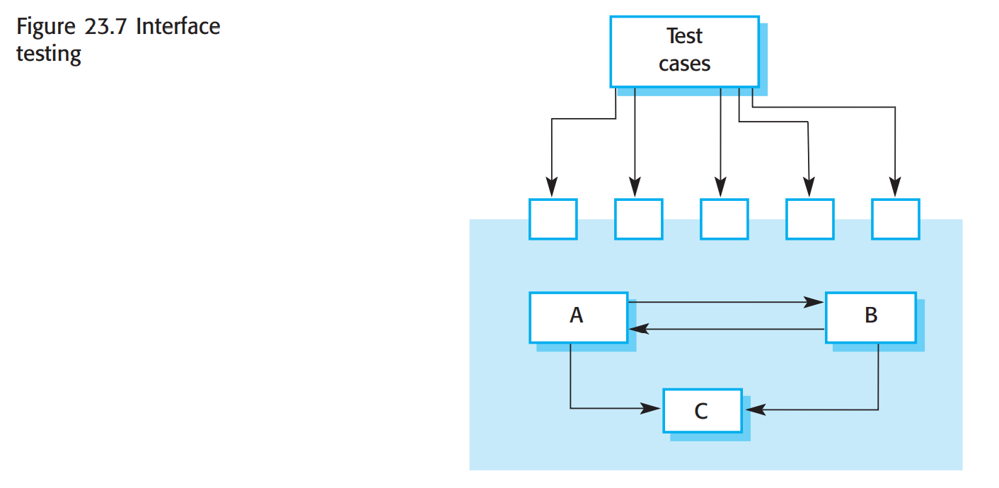

interface testing有一些general guidelines：

- Examine the code to be tested and explicitly list each call to an external component.
-  Where pointers are passed across an interface, always test the interface with ==null pointer== parameters
-  Where a component is called through a procedural interface, design tests that should cause the component to fail
- Use stress testing, as discussed in the previous section, in message-passing systems.
- Where several components interact through ==shared memory==, design tests that vary the ==order== in which these components are activated

## 3. Test case design

如何点炒饭

分为了三个大类：

### 3.1 Requirements-based testing

Requirements-based testing
: where test cases are designed to test the system requirements

理论上，我们前期的时候写的requirements，都是可以设计成测试用例的形式。于是这时候，我们就可以根据这些requirements来设计测试用例了

其实requirement-based testing应该更多是用来证明，你的程序能跑，而不是找茬

e.g.

有如下requirements:
> The user shall be able to search either all of the initial set of databases or select a subset from it

我们就可以设计如下test cases:

- Initiate user searches for items that are known to be present and known not to be present, where the set of database includes ==one== database
- ..., includes ==two== database
- ..., includes ==more than two== databases
- Select ==one== database from the set of databases and initiate user searches for items that are known to be present and known not to be present
- Select ==more than one== database from the set of databases and ...

反正就是对于同一个要求来说，应该多设计一些测试用例，尽可能覆盖掉所有的情况

### 3.2 Partition testing

Partition testing
: where you identify input and output partitions and design tests so that the system executes inputs from all partitions and generates outputs in all partitions

> The input data and output results of a program usually fall into a number of different classes that have ==common characteristics== such as positive numbers, negative numbers and menu selections

程序在面对同一个类型 (partition) 的东西时，往往会表现出同样的行为（比如面对两个正数的时候是一种行为，面对两个负数的时候则是另一种）

上述的class也叫做**equivalence partitions**

我们要做的，就是分辨出所有的这种equivalence partitions，然后从这些partition里抽取例子来测试

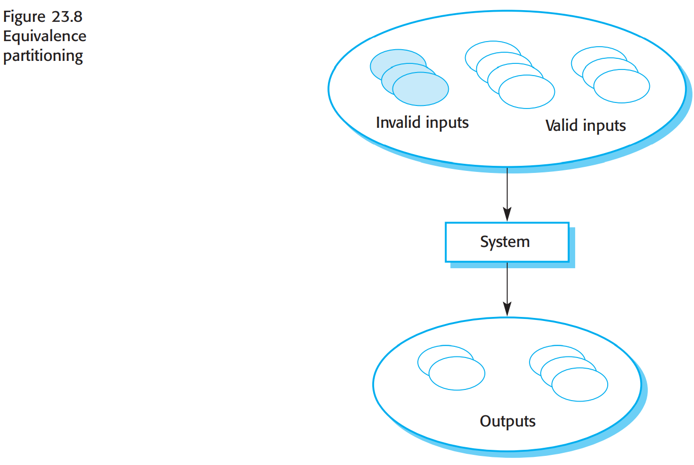

上图中每个椭圆都是一个partition

当你已经分辨出了所有的partition之后，你就可以从每个partition里抽取测试用例了。一个比较常见的做法是，抽取==边界值==，以及==中间值==

e.g.

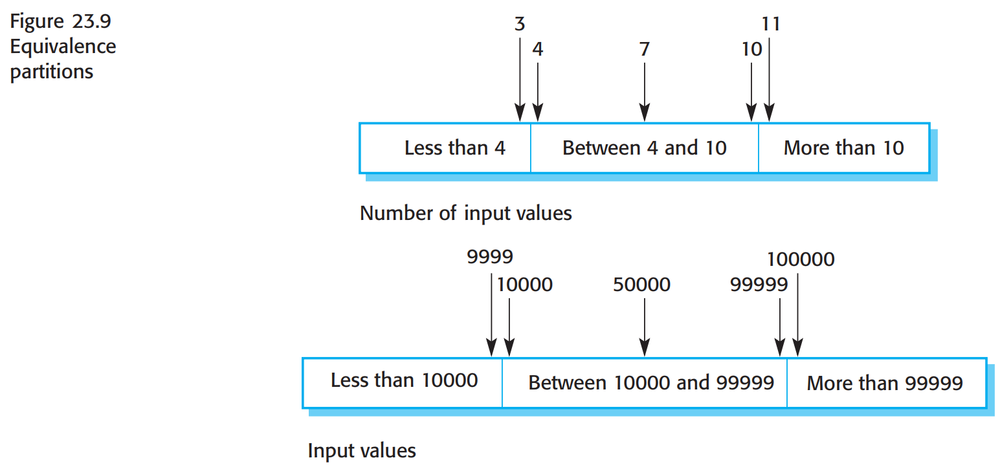

e.g.2

对于这么一个搜索函数：

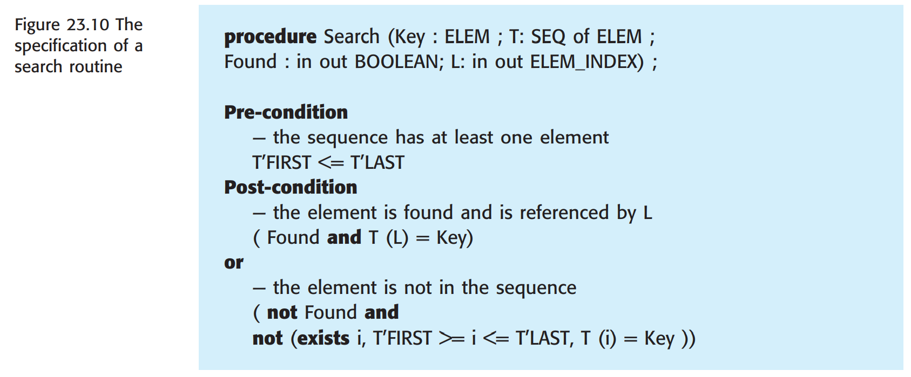

可以如下构造test case：

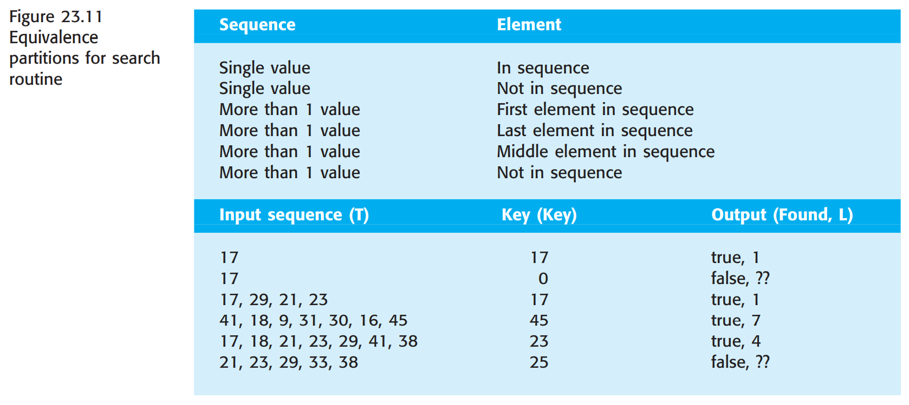

### 3.3 Structural testing

Structural testing
: where you use knowledge of the program's structure to design tests that exercise all parts of the program

由于知道具体的实现细节，其实就是白盒测试的一种

e.g.

对于二分搜索，结合[3.2](#32-partition-testing)中关于partition的知识，我们可以将搜索的值分为以下三个类：

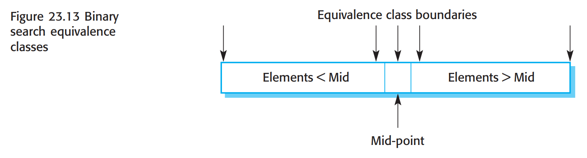

我们可以根据这三个类的边界值和中值，重新改善一下测试用例：

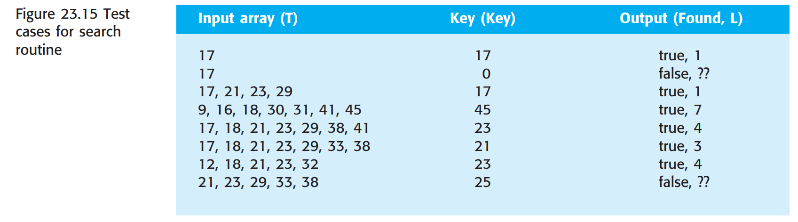

#### 3.3.1 Path testing

*structural testing*的一种

Path testing
: whose objective is to exercise every ==independent== execution path through a component or program

由于路径的数量正比于程序的规模，我们肯定是没法做到测试所有的路径的。比如程序里有循环的时候，这个就压根没法每个路径都测试了

所以，上面才如此强调，我们需要测试的是independent path (而不是path)

independent path
: is one that traverses at least one new edge in the flow graph

**flow graph**则是我们path testing的出发点。节点表示decision，而边表示flow of control

比如下面这段程序

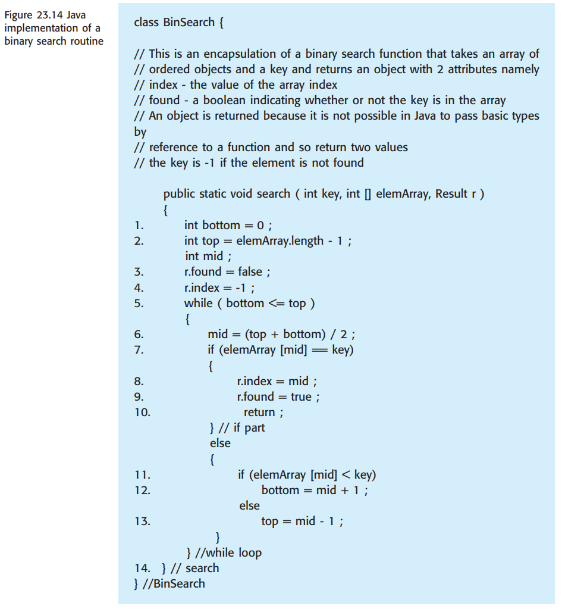

对应的flow graph如下 (数字表示代码的行号)

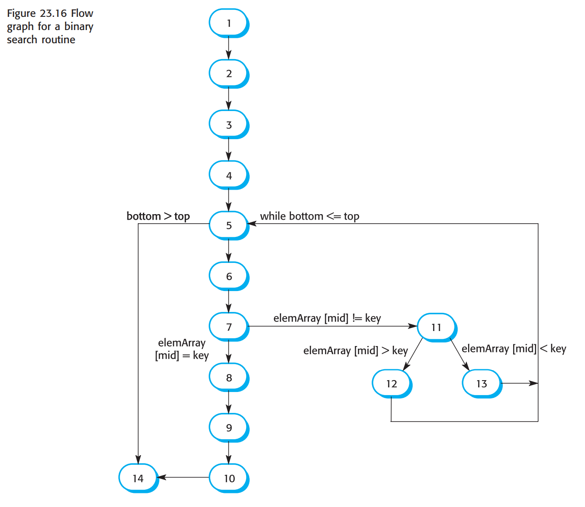

---

其实有方法可以得到到底程序有多少条independent path：

cyclomatic complexity
: for programs without goto statements, the value of the cyclomatic complexity is ==one more than the number of simple conditions== in the program

simple condition
: logical expression without 'and' or 'or' connectors

e.g.

`if A and B or C` 圈复杂度是3 + 1 = 4 (因为有`A`, `B`, `C`三个simple condition)

## 4. Test automation

testing的过程费时费力，所以能够自动化的话，那当然省事很多

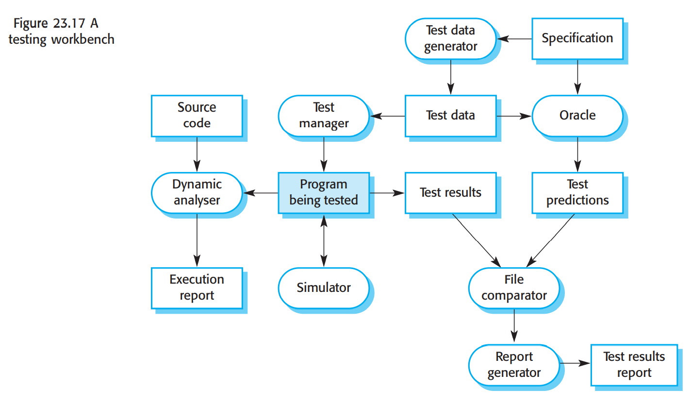

可以看到包含了：
- Test manager
- Test data generator
- Oracle 
- File comparator
- Report generator
- Dynamic analyzer
- Simulator 

## 5. When to Stop Testing

!!! note
    来自 "Software Engineering: theory and practice" P468

事实上，发现的bug越多，bug出现的概率就越大：

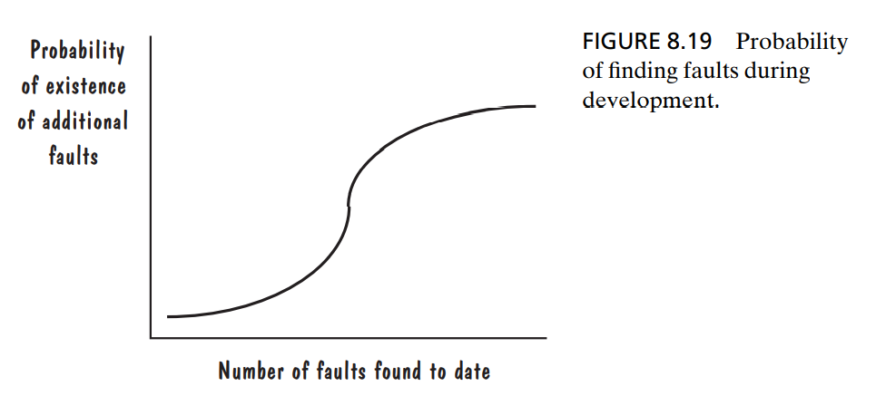

这让我们非常难以判定，什么时候应该停止测试。这就需要接下来讲的，如何估测还剩多少bug

### 5.1 Fault Seeding

我愿称其为==标志重捕法==

前提：有人故意往代码里播种了一些fault，然后另一个则负责尽可能地找出fault

由于找到的fault有可能是原本就存在的，也有可能是后来播种的，所以：

$$
\frac{\text{detected seeded faults} }{\text{total seeded faults} }=\frac{\text{detected nonseeded faults} }{\text{total nonseeded faults} }
$$

所以我们就可以估测，非播种的错误的总数：令$S$为播种的总数量，$s$为找到的播种错误，$N$为非播种的错误总数，$n$为找到的非播种错误数量：

$$
N=S\cdot \frac{n}{s}
$$

然而上述方法其实是做了非常理想化的假设的，假设了播种的错误和已有的错误是同一种类且复杂度一样

---

为了解决上述问题，我们用一点非常诡异的技巧 (似乎是不需要播种了)

我们准备两个独立的测试组：
- $x$: Group 1发现的错误数量
- $y$: Group 2发现的错误数量
- $q$: 两组发现的共同错误的数量 ($q\le x$, $q\le y$)
- $n$: 错误的总数

为了找到个等式，我们定义两个组找bug的效率为：
$$
E_1=x/n\\
E_2=y/n
$$

假设，找bug的效率在程序的所有的位置都处处相等的话，可以得到：
$$
E_1=x/n=q/y
$$

看着确实有点赖皮。带入$E_2=y/n$之后可以得到如下公式：

$$
n=\frac{q}{E_1\cdot E_2}=\frac{x\cdot y}{q}
$$

e.g.

假如第一组找到25，第二组找到30，有15个共同，则：
$$
x=25\\
y=30\\
q=15
$$

可以计算出两组的效率分别是：
$$
E_1=15/30=0.5\\
E_2=15/25=0.6
$$

!!! warning
    第一组的效率是以第二组的总数为分母！别搞反了

所以最终的估计总数是：

$$
n=\frac{15}{0.5\times 0.6}=50
$$

### 5.4 Identifying Fault-Prone Code

鉴别哪一部分代码容易出错有很多种方法

> For example, some researchers track the number of faults found in each component during development and maintenance.
>
> They also collect measurements about each component, such as size, number of decisions, number of operators and operands, or number of modifications
> 
> Then, they generate equations to suggest the attributes of the most fault-prone components.

利用上面算出来的属性，我们就可以衡量哪些代码最有可能出错

---

基于上面的各种属性，我们可以用一种奇怪的树来帮忙决策：

classification tree
: Classification tree analysis is a statistical technique that sorts through large arrays of measurement information, creating a decision tree to show which measurements are the best predictors of a particular attributes

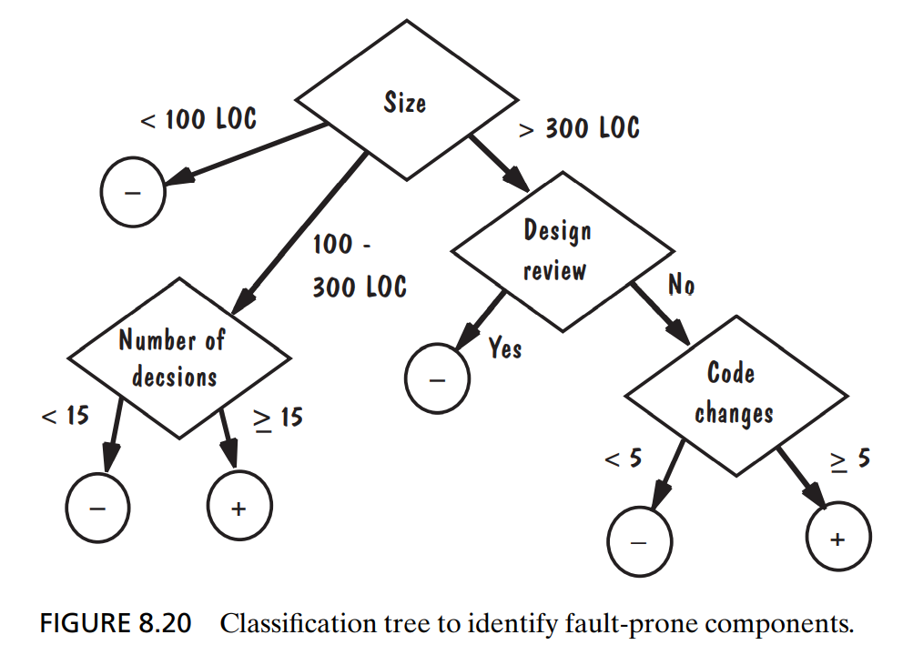

还挺诡异的，也不知道这个建起来的具体标准是什么

