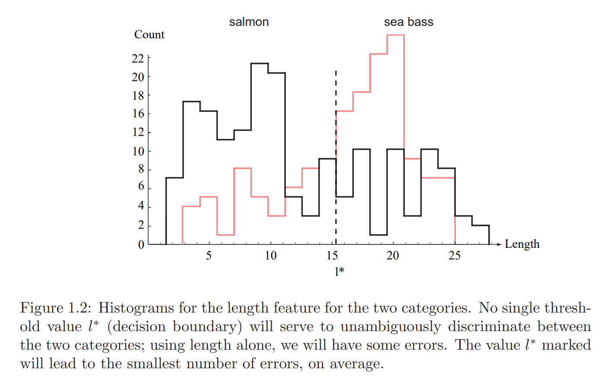
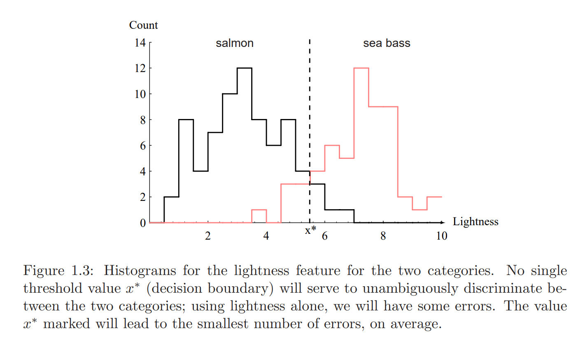
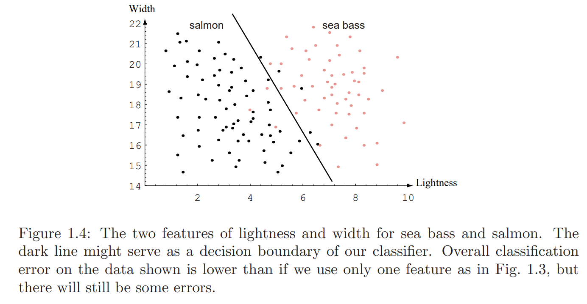
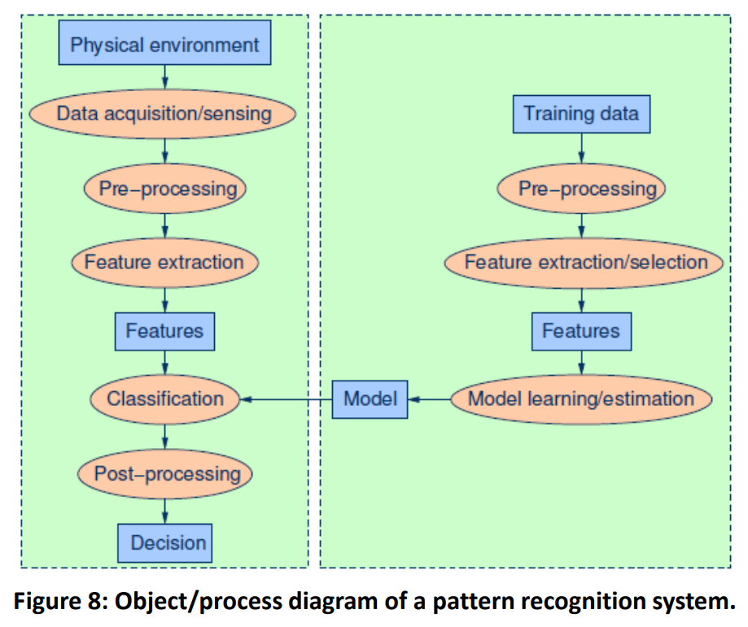
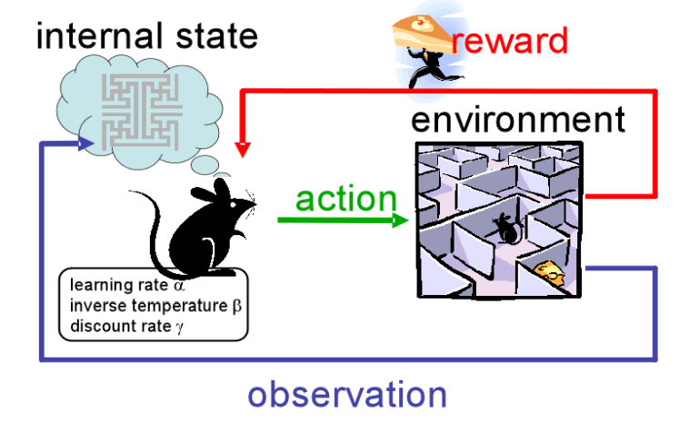
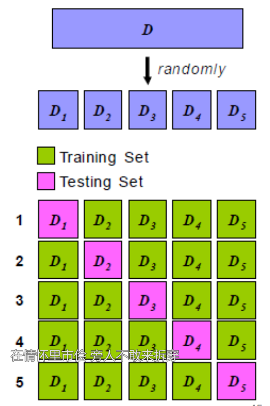

# Ch1 Introduction

人可以很轻松的识别人脸、理解语言，我们也想让机器能够做到

pattern
: a *pattern* is the opposite of chaos; it is an entity, vaguely defined, that could be given a name
: it is an abstract object, such as a set of measurements describing a physical object

比如指纹图片、声音的信号、手写字

pattern recognition
: is the study of how machines can:
: - Observe the environment
: - Learn to distinguish patterns of interest
: - Make reasonable decisions about the categories of patterns

这些特征很多都不会是直观的自然特征，而是些数学表达

## 1.2 An Example

比如我们想通过图片来区分 sea bass (鲈鱼) 和 salmon (三文鱼)

一个简单的处理系统有以下部分组成：

- **Sensing**

    说人话：拍照片
- **Preprocessing**

    比如分辨出每条鱼、降噪
- **Feature Extraction**

    特征提取。比如长宽、重量、尾巴的形状
- **Classification**

    比如用 SVM、决策树

---

关于用什么特征来区分：

假如我们用长度作为特征的话：

可以看到其实效果比较差，总有些是分类错误的

假如用亮度作为依据：

也还是有错误

然而上述都是只使用单个特征的情况，我们完全可以用多个特征。比如同时用宽度和亮度作为特征的话：

中间的分割线叫做 **decision boundary**。当然我们可以把这条线画的非常曲折，但是出于性能和泛化的考虑我们不会搞得太复杂，顶多就是再弯一些

当然也不是特征越多越好：
- Avoid unreliable features
- Be careful about correlations with existing features
- Be careful about measurement costs
- Be careful about noise in the measurements

---

反正系统大概是这个结构：

## 1.3 The Sub-problems of Pattern Classification

### 1.3.1 Feature Extraction

### 1.3.2 Noise

### 1.3.3 Overfitting

### 1.3.4 Model Selection

### 1.3.5 Prior Knowledge

### 1.3.6 Missing Features

### 1.3.10 Invariances

### 1.3.12 Costs and Risks

### 1.3.13 Computational Complexity

## 1.4 Learning and Adaptation

### 1.4.1 Supervised Learning

输入和输出都有

### 1.4.2 Unsupervised Learning

只有输入

需要用聚类或者可视化的方法来找规律

---

其实还有些 semi-supervised learning，就是只有一些样本的 label 知道

### 1.4.3 Reinforcement Learning

并不存在期望的类别，而是只有某个情况下，结果究竟是正确还是错误的反馈，而不知道为什么错或者对

通过奖励和惩罚来驱动

## 1.? Evaluation

ppt 1_PRC_intro P40 开始

如何判定哪个模型更好

### 1.?.1 A Simple Method

- Randomly separate 𝐷 into 𝐷𝑡𝑟𝑎𝑖𝑛 and 
𝐷𝑡𝑒𝑠𝑡
- Using 𝐷𝑡𝑟𝑎𝑖𝑛 to train 𝐴 and 𝐵
- Using 𝐷𝑡𝑒𝑠𝑡 to measure the performances of the trained 𝐴 and 𝐵
- Select the better performing classifier

然而这也有问题，说不定是这个测试集恰好很对某个模型的胃口

### 1.?.2 Independent Run (Bootstrap)

说白了就是，多测试几次，让数据集分割的时候每次都不太一样

取平均准确率更高的

### 1.?.3 m-fold Cross-Validation

把数据集分成 $m$ 等分，然后每次都取其中一份来作为测试集，其余的作为训练集

训练 $m$ 次之后取平均准确率最高的

