# Ch10 Unsupervised Learning and Clustering

相信有监督和无监督分别是啥意思也不用多说

在无监督的情况下，聚类就是一个很好的分类方案

## 10.4 Application to Normal Mixtures

### 10.4.3 K-means clustering

算法流程：
- Decide on a value for $k$.
- Initialize the $k$ cluster centers (randomly, if necessary).
- Decide the class memberships of the $N$ objects by assigning them to the nearest cluster center. (计算欧氏距离来比较)
- Re-estimate the $k$ cluster centers, by assuming the memberships found above are correct.
- If none of the $N$ objects changed membership in the last iteration, exit. Otherwise go to step3

centroid
: cluster center

---

到底分几类 ($k$) 是由用户决定的，但是这个到底怎么决定呢？

可以通过 objective function 来进行衡量：

Define the distance of a point $x_j$ in cluster $i$ to the center of cluster $C_i$ be:
$$
d_{i}=\sum ||\vec{x_j}-\vec{C_i}||^2
$$

objective function:
$$
d=\sum_{i=1}^k d_i
$$

通过计算 $k$ 取不同值的时候对应的目标函数的值，我们可以得到类似下图的玩意：

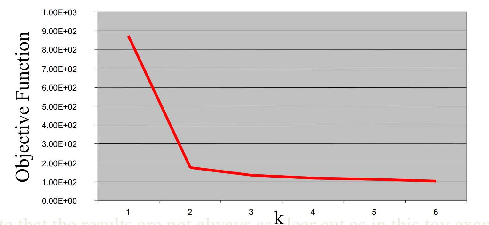

可以看到 $k=2$ 的时候有一个明显的下降，所以很可能 2 是一个合理的值。这种做法叫做 **knee finding** 或者 **elbow finding**

反正可以把目标函数改成

$$
d+ck
$$

$c$ 是常数，有种惩罚大的 $k$ 值的意思

#### 10.4.3.1 Problems: outliers

有些点就是会离其他点很远：

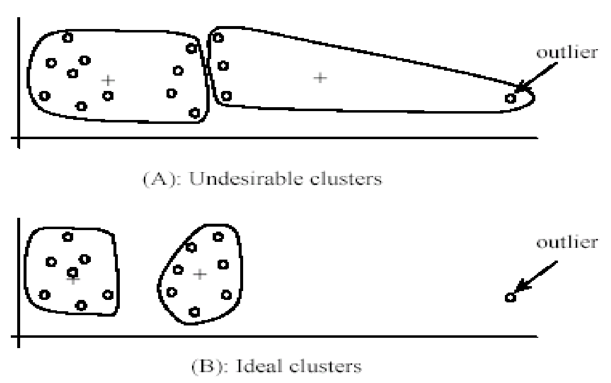

那咋办呢？
- 直接删了
- 随机采样（？我怎么觉得这不能解决

#### 10.4.3.2 Problem: initial seeds

对于最开始的中心点选取是很敏感的：

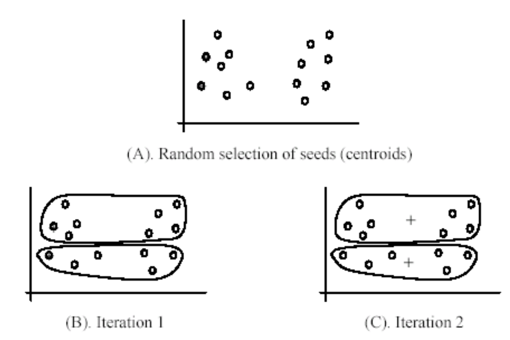

#### 10.4.3.3 Problem: hyper-ellipsoids

反正边界很奇怪的话就会难以划分：

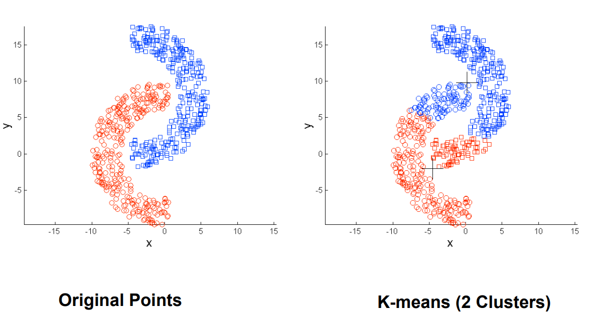

### 10.4.4 Fuzzy c-means clustering

所谓的 fuzzy 指的是，数据点可以属于不止一个类

符号定义如下：
- $X=\{\mathbf{x}_1,...,\mathbf{x}_n\}$: $n$ 个数据点
- $C=\{\mathbf{c}_1,...,\mathbf{c}_c\}$: $c$ 个类的中心
- $W=w_{i,j}\in [0,1],\ i=1,...,n,\ j=1,...,c$:

     partition matrix，描述点 $\mathbf{x}_i$ 属于类 $\mathbf{c}_j$ 的可能性 (对 $x_i$ 来说，属于所有类的概率之和为 1)
- $m\in (1,\infty)$: 

    degree of fuzziness, 数字越大越模糊

目标函数如下：
$$
J(W,C)=\sum_{i=1}^n\sum_{j=1}^cw_{ij}^m||\mathbf{x}_i-\mathbf{c}_j||^2
$$

其中：
$$
w_{i,j}=\frac{1}{\sum_{k=1}^c(\frac{||\mathbf{x}_i-\mathbf{c}_j||}{||\mathbf{x}_i-\mathbf{c}_k||})^{\frac{2}{m-1} }}
$$

至于 cluster 的 centroid 在的地方：

> the centroid of a cluster is the mean of all points, weighted by their degree of belonging to the cluster:
$$
c_k=\frac{\sum_xw_k(x)^mx}{\sum_xw_k(x)^m}
$$

---

总之，算法的大体上的框架如下：
- Choose a number of clusters.
- Assign coefficients randomly to each data point for being in the clusters.
- Repeat until the coefficients' ($w_{i,j}$) change between two iterations is no more than $\varepsilon$, the given sensitivity threshold :
    - Compute the centroid for each cluster ($c_k$)
    - For each data point, compute its coefficients of being in the clusters. ($w_{i,j}$)

---

优点：
- 无监督学习
- 总是收敛

缺点：
- 计算时间长
- 对初始种子敏感
- 对噪声敏感

## 10.9 Hierarchical Clustering

### 10.9.1 Definitions

事实上，根据最终划分出来的结果是否重叠，可以将聚类分为两种：

- **Partitional Clustering**

    前面的章节都是，不重叠
- **Hierarchical Clustering**

    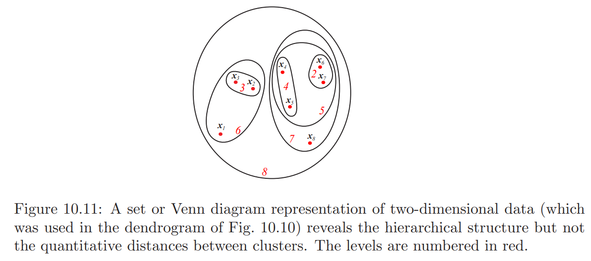

    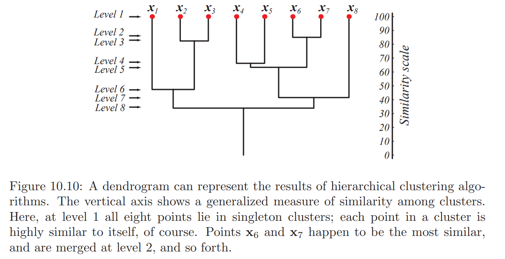

    反正可以画成一棵树

---

众所周知，建树有两种思路：
- top down

    这里叫 **divisive**
- bottom up

    这里叫 **agglomerative** /ə'ɡlɔmərətiv/

### 10.9.2 Agglomerative Hierarchical Clustering

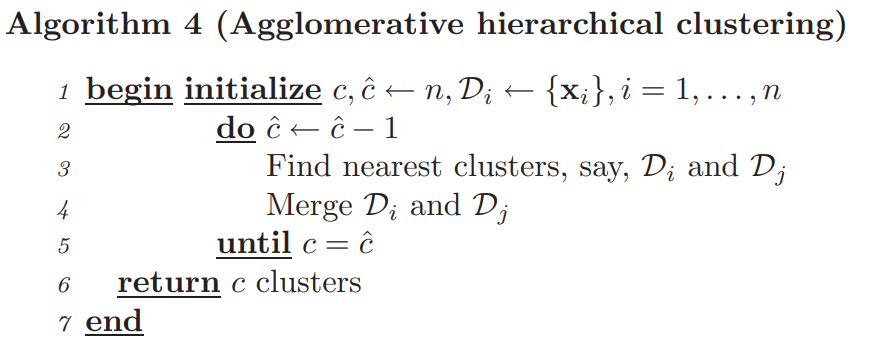

其中 $c$ 是我们希望最终拥有的 cluster 数量

非常简单直接

---

这种做法有如下问题：
- 结合两个 cluster 的操作无法撤销
- 没有直接最小化某个目标函数
- 四个方法总有些这的那的的问题

---

然而我们还没有提及过怎么样衡量 "nearest" 这个概念

总之有四种手段衡量，下面的小节介绍

!!! note
    ppt 上用到了一种叫 ***proximity matrix*** 的玩意来衡量不同 cluster 之间的关联程度

    反正好像数值越高，两个 cluster 就越 "near"

#### 10.9.2.1 MIN

也叫做 nearest-neighbor algorithm

<!-- $$
d_{min}(\mathcal{D}_i,\mathcal{D}_j)=\min_{x, x'\in \mathcal{D}_i} ||\mathbf{x}-\mathbf{x}'||
$$ -->

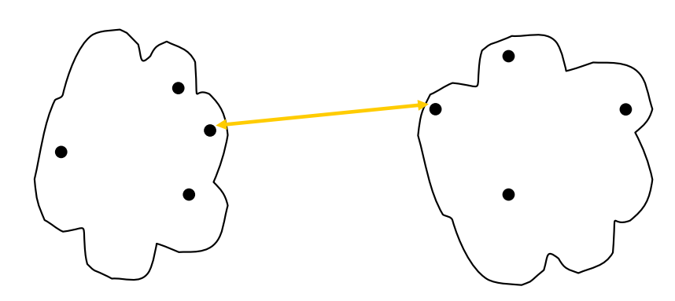

意思是，拿 cluster A 里离 cluster B 最近的点来代表 cluster A

也就是取 proximity matrix 里，当前 cluster 里==分数最高==的那个

e.g., 

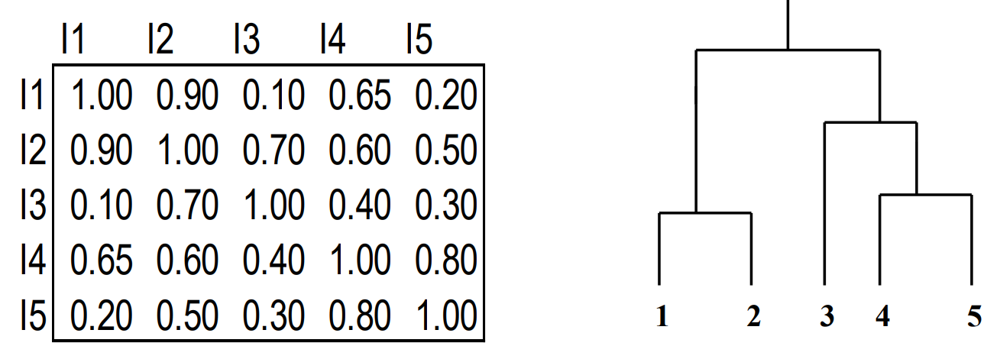

优点：
- 能处理非椭圆形

缺点：
- 对噪声和 outlier 敏感

#### 10.9.2.2 MAX

也叫做 farthest-neighbor algorithm

<!-- $$
d_{max}(\mathcal{D}_i,\mathcal{D}_j)=\max_{x, x'\in \mathcal{D}_i} ||\mathbf{x}-\mathbf{x}'||
$$ -->

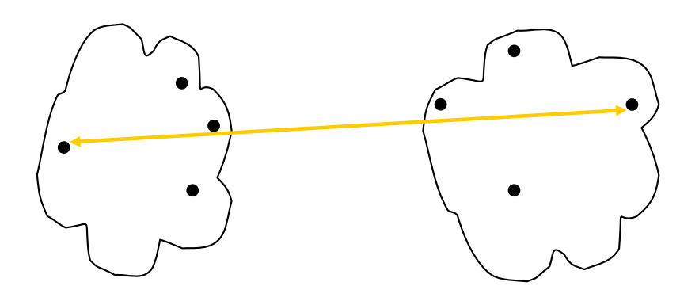

意思是，拿 cluster A 里离 cluster B 最远的点来代表 cluster A

也就是取 proximity matrix 里，当前 cluster 里==分数最低==的那个

e.g.,

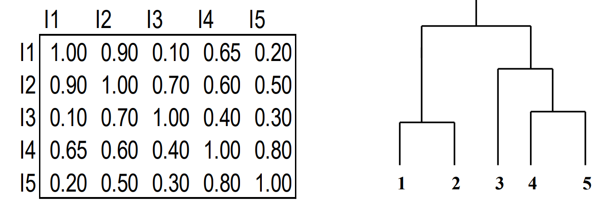

!!! warning
    可以看到和 MIN 的情况相比，虽然 proximity matrix 并没有发生变化，但是建树第三步的时候发生了变化：

    - cluster `1,2` 离 3 最远的点分数为 0.1
    - cluster `4,5` 离 3 最远的点分数为 0.3

    所以 cluster `4,5` 更优，选择将 `3` 合并到 `4,5`

优点：
- 不容易受到噪声和 outlier 的影响

缺点：
- 会把一个比较大的 cluster 给拆开
- 偏向球状的 cluster（？什么意思

#### 10.9.2.3 Group Average 

$$
d_{avg}(\mathcal{D}_i,\mathcal{D}_j)=\frac{1}{n_in_j}\sum_{\mathbf{x}\in \mathcal{D}_i}\sum_{\mathbf{x}'\in \mathcal{D}_j} ||\mathbf{x}-\mathbf{x}'||
$$

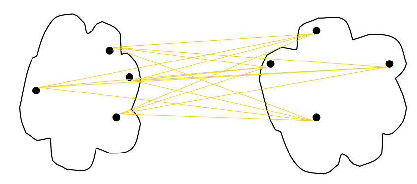

优点：
- 相对来说不太容易受噪声和 outlier 影响

缺点：
- 偏向球状的 cluster 

#### 10.9.2.4 Distance Between Centroids

<!-- $$
d_{mean}(\mathcal{D}_i,\mathcal{D}_j)=||\mathbf{m}_i-\mathbf{m}_j||
$$ -->

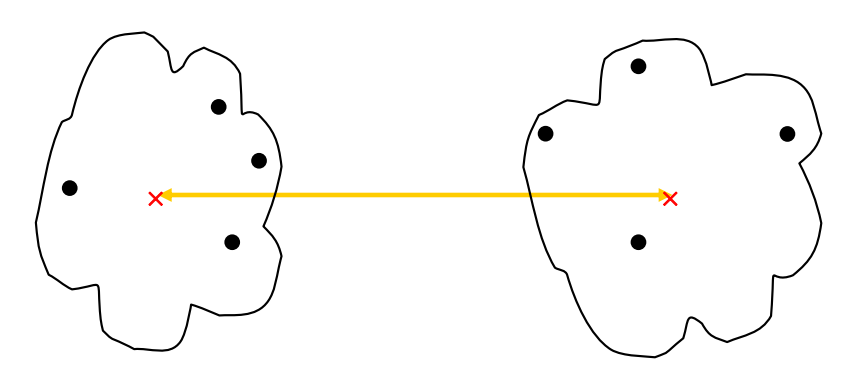

## 10.13 Principle component analysis (PCA)

!!! note
    稍微改了一下原本的书的目录结构，内容主要来自 "Bishop-Pattern-Recognition-and-Machine-Learning-2006" 这本书，以及 [wiki](https://en.wikipedia.org/wiki/Principal_component_analysis#Details)

当提供的样本的特征过多，为了更好的找到当中主要的成分，我们就需要进行主成分分析（最常用的==多变量分析方法==）

PCA 有两种定义方式，背后都对应了同一种算法
- **Maximum variance formulation**

    > defined as the orthogonal projection of the data onto a lower dimensional linear space (*principle subspace*), such that the ==variance of the projected data is maximized==
- **Minimum-error formulation**

    > defined as the linear projection that ==minimizes the average projection cost==, defined as the mean squared distance between the data points and their projections

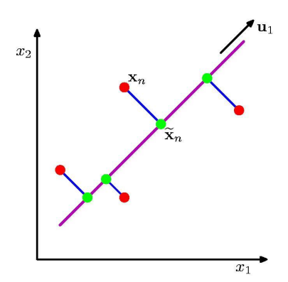

放在图中的话，紫色表示最大化 variance，而蓝色表示最小化距离

wiki 给的定义是：
> PCA is defined as an orthogonal linear transformation that transforms the data to a new coordinate system such that the ==greatest== variance by some scalar projection of the data comes to lie on the ==first== coordinate (called the first principal component), the second greatest variance on the second coordinate, and so on.

说明了 variance 的大小和 coordinate 的顺序有关，variance 越大，coordinate 越靠前

### 10.13.1 Details (sequential)

来详细说明这玩意具体是怎么整的

假定条件如下：

- $\mathbf{X}$: 大小为 $n\times p$，转换前的矩阵

    > $n$ 行表示多次的实验数据，$p$ 列表示多个不同的 feature
- $\mathbf{w}$: 大小为 $p\times l$，用于转换的权重矩阵

    > $p$ 行对应 $\mathbf{x}$ 里的 feature 的个数，$l$ 列表示转换后的空间的 feature 个数，也就是最终会有的 ==component 的个数==

- $\mathbf{t}$: 大小为 $n\times l$，转换后的矩阵

    > $n$ 行的实验数据被改成了 $l$ 列的 feature

他们的关系就非常的简单，前两个矩阵相乘等于后一个

wiki 上的表达：

$$
t_{k(i)}=\mathbf{x}_{(i)}\cdot \mathbf{w}_{(k)}\quad \text{for} \quad i=1,...,n\quad k=1,...,l
$$

> 需要注意的是，$\mathbf{w}_{(k)}$ 被限制成了 ==unit vector==，因为它只需要代表 component 的方向！

!!! note
    $t_{k(i)}$ 表示的是一个标量数值，每一个 $\mathbf{x}_{(i)}$ 向量会在投影后对应一个这样的==标量==（其实就是表示是单位向量的几倍）。而为了得到最终的投影之后的==向量==，还需要乘个单位向量。所以 $x_{(i)}$ 往 component $\mathbf{w}_{(k)}$ 方向的投影的结果向量为：

    $$t_{k(i)}\mathbf{w}_{(k)}=\{\mathbf{x}_{(i)}\cdot \mathbf{w}_{(k)}\}\mathbf{w}_{(k)}$$

    又因为矩阵点乘的定义，所以也可以写成：

    $$\mathbf{x}_{(i)}\mathbf{w}_{(k)}^{\mathsf{T} }\mathbf{w}_{(k)}$$

#### 10.13.1.1 First component

我们已经知道运算过程发生了什么了，来看看这些权重到底要怎么计算

对于第一个权重向量 $\mathbf{w}_{(1)}$ 来说，我们的目标是最大化方差，也就是：

$$
\begin{align*}
\mathbf{w}_{(1)}&=\argmax_{||\mathbf{w}||=1}\left\{ \sum_i (t_1)_{(i)}^2 \right\}\\
&=\argmax_{||\mathbf{w}||=1}\left\{ \sum_i (\mathbf{x}_{(i)}\cdot \mathbf{w})^2 \right\}
\end{align*}
$$

也可以写成矩阵形式：

$$
\begin{align*}
\mathbf{w}_{(1)}&=\argmax_{||\mathbf{w}||=1}\left \{ ||\mathbf{X}\mathbf{w}||^2 \right \}\\
&=\argmax_{||\mathbf{w}||=1}\left \{ \mathbf{w}^{\mathsf{T} }\mathbf{X}^{\mathsf{T} }\mathbf{X}\mathbf{w} \right \}
\end{align*}
$$

#### 10.13.1.2 Further components

还记得我们实际上是每一步进行一次投影的操作，所以第 $k$ 次投影之时，还剩下的空间就是：

$$\hat{\mathbf{X} }_{k}=\mathbf{X}-\sum_{s=1}^{k-1}\mathbf{X}\mathbf{w}_{(s)}\mathbf{w}_{(s)}^{\mathsf{T} }$$

> 每次投影的结果都是 $\mathbf{X}\mathbf{w}_{(s)}\mathbf{w}_{(s)}^{\mathsf{T} }$，所以把这些结果都减掉

于是就在这个剩余的空间里继续进行类似的操作：

$$
\mathbf{w}_{(k)}=\argmax_{||\mathbf{w}||=1}\left \{ \left \| \mathbf{\hat{X} }_k\mathbf{w} \right\|^2 \right \}
$$

### 10.13.2 Covariance Matrix 

上面提到的其实只是其中一种的计算方法(sequential)，还有另一种使用 covariance matrix 的计算方法

> wiki 上没看到，这里就按ppt上的来了

假定如下：
- $\mathbf{X}$: 大小为 $n\times p$ 的原始空间

流程如下：

- 先算**列**向量 $\mathbf{x}_i$ 们的平均值：

    $$
    \bar{\mathbf{x} }=\frac{1}{m}\sum_{i=1}^m \mathbf{x}_i
    $$

    !!! warning

        由于ppt的点乘顺序和wiki是反过来的，所以这里的 $\mathbf{x}_i$ 表示的不是行向量，而是列向量

- 把所有的列向量都减去这个平均值 $\bar{\mathbf{x} }$

    > 就是把数据集的中心给挪到 0 处

- 计算 $\mathbf{X}$ 对应的协方差矩阵

    $$\Sigma=\mathbf{X}\mathbf{X}^{\mathsf{T} }$$

- 计算协方差矩阵的 eigenvalue $\lambda_i$ 和对应的 eigenvector $\mathbf{\mu}_i$

    越靠前的 eigenvector 就是越靠前的 component

    !!! question
        所以到底咋算特征值来着

### 10.13.3 Shortcomings

- 不知道类的标签
- 只能捕捉线性的结构

