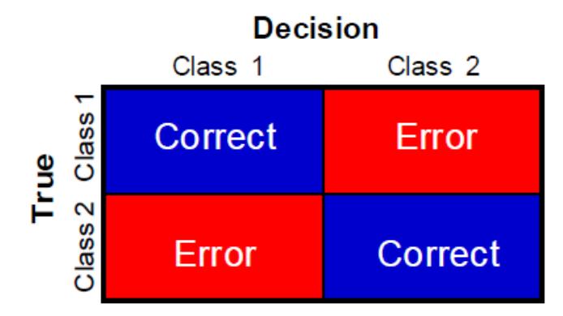
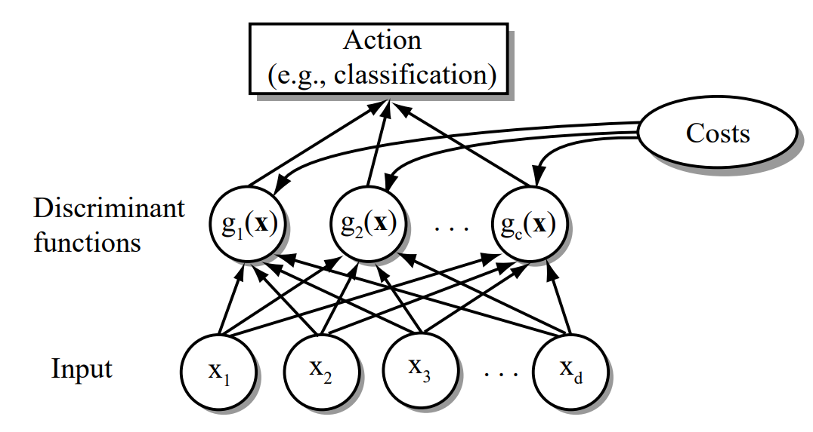
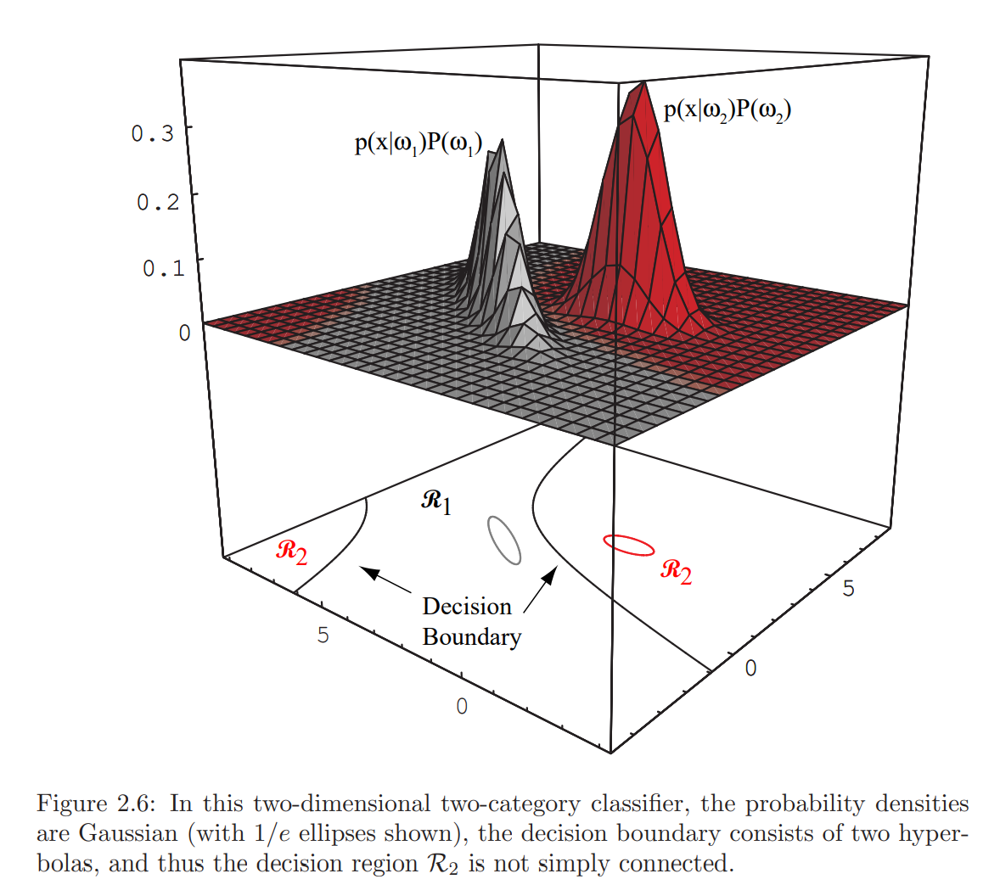
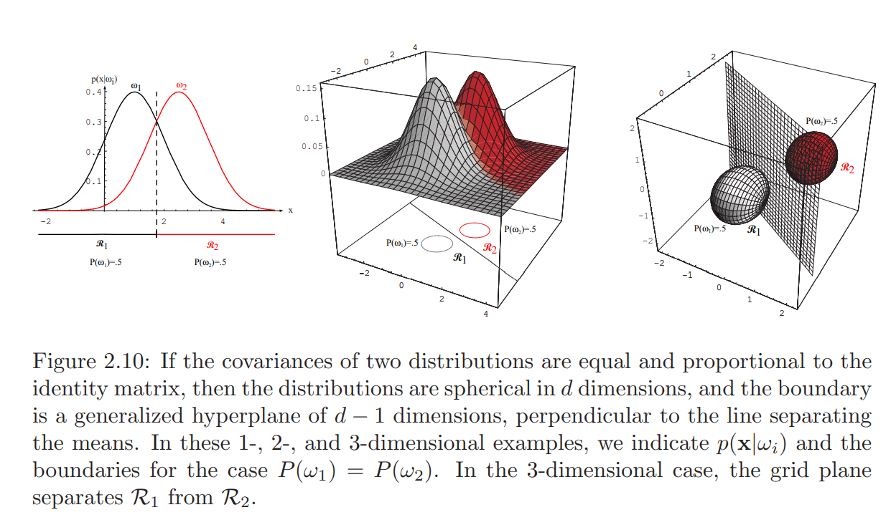
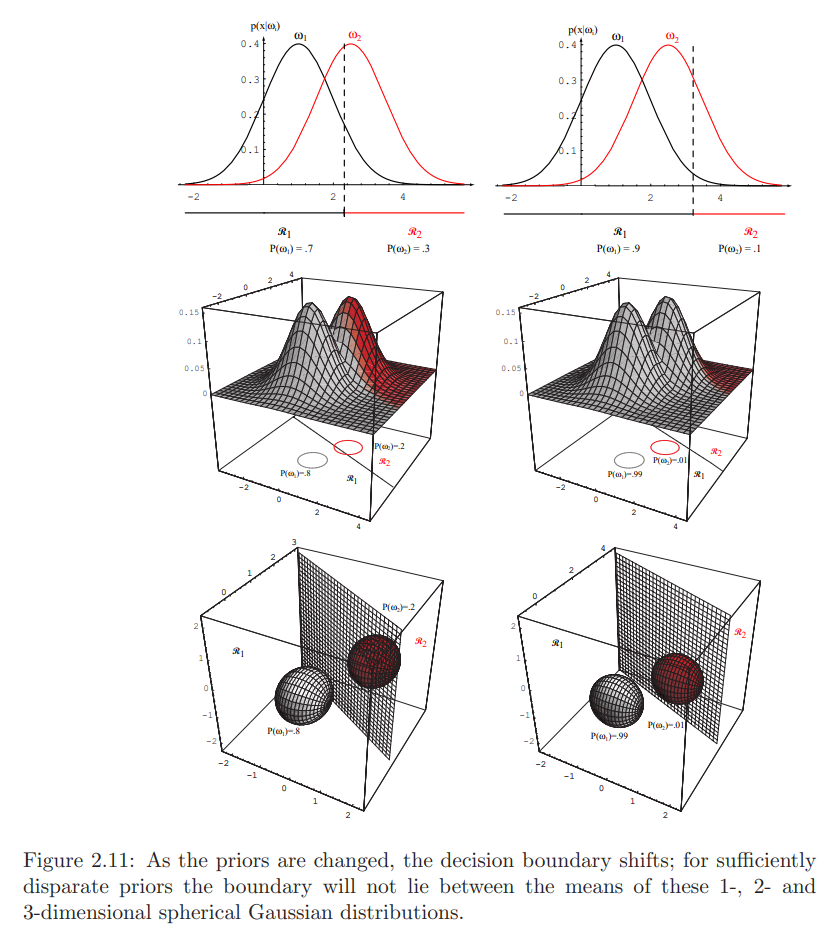
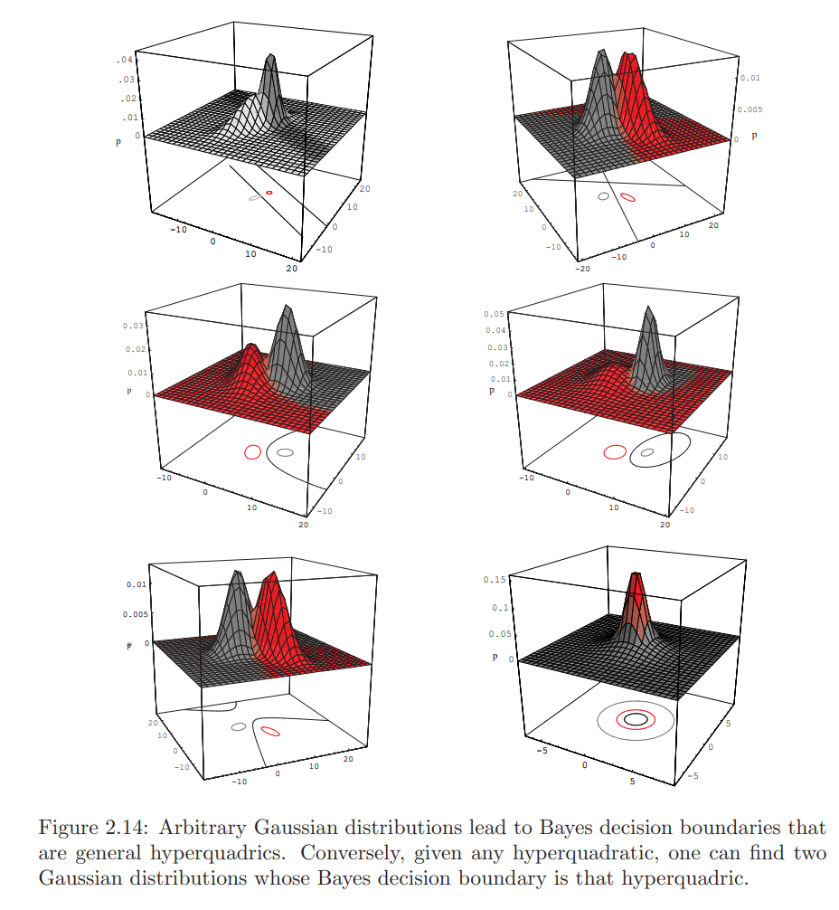
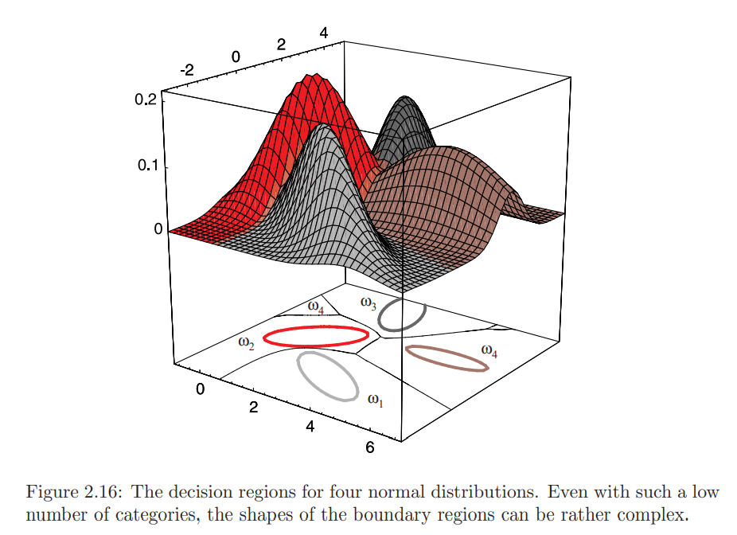
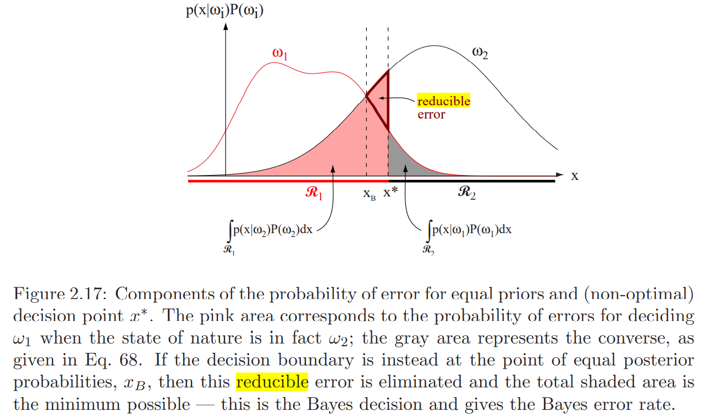

# Ch2 Bayesian decision theory

## 2.1 Introduction

state of nature $\omega$
: e.g., $\omega=\omega_1$ for sea bass and $\omega=\omega_2$ for salmon

priori probability (prior) $P(\omega)$
: e.g., $P(\omega_1)$ that the next fish is sea bass, and $P(\omega_2)$ that it is salmon

是个不管当前情况的概率

结合条件概率的概念，我们得到:

**Bayes' formula**
$$
P(\omega_j|x)=\frac{p(x|\omega_j)P(\omega_j)}{p(x)}
$$

其中：

$$
p(x)=\sum_{j=1}^2p(x|\omega_j)P(\omega_j)
$$

实际上 Bayes' formula 放在英语里的意思是：

$$
\text{posterior}=\frac{\text{likelihood}\times \text{prior} }{\text{evidence} }
$$

---

一通推导之后可以得到：

Bayes' decision rule
: Decide $\omega_1$ if $P(\omega_1|x)>P(\omega_2|x)$; otherwise decide $\omega_2$

鉴于对于两类来说，$p(x)$ 其实是一样的，所以也可以写成：

> Decide $\omega_1$ if $p(x|\omega_1)p(\omega_1)>p(x|\omega_2)p(\omega_2)$; otherwise decide $\omega_2$

!!! note
    也因为 $p(x)$ 的相同，所以存在正比例关系：
    $$
    p(\omega|x_j)\propto p(x_j|\omega)p(\omega)
    $$

根据这些式子，我们也可以讨论他们的特殊情况：

- 假如 $p(x|\omega_1)=p(x|\omega_2)$

  意味着 observation 提供的信息完全没有用，此时决策就完全取决于先验概率

- 假如 $P(\omega_1)=P(\omega_2)$

  意味着决策完全取决于 likelihoods $p(x|\omega_j)$

  这种特殊情况也叫做 **Maximum Likelihood (ML) Rule**

  > Decide $\omega_1$ if $p(x|\omega_1)>p(x|\omega_2)$, otherwise decide $\omega_2$

  !!! note
        这种特殊情况下，正比例关系变成了
        $$
        p(\omega|x)\propto p(x|\omega)
        $$

---

实际上，我们的 _Bayes' decision rule_ 也是有可能出错的。直观上来说就是这两种情况得错误：

用表达式来说就是：

$$
P(\text{error}|x)=
\begin{cases}
P(\omega_1|x)& \text{if we decide } \omega_2\\
P(\omega_2|x)& \text{if we decide } \omega_1
\end{cases}
$$

_Bayes' decision rule_ 的 classification error 为：

$$
p(\text{error}|x)=1-\max{[p(\omega_1|x),p(\omega_2|x)]}
$$

!!! note
    虽然上述的东西都是以二分类为例子，但是多分类的情况下同样也适用

## 2.2 Bayesian Decision Theory - Continuous Features

loss function
: states exactly how costly each action is, and is used to convert a probability determination into a decision

正式定义如下：
- $c$ categories: $\{\omega_1, \omega_2, ...,\omega_c\}$
- $a$ possible actions: $\{\alpha_1, \alpha_2,...,\alpha_a\}$

> The loss function $\lambda(\alpha_i|\omega_j)$ describes the loss incurred for taking action $\alpha_i$ when the state of nature is $\omega_j$

---

有了 loss function 之后，我们可以进一步定义 ***conditional risk***

> Suppose that we observe a particular $x$ and that we contemplate taking action $\alpha_i$. If the true state of nature is $\omega_j$ , by definition we will incur the loss $\lambda(\alpha_i|\omega_j)$.
> 
> Since $P(\omega_j|x)$ is the probability that the true state of nature is $\omega_j$ , the ***conditional risk*** associated with taking action $\alpha_i$ is:
> $$R\bigl(\alpha_{i}|{\bf x}\bigr)=\sum_{j=1}^{c}\lambda\bigl(\alpha_{i}|\omega_{j}\bigr)P\bigl(\omega_{j}|{\bf x}\bigr).$$

---

可以证明，*Bayes decision procedure* 实际上在 overall risk 里提供了最优的表现

将所有可能的 action 对应的 conditional risk 全部都算一遍，然后选择能够让 conditional risk $R(\alpha_i|x)$ 最小的 action，此时的 minimum overall risk 也叫做 ***Bayes risk***

对应的二分类问题的例子见ppt P18~19

## 2.3 Minimum-Error-Rate Classification

> If action $\alpha_i$ is taken and the true state of nature is $\omega_j$, then the decision is correct if $i=j$, and in error if $i\neq j$
> 
> If errors are to be avoided, it is natural to seek a decision rule that minimizes the probability of error, i.e., the ***error rate***

定义一种特殊的 ***zero-one*** loss function:
$$\lambda(\alpha_{i}|\omega_{j})=\left\{\begin{array}{l l}{ {0} }&{ {i=j} }\\ { {1} }&{ {i\not=j} }\end{array}\right.\qquad i,j=1,...,c.$$

也就是说，对于正确的决策，不会产生 loss，而错误的决策会造成 unit loss。也就是这种样子：
$$
\lambda=\left(\begin{array}{c c}{ {0} }&{ {1} }\\ { {1} }&{ {0} }\end{array}\right)
$$

zero-one loss function 所对应的 conditional risk 为：
$$
\begin{array}{l l l}
    { {R(\alpha_{i}|\mathbf{x})} }&{ {=} }&{ {\sum_{j=1}^{c}\lambda(\alpha_{i}|\omega_{j})P(\omega_{j}|\mathbf{x})} }\\ 
    { {} }&{ {=} }&{\sum_{j\neq i}{P(\omega_j|\mathbf{x})} }&{ {} }\\
    { {} }&{ {=} }&{ {1-P(\omega_{i}|\mathbf{x})} }&{ {} }
\end{array}
$$
恰好是 average probability of error

为了让 error rate 最小化，我们会发现实际上需要做的其实就是 [2.1](#21-introduction) 里的 *Bayes' decision rule*

## 2.4 Classifiers, Discriminant Functions and Decision Surface

### 2.4.1 The Multi-Category Case

有很多种表示 pattern classifier 的。其中最有用的一种是基于 ***discriminant functions*** $g_i(x),\ i=1,...,c$.

The classifier is said to assign a feature vector $\mathbf{x}$ to class $\omega_i$ if:

$$
g_i(\mathbf{x})>g_j(\mathbf{x})\qquad \text{for all }j\neq i
$$

> For the general case with risks, we can let $g_i(x) = −R(\alpha_i|x)$, since the ==maximum discriminant function will then correspond to the minimum conditional risk==
>
> For the minimum-error-rate case, we can simplify things further by taking $g_i(x) = P(\omega_i|x)$, so that the ==maximum discriminant function corresponds to the maximum posterior probability==

---

discriminant function 的选择并不是唯一的

比如说，我们可以在现有的 function 外面套一层单调递增函数，那么比较大小的结果压根不会变

听起来没啥，实际上很多时候，我们需要使用这样的技巧来==简化式子==：

比如外面套的函数是自然对数：
$$
\begin{array}{l}
    { {G(g_{i}(x))=\ln\!\left(g_{i}(x)\right)\!\!} }\\ 
    { {=\ln\!\left(p(x|\omega_{i})\right)+\ln\!\left(p(\omega_{i})\right)-\ln\!\left(p(x)\right))} }
\end{array}
$$

---

虽然 discriminant function 多种多样，但是他们都有着同样的效果：

decision region
: The effect of any decision rule is to divide the feature space into $c$ *decision regions*, $\mathcal{R}_1,...,\mathcal{R}_c$

: If $g_i(x)>g_j(x)$ for all $j\neq i$,then $x$ is in region $\mathcal{R}_i$

decision boundary
: The regions are separated by *decision boundaries*

图比较直观的展示了这些概念。需要注意的是这个二分类问题的边界有俩，所以“The decision region $R_2$ is not simply connected”

### 2.4.2 The Two-Category Case

二分类的时候可以用一些非常简单的 discriminant function：

$$
g(x)=g_1(x)-g_2(x)
$$

然后大于 0 就选择 $\omega_1$

minimum-error-rate discriminant function 则是可以有如下简单形式：
$$
g(x)=P(\omega_1|x)-P(\omega_2|x)\\
g(x)=\ln\frac{p(x|\omega_1)}{p(x|\omega_2)}+\ln\frac{P(\omega_1)}{P(\omega_2)}
$$

## 2.5 The Normal Density

### 2.5.1 Univariate Density

### 2.5.2 Multivariate Density

multivariate normal density in $d$ dimensions is written as:

$$
p({\bf x})=\frac{1}{(2\pi)^{d/2}|\Sigma|^{1/2} }\mathrm{exp}\left[-\frac{1}{2}({\bf x-}\,\mu)^{t}\Sigma^{-1}({\bf x-}\,\mu)\right]
$$

其中：
- $x$: $d$-component column vector 
- $\mu$: $d$-component mean vector
- $\Sigma$: $d$-by-$d$ covariance matrix

    $\Sigma=\int(x-\mu)(x-\mu)^{T}p(x)d x$

    $|\Sigma|$ 和 $\Sigma^{-1}$ 分别是 determinant 和 inverse

    !!! note
        协方差矩阵就是所有的变量两两求协方差后的结果，所以有沿着对角线方向对称的性质

## 2.6 Discriminant Functions for the Normal Density

之前我们介绍了可用如下简化 discriminant function 来进行 minimum-error-rate classification:

$$g_{i}({\bf x})=\ln\,p({\bf x}|\omega_{i})+\ln\,P(\omega_{i}).$$

对于 multivariate normal 来说 (也就是 $p(x|\omega_i)\sim N(\mu_i,\Sigma_i)$)，这玩意就变成了：

$$
\begin{align*}
    g_{i}(x)=&-\frac{1}{2}(x-\mu_{i})^{T}\Sigma_{i}^{-1}(x-\mu_{i})\\ 
    &-\frac{d}{2}\mathrm{ln}(2\pi)-\frac{1}{2}\mathrm{ln}(|\Sigma_{i}|)\\
    &+\mathrm{ln}(p(\omega_{i}))
\end{align*}
$$

下面来看看一些个特殊情况：

### 2.6.1 Case 1: $\Sigma_i=\sigma^2\mathbf{I}$

挺迷的

上图是先验分布相等的情况

这个则是先验分布不同的时候，decision boundary 的变化情况

### 2.6.2 Case 2: $\Sigma_i=\Sigma$

> Covariance of all classes are identical but otherwise arbitrary
> 
> Geometrically, this corresponds to the situation in which the samples fall in hyperellipsoidal clusters of equal size and shape, the cluster for the ith class being centered about the mean vector $\mu_i$

反正 discriminant function 被简化成：

$$
g_{i}({\bf x})=-\frac{1}{2}({\bf x}-\mu_{i})^{t}{\bf\Sigma}^{-1}({\bf x}-\mu_{i})+\ln\,P(\omega_{i}).
$$

甚至可以进一步简化成：（似乎是展开乘积）

$$
g_{i}({\bf x})={\bf w}_{i}^{t}{\bf x}+w_{i0}
$$

其中：
- $\mathbf{w}_{i}=\Sigma^{-1}\mu_{i}$
- $\omega_{i0}=-\frac{1}{2}\mu_i^t\Sigma^{-1}\mu_i+\ln P(\omega_i)$

### 2.6.3 Case 3: $\Sigma_i=\text{arbitrary}$

最通用的情况，只能从原式子中扔掉 $2\pi$ 那一项：

$$
g_{i}({\bf x})={\bf x}^{t}{\bf W}_{i{\bf X} }+{\bf w}_{i{\bf X} }^{t}+w_{i0}
$$

其中：
- ${\bf W}_{i}=-\frac{1}{2}\Sigma_{i}^{-1},$
- $\mathbf{w}_{i}=\mathbf{\Sigma}_{i}^{-1}\mu_{i}$
- $w_{i0}=-\frac{1}{2}{\mu}_{i}^{t}\Sigma_{i}^{-1}\!{\mu}_{i}-\frac{1}{2}\mathrm{ln}\left|\Sigma_{i}\right|+\mathrm{ln}{P}(\omega_{i}).$

“超二次曲面”

## 2.7 Error Probabilities and Integrals

在二分类的时候，我们的 classification error 可以如下表示：

$$
\begin{array}{r c l}
    { {P(\text{error})} }&{ {=} }&{ {P({\bf x}\in\mathcal{R}_{2},\omega_{1})+P({\bf x}\in\mathcal{R}_{1},\omega_{2})} }\\ 
    { {} }&{ {=} }&{ {P({\bf x}\in\mathcal{R}_{2}|\omega_{1})P(\omega_{1})+P({\bf x}\in\mathcal{R}_{1}|\omega_{2})P(\omega_{2})} }\\
    { {} }&{ {=} }&{ {\int\limits_{\mathcal{R_2} }{p({\bf x}|\omega_{1})P(\omega_{1})\;d{\bf x}+\int\limits_{\mathcal{R_1} }{p({\bf x}|\omega_{2})P(\omega_{2})\;d{\bf x}.} }} }
\end{array}
$$

图相对直观一点。我们希望粉色和灰色两部分的面积加起来最小（对应误差概率最小），而因为 decision point $x^*$ 是随便选的，反正只有 $x^*=x_B$ 的时候，误差才会最小（reducible error 彻底消失），剩下的不可削去的面积称为 **Bayes Error**

!!! warning
    ppt P37开始就不知道飞哪里去了

!!! note
    记得看tutorial
