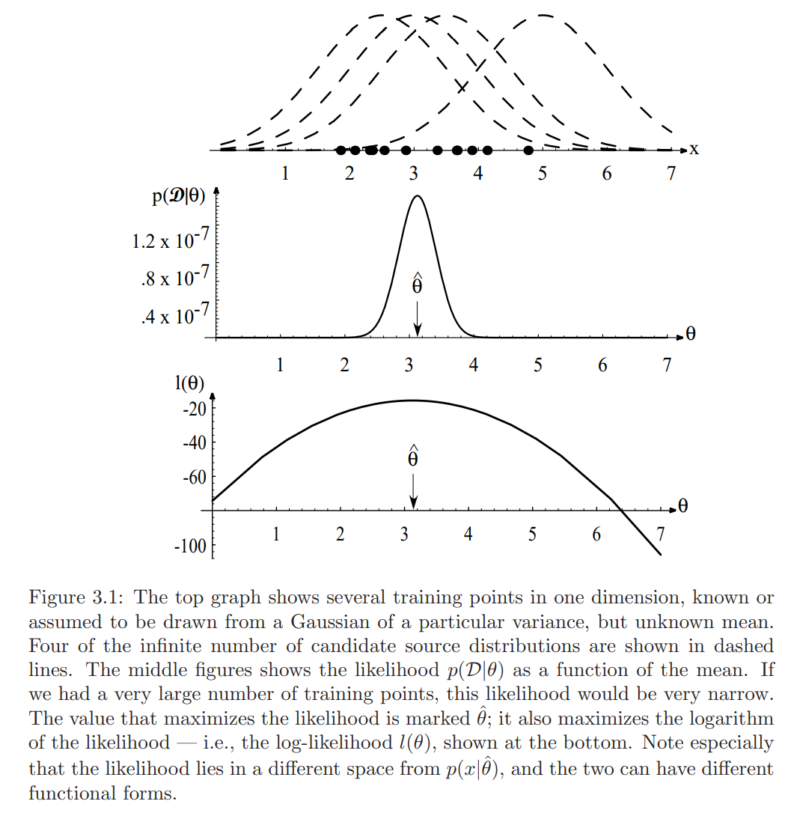
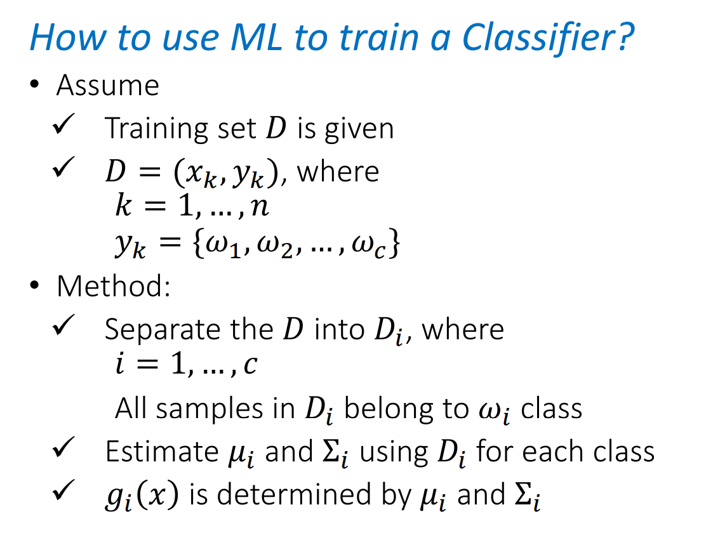

# Ch3 Maximum likelihood and Bayesian parameter estimation

Ch2 中，我们知道了如何在已知 $P(\omega_i)$ 和 $p(\textbf{x}|\omega_i)$ 的情况下，设计出最优的分类器

然而这有个问题，就是实际应用之中，这俩东西其实是一般都是不知道的，有的只是一些 training data

于是就有了个自然的想法：用样本来估测位置的概率和概率密度；在正常的监督模式分类问题中，先验概率 $P(\omega_i)$ 一般想要得到不难，但是条件概率 $p(\textbf{x}|\omega_i)$ 是个问题，因为样本数量一般都很少，在特征向量是高维的时候情况会更加严重

---

一种解决方法是：假定 $p(\textbf{x}|\omega_i)$ 服从某个已知的分布（e.g., 正态分布），那么问题就会从==估计未知的“函数”转化为估计未知的“参数”==。可以大幅度降低难度

参数估计的方法则是有许多经典算法。这里介绍的是两种：
- **Maximum likelihood estimation**

    > Maximum likelihood and several other methods view the parameters as quantities whose values are fixed but unknown. 
    >
    > The best estimate of their value is defined to be the one that maximizes the probability of obtaining the samples actually observed
- **Bayesian estimation**

    > Bayesian methods view the parameters as random variables having some known a priori distribution. 
    > 
    > Observation of the samples converts this to a posterior density, thereby revising our opinion about the true values of the parameters

## 3.2 Maximum Likelihood Estimation

### 3.2.1 The General Principle

假设我们把样本分成 $\mathcal{D}_1,...,\mathcal{D}_c$ 这样的 $c$ 等分，然后根据 probability law $p(x|\omega_j)$，从中选出样本 $\mathcal{D}_j$。这样的样本叫做 independent identically distributed ($i.i.d.$) variables

假设 $p(x|\omega_j)$ 存在参数表达的形式，则它会被参数向量 $\theta_j$ 唯一确定

e.g., 假如概率是正态分布，则 $\theta_j$ 就会包含 $\mu_j$ 和 $\Sigma_j$ 的成分

为了展现 $p(x|\omega_j)$ 和 $\theta_j$ 之间的关系，我们会把 $p(x|\omega_j)$ 改写成 $p(x|\omega_j,\theta_j)$

总之，我们的问题就变成了，==通过训练样本，来估计参数向量 $\theta_j$==

---

假设 $\mathcal{D}$ 包含了 $n$ 个样本 $x_1,...,x_n$，鉴于这些样本都是独立采样的，所以存在如下关系：

$$
p({\mathcal{D} }|\theta)=\prod_{k=1}^{n}p(\mathbf{x}_{k}|\theta).
$$

[Ch2 2.1](ch2-bayesian-decision-theory.md#21-introduction) 中提到过，$p({\mathcal{D} }|\theta)$ 被称为 "*likelihood* of $\theta$ with respect to the set of samples"，那么 ***maximum likelihood estimation*** of $\theta$ 显然就是能过够让 $p({\mathcal{D} }|\theta)$ 的值达到最大的对应值 $\hat{\theta}$

!!! note
    直观上来说，这个值使得==样本为 $\mathcal{D}$ 这个事实的概率达到最大==

同时，让后验分布 $p(x_k|\theta)$ 最大则会让 Bayes decision rule 的错误达到最小

---

为了分析方便，我们经常会将 likelihood 取 $\log$ 值，最大化 likelihood 就转化为最大化对应的 $\log$ 值

**log-likelihood function**
$$
    \begin{align*}
    l(\theta)&=\ln(p(\mathcal{D}|\theta))\\ 
    &=\sum_{k=1}^{n}\ln(p(x_k|\theta))
    \end{align*}
$$

于是乎，我们就可以把我们寻求的 $\theta$ 的解正式的写出来：
$$
\hat{\theta}=\arg\operatorname*{max}_{\theta}l(\theta),
$$

求解最优解的*必要条件*则是让导数等于 0：
$$
\nabla_{\theta}l=\sum_{k=1}^{n}\nabla_{\theta}\,\ln\,p(\mathbf{x}_{k}|\theta)=0
$$

其中：
- gradient operator：$\nabla_{\theta}\equiv\left[\begin{array}{c}{ {\frac{\partial}{\partial\theta_{1} }} }\\ { {\vdots} }\\ { {\frac{\partial}{\partial\theta_{p} }} }\end{array}\right].$

!!! note
    必要条件求出来的解可能只是局部最优解！

### 3.2.2 The Gaussian Case: Unknown $\mu$

正态分布的 probability density function 之前提到过：
$$
p(x)=\frac{1}{\left(2\pi\right)^{d/2}|\Sigma|^{1/2} }e x p\left[-\frac{1}{2}(x-\mu)^{T}\Sigma^{-1}(x-\mu)\right],
$$

于是 log-likelihood 可以写成：
$$
\sum_{k=1}^{n}\ln(p(x_{k}|\mu))=\sum_{k=1}^{n}\left(-{\frac{1}{2} }(x-\mu)^{T}\Sigma^{-1}(x-\mu)-{\frac{d}{2} }\ln(2\pi)-{\frac{1}{2} }\ln(|\Sigma|)\right).
$$

为了满足最大似然，$\hat{\mu}$ 就需要满足：
$$
{\nabla}_{\mu}\sum_{k=1}^{n}p(x_{k}|\mu)=\sum_{k=1}^{n}\Sigma^{-1}(x_{k}-{\hat{\mu} })=0\,.
$$

两边同时乘以 $\Sigma$ 就会得到：
$$
{\hat{\mu} }={\frac{1}{n} }\sum_{k=1}^{n}\mathbf{x}_{k}.
$$

### 3.2.3 The Gaussian Case: Unknown $\mu$ and $\Sigma$

这种时候 parameter vector $\theta$ 就会同时包含两个参数

$$
\begin{align*}
\nabla_{\mu}\displaystyle\sum_{k=1}^{n}p(x_{k}|\mu,\sigma)&=\displaystyle\sum_{k=1}^{n}\Sigma^{-1}(x_{k}-{\hat{\mu} })\\ 
\nabla_{\sigma}\displaystyle\sum_{k=1}^{n}p(x_{k}|\mu,\sigma)&=\displaystyle\sum_{k=1}^{n}\left(-{\frac{1}{ {\hat{\sigma} }} }+{\frac{(x_{k}-{\hat{\mu} })^{2} }{\hat{\sigma}^{2} }}\right).
\end{align*}
$$

反正会解出来：
$$
\begin{align*}
\hat{\mu}&={\frac{1}{n} }\sum_{k=1}^{n}x_{k}\,,\\ 
\hat{\sigma}^{2}&={\frac{1}{n} }\sum_{k=1}^{n}(x_{k}-{\hat{\mu} })^{2}\,,
\end{align*}
$$

---

懒得打字了